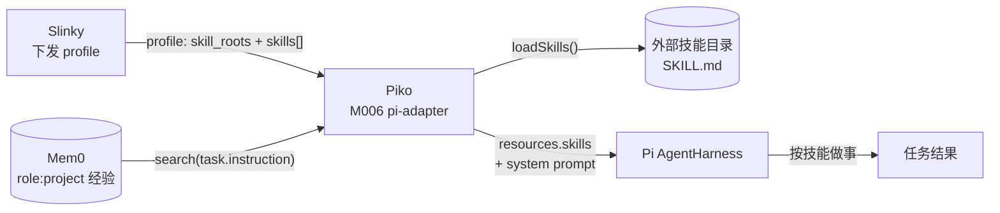
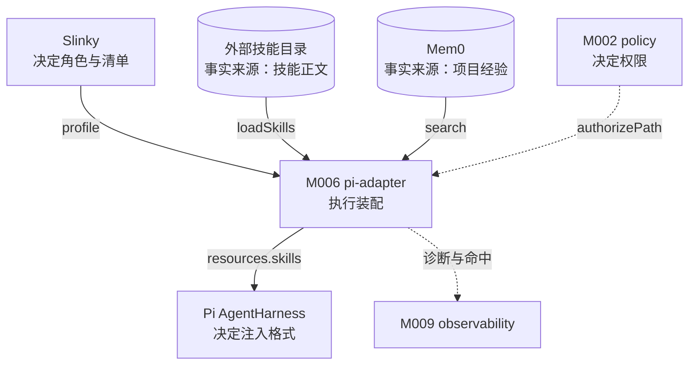
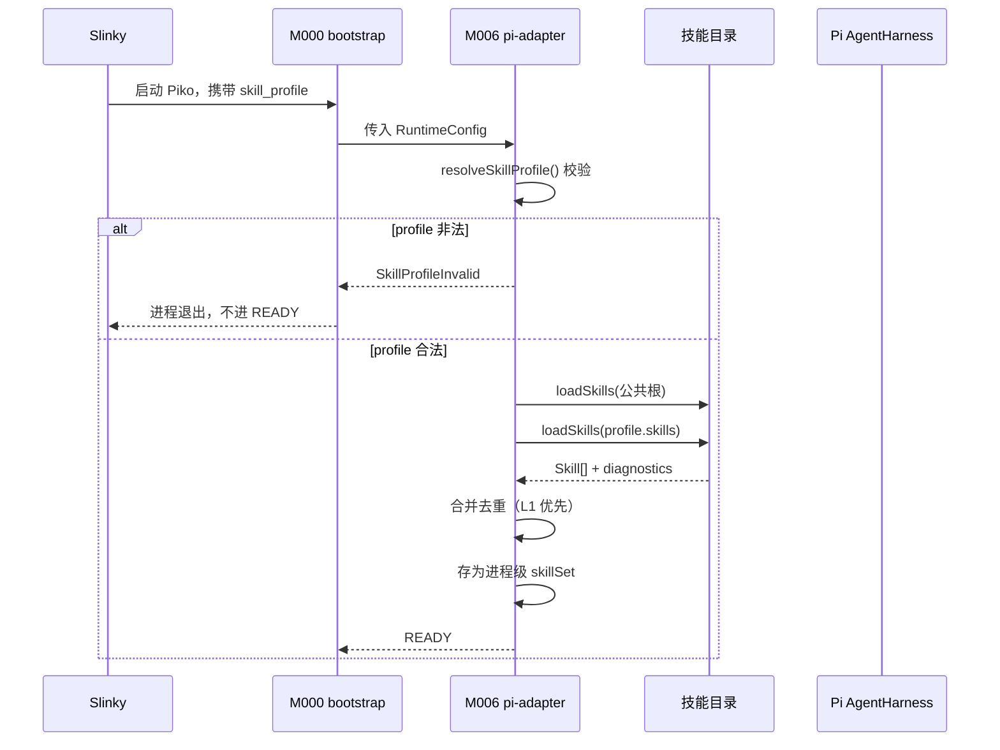
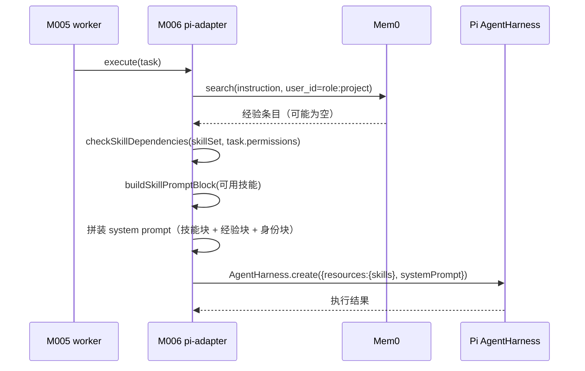

<!-- STD_DOCUMENT_COVER_BEGIN -->
# Piko 机制：职业技能体系（公共技能/角色技能/项目经验）

> **本文件遵守 STD（工程文档标准），STD 为最高优先级；修改本文件之前必须先读 STD 入口。**
> STD 入口：[项目采用说明与标准导航](../../../README.md#std-entry)。入口的**编写索引**已列出本类文档的全部硬性义务：不必通读规范，但**每一条都必须遵守**。

| 文档字段 | 值 |
|---|---|
| Document ID | `piko-skill-system` |
| Document Version | `0.1.0-draft.1` |
| Status | `Draft` |
| Project | `piko` |
| Document Owner | Piko Architecture |
| Last Modified Date | `2026-11-12` |
| Template ID | `design.system-mechanism` |
| Template Version | `3.4.0` |
<!-- STD_DOCUMENT_COVER_END -->

## 1. 机制摘要：解决什么问题

<details>
<summary>本节编写建议、规范与示例</summary>

本模板名称为“总体系统机制设计”，沿用 Template ID `design.system-mechanism` 与现有文件路径；纯软件
项目的跨模块机制也使用本模板，标题可按项目写成“软件系统机制设计”。机制横向承接系统公共行为，
可跨软件、固件和硬件责任单元；不代表分解树中的固定一级。

“责任单元”按运行边界判定：能够独立接收或拒绝操作、拥有状态或事实、独立部署/重启/失效，或必须
通过明确接口与另一单元交接的参与方，均算一个责任单元。两个软件模块即使属于同一 Owner、同一进程，
只要分别拥有上述责任，也可形成机制；只有一个模块内部的 helper/函数协作则留在模块设计。
先核查附录 A 的输入与适用性，再成文；折叠帮助后正文必须能独立解释机制。
编写方法见已采用 STD 的 `docs/ai-authoring-guide.md` 与 `docs/ai-guides/system-mechanism.md`，
共同规范见 `docs/design-writing-guide.md` 与 `docs/interface-data-mapping-standard.md`。本文所有带“虚构/教学”标记的图文不是项目事实。
正文与编写过程隔离：模板选择、填写步骤、绘图指令和修改经过留在帮助或评审记录中，正式开篇直接介绍实际机制。以下各节统一遵循“先用正文说明实际方案、依据、取舍和边界，再用图表汇总结论”；不能只填表，表格不能替代设计。生成后移除教学块并折叠帮助，逐段复查正文及图注，不以模板结构检查代替内容判断。

> **本节目的**：让新读者先理解这项协作为什么存在、带来什么结果，再进入协议与状态细节。

> **必须写清楚**：受益者及其实际任务、原有问题、机制所在系统与边界、核心输入—处理—输出、参与方分工、本版本范围和最重要的取舍。

> **编写规范**：用约一页自包含正文讲一个代表输入怎样经过参与方产生结果，说明为什么不能由一个单元独立完成；不以模块清单、Gate 或链接代替原理。系统设计仍保留端到端原理、关键阶段、系统级约束和代表失败；本文唯一维护详细状态转换、参与方协议与恢复规则。关联同一 Process/Step/Constraint ID，变更时核对系统摘要，不维护两套流程。

**本节应有图（基线必画）**：用途概览图放在正文开篇附近，只表达使用场景、处理范围及输出结果；图后沿一个代表输入解释处理原理、取舍和边界，不以参与方方框图代替用途。

> **抽象示例**：虚构版本查询让运维者一次看到 A、B 的运行版本；M 负责采样汇总而不替目标决定版本。选择非原子观测是为了避免全局暂停，代价是结果不能证明两个目标在同一瞬间一致。

> **完成条件**：本节有用途概览图、自包含的连续正文和已填写的“机制形态与适用性”；只读开篇就能说清什么时候用、解决什么问题、得到什么结果及不承诺什么，再进入分工与协议。不能只填表、放图或列文档索引；当前能力与目标能力可分辨。

</details>

<!-- 用连续段落说明何时使用、处理什么及得到什么；用途概览图放本节，参与方职责图放 §3。 -->

Slinky 启动一个 Piko 实例时，会告诉它"你这次是测试工程师"。Piko 必须据此把这个实例变成一个
**有特定职业技能的智能体**：它知道测试工程师该怎么想、该按哪套规范做事、在这个项目里吃过什么亏；
换成"开发者"的 profile，同一个 Piko 二进制就应当是另一套能力。这是本机制要解决的问题——**角色
不是写死在代码里的，而是由 Slinky 下发的 profile 决定的**。

职业技能分三层，各层解决不同的问题：

| 层 | 名称 | 谁定义 | 回答什么 | 例子 |
|---|---|---|---|---|
| L1 | **公共技能** | Piko 项目自带，随版本走 | 任何角色都要会的基础动作 | 用 Matrix 通信；会读 STD 并按 STD 工作；会用 mem0；会用 gitnexus；会用 github |
| L2 | **角色技能** | Slinky 下发的 profile 指定 | 这个**角色**的专业方法 | 测试工程师：截图并分析结果是否符合用例描述 |
| L3 | **项目经验** | 运行时累积，按 `${role}:${project}` 隔离 | 在**这个项目**里踩过什么坑 | 「X 模块的边界值测试必须拆 case，否则漏 race condition」 |

三层的差别不只是内容，更是**变化频率与权威来源**：L1 随 Piko 版本发布，L2 随 Slinky 的角色配置
变更，L3 随工作累积而变。把它们混成一个机制，就会让"升级 Piko"和"换个角色"互相牵连。

**核心输入 → 处理 → 输出**：输入是一个 profile（指明技能目录在哪里、本角色加载哪些技能）＋ 一次
任务；处理是"按 profile 解析技能清单 → 从外部目录加载 SKILL.md → 校验依赖是否齐备 → 与项目经验
一起装配进系统提示"；输出是交给 Pi AgentHarness 的 `resources.skills` 与系统提示中的技能区块。

**最重要的取舍**：技能内容**不内置在 Piko 仓库里**，而是放在 Slinky 管理的外部目录，由 profile 指路。
代价是 Piko 单独启动时没有技能可用（必须带 profile）；换来的是"改技能不用改 Piko、不用重新构建、
不用发版"。这与本项目"对接外部系统而非自建"的既有方向一致（参见 `piko-skill-memory.md` §11 的
V0.1 决策记录）。

**本机制复用 Pi 的 Agent Skills 能力，不自造技能格式。** Piko 侧只做三件事：解析 profile、按清单
加载、把结果交给 Harness。技能的语法（`SKILL.md` + frontmatter）、发现规则、注入格式全部沿用
Pi（`upstream/pi/packages/agent/src/harness/skills.ts` 的 `loadSkills()` 与
`system-prompt.ts` 的 `formatSkillsForSystemPrompt()`）。



图 M-SKILL-0 · 职业技能体系的输入与装配路径。profile 决定"知道什么"，Mem0 决定"在这个项目里学到什么"。

- **机制形态与适用性 / 业务副作用**：**只读装配 + 提示注入**。本机制不修改任务状态、不写入业务数据；
  唯一副作用是系统提示内容的组成，以及一次 Mem0 检索调用。技能加载失败**不阻断任务**——退化为
  无技能运行，并把失败事实记入观测（与 `piko-skill-memory.md` §10「Mem0 服务不可用」的既有风险
  处置一致：不阻塞任务）。
- **交接域**：**纯软件**。跨 Piko（M006 pi-adapter）、外部技能目录、Mem0 三个边界；技能目录是文件系统
  边界，Mem0 是 HTTP 边界。
- **裁剪依据**：本机制为 V2+ 新增，模板 §4 的硬件/FPGA/设备表项、§5.3 硬件接口等小节均不适用，
  逐节注明 N/A 与理由；不适用项见附录 A 的适用性表。


## 2. 使用场景与功能

<details>
<summary>本节编写建议、规范与示例</summary>

> **本节目的**：把机制用途分解成全部可验收能力，避免一个成功例子掩盖其他入口和运行模式。

> **必须写清楚**：实际业务场景、触发角色/系统、部署条件、能力边界、正常与异常结果、验收判据，以及每项能力的实现状态和验证结果。

> **编写规范**：先说明支持哪项产品任务，维护机制则说明它服务的业务保障目标；维护操作不能代替整个产品的客户场景。按能力而非文件或参与方列项，覆盖适用的查询、控制、配置、退出和恢复入口；按附录 A 说明不适用项。不能由图中出现模块推断该能力已实现。

**图例用法**：当存在不同触发者、部署条件或可观察结果时，用使用场景图把“条件→用户动作→结果”并列展示；不要在场景图里画内部调用顺序。单一简单场景可与 §1 用途图共用，但正文仍要说明边界、拒绝与验证。

> **抽象示例**：同一版本查询包含完整返回、单目标错误、全部目标错误和入口拒绝四类可观察结果；HTTP 请求结束并不意味着全部目标健康。它不提供历史查询或版本升级能力。

> **完成条件**：每个正式入口均能关联场景、公共操作、全部提供/消费方及验证；独立列明 Planned 与 NOT_RUN。

</details>

<!-- 先解释场景及能力差异，再汇总。 -->

### 2.1 五个实际场景

**S-1 测试工程师接一个验证任务**：Slinky 以 `test_engineer` profile 启动 Piko。该 profile 加载
公共技能（读 STD、用 gitnexus、用 mem0）与角色技能（截图并判定符合用例描述）。Agent 收到任务后
按 STD 写用例、跑门禁、必要时截图判断。**可观察结果**：系统提示里出现这三层技能，任务按 STD 的
口径产出结果。

**S-2 同一个 Piko 换成开发者**：Slinky 以 `developer` profile 启动。公共技能不变，角色技能换成
写实现、按 ISD 落地。**这证明角色是配置出来的，不是编译进去的**——同一个二进制，两套能力。

**S-3 项目经验随工作累积**：任务中 agent 发现"happy path 与边界值合在一个 case 里会漏断言"，
调用 `mem0_record` 写入；下一个同类任务开始时，预取命中这条经验。**可观察结果**：第二条任务的
系统提示里出现这条经验。

**S-4 技能目录里有个坏文件**：某个 `SKILL.md` 的 frontmatter 缺 `description`。Pi 的 `loadSkills()`
返回诊断而不抛异常。**可观察结果**：该技能不进提示，其余技能正常工作，诊断记入观测。

**S-5 技能声明的工具没给**：某角色技能要求 `matrix_send`，但本任务的 `tool_profile_ref` 没有它。
**可观察结果**：按本机制决策（§8 不变量 INV-SKILL-3）加载期拒绝该技能或整份 profile，不静默
放进一个"模型会去调用不存在工具"的提示里。

### 2.2 能力表

| Capability / Scenario ID | 业务任务与触发/条件 | 输入与可观察结果 | 提供方/全部消费者 | 实现状态 | 验证结果/判据 |
|---|---|---|---|---|---|
| CAP-SKILL-1 · 按 profile 解析并加载技能 | Piko 启动，`RuntimeConfig.skill_profile` 存在 | 输入：profile（`skill_roots` + `skills[]`）；输出：已加载的 `Skill[]` 或具名错误 | 提供：M006 pi-adapter；消费：Pi AgentHarness | **Planned**（V2+） | 待定：见 §15 VR-SKILL-1 |
| CAP-SKILL-2 · 公共技能强制加载 | 任意 profile | 公共技能集合不可被 profile 排除 | 提供：M006；消费：AgentHarness | **Planned** | VR-SKILL-2 |
| CAP-SKILL-3 · 角色技能按清单加载 | profile 的 `skills[]` 含角色目录 | 只有清单内的角色技能被加载 | 提供：M006；消费：AgentHarness | **Planned** | VR-SKILL-3 |
| CAP-SKILL-4 · 项目经验预取 | 任务开始 | `mem0.search(instruction, user_id=role:project)` 结果注入 | 提供：M006；消费：AgentHarness | **Implemented**（V0.1.3，`src/skill-prefetch.ts`） | VR-SKILL-4 |
| CAP-SKILL-5 · 技能依赖校验 | 加载期 | skill 声明的 tools/paths 与任务权限比对 | 提供：M006 + M002 policy | **Planned** | VR-SKILL-5 |
| CAP-SKILL-6 · 加载失败降级 | 目录不可读 / 诊断 warning | 任务继续，无技能运行，失败记入观测 | 提供：M006；消费：M009 observability | **Planned** | VR-SKILL-6 |
| CAP-SKILL-7 · 技能事实进 Result | 任务结束 | 本次用了哪些技能、命中几条经验 | 提供：M006；消费：M005 worker / M003 | **Planned** | VR-SKILL-7 |

**不提供的能力（明确边界）**：不做技能的在线编辑、不做技能版本回滚、不做跨角色经验共享、
不自建向量检索（沿用 Mem0）、不做角色行为的训练（属 V2+ 的另一条线，见 `piko-skill-memory.md` 附录 A.2）。

### 2.3 与既有 V0.1 的关系

V0.1 已实现的是**第三层（项目经验）**：`src/skill-prefetch.ts` + `src/skill-tools.ts` +
`src/mem0-client.ts`。本机制不推翻它，而是在其之上补齐**第一、二层**，并把三者统一到同一个
装配点上。V0.1 的 `identity` 字段继续有效；本机制新增的是 `skill_profile`，二者关系见 §4.3。

**迁移边界**：V0.1 的用户不需要改任何配置即可继续工作（profile 缺省 ⇒ 无 L1/L2，只有 L3）；
要获得 L1/L2 才需要新增 profile。

## 3. 参与方、责任和 authority

<details>
<summary>本节编写建议、规范与示例</summary>

> **本节目的**：确定每个决定、事实和接口由谁负责，避免多方分别定义相互冲突的行为。

> **必须写清楚**：运行参与方、职责与非职责、权威数据/状态、提供和消费的接口、工程 Owner、实际部署和实现位置，以及依赖的其他机制。对跨单元共享的状态或数据，分别指出规则由谁裁决、事务/写入由谁执行、权威事实以哪里为准；要求跨故障恢复时，再说明恢复时谁读取及记录寿命。这些角色可以由同一单元承担，但不能用一个含糊的“拥有”代替。

> **编写规范**：工程 Owner 不是运行实体；组件在同一进程也不意味着所有状态同属一个 authority。若 A 决定状态转换、B 执行事务、C 保存记录，说明 A 如何发出决定、B 如何原子检查、C 哪一条记录可供恢复核对；不能把“规则 Owner”“持久化 Writer”和“权威记录”混写。读取引用的实际定义并绑定版本/对象，只有计划路径或口头确认不算共同输入。复用已有编排，不为模板新增服务、Queue、Worker、lease 或 generation；跨机制依赖说明调用方向、循环等待和故障传播。

**本节应有图（基线必画）**：参与方协作图画出真实运行责任单元、拥有的事实和跨边界交接；图中不要把工程 Owner 当运行组件。图后正文解释分工依据、唯一 authority 和依赖，不把图例留给读者猜。

> **抽象示例**：M 决定本轮汇总结果，A 决定 A 的版本；M 不得用缓存或 B 的版本替代 A 的错误。A 与 B 可以由同一开发团队维护，但仍是两个独立采样目标。

> **完成条件**：能为每项权威事实和跨边界决定找到唯一裁决者、适用的写入/事务执行者和事实来源；声称可恢复时还能定位持久来源与恢复读取者，只读临时上下文不虚构持久记录。所有消费者的前提已核对。沿协作图的每条跨单元边界，均能反查 §5 的接口或明确记录规格缺口，不用图上箭头冒充调用契约。

</details>

<!-- 说明参与方为何这样分工，再登记 authority 与边界。 -->

分工的依据是"**谁掌握权威事实，就由谁裁决**"：技能的**内容**不由 Piko 决定，所以 Piko 不能是
技能的权威；技能的**清单**（这个角色用哪些）由 Slinky 决定，所以 profile 是清单的权威；**技能该
怎么被模型理解**由 Pi 决定，所以注入格式不由 Piko 重造。Piko 在中间只承担"按清单装配"这一件事。

| Participant / 工程 Owner | 负责/不负责 | 决定/写入/事实来源/恢复（适用时） | Provided/Consumed interface | 部署/实现位置 | 依赖机制与基线 |
|---|---|---|---|---|---|
| **Slinky**（角色编排者） | 负责：决定某实例扮演什么角色、该角色加载哪些技能；持有技能目录 | **决定**：profile 内容、触发角色切换 | 提供 `skill_profile`（经启动参数或 RuntimeConfig） | Piko 之外 | 无（外部系统） |
| **外部技能目录**（文件系统） | 负责：存放 `SKILL.md`；不负责解释语义 | **事实来源**：技能正文与 frontmatter | 被 `loadSkills()` 读取 | Slinky 管理的路径 | 无 |
| **Piko · M006 pi-adapter** | 负责：解析 profile、调用 `loadSkills()`、校验依赖、装配 `resources.skills`、注入系统提示 | **执行**：装配；**不决定**技能内容 | 提供 `skillProfile → Skill[]`；消费 Mem0 检索结果 | `src/pi-runtime.ts` | MECH-RUN（任务生命周期） |
| **Piko · M002 policy** | 负责：判定某任务能否访问某路径/工具 | **决定**：权限判定 | 提供 `authorizePath` / tool-profile 解析 | `src/policy.ts` | MECH-RUN |
| **Piko · M009 observability** | 负责：记录技能加载诊断与命中事实 | **执行**：记录 | 消费 skill 加载结果 | `src/observability.ts` | 无 |
| **Mem0**（外部记忆） | 负责：按 `user_id` 存取经验；不负责判定"哪条相关" | **事实来源**：L3 项目经验 | `search` / `add` HTTP | Slinky 或自托管 | 无 |
| **Pi AgentHarness** | 负责：把 `resources.skills` 渲染进提示、按 skill 名调用 | **决定**：注入格式 | 消费 `Resources.skills` | `upstream/pi`（pinned） | 无 |

**关键 authority 结论**：

- 技能**内容**的权威是外部目录，Piko 只读不写；
- 技能**清单**的权威是 profile，Piko 不推断、不补全；
- 技能**注入格式**的权威是 Pi，Piko 不重造（只用 `formatSkillsForSystemPrompt`）；
- 项目**经验**的权威是 Mem0，Piko 不做二次打分或过滤（V0.1 已定的原则，见 `piko-skill-memory.md` §4.2）。



图 M-SKILL-1 · 参与方与 authority。实线是数据流，虚线是判定/记录。Piko 位于中间，只装配不裁决。

### 3.1 系统约束与参与方承接

<details>
<summary>本节编写建议、规范与示例</summary>

> **本节目的**：把系统分配给本机制的政策和预算落实到参与方，使跨单元协作满足同一组约束。

> **必须写清楚**：上级基线、Constraint ID、决定状态和条件，参与方必须提供的保证、允许的
实现自由度、组合规则、各方落实位置、验证及变更影响；本 Mechanism ID、上级 Mechanism ID 和系统总表位置，前置依赖另列。

> **编写规范**：固定系统分配和所引用的契约版本，以来源文档与约束 ID 联合定位；细分项关联
父约束，拟议输入仍标为拟议。机制 Owner 只在系统授权范围内细化，不能自行改变超限行为、
重试政策或总预算。已有系统分配直接引用；需要细分时说明参与方及公共开销，避免一份资源
被重复承诺。把生产方保证与消费方前提接起来，检查
正常及失败路径；各方独立通过并不证明协作闭合。下级通用单元或硬件/FPGA 专项设计用同一约束 ID
说明实现与验证，冲突返回原决定责任方，不由某一参与方单方修改；系统摘要同步反映已采用
的变化，但不复制本文的完整状态机或协议。

**ID 规则**：本机制新增的约束使用 `CON-<MECH>-<nnn>`，其中 `<MECH>` 是已登记的 Mechanism ID 命名域；历史 ID 不静默重命名，但须标明类别并避免新冲突。每条约束在本节固定来源、承接和组合验证，不到 §16 再临时编号。

> **抽象示例**：虚构系统要求校验失败时当前目录不变。机制据此规定校验方只交付整批通过的
候选，写入方拒绝失败或检查不完整的结果；双方可选择内部算法，但不能改为跳过错误行后发布。
验证先构造上游校验失败，检查输出及编排不调用写入入口；再直接向写入接口注入未通过的
候选，检查其拒绝且旧快照未变。两类检查分别验证正常交接和边界防护，不能相互代替。
此例仅示范约束怎样跨参与方落实，不代表已有契约、实现或测试结果。

> **完成条件**：系统约束可追到参与方责任、详细流程与组合验证，自由度和反馈边界明确；
未验证或不满足的项保持可见，不因接口表已填或单方 PASS 而判整体闭合。

</details>

<!-- 说明约束如何改变参与方行为，再登记承接关系。 -->

<!-- 先核对系统模板第 3.4 节登记的本 Mechanism ID 与上级 Mechanism ID（顶层 none），说明父机制分配的范围和组合保证。前置依赖是另一关系，不把“依赖某机制”误写为“属于某机制”；多处使用引用同一身份，禁止自指、循环或悬空上级。 -->

| Constraint ID / 上级基线与决定状态 | 适用条件 | 系统保证/分配 | 参与方承接与自由度 | 流程/协议/下级落实位置 | 组合验证与证据状态 | 差距/变更影响/裁决责任 |
|---|---|---|---|---|---|---|
| CON-SKILL-001 技能目录只读（Piko 不写、不改、不删） | 恒定 | Piko 对技能目录**零写权限** | M006：只用 `loadSkills` 读，不提供写接口 | §4.1.2 / §8 INV-SKILL-2 | VR-SKILL-8 | 无 |
| CON-SKILL-002 技能不得授予权限 | 恒定 | 技能声明的依赖只用于**校验**，不改变任务权限 | M002 为唯一权限裁决者；M006 只问"在不在" | §5.1.3 / §11.2 | VR-SKILL-5 | 无 |
| CON-SKILL-003 公共技能不可被 profile 排除 | 恒定 | L1 恒加载 | M006 装配顺序固定 | §5.1.2 / §8 INV-SKILL-1 | VR-SKILL-2 | 无 |
| CON-SKILL-004 profile.role 与 identity.role 必须一致 | 恒定 | 启动期 fail-fast | M000 启动校验 | §4.3.1 C-2 / §8 INV-SKILL-4 | VR-SKILL-1 | 无 |
| CON-SKILL-005 技能装配失败不阻断任务（除 strict） | 恒定 | 降级为无技能运行并记诊断 | M006 装配与 M005 执行解耦 | §7.1 BR-SKILL-4/5 / §9.1 | VR-SKILL-6 | 无 |
| CON-SKILL-006 技能装配纯函数性 | 恒定 | 同 profile ＋ 同目录 ⇒ 同 `Skill[]` | M006 不得引入时间/随机/调用序依赖 | §8 INV-SKILL-5 | VR-SKILL-2/3 | 无 |

### 3.2 运行时统筹与确认责任

<details>
<summary>本节编写建议、规范与示例</summary>

> **本节目的**：把机制 Owner 的工程责任与运行时实际协调、记录和汇总的责任区分开。

> **必须写清楚**：操作入口、运行时统筹者、权威状态及保存位置、目标/操作身份、各方确认和
总体成功判据，以及部分完成、超时和统筹者退出后的核对、资源清理及业务恢复条件。

> **编写规范**：从系统能力清单逐项核查，沿实际调用链指定运行组件，不用“Owner 协调”代替。
可复用现有本地编排或公共协议，不为满足模板新增控制服务。逐阶段区分受理、生效、完成和
清理确认；若状态仅在内存中，明确退出后丢失什么及不能承诺什么。先设计共同流程和契约，再
分配内部实现，写清不支持的恢复与重试边界。详细失败遵守 §9，系统摘要同步关键规则。

> **抽象示例**：虚构版本查询由现有管理服务逐目标采样和汇总，目标各自是版本 authority。
部分目标未返回就保留 Partial；管理服务退出后重新查询只产生新观测，不声称恢复旧快照。

> **完成条件**：能指出每个运行决定、确认及状态由谁产生，失联或退出后仍可判定合法下一步；
下游不需各自新建一套共同状态机，文档责任不被误写成运行实体。

</details>

<!-- 说明统筹、确认和未知结果的责任，再登记角色。 -->

| 能力/Process ID | 运行时统筹/权威状态 | 参与方动作及确认 | 总体成功/部分结果 | 中断核对与清理/重新开放 | 关联公共契约 |
|---|---|---|---|---|---|
| CAP-SKILL-1 解析 profile | **M006** 裁决 profile 是否合法 | M000 调用；失败由 M006 判定 | 成功＝进入装配；失败＝`SkillProfileInvalid`，进程不进 READY | 无在途对象 | §5.1.1 |
| CAP-SKILL-2/3 加载技能 | **Pi `loadSkills`** 决定"什么算合法技能"；**M006** 决定"加载哪些" | Pi 解析 frontmatter；M006 选目录 | 成功＝`Skill[]`＋诊断；无"部分受理"概念（坏技能＝不入，非半份） | 无在途对象 | §5.1.2 |
| CAP-SKILL-4 经验预取 | **Mem0** 权威持有经验内容 | M006 发起检索并注入 | 成功＝注入；失败＝空经验块，任务继续 | 无 | §5.2.1 / §9.1 |
| CAP-SKILL-5 依赖校验 | **M002** 权威判定权限 | M006 组织校验 | satisfied / unsatisfied 二态 | 无 | §5.1.3 |
| CAP-SKILL-7 技能事实进 Result | **M003** 持久化 Result；**M005** 决定何时写 | M006 提供事实 | `skills_used` 与装配集合一致 | Result 冻结后不可改（既有语义） | §12.2 |

### 3.3 拓扑、目标身份与共享故障域

<details>
<summary>本节编写建议、规范与示例</summary>

> **本节目的**：让操作实际作用于正确对象，并明确哪些边界能够隔离、哪些会共同失败。

> **必须写清楚**：逻辑目标到进程/节点/设备的映射、可信身份、访问路径、重启或配置代次、共享资源及故障/复位域。

> **编写规范**：按实际部署说明一对多、多对一和映射变化时的核对点；地址不等于身份，重新连接不证明还是原对象。硬件机制按需展开板卡/端口/链路和复位范围，纯软件不填虚构 PCIe 或设备字段。图中省略的中间件也须核查超时、缓存、重试和授权行为；共享电源、进程、连接池等不能在隔离结论中被遗漏。

> **抽象示例**：A、B 使用固定 target_id 与已校验的 mTLS peer 映射；boot_id 区分启动实例。管理进程退出会丢失本轮结果，但不改变目标版本。

> **完成条件**：沿每条访问路径能定位授权对象、映射更新和共享失效影响；不能把逻辑隔离写成物理独立。

</details>

<!-- 解释映射依据和变化过程；用拓扑图或短表呈现，不只列地址。 -->
| 逻辑目标/身份 | 部署及访问路径 | 映射 authority/更新条件 | 共享故障/复位域 | 旧目标/旧代次处理 |
|---|---|---|---|---|
| 技能集合（进程级，内存） | Slinky 写入的 `skill_profile` → `config/runtime.*.json` → `RuntimeConfig` | 映射 authority：M006 持有唯一副本，M005/M009 只读引用 | 共享故障域：与 Piko 进程同生共死 | 旧目标/旧代次处理：进程重启即重新装配，无"旧代次"概念 |
| 任务级技能可用集合（每任务派生） | 由进程级集合 ＋ 任务权限校验派生 | 映射 authority：无持久副本，任务内计算 | 共享故障域：随任务 | 旧目标/旧代次处理：任务重放重新派生（§8 INV-SKILL-5） |
| 外部技能目录 | Slinky 管理的文件系统路径 | 映射 authority：目录内容是唯一权威 | 共享故障域：**外部**——目录不可用时 Piko 降级 | 旧目标/旧代次处理：已加载的技能在内存中继续有效至重启 |

## 4. 数据结构设计

<details>
<summary>本节编写建议、规范与示例</summary>

<!-- 数据结构分类编写建议与教学例子；生成文档时按实际对象保留适用类别。
只保留适用类别，并在章首记录不适用类别的原因与 tailoring 依据。类别按性质划分，不按输入/输出划分；每个具体结构以真实名称作带编号的小节标题，字段、约束、唯一来源、所有权/寿命、合法与拒绝实例及验证随该结构描述，不另设数据结构清单。下列例子均为虚构，不能作为项目契约：

| 类别 | 具体示例（均为虚构） | 适用条件与关键约束 |
|---|---|---|
| 公共基础类型与枚举 | `InspectionState = ACCEPTED \| RUNNING \| SUCCEEDED \| FAILED`；示例值 `RUNNING` | 多处共用时采用；`RUNNING` 表示已开始执行，未知值拒绝 |
| 业务与操作数据结构 | `InspectionRequest {request_id:"req-7", image_uri:"asset://image/7", policy_version:3}` | 存在业务载荷时采用；三字段必填，`request_id` 绑定一次业务操作 |
| 配置与规则数据结构 | `config/inspection-policy.yaml {schema_version:1, policy_version:3, enabled:true, score_threshold:0.75}` | 存在受控规则时采用；阈值在 0–1，新版本仅对后续任务生效 |
| 通信报文结构 | `FrameReadyEvent {source_id:2, frame_id:7, sequence:42, image_ref_id:9}` | 存在消息交接时采用；`sequence` 在同一来源内递增，重复号按契约去重 |
| 设备与 FPGA 表项结构 | `RouteTableEntry {route_id:u12=7, target:u4=2}` | 实际拥有设备/RTL 表项时采用；16 位布局和写入确认均须由机器源定义 |
| 运行状态数据结构 | `InspectionRuntimeState {task_id:"t-7", generation:2, state:RUNNING, result_uri:null}` | 存在跨步骤状态时采用；唯一写者确认 `ACCEPTED → RUNNING` 后发布 |
| 数据库表结构 | `inspection_jobs(task_id PRIMARY KEY, generation, state, result_uri)` | 实际拥有数据库表时采用；受理回复前提交事务，升级说明版本迁移 |
| 错误码与错误结构 | `InspectionError {code:QUEUE_FULL, request_id:"req-7", task_id:null}` | 存在错误载荷时采用；公共 `QUEUE_FULL` 逐码定义，拒绝本次新任务 |

结构小节以 `InspectionRequest` 等真实名称为标题：先展示类型声明，再逐字段写类型、必填/范围、跨字段规则、来源、持有者和验证。上表只是简短实例，不是字段全集或机器权威；没有设备或数据库的项目，不要为了填类别发明寄存器或表。

**以下为本层原有编写要求。**

**数据与错误承接**：先列机制拥有或跨参与方交换的全部 Data/Type ID（含状态、消息和错误载荷）、生产者、消费者、唯一机器源及版本；逐对象展开字段、条件、寿命和实例。只引用上级公共错误码，不重定义含义；确无新增对象时列复用对象与正式裁剪依据。

已有机器源须按固定版本核对字段和编码；无机器源 Proposed 契约须给出 Owner、形成机器定义的截止 Gate 和失败出口，不能把草案当成现有代码。

> **本节目的**：把跨参与方交换的对象设计完整，让生产者与消费者能够独立实现同一语义。

> **必须写清楚**：全部公共字段的类型、编码、长度/范围、单位、可选性、版本、身份/关联规则，生产/变换/消费/存储位置与生命周期。

> **编写规范**：公共字段与操作在唯一契约完整定义；已有机器源精确引用固定版本的实际对象/操作，并读取核对其内容，不另抄一份规范。无机器源时可以在受控设计先完整定义 Proposed 契约，再核对编码。系统接口章是入口，不等于定义已经存在。分别检查全部提供方和消费者；私有内部布局由下级决定，但不能把共同字段改称内部细节。

**本节应有图（条件图）**：当对象跨责任单元经历复制、变换、持久化或所有权转移，画数据对象图并标明生产者、变换、唯一权威和寿命；只有简单单次传递且文字与字段记录已无歧义时可不画，在附录 A 记录理由。数据图不能冒充调用时序。

> **抽象示例**：Sample 是目标在本地锁内复制的一组版本字段；Report 汇总两个目标的采样或错误。两个局部一致 Sample 组合后仍不是同一时刻的全局快照。

> **完成条件**：读者能依据正式契约构造合法/非法输入，理解每次变换及丢失边界；对象名和计划路径不算闭合。

-->
</details>

<!-- 在此写入机制数据结构的共同设计结论；§4.1–§4.8 按性质展开具体结构，§4.9–§4.10 说明跨参与方的编码和可见性。 -->

### 4.1 公共基础类型与枚举（适用时）

<details>
<summary>本节编写建议、规范与示例</summary>

> **本节目的**：统一本层拥有的共享类型与枚举语义，使该类数据可由下级直接承接。

> **必须写清楚**：逐值含义、合法范围、未知值处理及唯一来源；逐结构记录 Data/Type ID、固定来源、字段、所有权与寿命、合法和拒绝实例及验证。

> **编写规范**：复用上级类型时仅给固定引用和本层投影，不重定义值。本类别不适用时在章首说明原因和 tailoring 依据，不保留空小节。如果字段已有机器定义，应固定版本并逐项核对；教学例子不得成为项目默认值。

> **抽象示例**：任务状态 RUNNING 只表示执行已开始，不代表成功完成；示例只说明写法，不是项目的机器契约。

> **完成条件**：各使用处对同一值作一致解释，且没有与其他章节重复维护同一字段定义。

</details>

<!-- 编写建议：只收录本层拥有或必须呈现的公共基础类型与枚举；已由上级或机器源定义的值只引用固定来源。逐值写含义、范围、未知值处理和适用边界。虚构例子：InspectionState 的 RUNNING 只表示检测已开始执行，不等于完成。 -->

#### 4.1.1 `SkillLayer` · 技能分层枚举

- **唯一来源**：本机制定义（`docs/20_system_design/mechanisms/piko-skill-system.md` §4.1.1）。
- **定义**：`"common" | "role" | "experience"`。
- **逐值含义**：
  - `common`（L1 公共技能）：Piko 自带、随版本发布、**所有 profile 强制加载**。不可被 profile 剔除。
  - `role`（L2 角色技能）：由 profile 的 `skills[]` 点名加载；换 profile 即换这一层。
  - `experience`（L3 项目经验）：不是文件，是 Mem0 按 `${role}:${project}` 检索的结果。
- **跨字段约束**：一个技能条目**只能属于一层**；`common` 项的 `source` 必须是 Piko 内置目录，
  `role` 项的 `source` 必须来自 profile 的 `skill_roots`。
- **生产/修改**：加载期由 M006 赋值，只读；不持久化。
- **拒绝实例**：`skills[]` 中显式列出 `common/...` 之外的层前缀，或 profile 试图排除公共技能。

#### 4.1.2 `SkillSource` · 技能来源

- **定义**：`{ root: string; layer: SkillLayer; relPath: string }`。
- **含义**：`root` 是 profile 给的 `skill_roots` 中的一项（或在 `common` 层为 Piko 内置根）；
  `relPath` 是相对该根的路径；两段拼出 `SKILL.md` 的绝对路径，即 Pi `Skill.filePath`。
- **约束**：`root` 必须是绝对路径且已存在；`relPath` 不得含 `..`（防目录穿越，与 M002
  `authorizePath` 同一套规则）。
- **拒绝实例**：相对路径的 `root`；`relPath` 逃出 `root`。

#### 4.1.3 `SkillDiagnostic` · 加载诊断

- **唯一来源**：沿用 Pi `SkillDiagnostic`（`upstream/pi/packages/agent/src/harness/skills.ts`），
  Piko 不另造，只在观测层加 `task_id` / `profile_id` 两个关联字段。
- **逐值**：`code ∈ {file_info_failed, list_failed, read_failed, parse_failed, invalid_metadata}`；
  `type` 恒为 `"warning"`。
- **约束**：诊断**不阻断装配**——坏一个技能不影响其余技能，也不让任务失败（见 §9）。
- **如何被消费**：写入 M009 observability 的 `skill.load.diagnostic` 事件；不进 Result 正文。

### 4.2 业务与操作数据结构（适用时）

<details>
<summary>本节编写建议、规范与示例</summary>

> **本节目的**：定义业务操作实际交换和保存的对象，使该类数据可由下级直接承接。

> **必须写清楚**：逐字段类型、必填性、范围、键及跨字段条件；逐结构记录 Data/Type ID、固定来源、字段、所有权与寿命、合法和拒绝实例及验证。

> **编写规范**：同一结构无论作为输入还是输出只定义一次。本类别不适用时在章首说明原因和 tailoring 依据，不保留空小节。如果字段已有机器定义，应固定版本并逐项核对；教学例子不得成为项目默认值。

> **抽象示例**：InspectionRequest 用非空 request_id 关联一次检测操作；示例只说明写法，不是项目的机器契约。

> **完成条件**：合法与拒绝实例均能依字段和规则判定，且没有与其他章节重复维护同一字段定义。

</details>

<!-- 编写建议：按真实业务对象逐字段说明类型、必填/可空、范围和跨字段不变量；同一结构在多个接口使用时只定义一次。虚构例子：InspectionRequest 的 request_id 非空且标识一次业务操作。 -->

#### 4.2.N `<真实结构名>`

- **完整定义、Data/Type/Error ID 与唯一来源**
- **逐字段/逐值类型、范围、含义与跨字段约束**
- **生产/修改、所有权、可见点、寿命及失败出口**
- **合法与拒绝实例、V/Case 与证据状态**

### 4.3 配置与规则数据结构（适用时）

<details>
<summary>本节编写建议、规范与示例</summary>

> **本节目的**：固定决定行为的配置与规则载荷，使该类数据可由下级直接承接。

> **必须写清楚**：字段、默认值来源、版本、校验和生效点；逐结构记录 Data/Type ID、固定来源、字段、所有权与寿命、合法和拒绝实例及验证。

> **编写规范**：未决定的配置不得由下级自行添加 fallback。本类别不适用时在章首说明原因和 tailoring 依据，不保留空小节。如果字段已有机器定义，应固定版本并逐项核对；教学例子不得成为项目默认值。

> **抽象示例**：DetectionPolicy 的新版阈值只作用于新任务；示例只说明写法，不是项目的机器契约。

> **完成条件**：能判定任一操作使用哪一版规则，且没有与其他章节重复维护同一字段定义。

</details>

<!-- 编写建议：给出受控配置的字段、默认值来源、版本、校验和生效点；配置未定义时不能由下级自创 fallback。虚构例子：DetectionPolicy 的 threshold 只对新受理任务生效。 -->

#### 4.3.1 `SkillProfile` · 角色技能档案（本机制的核心结构）

- **唯一来源**：本机制定义。JSON Schema 将落在
  `interfaces/schemas/piko-skill-profile-v0.1.schema.json`（Planned）。
- **完整定义**：

```typescript
interface SkillProfile {
  /** 这份 profile 的身份；写进观测与 Result，也用于 Mem0 的 role 段。 */
  profile_id: string;
  /** 该实例扮演的角色；与 V0.1 的 identity.role 同义，二者必须一致（见约束 C-2）。 */
  role: string;
  /** 技能文件所在的外部目录。由 Slinky 管理，Piko 不内置其内容。 */
  skill_roots: string[];
  /** 本角色要加载的技能，相对 skill_roots 的路径或 glob。公共技能可不列（强制加载）。 */
  skills: string[];
}
```

- **逐字段类型、范围、含义**：

| 字段 | 类型 | 必填 | 含义与范围 | 拒绝条件 |
|---|---|---|---|---|
| `profile_id` | string | 是 | 稳定标识，匹配 `^[A-Za-z0-9._-]+$` | 空串、含 `:`（与 Mem0 `user_id` 分隔符冲突）、含空白 |
| `role` | string | 是 | 角色名，同上字符集 | 与 `RuntimeConfig.identity.role` 不一致（C-2） |
| `skill_roots` | string[] | 是 | 至少 1 项；每项绝对路径 | 相对路径、不存在、不可读 |
| `skills` | string[] | 是 | 可为空数组（只加载公共技能）；每项是相对路径或 `dir/*` | 含 `..`、绝对路径、逃出任一 `skill_root` |

- **跨字段约束**：
  - **C-1 根唯一**：同一 `relPath` 在多个 `skill_root` 下命中时，按 `skill_roots` 顺序取第一个，
    并记一条 `duplicate_skill_name` 诊断（不静默覆盖）。
  - **C-2 角色一致**：`profile.role` 必须等于 `RuntimeConfig.identity.role`。不一致是配置错误，
    启动期 fail-fast——两个"角色"说法并存会让 L3 经验按哪个隔离变得不可判定。
  - **C-3 公共技能不可排除**：`skills[]` 不控制 L1；即使 `skills: []`，公共技能仍加载。
- **生产/修改**：Slinky 提供，启动期只读；Piko 不写回。
- **可见点与寿命**：整个进程生命周期；不带进 Result 正文（只带 `profile_id`）。
- **失败出口**：解析失败 ⇒ 启动期 `SkillProfileInvalid`（见 §4.8 错误码），进程不进 READY。
- **合法实例**：

```json
{ "profile_id": "test_engineer", "role": "test_engineer",
  "skill_roots": ["/srv/slinky/skills"],
  "skills": ["roles/test_engineer/*"] }
```

- **拒绝实例**：`skill_roots: ["skills"]`（相对路径）；`role` 与 identity 不符；
  `skills: ["../../etc"]`（逃出根）。

#### 4.3.2 `SkillDependency` · 技能声明的依赖

- **含义**：`SKILL.md` 的 frontmatter 可选声明 `requires.tools` 与 `requires.paths`，
  用来说明"这个技能要用到哪些工具/路径"。
- **约束**：声明是**校验用**，不授予权限——权限仍由 `TaskRequest.permissions.tool_profile_ref`
  与 `write_paths`/`read_paths` 决定（M002 policy 是唯一裁决者）。
- **为什么需要**：技能说「用 mem0 查经验」而任务根本不给 `mem0_lookup`，模型会去调不存在的工具；
  声明出来才能在加载期发现（§8 INV-SKILL-3）。
- **失败出口**：声明未满足 ⇒ 该技能不进提示；是否让整个加载失败由 §7.2 的严格度开关决定。

#### 4.3.3 与 V0.1 `identity` 的关系

V0.1 已有：

```typescript
identity?: {
  role: string;
  name: string;
  memory: MemoryConfig;        // Mem0
  doc_search?: DocSearchConfig; // GraphRAG
}
```

本机制新增 `skill_profile`，二者**并列而非替代**：

- `identity.role` 决定 L3 经验隔离（`user_id = ${role}:${project}`），**本机制不改这条链路**；
- `skill_profile` 决定 L1/L2 加载；
- 约束 C-2 要求二者 `role` 一致，避免"身份说是 tester、技能档是 developer"。

**缺省行为**：`skill_profile` 不存在 ⇒ 只加载 L1 公共技能（若已配置）与 L3 经验，与 V0.1 完全兼容。

### 4.4 通信报文结构（适用时）

<details>
<summary>本节编写建议、规范与示例</summary>

> **本节目的**：定义跨执行边界交换的消息载荷，使该类数据可由下级直接承接。

> **必须写清楚**：字段、编码、关联身份、顺序、重复与兼容边界；逐结构记录 Data/Type ID、固定来源、字段、所有权与寿命、合法和拒绝实例及验证。

> **编写规范**：投递与重试动作在接口章节定义，结构只拥有载荷语义。本类别不适用时在章首说明原因和 tailoring 依据，不保留空小节。如果字段已有机器定义，应固定版本并逐项核对；教学例子不得成为项目默认值。

> **抽象示例**：FrameReadyEvent 使用 frame_id 与来源内递增的 sequence；示例只说明写法，不是项目的机器契约。

> **完成条件**：两端可按同一报文解释和验证，且没有与其他章节重复维护同一字段定义。

</details>

<!-- 编写建议：定义真实消息、事件、流或文件载荷的字段、编码、关联身份、顺序与兼容边界；投递/重试行为由对应接口定义。虚构例子：FrameReadyEvent 带 frame_id 与来源内递增的 sequence。 -->

#### 4.4.N `<真实结构名>`

- **完整定义、Data/Type/Error ID 与唯一来源**
- **逐字段/逐值类型、范围、含义与跨字段约束**
- **生产/修改、所有权、可见点、寿命及失败出口**
- **合法与拒绝实例、V/Case 与证据状态**

### 4.5 设备与 FPGA 表项结构（适用时）

<details>
<summary>本节编写建议、规范与示例</summary>

> **本节目的**：定义实际设备或 RTL 表项的受控布局，使该类数据可由下级直接承接。

> **必须写清楚**：位宽、复位值、读写权限、写入确认与生效条件；逐结构记录 Data/Type ID、固定来源、字段、所有权与寿命、合法和拒绝实例及验证。

> **编写规范**：纯软件项目无此对象时按 tailoring 删除，不虚构寄存器。本类别不适用时在章首说明原因和 tailoring 依据，不保留空小节。如果字段已有机器定义，应固定版本并逐项核对；教学例子不得成为项目默认值。

> **抽象示例**：RouteTableEntry 的 target 位宽以固定 register map 为准；示例只说明写法，不是项目的机器契约。

> **完成条件**：表项写入与读取有唯一可核对的机器来源，且没有与其他章节重复维护同一字段定义。

</details>

<!-- 编写建议：只有真实拥有设备或 RTL 表项时才保留；按固定机器源描述位宽、复位值、读写约束与生效条件。纯软件范围不得为填模板虚构寄存器。虚构例子：RouteTableEntry 的布局来自 register map。 -->

#### 4.5.N `<真实结构名>`

- **完整定义、Data/Type/Error ID 与唯一来源**
- **逐字段/逐值类型、范围、含义与跨字段约束**
- **生产/修改、所有权、可见点、寿命及失败出口**
- **合法与拒绝实例、V/Case 与证据状态**

### 4.6 运行状态数据结构（适用时）

<details>
<summary>本节编写建议、规范与示例</summary>

> **本节目的**：定义跨步骤保留的状态及其权威，使该类数据可由下级直接承接。

> **必须写清楚**：字段、唯一写者、转移前提、可见点和恢复事实；逐结构记录 Data/Type ID、固定来源、字段、所有权与寿命、合法和拒绝实例及验证。

> **编写规范**：状态名称不代替进入条件，内存态与持久态分开。本类别不适用时在章首说明原因和 tailoring 依据，不保留空小节。如果字段已有机器定义，应固定版本并逐项核对；教学例子不得成为项目默认值。

> **抽象示例**：TaskRuntimeState 进入 RUNNING 需有已受理执行的事实；示例只说明写法，不是项目的机器契约。

> **完成条件**：正常、失败和重启路径均能定位当前有效状态，且没有与其他章节重复维护同一字段定义。

</details>

<!-- 编写建议：定义状态字段、唯一写者、允许转移、可见点和恢复事实；状态不能只列名称而不写进入条件。虚构例子：TaskRuntimeState 从 QUEUED 到 RUNNING 须有受理执行的事实。 -->

#### 4.6.N `<真实结构名>`

- **完整定义、Data/Type/Error ID 与唯一来源**
- **逐字段/逐值类型、范围、含义与跨字段约束**
- **生产/修改、所有权、可见点、寿命及失败出口**
- **合法与拒绝实例、V/Case 与证据状态**

### 4.7 数据库表结构（适用时）

<details>
<summary>本节编写建议、规范与示例</summary>

> **本节目的**：定义本层实际拥有的持久表，使该类数据可由下级直接承接。

> **必须写清楚**：列、类型、主键/索引、约束、事务边界和迁移版本；逐结构记录 Data/Type ID、固定来源、字段、所有权与寿命、合法和拒绝实例及验证。

> **编写规范**：只读外部数据库时引用其唯一来源，不自创表定义。本类别不适用时在章首说明原因和 tailoring 依据，不保留空小节。如果字段已有机器定义，应固定版本并逐项核对；教学例子不得成为项目默认值。

> **抽象示例**：inspection_jobs 在承诺受理前完成事务提交；示例只说明写法，不是项目的机器契约。

> **完成条件**：冲突、崩溃和升级后的表状态可核查，且没有与其他章节重复维护同一字段定义。

</details>

<!-- 编写建议：仅对实际拥有的持久表逐列写类型、键、索引、约束、事务边界和迁移规则。虚构例子：inspection_jobs 在受理回复前完成约定的持久提交。 -->

#### 4.7.N `<真实结构名>`

- **完整定义、Data/Type/Error ID 与唯一来源**
- **逐字段/逐值类型、范围、含义与跨字段约束**
- **生产/修改、所有权、可见点、寿命及失败出口**
- **合法与拒绝实例、V/Case 与证据状态**

### 4.8 错误码与错误结构（适用时）

<details>
<summary>本节编写建议、规范与示例</summary>

> **本节目的**：定义本层拥有的错误数据并承接公共码，使该类数据可由下级直接承接。

> **必须写清楚**：逐码含义、载荷、触发事实、结果状态和下级用法；逐结构记录 Data/Type ID、固定来源、字段、所有权与寿命、合法和拒绝实例及验证。

> **编写规范**：公共错误沿用系统唯一来源，私有异常越界前映射。本类别不适用时在章首说明原因和 tailoring 依据，不保留空小节。如果字段已有机器定义，应固定版本并逐项核对；教学例子不得成为项目默认值。

> **抽象示例**：QUEUE_FULL 表示本次任务未受理，不等于执行失败；示例只说明写法，不是项目的机器契约。

> **完成条件**：接口每个失败出口均指向已定义错误及验证，且没有与其他章节重复维护同一字段定义。

</details>

<!-- 编写建议：公共错误码继承系统逐码定义，本层写产生、透传或转换责任；私有错误不可冒充公共码。虚构例子：QUEUE_FULL 表示本次任务未受理，与执行失败不同。 -->

#### 4.8.1 技能体系错误码

**唯一来源**：本机制定义；错误结构沿用 Piko 既有 `PikoError { code, status, message }`
（`src/types.ts`）。技能加载错误**全部在启动期或加载期**产生，不进任务 Result 的 `failure`。

| 错误码 | 何时产生 | 状态 | 处置 | 是否阻断任务 |
|---|---|---|---|---|
| `SkillProfileInvalid` | profile 解析失败或违反 C-1/C-2/C-3 | 启动期 | 进程不进 READY，报出具体字段 | 是（进程级） |
| `SkillRootUnreadable` | `skill_roots` 某项不存在或不可读 | 启动期 | 同上 | 是（进程级） |
| `SkillDependencyUnsatisfied` | 技能的 `requires.tools/paths` 与任务权限不符 | 加载期（每任务） | 按 §7.2 严格度：`strict` ⇒ 该技能剔除并升级为任务失败；`lenient` ⇒ 剔除并记诊断 | 视严格度 |
| `SkillPathEscapesRoot` | `relPath` 逃出 `skill_root` | 加载期 | 该技能剔除，记诊断；**绝不读取根外文件** | 否 |
| `SkillNameDuplicate` | C-1 命中多于一个根 | 加载期 | 取第一个，记诊断 | 否 |

**逐条说明为什么这样分级**：

- profile 错是**部署错误**，让进程直接起不来比"带着半套技能跑"更容易发现；
- 技能文件坏是**内容质量问题**，不该让任务失败——这与 Pi 的 `SkillDiagnostic` 是 warning 的取舍一致；
- 依赖不满足介于两者之间：它说明"配置与权限对不上"，默认按 `lenient` 剔除并记诊断，
  但允许 profile 声明 `strict: true` 升级为失败（§7.2）。

### 4.9 编码、布局与共享类型映射

<details>
<summary>本节编写建议、规范与示例</summary>

> **本节目的**：分清逻辑对象、序列化与真实二进制布局。

> **必须写清楚**：适用编码、长度边界、共享类型来源与真实 ABI 条件。

> **编写规范**：先判断是否实际存在二进制 ABI，普通 JSON 不虚构 wire offset 或 Host sizeof。可变数组给计数来源、上限和溢出动作；实际 wire 才补端序、对齐、padding/reserved、校验和兼容。投影/转换给原类型 ID、字段映射及损失/补足，不能同名另定义公共结构。

> **抽象示例**：虚构 payload 最多 4096 UTF-8 bytes；字符数不能代替编码后的字节数检查。

> **完成条件**：每次编码/转换可判定合法与失败，不适用布局有具体理由。

</details>

| 类型 ID / 编码源基线 | 逻辑宽度/序列化长度 | 实际 ABI 定位或不适用理由 | 原类型 → 投影/转换/损失 | 验证项 |
|---|---|---|---|---|
| `SkillProfile`（JSON） | 本机制 §4.3.1；UTF-8；字段长度上限待 schema 定稿 | N/A（纯软件，无 ABI） | 原类型 → 投影：Piko 内部 `SkillProfile` 与 JSON 一一对应，无投影损失 | VR-SKILL-1 |
| `Skill`（Pi 原生） | `upstream/pi` `packages/agent/src/harness/types.ts` @ `9767ba2` | N/A | 原类型 → 投影：直接传给 `Resources.skills`，**不转换** | VR-SKILL-2/3 |
| `SkillDiagnostic`（Pi 原生） | 同上 | N/A | 原类型 → 投影：Piko 只在观测事件里加 `task_id` / `profile_id`，不改原字段 | VR-SKILL-6 |

### 4.10 一致性、可见性与数据寿命

<details>
<summary>本节编写建议、规范与示例</summary>

> **本节目的**：明确数据何时可见、对谁一致、在什么故障范围内可恢复。

> **必须写清楚**：局部与组合一致性、可见/提交/持久边界、复制和缓存政策、生命周期、清理责任，以及真实故障下会丢失什么。另须登记**状态写读传播**：每个写/变更后由哪些读回入口或消费者观察到一致值（同运行内的读回点与刷新/时延口径）——该登记是 SST/ST「写读一致性分母」（test-standard 覆盖维度总表）的唯一来源。

> **编写规范**：“已写入”“已返回”不等于 durable；说明保证对应进程退出、节点断电还是外部存储故障。只读或纯内存机制明确不承诺持久性；不为填表引入日志库。对共享缓冲区、描述符、DMA 等按实际说明所有权转移、在途使用、完成确认和安全复用。

> **抽象示例**：只读查询里目标 tuple 是局部一致副本，Report 仅驻留 M 内存；M 退出无法找回旧 Report。重新采样获得新 observation_id，不能重命名为旧轮次恢复。

> **完成条件**：从生产到释放的每次所有权/可见性变化均能推演，故障保证有精确范围且没有默认持久承诺。

</details>

<!-- 说明一致性边界和为何选择该方案，引用对象/操作 ID，不复制字段表。 -->

## 5. 接口设计

<details>
<summary>本节编写建议、规范与示例</summary>

<!-- 接口分类编写建议与教学例子；生成文档时按实际接口保留适用类别。
只保留真实存在的接口类别；不适用类别说明边界与 tailoring 依据。每个接口以真实函数、路由、消息或端口名为标题，下面先给完整的代码式声明，再在同一小节写输入、输出、逐条件错误、交互和验证。以下均为虚构示意：

| 可选类别 | 具体接口示例（均为虚构） | 适用条件与结果语义 |
|---|---|---|
| API | `submit_inspection(request: InspectionRequest) -> InspectionSubmission \| InspectionError` | 实际提供函数/端点时采用；合法请求返回 `task_id=t-7`，非法请求返回 `INVALID_REQUEST` |
| 消息与数据流接口 | `frame.ready(event: FrameReadyEvent) -> DeliveryAck \| DeliveryError` | 实际跨边界发消息时采用；`sequence=42` 被接收则确认 42，队列满则显式拒绝 |
| 硬件与固件接口 | `route_table_write(index:u16, entry:RouteTableEntry) -> WriteAck \| BusError` | 实际拥有寄存器/RTL 边界时采用；写入完成握手后才可读到新表项 |
| 人机与维护接口 | `inspectctl status --task t7 -> TaskStatus \| CommandError` | 实际提供 CLI 时采用；存在任务显示 `RUNNING`，未知任务返回 `TASK_NOT_FOUND` |

接口声明中的类型名必须能直接定位到本模板的数据结构设计章或固定外部机器来源；不要只给 ID 让读者猜输入输出。完整的 `submit_inspection` 虚构示例放在 API 节；请求、成功输出和错误载荷分别在数据结构设计章按归属定义或固定引用，不在接口章维护第二份字段表。

**以下为本层原有编写要求。**

**接口与错误承接**：按实际接口形态和真实名称逐项成节；每项记录 Operation/Member ID、提供责任、固定签名及 request/response/error 类型，并在同一处描述成功、失败、结果已知性和演练。错误引用系统 Error ID 并说明转换或透传，下级分配见 §14.3。

> **本节目的**：定义一次操作到底请求什么、何时算完成，以及错误后调用方可做什么。

> **必须写清楚**：每个 API/消息/硬件命令的调用前提、完整参数与结果、错误码、截止时间、幂等/重复/取消语义及确认的证明范围。

> **编写规范**：区分 accepted、effective、completed、durable、released，不能用一个成功码混指多种保证。逐错误说明是否发生副作用、结果是否已知及后续合法动作；鉴权、格式、容量检查的顺序也影响行为。配置、调试和查询命令都属于公共入口；协议参数可引用唯一来源，不能只给 happy-path JSON。用一套具体值贯穿全部调用，核对跨字段条件、实例关联、错误返回和下一步；接收方无法确定对象或合法动作时须回到共同设计补齐。

> **抽象示例**：EX-OP1 的 HTTP 200 只表示本轮采样汇总结束；Report 的 COMPLETE、PARTIAL、FAILED 分别表示两个、一个、零个目标成功。入口拒绝不产生 Report，也不采样。

> **完成条件**：提供/消费双方对每个成功和错误结果有同一解释，未知结果不被改写成确定失败。逐条对照 §3 协作图、§6 主/分支流程和 §14.3：每条真实跨责任单元调用或消息都在本章有唯一可定位的接口记录；仅列外部服务接口不能替代进程内模块交接。缺接口时标为设计缺口，而非把“详见下级实现”当作共同契约。

-->
</details>

<!-- 按接口形态分类；每个真实接口在一处写完定义、交互、错误、实例和验证，不建立重复清单。 -->

### 5.1 API（适用时）

<details><summary>编写建议、规范与示例</summary>

> **本节目的**：把真实函数或端点的完整可调用合同固定在一处。

> **必须写清楚**：名称/签名、来源、输入、输出、错误、交互及验证。

> **编写规范**：逐接口成节；字段和公共错误引用唯一权威，不另建清单。输入、输出、错误、交互与验证留在同一记录，不能拆到别章。沿同一对象身份核对权限、确认、结果已知性及清理；规格未定时显式记录设计缺口，不以代码尚未实现替代。

> **抽象示例**：同请求重放返回原任务状态，不表示新增执行。

> **完成条件**：编码者能找到接口、构造调用并解释所有适用结果。没有面向用户的 API 不等于没有模块间 API；§5.1 写 N/A 前须检查 §3、§6、§14.3 的全部进程内交接，确无此类边界才按 tailoring 说明不适用。

按真实函数名或 HTTP/RPC 路由逐接口成节；在同一节写完来源、输入、输出、错误、授权、确认边界、超时/取消/幂等、实例和验证。机制只定义跨责任单元的共同契约，不为每个内部 helper 建接口。继承操作引用固定来源；尚无机器源标 Proposed 并记录定稿 Gate。以至少一份代表输入完成从调用入口到确认、失败出口与清理的**调用演练**，不能只列 happy-path JSON。

> **抽象示例**：`prepare(args)` 返回 accepted 不等于 completed；响应丢失先按原 operation_id 查询，同 ID 不同 payload 返回冲突错误而不新增执行。只读函数不虚构副作用、任务取消或接管。

</details>

#### `<真实限定函数名、签名或 HTTP/RPC 路由>`

<!-- 编写建议：先展示机制参与方实际调用的函数签名或路由，再逐参数写 Data ID、前置事实与校验顺序；成功、拒绝、未知结果分别给出返回结构、触发条件和下一步。机制文档固定跨单元协议语义，不重复定义参与模块内部函数。 -->

<!-- 先在此放代码式完整声明：函数/端点名称(参数名: 数据结构名, ...) -> 成功数据结构名 | 错误数据结构名；使用项目实际语法、参数名和数据结构名。 -->

- **Interface/Member ID、用途与提供责任**

  <!-- 稳定 ID；本机制拥有或引用 -->
- **唯一契约、版本与状态**

  <!-- 机器源 selector/revision/hash；Proposed/Implemented/Verified 分开 -->
- **输入与前提**

  <!-- 参数或请求 Data/Type ID、目标身份、授权、校验顺序 -->
- **成功输出与保证**

  <!-- 响应/事件 ID；accepted/effective/completed/durable/released 的适用范围 -->
- **错误与合法下一步**

  <!-- 逐条件 Error ID、结果已知性、副作用、查询/等待/安全重试条件 -->
- **交互与生命周期**

  <!-- 同步/异步、超时、取消、重复/幂等、并发、资源释放、版本 -->
- **代表调用与验证**

  <!-- 正常及失败/取消实例，同一对象身份、V/Case、Run 状态 -->

#### 5.1.1 `resolveSkillProfile(input) → SkillProfile`

- **来源**：本机制新增；实现位置 `src/skill-profile.ts`（Planned）。
- **签名**：`resolveSkillProfile(raw: unknown): SkillProfile`。
- **输入**：`RuntimeConfig.skill_profile` 的原始值（来自配置文件，Slinky 写入）。
- **输出**：已校验的 `SkillProfile`。
- **错误**：`SkillProfileInvalid`（违反 §4.3.1 任一约束）、`SkillRootUnreadable`。
- **交互与生命周期**：**同步、启动期调用一次**；结果常驻进程，不随任务变化。
- **调用演练（代表输入）**：

```
输入: { profile_id: "test_engineer", role: "test_engineer",
        skill_roots: ["/srv/slinky/skills"], skills: ["roles/test_engineer/*"] }
→ 校验 profile_id 字符集 ✓
→ 校验 role 与 identity.role 一致 ✓
→ 校验 /srv/slinky/skills 存在且可读 ✓
→ 返回 SkillProfile
失败分支: skill_roots 写成 "skills"（相对）→ SkillProfileInvalid("skill_roots[0] must be absolute")
```

#### 5.1.2 `loadProfileSkills(profile, env, context) → { skills, diagnostics }`

- **来源**：本机制新增；内部复用 Pi 的 `loadSkills()`
  （`upstream/pi/packages/agent/src/harness/skills.ts`）。
- **签名**：
  `loadProfileSkills(profile: SkillProfile, env: ExecutionEnv, ctx: Context): Promise<{ skills: Skill[]; diagnostics: SkillDiagnostic[] }>`。
- **输入**：已校验的 profile、执行环境（文件系统访问）、Pi 的 Context。
- **输出**：Pi 原生 `Skill[]`（`name/description/content/filePath/disableModelInvocation`）与诊断数组。
- **内部顺序**：
  1. 加载 **L1 公共技能**（Piko 内置根，不可被 profile 排除）；
  2. 按 `profile.skills[]` 解析 `skill_roots` 下的匹配项（glob 展开）；
  3. 合并，按 `name` 去重：同名时 L1 优先，并记 `SkillNameDuplicate` 诊断。
- **错误**：不抛——坏技能进 `diagnostics`，符合 Pi 的既有契约。
- **交互**：异步、启动期一次；幂等（同一 profile + 同一目录 ⇒ 同一结果）。
- **调用演练**：

```
输入: profile(如上), env=DurableNodeExecutionEnv
→ loadSkills(env, [内置公共根])            → 5 个公共技能
→ loadSkills(env, ["/srv/slinky/skills/roles/test_engineer"])
                                           → 3 个角色技能，1 条 warning(缺 description)
→ 合并 → 8 个技能（坏的那个不进）＋ 1 条诊断
```

#### 5.1.3 `checkSkillDependencies(skills, permissions) → { satisfied, unsatisfied }`

- **来源**：本机制新增；权限判定调用 M002 `src/policy.ts`。
- **签名**：
  `checkSkillDependencies(skills: Skill[], permissions: TaskPermissions): { satisfied: Skill[]; unsatisfied: Array<{skill, reason}> }`。
- **输入**：已加载技能、本任务权限（`tool_profile_ref` / `read_paths` / `write_paths`）。
- **输出**：可用的技能与不可用清单（含原因）。
- **约束**：**只校验、不授权**——本函数不改变任何权限，只回答"声明的依赖在不在"。
- **错误**：不抛；结果由调用方按 §7.2 严格度处置。
- **交互**：同步、每任务一次（因为权限是任务级的）。

#### 5.1.4 `buildSkillPromptBlock(skills) → string`

- **来源**：直接复用 Pi 的 `formatSkillsForSystemPrompt()`
  （`upstream/pi/packages/agent/src/harness/system-prompt.ts`），**Piko 不重写**。
- **输入**：`Skill[]`（会过滤 `disableModelInvocation`）。
- **输出**：`<available_skills>…</available_skills>` 区块；空数组返回空串。
- **为什么单独列出**：这是 Piko 与 Pi 的**唯一格式契约点**。若 Pi 升级改了格式，只需盯着这一处。

### 5.2 消息与数据流接口（适用时）

<details><summary>编写建议、规范与示例</summary>

> **本节目的**：固定组件或系统为协作而交换的命令、状态、消息及连续数据的格式与交接行为；内部协作即使使用 HTTP/RPC，也在本节定义，面向使用方的 API 留在 §5.1。

内部协作使用 HTTP/RPC 时，以实际 method + route 或 RPC 方法为标题，在同一记录说明请求/响应、鉴权、协议状态与业务错误映射、超时和版本；不得因传输形式把同一接口再放入 §5.1。

> **必须写清楚**：消息身份、格式、确认、顺序、背压、丢失及验证。

> **编写规范**：以真实 topic/流名逐接口成节，字段只引用数据结构章。把确认、背压、丢失和恢复与该流的正常及异常实例写在同一记录。说明谁产生并确认权威事实，旧事件迟到时依据什么身份拒绝，不能由接收方猜测状态。

> **抽象示例**：队列已满时拒绝新消息并返回可判定错误，不默默丢弃。

> **完成条件**：两端能用相同关联身份解释正常与异常交付。

按实际消息、topic、队列或流名称逐项完整描述。除共同字段外，同节写生产/消费责任、消息 Data/Type ID、关联身份、顺序、确认、积压/背压、重复、过期、丢失和停启。状态与资源寿命引用 §4.3、§8，不复制第二套字段或状态机。用具体消息演练正常交付和一条迟到/重复/丢失分支。

</details>

#### 5.2.1 `mem0.search` · 项目经验检索（唯一跨进程调用）

- **Interface/Member ID、用途、提供责任与唯一来源**：`Mem0Adapter.search(query, user_id, max_results)`
  （`src/mem0-client.ts`，V0.1 已实现）。用途＝取 L3 项目经验。提供责任＝Mem0 服务（外部）。
- **输入与输出**：输入 `query: string`（= 任务 instruction）、`user_id: string`
  （= `${role}:${project}`，**Piko 侧构造，agent 不可控**，见 `piko-skill-memory.md` §6.1）、
  `max_results: number`（默认 5）；输出 `MemoryResult[]`（§5.1 of `piko-skill-memory.md`）。
- **错误与交互**：HTTP 失败 ⇒ 抛 `Mem0ApiError`（带 `code` / `status`）；**顺序**：单次调用，无流、
  无背压；**重复**：每次任务一次，检索本身无幂等要求（结果本就可能不同，见 §8 INV-SKILL-5 说明）；
  **丢失**：超时或错误 ⇒ 经验块为空，任务继续（§7 BR-SKILL-7）；**取消**：任务取消时该调用可中止。
- **实例与验证**：`UT-PI-*`（mem0 client 搜索/错误映射）与 `src/skill-prefetch.test.ts` 覆盖；
  VR-SKILL-4。

#### 5.2.2 `Pi AgentHarness` 的 `resources.skills` · 装配交接（进程内）

- **Interface/Member ID、用途、提供责任与唯一来源**：`AgentHarnessOptions.resources`
  （`upstream/pi/packages/agent/src/harness/types.ts`，`Resources = { promptTemplates?, skills? }`）。
  用途＝把装配好的技能交给 Pi。提供责任＝M006 pi-adapter；消费责任＝Pi。
- **输入与输出**：输入 `Skill[]`（Pi 原生类型：`name` / `description` / `content` / `filePath` /
  `disableModelInvocation?`）；输出＝无返回值，Pi 侧据此渲染提示并支持显式调用。
- **错误与交互**：**无错误路径**——`resources` 是只读数据，不涉及确认、重放或释放；
  技能的失败在**装配期**（§9.1）已经处理完毕。
- **实例与验证**：Pi 侧 `packages/agent/test/harness/system-prompt.test.ts` 覆盖渲染格式；
  piko 侧 VR-SKILL-2/3/7。

#### 5.2.3 N/A · 协作端点/队列/流

本机制**不定义**任何跨进程的消息端点、topic、队列或流。跨边界的两个调用已在
§5.2.1（Mem0 HTTP）与 §5.2.2（进程内交接）完整登记；不存在第三条边界。

### 5.3 硬件与固件接口（适用时）

<details><summary>编写建议、规范与示例</summary>

> **本节目的**：固定真实物理或逻辑硬件交接而不虚构设备。

> **必须写清楚**：端点、方向、位宽/电气、时序、复位、错误及验证。

> **编写规范**：机器寄存器或接口控制文件保持唯一权威；纯软件按 tailoring 省略。实际端点的电气、时序、错误与验证须集中在同一接口记录。两端固定同一版本和项目选项，核对单侧复位、失联与在途访问的安全退出，不用标准名称代替产品决定。

> **抽象示例**：复位未完成时 READY 无效，接收端不得采样。

> **完成条件**：两端能按同一约束连接并验证异常时的安全状态。

只为真实存在的跨硬件/FPGA/固件边界建条目；纯软件机制按 tailoring 省略本类，不虚构 PCIe、DMA、寄存器或硬件复位。同一接口内写端点、方向、标准版本与项目选项、位宽/电气、clock/reset、时序/握手、错误及恢复。机器寄存器表或接口控制文件保持字段权威。

</details>

#### 5.3 N/A · 硬件/固件接口

本机制为**纯软件**机制：装配在进程内完成，唯一跨进程调用是 §5.2.1 的 Mem0 HTTP。
不存在硬件连接、总线、寄存器组或端口，故本小节按 tailoring 省略，不虚构 PCIe、DMA、
寄存器或硬件复位。

**仍须满足的核心保证**：Mem0 HTTP 调用的超时与失败语义已在 §5.2.1 与 §9.1 定义——
超时或错误不阻断任务（BR-SKILL-7）。软硬件交接不存在，因此没有故障安全、复位与
"两端按同一约束连接"的要求。


### 5.4 人机与维护接口（适用时）

<details><summary>编写建议、规范与示例</summary>

> **本节目的**：让用户或维护者知道在哪里对哪个对象怎样操作。

> **必须写清楚**：入口、身份、目标、输入、反馈、错误、退出及验证。

> **编写规范**：以实际页面操作或命令逐项成节，不凭模板新增入口。执行位置、目标选择、权限、反馈和失败出口须连续呈现，不另建命令表。维护操作仍经过共同授权与状态检查；受控注入或环回必须能确认命中、撤销及恢复，不默认作用于全部目标。

> **抽象示例**：未知目标返回拒绝，不自动改选其他实例。

> **完成条件**：非作者能执行代表操作、解释结果并安全退出。

按实际 UI 操作、CLI 命令、管理页面或诊断入口逐项完整定义；不强制所有机制另造 CLI。写执行位置、目标选择、身份权限、输入/默认/互斥条件、输出/退出码、运行影响、审计、取消及恢复。维护入口不得绕过共同授权与状态检查。

</details>

#### 5.4 N/A · 人机与维护接口

本机制**不新增**任何 CLI、页面控件或维护入口。

- 技能目录的**内容**由技能作者在其目录内维护——那是文件系统操作，不是 Piko 的接口。
- 技能的**装载**由 Slinky 通过启动期的 `skill_profile` 配置完成，不经由 Piko 的交互面。
- 运维若要查看"这个实例加载了什么"，走的是既有的 `/diagnostics` 观测端点（M009），
  本机制只在其上追加 `skill.*` 事件（§12.1），不新增专用入口。

**仍须满足的核心保证**：任何维护动作不得绕过 M002 的共同授权与状态检查——本机制不提供
绕过路径，因为技能装载完全在启动期、无运行期变更入口。


## 6. 正常端到端流程

<details>
<summary>本节编写建议、规范与示例</summary>

> **本节目的**：用可执行的顺序把参与方、公共协议、状态与外部结果连起来。

> **必须写清楚**：触发/前置条件、每步执行方、输入校验、同步/并行关系、等待和期限、状态变化、确认依据以及最终清理。

> **编写规范**：先用连续正文解释主流程原理和取舍，再以编号时序图与步骤对照。连线必须说明请求、响应或事件，图中简写精确关联操作；不从先后顺序推导原子性。发送、接收与完成不是同一步，通知也不是测试控制已命中。对“恰好一次”“不丢失”“有序”“已提交”等关键保证，标出每个可中断阶段的权威可见点、推进条件和重复进入后的处理；不能只写“重启对账”而不给可用身份、记录和判断。每个阶段写出失败出口，细节引用 §9，不维护第二份恢复流程。

**本节应有图（基线必画）**：正常时序图至少呈现一次代表输入从触发到结果与释放的调用、等待和确认。若有业务副作用及响应丢失、停止、取证或清理分支，再补完整过程图；若取消/回退依赖不同前置条件，再补条件依赖图。后两种图按机制事实触发，不为凑图数虚构路径。

> **抽象示例**：M 依次执行 A、B 查询，每次最多 700 ms，整轮收集预算 1500 ms；只有在期限内完整校验的结果才能入报表。采用顺序查询不意味着两端并发，也不意味着同步快照；这些数值仅是教学契约 Specified 值，非实测。

> **完成条件**：本节有正常时序图及对应连续正文。给定一份输入，读者能沿所有步骤确定调用、等待、对象变化及终止条件；有提交/副作用时，至少能在一处关键提交前后插入中断，依据已写事实判断恢复会继续、去重、阻塞还是拒绝；纯只读流程改查响应迟到与临时资源清理。有副作用或多分支清理时，所需补图与 §9 一致，没有用“处理后完成”跳过核心机制。

</details>

| Process / Step | 执行方 → 接收方 | 前置/输入 | 判断与动作 | 状态/对象变化 | 确认、期限、失败出口 |
|---|---|---|---|---|---|
| S1 读 profile | M000 bootstrap → M006 pi-adapter | `RuntimeConfig.skill_profile` | 校验字段与 C-2 | profile 进入进程内存 | 失败：`SkillProfileInvalid` → 不进 READY |
| S2 加载公共技能 | M006 → 外部技能目录 | 内置公共根路径 | `loadSkills` 递归读 `SKILL.md` | 内存中的 L1 集合 | 失败：目录缺失 → 诊断；该技能不入 |
| S3 加载角色技能 | M006 → 外部技能目录 | `profile.skills[]` 解析后的路径集 | glob 展开后逐个 `loadSkills` | 内存中的 L2 集合 | 失败：诊断 + 跳过；同名冲突取首个 |
| S4 合并去重 | M006（进程内） | L1 ＋ L2 ＋ 诊断 | L1 优先；同名记 `SkillNameDuplicate` | 进程级 `skillSet` 冻结 | 无失败路径 |
| S5 依赖校验 | M006 → M002 policy | `skillSet` ＋ 任务权限 | 逐技能比对声明依赖 | 本任务可用集合 | lenient 剔除 / strict 失败 |
| S6 经验检索 | M006 → Mem0 | `task.instruction` ＋ `user_id` | HTTP 检索 | 经验条目 | 失败 → 空经验块，任务继续 |
| S7 渲染提示 | M006 → Pi AgentHarness | 可用技能 ＋ 经验 ＋ 身份 | `formatSkillsForSystemPrompt` ＋ `buildSystemPrompt` | `systemPrompt` 字符串 | 无 |
| S8 建 Harness | M006 → Pi | `resources.skills` ＋ `systemPrompt` | `AgentHarness.create` | Agent 开始执行 | 无 |

### 6.1 交叠请求、跨轮次与生命周期边界

<details>
<summary>本节编写建议、规范与示例</summary>

> **本节目的**：只补充 §6 单条正常主流程没有表达的交叠请求、跨轮次操作和生命周期边界，避免重复写第二遍主流程。

> **必须写清楚**：多个请求或轮次的关联/隔离、初始化/就绪、配置生效、停止/重启、模式切换和恢复与主流程交叠时的准入点、在途状态及并发裁决。

> **编写规范**：用过程清单关联唯一详细流程；系统正文保留端到端原理，不重复详细状态机。逐项推演启动未就绪时调用、更新与业务交叠、停止时迟到结果等情况。若消费的来源有分页、截断、缺批或重放标志，说明完整性怎样证明、缺口如何补取或显式阻塞，以及何时允许推进本地 cursor/检查点；“已处理收到的部分”不自动证明“不丢失”。没有热更新就说明需重启及停机边界，不能写“默认自动生效”；没有独立服务就从已有调用方生命周期承接。

> **抽象示例**：查询端点启动完成身份与配置校验后才开放；配置不支持热切换。关闭一轮时撤销 M 的等待，迟到回调不能进入新的 observation_id；目标自己的在途只读查询按限时规则结束。

> **完成条件**：每个适用过程及代表交叠有先后裁决、确认和退出条件，不依赖作者没写出的后台行为。

</details>

### 6.1 装配主流程（启动期）



**主流程说明**：profile 在**进程启动时**解析一次，得到"这个角色知道什么"的固定集合。
任务执行时不再重新扫描目录——技能变更需要重启 Piko（§13 兼容性里说明为什么这样取舍）。

### 6.2 装配主流程（每任务）



**关键点**：L1/L2 是**进程级固定集合**，逐任务只做"依赖校验"与"渲染"；L3 是**逐任务检索**。

### 6.3 交叠与生命周期裁决

| Process ID | 触发/执行方 | 开放或生效点 | 在途对象处理 | 与其他操作交叠规则 | 唯一流程/验证 |
|---|---|---|---|---|---|
| PR-SKILL-LOAD | 启动期，M000/M006 | 进程 READY 前 | 无（尚无任务） | 与 MECH-STARTUP 的 S1–S8 顺序一致：技能加载在配置校验之后、READY 之前 | §5.1.1/5.1.2；VR-SKILL-1 |
| PR-SKILL-BIND | 每任务，M006 | `execute()` 入口 | 已在跑的任务不受影响 | 不影响 MECH-RUN 的 lease/epoch；纯只读装配 | §5.1.3/5.1.4；VR-SKILL-5 |
| PR-SKILL-RECORD | 任务中，agent 调 `mem0_record` | 任意时刻 | 不阻塞任务 | 与 MECH-RUN 无冲突（外部写入） | VR-SKILL-4 |

## 7. 分支和替代流程

<details>
<summary>本节编写建议、规范与示例</summary>

> **本节目的**：把边界输入和不同模式展开成可判断的结果，不让 fallback 成为未声明的第二套机制。

> **必须写清楚**：分支触发、与主链差异、继续/终止条件、已完成动作、可观察结果、是否允许替代路径及其授权。

> **编写规范**：至少覆盖本机制适用的入口拒绝、无结果、部分完成、容量不足、取消及依赖失效；不用固定异常清单强加不存在的队列。替代目标、缓存、降级、自动重试均需明确范围和原有批准依据，不可因方便补入。若确有队列投递，区分登记和投递确认：不能断言任务不存在。同一条件在能力边界、分支表、状态机、失败表和验证项中须只有一个已选外部结果；“拒绝或忽略”这类尚未裁决的二选一不是可执行规则，应记录为设计缺口及阻断范围。

> **抽象示例**：A 返回有效 Sample、B 超时时结果为 PARTIAL；A 的结果保留，B 不以旧缓存替代。M 入口已满则直接 BUSY，不排队；没有自动重试或重定向。

> **完成条件**：每个场景分支均关联唯一的可观察结果和后续合法动作，不把未受理、结果未知和已失败混合；与 §2、§8、§9、§15 对同一条件的表述一致。

</details>

<!-- 用代表分支解释差异与取舍，再登记外部结果。 -->

| Branch ID / 场景 | 条件 | 已确认动作与主链差异 | 外部结果/继续条件 | 替代路径及授权 | 验证 |
|---|---|---|---|---|---|
| BR-SKILL-1 profile 缺省 | 无 profile | 只走 L3；与 V0.1 相同 | 任务正常 | 无 |
| BR-SKILL-2 frontmatter 非法 | 某 SKILL.md 缺 description | 该技能跳过 | 其余正常 | Pi 既有 warning 语义 |
| BR-SKILL-3 skill_root 不可读 | 目录不存在 | 启动失败 | 不进 READY | §4.8 `SkillRootUnreadable` |
| BR-SKILL-4 依赖不满足（lenient） | 技能要的工具未授权 | 剔除该技能 | 任务继续 | 记诊断 |
| BR-SKILL-5 依赖不满足（strict） | 同上 ＋ profile.strict | 任务失败 | Result.failure = SkillDependencyUnsatisfied | §4.8 |
| BR-SKILL-6 同名技能 | 两根下同名 | 取靠前根 | 记 `SkillNameDuplicate` | C-1 |
| BR-SKILL-7 Mem0 不可达 | HTTP 错/超时 | 经验块空 | 任务继续 | 记观测 |
| BR-SKILL-8 技能全被剔除 | 全部依赖不满足 | 无技能区 | 任务继续 | — |

## 8. 状态机与不变量

<details>
<summary>本节编写建议、规范与示例</summary>

> **本节目的**：把流程约束落实成可检查的状态转换与资源使用规则。

> **必须写清楚**：业务状态、执行上下文、资源状态分别由谁维护，事件、Guard、原子边界、非法转换、迟到事件及必须恒成立的不变量。

> **编写规范**：不要把业务完成、消息确认和资源已释放合并成一个 done。状态转换 Guard 应可执行核验；逐个追查条件事实的生产者、触发事件、权威记录、观测方法和失效边界，不以“已确认”自证成立。测试从输入/事件驱动判定，不能直接给目标状态赋值替代关键条件。涉及取证时区分来源确认为空与来源无法读取。有副作用时检查执行/写入授权有效，不以调度标签代替接收端防护。给每个不变量指定 enforcement 和反例测试；对“恰好一次/不丢失”等跨单元保证，选取提交前、提交后但确认前、迟到或截断输入等适用窗口，逐个说明防重/补取/阻塞所依据的权威事实；跨重启保证须说明事实怎样持久。不是所有机制都需要持久状态机或 lease。

**本节应有图或等价短表（条件基线）**：存在多状态转换、跨单元资源交付或条件释放时画状态与资源图，标事件、Guard、Writer 和复用前提；简单只读机制可用短表逐项说明临时状态、迟到结果与资源寿命，并在附录 A 登记省图依据。取消/回退清理形成多分支依赖时，另与 §6、§9 共用条件依赖图。

> **抽象示例**：查询轮次在 M 内存中经历采样 A、采样 B、汇总和关闭；关闭后迟到响应不能被接纳。进程退出仅回收资源，不持久保存 CLOSED 记录；轮次释放不证明远端旧查询已结束，目标仍遵守本地 700 ms 上限。

> **完成条件**：正常、异常和非法事件均能定位转换或拒绝；每项关键不变量至少有一条会试图违反它的具体事件序列，能指出守护点、独立可观察判据及仍未证明的范围。适用的状态与资源图或有理由的短表，与 §6 时序、§9 失败出口及资源寿命相容。

</details>

| From | Event | Guard / 原子边界 | To | Writer | Side effect / 资源变化 | 非法/迟到转换结果 |
|---|---|---|---|---|---|---|
| `Unloaded` | 进程启动，S1 通过 | profile 合法 | `Loaded` | M006 | 装配进程级技能集 | 非法 ⇒ 停在 `Unloaded`，进程退出 |
| `Loaded` | 任务到达，S5 完成 | 依赖校验按 strict 决定 | `Bound` | M006 | 得出本任务可用集合 | strict 失败 ⇒ 任务失败 |
| `Bound` | 任务结束 | — | `Unloaded`（进程仍在） | M005 | 技能集不变，任务级集合丢弃 | — |

| INV-ID | 可验证断言（量词、条件和预期必须明确） | Enforcement / 事实来源 | 反例输入/违反后的结果 | 验证项 |
|---|---|---|---|---|
| INV-SKILL-1 | ∀ profile：`skillSet` ⊇ L1 公共集合（与 `profile.skills` 无关） | §5.1.2 装配顺序 | profile 排除 L1 → 该 L1 仍在 | VR-SKILL-2 |
| INV-SKILL-2 | ∀ 技能文件：Piko 对其目录的写次数 = 0 | 只调用 `loadSkills`（只读） | 目录内容被运行时改写 ⇒ 该断言破坏 | VR-SKILL-6 |
| INV-SKILL-3 | ∀ 进入提示的技能：其 `requires.tools ⊆ 任务可用工具` 且 `requires.paths ⊆ 可读路径` | §5.1.3 校验后才渲染 | 未校验即渲染 ⇒ 模型调用不存在的工具 | VR-SKILL-5 |
| INV-SKILL-4 | `profile.role` = `identity.role` | 启动期 C-2 校验 | 两者不等 ⇒ `SkillProfileInvalid` | VR-SKILL-1 |
| INV-SKILL-5 | ∀ 两次装配（同 profile、同目录内容）：结果集合相等 | 装配不读时间/随机/调用序 | 目录内容变化 ⇒ 断言按"同目录内容"前提仍成立 | VR-SKILL-2/3 |
| INV-SKILL-6 | 技能层错误码不出现在 Result.failure（除 strict 的 `SkillDependencyUnsatisfied`） | 装配与执行解耦 | 装配错误被当成任务失败 | VR-SKILL-6 |

### 8.1 资源预留、交付、释放与复位

<details>
<summary>本节编写建议、规范与示例</summary>

> **本节目的**：让资源可用性与状态变化一致，防止部分失败后泄漏、重复分配或过早复用。

> **必须写清楚**：各资源的申请、预留、激活、使用、归还/隔离时点，联合资源失败补偿，确认责任、共享预算和复位作用范围。

> **编写规范**：只展开本机制实际资源，引用现有资源管理 authority。多资源分配明确顺序、失败回退和已激活部分；释放必须证明无人仍能访问，涉及硬件在途操作时不能用软件标志替代排空确认。只读临时查询也有连接/槽位期限，但不因此建立跨请求租约或持久任务。

> **抽象示例**：M 每次获准轮次使用一个槽位，目标各有独立查询上限；客户端断开只触发 M 本地清理，目标在途查询自行限时退出。资源上限各按自己的计量域核算。

> **完成条件**：逐个失败点检查资源守恒、清理责任和复用前提；未确认释放的项保持隔离或阻塞而非标空闲。

</details>

<!-- 先推演资源守恒和复用前提，再登记各资源。 -->

| Resource / budget ID | 计量域与所有者 | 预留→激活→交付 | 完成/释放确认 | 部分失败/复位/安全复用 | 校核 |
|---|---|---|---|---|---|
| RES-SKILL-01 技能内存占用 | M006 持有；进程生命周期 | 启动期分配（读入 `content`） | 任务开始前即激活 | 进程退出释放 | 目录不可读 ⇒ 分配更少，不失败 | 无上限硬约束；见 RISK-SKILL-002 |
| RES-SKILL-02 Mem0 连接 | Mem0 服务端持有 | 每任务一次短连接 | 请求期间激活 | 请求结束释放 | 超时 ⇒ 释放，经验块空 | 由 Mem0 侧管理 |

### 8.1 不变量

| 不变量 | 内容 | 违反时的现象 | 如何守住 |
|---|---|---|---|
| **INV-SKILL-1** | 公共技能不可被 profile 排除 | 某角色悄悄丢了基础能力 | §5.1.2 固定先加载 L1，且不从结果里按 `skills[]` 过滤 |
| **INV-SKILL-2** | 技能内容只读，Piko 不写技能目录 | 技能被运行时污染，不可复现 | 只调用 `loadSkills`；不提供写接口 |
| **INV-SKILL-3** | 不可用的技能不得进入提示 | 模型调用不存在的工具，产生误导性失败 | §5.1.3 校验后才渲染 |
| **INV-SKILL-4** | `profile.role` == `identity.role` | L3 经验按哪个 role 隔离变得歧义 | 启动期 C-2 校验，fail-fast |
| **INV-SKILL-5** | 技能装配是**纯函数**：同一 profile ＋ 同一目录清单 ⇒ 同一 `Skill[]` | 同一任务重放得到不同能力，破坏 durable 语义 | 不读时间、不读随机、不按调用次数变化 |
| **INV-SKILL-6** | 技能加载失败不影响 MECH-RUN 的 lease/epoch/终态 | 技能问题被误报为任务失败 | 加载与执行解耦；错误码不进 Result（除 strict） |

**INV-SKILL-5 是本机制与 durable 语义的关键接口**。V0.1 的 Mem0 检索**不满足**这条（每次内容可能不同），
所以 L3 **不参与**"同任务同结果"的保证——它被明确标注为"上下文增强，不保证重放一致"，
这与 `piko-skill-memory.md` §10 对 Mem0 的既有定位一致。

## 9. 失败传播、重试与恢复

<details>
<summary>本节编写建议、规范与示例</summary>

> **本节目的**：在失联、部分成功或结果未知时维持单一有效执行与可追踪结果，不把探活失败
误当作执行失败，也不因重试制造重复副作用。

> **必须写清楚**：谁确认权威任务状态，旧执行者可能仍执行什么、其执行/写入权限如何失效，
迟到写入和已发生副作用如何核对，重试的幂等/去重条件、阻塞或转人工出口及证据。

> **编写规范**：失联先标记结果未知并核对权威状态；若结果已确认，按契约返回或恢复该结果，
不重新执行。对有副作用的重新执行或在途资源复用，只有确认旧执行者停止或已被隔离，且满足幂等/去重条件时才允许重试。说明隔离
由哪个资源或副作用接收方强制执行、如何拒绝旧写入；仅更新调度记录或等待 lease 到期不等于
旧 Worker 已停止或所有旧权限已失效。核对外部副作用；无法确认时保持阻塞或转人工，不盲目
重派。任务身份与执行代次、lease、generation 等规则由唯一契约明确，不从本模板推导固定
的“同代次”或“换代次”策略，也不新增项目尚未批准的重试机制。真正无业务副作用、无跨请求
资源预留的只读查询可用新观测上下文重新采样，核对目标身份并限定旧查询清理期限；新采样
不代表原操作恢复，不证明旧执行已停止，与系统模板的“参与方确认与异常收敛”指导保持一致。

**本节应有图（条件图）**：结果未知、部分副作用、接管或多恢复出口需要异常处置图，分别标出权威核对、访问安全、操作终态、资源释放与重新准入。涉及副作用收口时与 §6 共用完整过程图；取消/回退有条件依赖时与 §8 共用依赖图。只有简单只读失败分支且短表足以逐项判断时，可在附录 A 说明省图依据。

> **抽象示例**：Worker 的完成响应丢失，监控先记录 UnknownOutcome。若权威记录已有结果，
返回原结果；否则按契约确认旧执行者已停止或隔离，并核对副作用去重证据，才进入获准的重试
路径。若无法阻止旧 Worker 继续写入，或副作用无法判明，原操作重执行保持阻塞并移交指定责任方。
阻塞重执行不等于阻塞所有处置：若访问安全可独立证明，实际契约可以允许封结 UNKNOWN、丢弃私有产物及释放资源，不能为释放而伪造旧结果。
测试应覆盖旧 Worker 恢复、迟到结果和新旧执行交叠，检查旧写入被拒绝且副作用不重复。

> **完成条件**：能够从失败点推演到结果确认、安全收口、获准重试或阻塞处置；分别判断结果已知性、访问安全、操作终态、资源释放和重新准入。若声称跨重启恢复，对最危险的适用崩溃/响应丢失窗口写出中断前最后持久事实、重启后查询的身份和位置、每种查询结果对应的合法动作；只写“扫描日志/重新对账”不足以证明恢复。纯临时只读机制则说明进程退出后旧观测失效及资源回收边界。安全收口不一定恢复旧结果，结果未知也不自动允许重试；每个结论有独立依据和验证，不以“重新发 lease”代替安全前提。

</details>

<!-- 先沿真实失败推演到合法出口，再登记判断依据。 -->

| Failure ID / 检测方 | 失败点与传播 | 结果已知性 | 已发生/可能副作用 | 访问安全/证据 | 操作终态 | 资源释放 | 重新准入/重试条件 |
|---|---|---|---|---|---|---|---|
| FAIL-SKILL-01 `SkillProfileInvalid` / M006（启动期） | profile 解析或 C-1/C-2/C-3 违反 | 进程级失败，无 Result | 无业务副作用 | 无 | 进程退出 | 修配置后重启 |
| FAIL-SKILL-02 `SkillRootUnreadable` / M006（启动期） | `skill_roots` 不可读 | 同上 | 无 | 无 | 进程退出 | 修挂载/权限后重启 |
| FAIL-SKILL-03 frontmatter 解析失败 / Pi | 某技能格式错 | 该技能跳过；其余正常 | 该技能不生效 | 无 | 无 | 无需处理 |
| FAIL-SKILL-04 `SkillDependencyUnsatisfied` / M002（每任务） | 技能声明的依赖未授权 | lenient：剔除；strict：任务失败 | strict 时 Result.failure 已写 | 无 | 无 | 补权限或改 profile |
| FAIL-SKILL-05 `SkillPathEscapesRoot` / M006（每任务） | `relPath` 逃出根 | 该技能剔除 | 无（**未读取根外文件**） | 无 | 无 | 修 skill 路径 |
| FAIL-SKILL-06 Mem0 检索失败 / M006（每任务） | HTTP 错/超时 | 经验块为空 | 无 | 无 | 无 | 后端恢复后下次任务生效 |
| FAIL-SKILL-07 技能目录运行期消失 / M006 | 目录被删（已加载的仍在内存） | 当前任务不受影响 | 无 | 无 | 无 | 重启后生效 |

### 9.1 失败分类与处置

| 失败 | 层次 | 是否可重试 | 处置 | 记录在哪 |
|---|---|---|---|---|
| `SkillProfileInvalid` | 启动期 | 否（需改配置） | 进程退出 | 启动日志 + 不退出的错误码 |
| `SkillRootUnreadable` | 启动期 | 是（修挂载/权限后重启） | 进程退出 | 同上 |
| `SKILL.md` 解析失败 | 加载期 | 否（内容错） | 该技能跳过 | `skill.load.diagnostic` 事件 |
| `SkillDependencyUnsatisfied` | 每任务 | 视配置 | lenient 剔除 / strict 失败 | 观测量 + （strict 时）Result.failure |
| Mem0 检索失败 | 每任务 | 是（下次任务） | 经验块为空 | 观测；不进 Result |
| 技能目录在运行期被删除 | 运行期 | — | 已加载的技能在内存中继续有效至进程重启 | 无（不影响当前任务） |

### 9.2 恢复语义

**本机制不参与 MECH-RECOVERY 的恢复流程。** 理由：

- 技能集合是**进程级、内存中**的，崩溃后在下次启动重新加载——不需要持久化恢复；
- 技能内容不随任务变化，不存在"补写"问题；
- L3 经验权威在 Mem0，恢复时不重放检索（重放会得到不同结果，见 INV-SKILL-5 的说明）。

**唯一需要恢复核对的事实**：Result 里记录的 `skills_used`（§12）——若任务在技能装配后、执行中崩溃，
恢复时重跑会不会用不同的技能？**答案：不会**，只要 profile 与目录未变（INV-SKILL-5）。若目录已变，
本次重跑使用新技能，Result 里的 `skills_used` 会如实反映新集合——这是正确的，因为技能已经变了。

## 10. 并发、排序与容量

<details>
<summary>本节编写建议、规范与示例</summary>

> **本节目的**：从实际负载和共享资源推出可承诺的并发、时延及过载行为。

> **必须写清楚**：并发计量范围、顺序/公平性、背压、截止时间分配、各方及共同开销、饱和与恢复行为、预算来源与证据等级。

> **编写规范**：先给负载模型和推导再给参数；区分每目标、每进程、每节点和系统总量，联合申请不能重复承诺同一预算。确认锁粒度、阻塞是否持锁、重试放大及超时后在途资源；不用“支持高并发”代替上限。需要锁、队列、租约等时说明已有机制，不能以模板清单为新配置授权。

> **抽象示例**：EX-OBS 的 M 每进程最多 4 轮，无排队；每轮两个顺序查询各最多 700 ms，整轮收集预算 1500 ms，命令等待 2000 ms。目标每进程最多 4 个查询是独立准入限制，不等于 M 永远不会遇到 BUSY；数字是教学 Specified 上限，尚未实测。

> **完成条件**：可复算预算、解释超限和期限传播，并区分设计目标与已验证支持值。每个声称“有上限”“等待”“退避”“不计入总期限”的适用路径，给出数值及单位和作用域，或引用含这些值的已采用来源；有意无固定期限时说明依据、资源占用及取消/人工出口。数值尚未决定时写明 Owner、关闭 Gate、受阻的设计/验收范围，不用“由 schema 控制”或“等待空闲”充当预算。

</details>

<!-- 从负载与共享资源推导限制，再登记预算和超限出口。 -->

| 负载/作用域 | 约束来源 | 各方及共享开销推导 | 分配/上限 | 超限与恢复 | 证据等级/验证 |
|---|---|---|---|---|---|
| 技能数量 / 每实例 | 数十个（§10.2 假设） | profile 决定 | 提示开销 ≈ 3 行/技能 | 无硬上限 | 超过百级需收敛 | VR-SKILL-2 实测 |
| 技能正文大小 / 每技能 | KB 级 | 技能作者 | **不进提示**，仅摘要进；正文按需 `read` | 无 | — | — |
| 目录深度 / 每根 | 有限递归 | Pi 规则 | 加载期一次性遍历 | 无 | — | — |
| 启动期加载时延 / 每实例 | 未实测（Planned） | 目录大小决定 | **阻塞 READY**（启动期） | 无 | 需在实现前定预算 | RISK-SKILL-002 |

### 10.1 并发

| 场景 | 是否安全 | 依据 |
|---|---|---|
| 多个任务并发装配技能 | 安全 | 装配是只读的；`skillSet` 在启动后不可变 |
| 装配期间目录被修改 | 安全（结果可能不一致但不会崩） | `loadSkills` 对缺失/不可读返回诊断而非抛错 |
| 多个 Piko 实例共享同一技能目录 | 安全 | 全是只读访问；不需要锁 |
| 同一实例内 profile 热切换 | **不支持** | profile 是启动期快照；切换需重启（§13） |

### 10.2 容量

| 项 | 当前假设 | 依据 |
|---|---|---|
| 技能数量 | 数十个量级 | 每个技能在系统提示里约 3 行（name/description/location） |
| 单个 SKILL.md 大小 | KB 级 | 全文不进提示，只有摘要进；正文由模型按需 `read` |
| 技能目录深度 | 有限递归 | 沿用 Pi 的 `loadSkills` 递归规则 |

**容量风险**：技能过多会挤占上下文。按 50 个技能估算，提示开销约 150 行，可接受；
超过百级需要 profile 收敛或引入延迟加载（记入 §16 未决项）。

## 11. 安全、权限与信任边界

<details>
<summary>本节编写建议、规范与示例</summary>

> **本节目的**：在每个实际入口绑定可信身份与授权对象，而不只罗列身份字段。

> **必须写清楚**：资产、调用者和目标身份、身份传播/校验、授权策略与执行位置、撤权、敏感数据、管理和调试边界及审计。

> **编写规范**：说明凭据从哪里受控加载、哪一跳校验谁、目标映射如何防止误用，且不能暴露真实密钥。身份 tuple 不是授权本身，内网不等于可信。写操作、故障注入、复位等逐项定义权限与撤销；硬件/管理旁路也需审查。只读接口也可能泄露信息或耗尽资源，应定义准入、限额和失败拒绝行为。

> **抽象示例**：M 校验 version-reader 权限后才采样；A/B 的可信 peer 与固定 target_id 一起核对。报告身份不符时返回 IDENTITY_MISMATCH，不将该数据归到预期目标。

> **完成条件**：能沿每条访问路径指出实际强制点、拒绝结果及越权测试；没有只靠可伪造参数或网络位置的保证。

</details>

<!-- 先说明信任边界和拒绝路径，再登记强制点。 -->

| 入口/资产 | 身份来源与传播 | 授权对象/强制点 | 撤销/过期行为 | 拒绝与审计 | 验证 |
|---|---|---|---|---|---|
| 启动期读取 profile | Slinky（写入者）／Piko（读者） | `RuntimeConfig.skill_profile` | 配置读取，与其他配置同级 | 无独立撤销（改配置需重启） | 审计：启动日志 + `skill.load.profile` 事件 | VR-SKILL-1 |
| 读取技能目录 | Piko M006（读者）／Slinky（管理者） | `skill_roots` 下文件 | **只读**；路径必须在根内 | 目录撤权 ⇒ 启动失败或诊断 | 审计：`skill.load.diagnostic` | VR-SKILL-6/8 |
| 技能声明的工具/路径 | 技能作者（声明）／M002（裁决） | `requires.tools` / `requires.paths` | **声明不授权** | 不适用 | 审计：`skill.bind.task` 记 unsatisfied | VR-SKILL-5 |
| Mem0 经验 | M006（读）／Mem0（持有） | `user_id = ${role}:${project}` | 按 role+project 隔离 | 凭据撤销 ⇒ 检索失败降级为空 | 审计：观测（`experience_hits`） | VR-SKILL-4 |

### 11.1 信任边界

**技能是代码级信任的输入，不是数据。** Pi 的文档明确写着：技能可以指示模型做任何动作，可能包含
可执行代码。因此：

| 边界 | 谁可信 | 本机制的处置 |
|---|---|---|
| profile 来自 Slinky | 可信（部署配置） | 校验格式，不校验语义 |
| 技能目录由 Slinky 管理 | **可信，但需人工审阅** | Piko 不扫描内容安全性；技能内容的安全责任在作者 |
| 技能正文进入系统提示 | 按代码对待 | 内容不经过滤；`relPath` 防穿越是 Piko 唯一做的输入校验 |
| 技能要求的工具/路径 | **不可信** | 声明只用于校验，**不授予权限**（M002 是唯一裁决者） |

### 11.2 权限不因技能而扩张（关键）

这是本机制最重要的一条安全规则：

> **技能可以说"我需要 `matrix_send`"，但它拿不到 `matrix_send`——能不能调，仍由任务的
> `tool_profile_ref` 与 `write_paths` 决定。**

理由：若技能能授权，那么"换一个技能文件"就等于"提权"，而技能文件在外部目录、由别人管理。
这会把 Piko 的权限围栏（M002 policy）绕开。所以 §5.1.3 的函数名叫 `check`，不叫 `grant`。

### 11.3 路径穿越

`relPath` 必须解析后仍在对应 `skill_root` 内（§4.1.2 的约束）。实现上复用 M002 的
`authorizePath` 逻辑，不另写一套路径判定。

## 12. 可观测性与证据

<details>
<summary>本节编写建议、规范与示例</summary>

> **本节目的**：设计能够定位协作失败的维护能力，区分事实观测、诊断和运行控制。

> **必须写清楚**：按能力需要的指标、日志、状态查询、自检、调试入口与证据关联，使用者如何据此区分失败原因及决定下一步。

> **编写规范**：从故障推导维护需求，不堆通用“加日志/监控”。写清每种信号的生产方、采集路径、缺失时含义、敏感范围、容量和保留依据，不照抄 30 天等常数。记录不等于实时状态，局部统计不证明端到端完整；命令和自检见子节，测试章引用这些能力而不重复定义。

> **抽象示例**：版本查询提供当前两个采样结果及明确错误；它不是历史审计系统，也不保证同时点状态。若项目需要历史记录，应由实际日志/审计 authority 定义，不能从这张查询图推导已有存储。

> **完成条件**：给出一个实际故障时，维护者能找到正确入口与相关证据，并知道哪些结论仍不能得出。

</details>

<!-- 先用代表故障说明如何定位，再列观测能力与已有维护机制的关系。 -->

### 12.1 统计、日志、时间与关联

<details>
<summary>本节编写建议、规范与示例</summary>

> **本节目的**：让多参与方证据能够比较，避免不同窗口、代次和单位拼成错误结论。

> **必须写清楚**：事件/计数定义、触发与去重、单位、时间源/采样窗口、重启或清零语义、关联身份、聚合规则、截断和丢失提示。

> **编写规范**：区分累计值、区间增量和当前值；明确 reset 是否影响业务及多方快照是否一致。跨时钟比较需要误差和同步假设，不能从日志时间戳推导全局顺序。每条关键事实绑定目标/操作/启动身份，字段完整定义或引用唯一 schema；可观测性采集本身的开销也计入预算。

> **抽象示例**：observed_after_ms 是 M 本轮单调时钟相对值，只表示收到并校验采样的时间，不是目标的采集 UTC 时刻。Report 的 non_atomic 不因两项时间接近而改变。

> **完成条件**：两份证据是否可聚合、是否可比较及缺失/截断影响都能判定；每项数字有口径和范围。

</details>

<!-- 先用代表故障说明证据链，再登记信号口径。 -->

| Signal / schema | 生产/采集路径 | 口径、单位、窗口、时间源 | 关联身份/代次 | 清零/丢失/聚合规则 | 保留与开销 |
|---|---|---|---|---|---|
| `skill.load.profile` | 启动期 emit | 字段：profile_id / role / skill_count / root_count | 一次性 | 不适用 | 无 | 进程内 |
| `skill.load.diagnostic` | 加载期 emit | 字段：code / path / message / profile_id | 每诊断一条 | 不适用 | 环形保留（既有 ring 机制） | 进程内 |
| `skill.load.failed` | 启动期 emit | 字段：error_code / field / message | 每次失败一条 | 不适用 | 同上 | 进程内 |
| `skill.bind.task` | 每任务 emit | 字段：task_id / skills_available / skills_unsatisfied / experience_hits | 每任务一条 | 不适用 | 同上 | 进程内 |
| `skill.experience.miss` | 每任务，Mem0 空 | 字段：task_id / query_len | 每任务至多一条 | 不适用 | 同上 | 进程内 |

### 12.2 维护命令、自检与调试路径

<details>
<summary>本节编写建议、规范与示例</summary>

> **本节目的**：在机制设计阶段确定如何查询、定位、干预和退出，不把关键维护入口推给临时脚本。

> **必须写清楚**：需要哪些维护入口（CLI、HTTP/RPC API、管理页面、探针或硬件调试入口）和自检项，在哪里以什么权限执行、控制哪个对象，完整参数/输出/错误、作用范围、命中确认、退出和恢复条件。

> **编写规范**：按真实需求覆盖身份/版本、状态/配置、统计/日志、自检/探针、受控调试和恢复等类别；缺项记录理由，不强制提供危险控制。CLI 的完整语法/输出/退出码与 HTTP/RPC 的 endpoint/method/request/response/status/error 具有同等契约责任，不能把“命令”理解为唯一入口。自检说明项目、依赖、测试路径、通过标准和无法覆盖的范围；替代依赖、旁路或环回若适用，明确物理/逻辑施加点、回读点、占用与退出条件，软件 echo 不能证明真实链路或 DMA。

> **抽象示例**：EX-OBS 只提供管理主机上的 sys-inspect revisions，无目标参数；标准输出为 Report，退出 0/2/3 区分结果，错误走标准错误和退出 4，非法命令退出 64。该示例不提供 clear、flush 或 reset；这些动作不能因名称相近被互换。

> **完成条件**：操作者无须猜执行环境或补参数就能调用；诊断结果说明验证了哪条路径，受控干预有安全退出。

</details>

<!-- 先说明操作者怎样完成一次诊断，再登记入口契约。 -->

| Maintenance API / Command / Diagnostic ID | 执行位置、入口、目标、权限 | 完整请求/语法与结果/错误契约 | 施加/回读点及覆盖 | 依赖/占用/恢复退出 | 验证 |
|---|---|---|---|---|---|
| `GET /diagnostics`（既有，M009） | Piko M001（HTTP） | 运维读 | 鉴权同既有诊断面 | 追加 `skill.*` 事件可读 | 追加事件不改既有字段 | 既有端点，VR-SKILL-6 事件可见 |
| 技能目录维护（非 Piko 接口） | 技能作者 | 文件系统 | 目录写权限由 Slinky 侧管理 | Piko 无接口 | — | — |

### 12.1 事件与指标

| 事件/指标 | 何时产生 | 字段 | 用途 |
|---|---|---|---|
| `skill.load.profile` | 启动期，profile 解析成功 | `profile_id`, `role`, `skill_count`, `root_count` | 确认"这个实例加载了什么" |
| `skill.load.diagnostic` | 加载期，每个诊断一条 | `code`, `path`, `message`, `profile_id` | 定位坏技能 |
| `skill.load.failed` | 启动期失败 | `error_code`, `field`, `message` | 排查部署问题 |
| `skill.bind.task` | 每任务 | `task_id`, `skills_available`, `skills_unsatisfied`, `experience_hits` | 追"这个任务用了什么" |
| `skill.experience.miss` | 每任务，Mem0 返回空 | `task_id`, `query_len` | 评估经验覆盖度 |

### 12.2 进 Result 的事实

Result 中新增（Planned，需同步契约版本）：

```json
{ "skills_used": ["std-authoring", "screenshot-analysis"],
  "experience_hits": 2 }
```

**为什么进 Result**：Slinky 验收时需要知道"这个 agent 是按哪套技能做出来的结果"。
只记 ID 不记正文——正文可能很长，且不是验收依据。

### 12.3 不进 Result 的

- 技能正文（体积）
- 具体经验内容（属于 L3，由 Mem0 权威持有；Result 只记命中条数）
- 诊断明细（进观测，不进业务结果）

## 13. 配置、兼容与部署

<details>
<summary>本节编写建议、规范与示例</summary>

> **本节目的**：让参与方运行在已明确的组合下，并把配置或版本切换设计到真正生效及恢复。

> **必须写清楚**：配置 authority、允许组合、加载/校验/分发/激活顺序、生效点、旧请求处理、部署故障域、升级中断与回滚条件。

> **编写规范**：给公共配置完整定义或固定契约，包括默认值、范围、单位、来源优先级、权限和无效处理；没有多来源时不新增路径。区分 installed、loaded、active、verified，版本一致不证明功能已验证。跨方更新说明兼容窗口与每个检查点中断结果；回滚须检查数据/协议兼容和副作用，不笼统称原子或自动。

> **抽象示例**：查询机制绑定 EX-OBS-01/v1，拒绝不支持版本而不自动降级；配置仅在启动校验后有效，不提供热更新。后来配置变更需新的部署输入，不能假设在途轮次读取新值。

> **完成条件**：能从候选配置推演到各方生效、失败退出与允许回滚的位置；组合状态与验证状态分开。

</details>

<!-- 先推演配置从候选到生效/回滚，再登记组合。 -->

| 配置/组合 baseline | 来源/完整定义 | 校验与生效确认 | 在途/跨版本规则 | 中断检查点/回滚前提 | 验证 |
|---|---|---|---|---|---|
| `RuntimeConfig.skill_profile` / 本机制 v0.1.0-draft.1 | 本机制 §4.3.1（JSON Schema 待建，G-SKILL-SCHEMA-1） | 启动期校验（§5.1.1）；失败 ⇒ 不进 READY | 新增可选字段，老配置行为不变（缺省＝无 L1/L2） | 不适用（启动期） | 移除该字段即回到 V0.1 | VR-SKILL-1 |
| `RuntimeConfig.identity.role` / 既有 | `src/types.ts` | 启动期与 `profile.role` 一致性校验（C-2） | 不变 | 不适用 | 同 §13.2 | VR-SKILL-1 |
| `profile.strict_dependencies` / 本机制 | §7.2 | 每任务加载期 | 新增可选布尔，默认 `false` | 不适用 | 改回 `false` | VR-SKILL-5 |
| 公共技能内置根路径 / 本机制 | §4.1.2（**具体路径待定**，RISK-SKILL-007） | 启动期 | 随 Piko 版本 | 不适用 | — | — |

### 13.1 配置项

`RuntimeConfig.skill_profile`（新增，可选）：

```json
{
  "skill_profile": {
    "profile_id": "test_engineer",
    "role": "test_engineer",
    "skill_roots": ["/srv/slinky/skills"],
    "skills": ["roles/test_engineer/*"],
    "strict_dependencies": false
  }
}
```

- **缺省**：字段不存在 ⇒ 不加载 L1/L2，行为等同 V0.1。
- **来源**：Slinky 写入；也可由环境变量注入（沿用 `scripts/load-env.sh` 的机制）。
- **不是**任务级字段：profile 属于**进程**，不属于 `TaskRequest`。

### 13.2 为什么不做热加载

技能变更需要重启 Piko。取舍：

- **支持热加载**：改技能立即生效，但"同一任务重放用什么技能"变得不可预测，
  且需要文件监听、并发保护、缓存失效——复杂度高。
- **不支持（本设计）**：重启代价是一次进程启动（秒级），换来 INV-SKILL-5 的确定性。

Slinky 编排层可以在需要时滚动重启实例，这比在 Piko 内部做热加载更简单、更可预测。

### 13.3 兼容性

| 变更 | 是否破坏兼容 |
|---|---|
| 新增 `skill_profile` | 否（可选字段） |
| 新增 `SkillProfile` schema | 否（新文件） |
| `identity` 保持不变 | 是（继续有效，不改） |
| Result 新增 `skills_used` | **是**（契约版本需升 `0.3.0-simplified.6` → 下一版） |

**Result 字段变更需要同步**：`interfaces/schemas/` 的任务契约、`tests/contract/validate_v03_contract.py`、
以及 Slinky 侧解析。本机制标注为 `Planned`，落地时必须走契约变更流程。

### 13.4 部署

- 技能目录由 Slinky 提供，Piko 侧只要求**可读**；
- 不需要额外的进程或服务；
- 不需要改 Pi 上游：`loadSkills` / `formatSkillsForSystemPrompt` 已在 pinned checkout 中。

## 14. 跨责任单元分解与接口分配（下级设计输入）

<details>
<summary>本节编写建议、规范与示例</summary>

> **本节目的**：把纵向跨多个责任单元的机制，转换成各软件模块、FPGA/硬件单元或外部参与方必须承接的设计输入。本章是要求侧；软件模块设计在“机制承接表”逐条记录落实侧。

> **必须写清楚**：全部提供方和消费者到实际架构对象的映射、每个功能/步骤的主责与协作、跨单元接口契约，以及逐下级对象的设计输入清单；固定共同语义、允许的内部自由度和本地/组合验证边界必须可追踪。

> **编写规范**：软件项目使用系统架构中的正式模块 ID；软硬件机制先映射到责任单元/Owner，再映射其领域设计对象，不把“模块”一词强套给板卡或 FPGA。单模块机制允许声明“单模块、无跨模块接口”，但仍列出该模块收到的固定输入及验证责任。接口引用 §5 的唯一成员 ID，不在本章重定义字段。把 §3 协作图的边与 §6/§7 实际交接逐条对照 §5 和 §14.3：外部服务调用不覆盖内部模块接口；从图到接口、从接口到实际调用都应能反查。先区分共同方案未定、旧契约冲突、设计完整待实现；前两类不能下推给模块自行决定。

> **抽象示例**：推理流机制把入口校验、准入、后端调用、事件归一和用量终结分别分配给 HTTP Adapter、Router、Provider Adapter 与 Usage Recorder；接口表引用同一 request/result 类型，模块输入清单再规定背压、超时和 unknown 用量由谁深化。

> **完成条件**：从任一机制步骤能找到主责对象、协作者、接口和下级设计入口；从任一下级对象能反查它承接的全部机制要求。下级无须重新决定系统级政策，各局部设计组合后仍可验证本机制保证。

</details>

<!-- 在此概述本机制怎样分解到责任单元，以及为何采用该边界；随后四节保存可追踪映射。 -->

### 14.1 参与方到架构对象映射

<details>
<summary>本节编写建议、规范与示例</summary>

> **本节目的**：把 §3 的运行参与方落到系统架构中已有的正式设计对象，消除角色名、模块名和 Owner 之间的歧义。

> **必须写清楚**：每个参与方对应的责任单元、Owner、对象 ID/类型/层或领域、下级设计文档，以及负责和明确不负责的范围。

> **编写规范**：只使用系统架构已经登记的对象；一个参与方可映射多个对象，一个对象也可承担多个角色，但须解释原因。软件使用正式模块 ID；板卡、FPGA 和外部系统保留自己的对象类型。没有下级文档时标明计划或缺口，不伪造路径。

> **抽象示例**：HTTP 入口角色映射到 M-API，准入角色映射到 M-ROUTER；两者同进程不消除接口和失败边界。

> **完成条件**：任一参与方都能定位实际设计对象，任一对象都能解释它在本机制中的角色且不新增隐含层级。

</details>

| 机制参与方（§3） | 责任单元/Owner | 架构对象 ID / 类型 / 层或领域 | 下级设计文档 | 在本机制中的主责与非职责 |
|---|---|---|---|---|
| Slinky | 角色编排者（外部） | 外部系统（非 Piko 对象） | — | 主责：决定 profile 与技能目录。**不负责**：技能内容正确性、Piko 内部装配 |
| 外部技能目录 | 文件系统（外部） | 外部数据源 | — | 主责：技能正文与 frontmatter 的**事实来源**。**不负责**：解释语义、授权 |
| Piko · M006 pi-adapter | Piko Architecture | `M006 pi-adapter`（模块） | `docs/50_implementation_design/piko-pi-adapter-impl.isd.md` | 主责：解析 profile、装配技能、渲染提示。**不负责**：决定技能内容、不授予权限 |
| Piko · M002 policy | Piko Architecture | `M002 policy`（模块） | `docs/50_implementation_design/piko-policy-impl.isd.md` | 主责：权限判定（读路径/工具授权）。**不负责**：技能内容 |
| Piko · M009 observability | Piko Architecture | `M009 observability`（模块） | `docs/50_implementation_design/piko-observability-impl.isd.md` | 主责：记录加载诊断与命中事实。**不负责**：判定 |
| Mem0 | 外部记忆服务（外部） | 外部系统 | — | 主责：L3 经验的存取与按 `user_id` 隔离。**不负责**：判定"哪条相关" |
| Pi AgentHarness | Pi 上游（外部依赖，pinned） | `upstream/pi` `packages/agent` | — | 主责：技能注入格式与显式调用。**不负责**：技能来源与权限 |

### 14.2 功能和步骤到责任单元分配

<details>
<summary>本节编写建议、规范与示例</summary>

> **本节目的**：把 §2 能力和 §6–9 的步骤、分支与约束分配给主责对象和协作者，使端到端流程能够由局部设计组合出来。

> **必须写清楚**：每项能力/步骤/约束的主责对象、协作对象、交付结果、固定行为、本地自由度和组合验证责任。

> **编写规范**：沿代表输入逐步分配，不用“共同负责”隐藏最终决定者。主责不是唯一执行者；协作对象的前提和失败出口也要登记。相同规则引用稳定 ID，不在各行重写不同版本。

> **抽象示例**：入口模块负责校验并产生 typed error，Router 只在校验成功后准入；二者不能都假定对方完成字段检查。

> **完成条件**：每个流程步骤只有一个明确主责，所有必要协作都有输入/结果，且没有无人负责或重复决定的系统行为。

</details>

| Capability / Process Step / Constraint | 主责架构对象 | 协作对象 | 必须产生或消费的结果 | 固定行为 / 本地自由度 | 组合验证责任 |
|---|---|---|---|---|---|
| CAP-SKILL-1 解析 profile | `M006 pi-adapter` | Slinky（提供 profile）、`M000 bootstrap`（调用） | 合法 `SkillProfile` 或 `SkillProfileInvalid` | 固定：字段校验与 C-2 一致性校验；自由度：profile 落在哪个配置文件 | M006 单测（VR-SKILL-1） |
| CAP-SKILL-2 公共技能强制加载 | `M006 pi-adapter` | 外部技能目录 | L1 `Skill[]` | 固定：不可被 profile 排除；自由度：公共技能的**内容**（属 Piko 仓库） | M006 单测（VR-SKILL-2） |
| CAP-SKILL-3 角色技能按清单加载 | `M006 pi-adapter` | 外部技能目录、Slinky（清单） | L2 `Skill[]` | 固定：只含清单内项；自由度：清单怎么写（属 Slinky） | M006 单测（VR-SKILL-3） |
| CAP-SKILL-4 项目经验预取 | `M006 pi-adapter` | Mem0 | 经验条目（可能空） | 固定：`user_id` 在 Piko 侧构造、失败不阻塞；自由度：检索实现（Mem0 内部） | 已有 V0.1 覆盖（VR-SKILL-4） |
| CAP-SKILL-5 依赖校验 | `M006 pi-adapter` | `M002 policy`（判定） | `satisfied` / `unsatisfied` | 固定：只校验不授权；自由度：具体依赖声明格式（待 schema 定稿） | M006 + M002 单测（VR-SKILL-5） |
| CAP-SKILL-6 加载失败降级 | `M006 pi-adapter` | `M009 observability` | 诊断事件 | 固定：不阻断任务；自由度：诊断的展示格式 | M006 单测（VR-SKILL-6） |
| CAP-SKILL-7 技能事实进 Result | `M005 worker`（写 Result） | `M006`（提供事实）、`M003`（持久化） | `skills_used` / `experience_hits` | 固定：只记 ID 与条数，不记正文；自由度：字段顺序 | 集成（VR-SKILL-7） |
| INV-SKILL-1..6 | `M006 pi-adapter` | `M002`、`M005` | — | 固定：见 §8.1 六条不变量；自由度：内部实现 | §15.1 各 VR |
| PR-SKILL-LOAD（启动期） | `M000 bootstrap` | `M006` | READY 前完成装配 | 固定：失败则不进 READY；自由度：调用顺序细节 | 启动集成 |

### 14.3 责任单元间接口契约

<details>
<summary>本节编写建议、规范与示例</summary>

> **本节目的**：把责任分配连接到真实可调用的接口，使下级对象能够独立实现并组合。

> **必须写清楚**：每个跨对象接口的成员 ID/基线、提供者、全部消费者、调用或事件形态、固定语义与错误，以及期限、取消和重复边界。

> **编写规范**：本节只写跨对象交接语义、调用方向、提供/消费责任和机制固定的边界；完整签名、字段、编码和错误码由 §5 与机器目录唯一维护，本节只引用同一成员 ID/基线，不复述或另建简化版本。接口缺失时是机制设计缺口，不写成模块自由发挥。进程内函数也要说明交接责任；没有跨对象接口时说明为何所有行为在单一对象内闭合。

> **抽象示例**：Router.admit 交付许可和候选，退出上下文释放许可；它不承诺后端已执行，也不把 429 改成 provider failure。

> **完成条件**：每次跨对象交接都有唯一契约，双方不靠口头约定补参数、确认含义或错误处理。逐条检查 §3/§6/§7 的跨对象边界与 §5/本表双向对应；仅列外部协议、模块名或下级文件路径，不能替代本机制需固定的内部交接语义。

</details>

| 接口成员 ID / 固定 baseline | 提供对象 | 全部消费对象 | 调用/事件形态 | 本机制固定的语义与错误 | 期限/取消/重复及边界 |
|---|---|---|---|---|---|---|
| `resolveSkillProfile` / 本机制 v0.1.0-draft.1 | `M006 pi-adapter` | `M000 bootstrap`（启动期调用） | 同步函数调用 | 成功＝返回已校验 profile；失败＝抛 `SkillProfileInvalid`（含字段名） | 启动期一次；幂等；无取消概念 |
| `loadProfileSkills` / 本机制 v0.1.0-draft.1 | `M006 pi-adapter` | `M006`（自身装配流程） | 异步函数调用 | **不抛**；坏技能进 `diagnostics` | 启动期一次；幂等；目录变化时结果可能不同（§13.2） |
| `checkSkillDependencies` / 本机制 v0.1.0-draft.1 | `M006 pi-adapter` | `M006` | 同步函数调用 | **不抛、不授权**；只回答"声明的依赖在不在" | 每任务一次；幂等 |
| `buildSkillPromptBlock` / Pi `formatSkillsForSystemPrompt`（pinned `9767ba2`） | Pi 上游 | `M006` | 同步函数调用 | 空数组返回空串；过滤 `disableModelInvocation` | 纯函数；幂等 |
| `Mem0Adapter.search` / `src/mem0-client.ts`（V0.1） | 外部 Mem0（经 M006 调用） | `M006` | HTTP POST | 失败抛 `Mem0ApiError`；调用方必须降级为空经验块 | 每任务一次；结果可重复调用（内容可能不同） |
| `M002 authorizePath` / `src/policy.ts` | `M002 policy` | `M006`（路径校验与依赖判定） | 同步函数调用 | 拒绝＝抛 typed 错误；**不得**被技能绕过 | 同步；无状态 |
| `M009 emit` / `src/observability.ts` | `M009 observability` | `M006`（技能事件） | 同步函数调用 | 只记录，不影响任务终态 | 同步；失败不抛（fail-open，既有约定） |

<!-- 接口成员沿用 §5 和机器目录 ID，不重新编号或复制字段；尚未实现不等于规格未定义。 -->

### 14.4 下级设计输入清单

<details>
<summary>本节编写建议、规范与示例</summary>

> **本节目的**：形成可由每份下级设计逐行承接的稳定要求集合，连接纵向机制视图与横向模块视图。

> **必须写清楚**：每行唯一的下级要求 ID、承接对象和文档、来源能力/步骤/约束/接口、必须负责和提供/消费的内容、必须深化的问题、自由度及本地/组合验证交接。

**ID 规则**：下级设计输入使用 `M-<MECH>-DI-<nnn>`，其中 `<MECH>` 与已登记 Mechanism ID 的命名域一致；例如 `M-INFER-DI-001`。历史 ID 不静默重命名，但须明确类别并避免新冲突。

> **编写规范**：为每行分配在本文内唯一且版本内稳定的 Requirement ID，并关联稳定来源 ID；粒度以一个下级对象能独立承接和验证为准，不把代码文件或私有 helper 猜进要求侧。模块设计附录 A 必须以 Mechanism Document ID + Requirement ID 精确反向登记，不能只写“§14.4”或复制一段近似文字；发现遗漏或冲突回到本节裁决。

> **抽象示例**：M-API 承接 terminal 唯一性和断开清理，必须深化背压与帧缓冲；内部缓冲容器可选，但对外事件顺序不可改变。

> **完成条件**：任一行都能由一个下级对象接收并在其文档定位落实；全部行组合后覆盖本机制适用能力且不重复定义接口。

</details>

| 下级要求 ID | 承接对象 ID / 下级设计文档 | 来源 Capability / Step / Constraint / 接口成员 | 必须负责的行为与保证 | 必须提供/消费的接口 | 下级必须展开的问题 | 允许自行决定的范围 | 本地验证 / 组合验证交接 |
|---|---|---|---|---|---|---|---|---|
| `M-SKILL-DI-001` | `M006 pi-adapter` / `piko-pi-adapter-impl.isd.md` | CAP-SKILL-1 / `resolveSkillProfile` | 解析并校验 `skill_profile`；失败抛 `SkillProfileInvalid` | 提供 `resolveSkillProfile` | profile 的配置来源与校验时机 | 内部实现与错误消息措辞 | 单测 VR-SKILL-1 |
| `M-SKILL-DI-002` | `M006 pi-adapter` / 同上 | CAP-SKILL-2/3 / `loadProfileSkills` | 加载 L1（强制）＋ L2（按清单）；坏技能降级为诊断 | 提供 `loadProfileSkills` | 公共技能的**存放位置**（Piko 仓库内哪个路径） | 诊断事件的字段命名 | 单测 VR-SKILL-2/3/6 |
| `M-SKILL-DI-003` | `M006 pi-adapter` / 同上 | CAP-SKILL-5 / `checkSkillDependencies` | 只校验不授权；`strict` 时升级为失败 | 提供 `checkSkillDependencies` | 依赖声明的 frontmatter 语法（与 schema 一并定稿） | 校验顺序与批量策略 | 单测 VR-SKILL-5 |
| `M-SKILL-DI-004` | `M006 pi-adapter` / 同上 | §5.1.4 / `formatSkillsForSystemPrompt` | 技能块进系统提示；位置与顺序符合 Pi 约定 | 消费 Pi 的渲染函数 | 技能块与经验块、身份块的**相对顺序** | 提示措辞 | 集成 |
| `M-SKILL-DI-005` | `M002 policy` / `piko-policy-impl.isd.md` | §11.2 / `M002 authorizePath` | 技能声明**不得**扩大权限；路径判定与业务路径共用同一套 | 提供 `authorizePath` | 技能依赖检查如何复用既有路径判定 | — | 单测（与 M006 联测） |
| `M-SKILL-DI-006` | `M005 worker` / `piko-worker-impl.isd.md` | CAP-SKILL-7 | Result 携带 `skills_used` / `experience_hits`；只记 ID 与条数 | 提供消费 M006 的技能事实 | 契约升版 `simplified.6 → .7` 的具体字段与默认值 | 写入时机 | 集成 VR-SKILL-7 |
| `M-SKILL-DI-007` | `M009 observability` / `piko-observability-impl.isd.md` | §12.1 | 记录 `skill.load.*` / `skill.bind.task` 事件；fail-open | 提供 `emit` | 事件命名与现有事件体系的合并 | 指标聚合 | 单测 |
| `M-SKILL-DI-008` | `M000 bootstrap` / `piko-bootstrap-impl.isd.md` | PR-SKILL-LOAD | 启动期完成技能装配；失败不进 READY | 消费 `resolveSkillProfile` | 装配在 S1–S8 中的确切位置 | 重试策略 | 启动集成 |

<!-- 模块设计“机制承接表”必须逐行引用本表来源；代码文件/symbol 属于落实侧，不在机制文档猜测。 -->

## 15. 验证、上线与回滚

<details>
<summary>本节编写建议、规范与示例</summary>

> **本节目的**：给正常、边界和失败行为建立独立正确性判据，并限定发布结论。

> **必须写清楚**：§3.1 的 Constraint ID、场景和不变量怎样测试，哪些是本地或组合验证、实际输入与 Oracle、证据状态及上线/退出条件。

> **编写规范**：覆盖全部适用能力；局部 PASS 不关闭组合目标，固定相同输入/拓扑/配置，区分真实路径、模拟替身与未运行范围。只读教学示例不是执行证据；结构测试通过也不是内容质量通过。测试从外部结果和权威事实独立判断，不用被测代码同一分支自产答案；发布与运行激活按项目现有权限单独决定。对每项核心保证，至少提供可执行的正常向量和最可能破坏该保证的故障/交叠向量：实际输入、前置事实、注入与命中、权威观察位置、预期外部结果、清理及证据状态要能连成一次演练；只列“联调/崩溃重放测试”不是用例。

**本节应有图（条件图）**：故障注入需 arm/hit/release 控制、跨多个环境或替代依赖验证时，画测试路径图并区分业务线与测试控制线；简单的单环境只读用例可用具名输入、独立 Oracle 与 Run 对照代替，在附录 A 记录理由。图和表都不能把计划夹具写成已经实现的测试入口。

> **抽象示例**：查询组合测试可预置 A/B 的不同版本并让 B 延迟，Oracle 是预置事实、独立截止时间观测及 EX-OBS 契约，不是把 M 输出复制成预期。对于有副作用的 FAIL-001，还需旧 Worker 恢复、迟到结果与交叠时副作用不重复；无法确认则阻塞或转人工。

> **完成条件**：每项约束都有可执行验证或明确阻塞，能区分已设计/已实现/已验证及上线授权，不以用例数量代替覆盖。至少抽一条 §8 不变量及其反例，沿 §5 接口、§6/§9 事实链和本章测试向量核对；没有独立 Oracle 或无法注入/观察的关键窗口，保持验证缺口，不写组合 PASS。

</details>

<!-- 先说明验证策略与未覆盖边界，再维护追踪表。 -->

| 设计验证项 / Scenario/Invariant/Constraint | 可执行 Case / 独立 Oracle | 环境需求及 real/simulated 范围 | 用例实现状态 | Run/执行结果与证据 | 不适用依据/未覆盖范围 |
|---|---|---|---|---|---|
| VR-SKILL-1 / CAP-SKILL-1 / INV-SKILL-4 | 合法与非法 profile 各若干（含 C-2 不一致、相对路径、目录缺失） | 单测（纯内存，无外部依赖） | 独立 Oracle：手工推演的 `SkillProfileInvalid` 字段 | VR-SKILL-1 |
| VR-SKILL-2 / INV-SKILL-1 | `skills: []` 的 profile | 单测 | Oracle：L1 集合非空且等于内置公共集 | VR-SKILL-2 |
| VR-SKILL-3 / CAP-SKILL-3 | 清单内外的角色技能 | 单测（临时目录放真实 SKILL.md） | Oracle：结果集合＝清单匹配集 | VR-SKILL-3 |
| VR-SKILL-4 / CAP-SKILL-4 | Mem0 有/无命中 | 已有单测（`src/skill-prefetch.test.ts`） | Oracle：命中数与注入条数一致 | 已有 |
| VR-SKILL-5 / INV-SKILL-3 | 技能声明 `matrix_send`，任务无此工具 | 单测（lenient 与 strict 两臂） | Oracle：lenient ⇒ 剔除且任务成功；strict ⇒ 任务失败且 code 正确 | VR-SKILL-5 |
| VR-SKILL-6 / CAP-SKILL-6 / INV-SKILL-6 | 目录缺失、坏 frontmatter、无读权限 | 单测 | Oracle：任务成功 ＋ 诊断可见 ＋ Result.failure 无技能类错误 | VR-SKILL-6 |
| VR-SKILL-7 / CAP-SKILL-7 | 一次真实任务 | 集成 | Oracle：`skills_used` ＝ 装配集合 | VR-SKILL-7 |
| VR-SKILL-8 / INV-SKILL-2 | `relPath: "../../etc/passwd"` | 单测 | Oracle：抛 `SkillPathEscapesRoot` 且根外文件未被读取 | VR-SKILL-8 |

<!-- 每项设计验证项同时绑定接口/类型成员 ID 与固定源基线；Case、环境和 Run 分开，局部 backend 通过不关闭组合目标。 -->

<!-- 按真实能力填写；未运行写 NOT_RUN，不把教学例子当已验证用例。 -->

### 15.1 输入构造、故障控制与独立判据

<details>
<summary>本节编写建议、规范与示例</summary>

> **本节目的**：使测试能到达目标条件并正确解释结果，而不是只有测试分类名。

> **必须写清楚**：主要测试方法、合法/非法输入、边界组合、故障施加/回读点、arm→hit→release 控制、独立判据及复现证据。

> **编写规范**：按机制选方法，例如提示词输入和 LLM 返回结果需分别构造输入族与可解释判据，记录非确定性和允许差异，不能只看是否有输出。故障通知不代表注入已命中；记录控制权限、目标、命中确认、超时撤销和复位。替代依赖与环回能力引用 §12.2，标清 real/simulated 边界，独立 Oracle 不复用被测错误算法。

> **抽象示例**：延迟 B 前先 arm，只有 B 的指定 observation_id 命中夹具后才记 hit；release 后验证恢复。不能只看到“已发送注入请求”就判故障路径覆盖。

> **完成条件**：每个测试有可构造的输入、可证实的命中和独立可判结果；无法控制或观察的点明确为设计/验证缺口。

</details>

<!-- 先说明故障如何施加、命中和撤销，再登记测试方法。 -->

| Test ID / 约束 | 输入与预置事实 | arm / hit / release及位置 | real / simulated路径 | 独立Oracle/容差 | 复现证据 |
|---|---|---|---|---|---|
| T-SKILL-01 / INV-SKILL-4 | 合法 profile | real（纯内存） | — | 独立 Oracle：手推校验结果 | 零容差（等值） | 单元层 |
| T-SKILL-02 / CON-SKILL-004 | `profile.role` ≠ `identity.role` | real | — | 独立 Oracle：必抛 `SkillProfileInvalid` | 零容差 | 单元层 |
| T-SKILL-03 / INV-SKILL-1 | `skills: []` | real（真实目录放真实 SKILL.md） | — | Oracle：L1 非空 | 零容差 | 单元层 |
| T-SKILL-04 / INV-SKILL-5 | 依赖不满足 × 两臂 | real | — | Oracle：剔除/失败两态 | 零容差 | 单元层 |
| T-SKILL-05 / INV-SKILL-2 | 路径穿越 | real | — | Oracle：抛错且未读根外文件 | 零容差 | 单元层 |
| T-SKILL-06 / CAP-SKILL-7 | 完整任务 | real（本地 HTTP ＋ 真实 Pi） | — | Oracle：Result 字段一致 | 零容差 | 集成层 |

### 15.2 环境部署、复位、并发隔离与自动化

<details>
<summary>本节编写建议、规范与示例</summary>

> **本节目的**：让验证可快速重复、可并行执行，且一轮失败不污染下一轮。

> **必须写清楚**：最小依赖、固定版本/配置/数据、部署与就绪检查、干净复位、每轮隔离身份/端口/文件/资源、自动化入口与结束判据。

> **编写规范**：将环境搭建、执行、证据采集和清理串成可重放步骤；记录所有实际命令与退出码，不编造运行。隔离测试为不同任务分配独立范围，竞争测试则刻意共享同一预算，两者分别验证。共享物理设备不能假装完全隔离；定义串行化边界、失败残留检测、强制清理权限及复位后基线检查。

> **抽象示例**：两组查询套件使用不同端口、证书映射和 M 实例，避免错误消费另一组响应；容量测试则共享一个 M，刻意超过四轮上限，检查 BUSY 及释放后恢复。这两项不是同一种并行测试。

> **完成条件**：另一位执行者能从固定输入部署、复位、重跑并定位失败；并发任务的资源边界和有意竞争范围明确。

</details>

<!-- 描述部署→就绪→预置→执行→取证→清理→复位校核；详细脚本只引用实际位置。 -->

### 15.3 组合验收、启用与旧机制退出

<details>
<summary>本节编写建议、规范与示例</summary>

> **本节目的**：把设计承接、测试结果与实际启用分开，避免未闭合范围被上线动作掩盖。

> **必须写清楚**：每项组合约束的实际结果、未运行/阻塞范围、启用条件与授权、兼容观察窗口、暂停/回滚检查点及旧机制退出依据。

批量成文时按父子及共享契约关系回查受影响的其他机制：固定同一场景/输入，比较各方保证与
前提、预算分配及等待/释放条件。逐成员 backend 的分母来自独立范围输入；一份文档或一个
backend 通过不能代表本批闭合，未实现者不删除。复用系统清单和已有记录，不另造评审台账。

> **编写规范**：只使用项目已批准流程，不引入新的发布平台。先核查双方实现和组合证据，再决定是否满足启用条件；回滚引用 §13 唯一流程并检查真实兼容性。存在旧/新 authority 冲突时先裁决实际范围，不以改名、加目录或复制文档关闭冲突。

> **抽象示例**：查询新协议完成各方契约验证后仍需真实部署组合检查；NOT_RUN 不能因为文档评审通过变成 PASS。无运行发布请求的设计交付只记录后续条件，不激活服务。

> **完成条件**：验收范围、剩余风险、实际授权及退出策略一致，历史/目标/当前 authority 没有重叠或被静默改写。

</details>

<!-- 先说明组合结论和授权边界，再登记上线/退出条件。 -->

### 15.1 验证项

| ID | 验证什么 | 方式 | 判据 |
|---|---|---|---|
| VR-SKILL-1 | profile 解析与校验 | 单测：合法/非法 profile 各若干 | 非法的一律 `SkillProfileInvalid` 且指明字段 |
| VR-SKILL-2 | 公共技能强制加载 | 单测：`skills: []` 时仍有 L1 | L1 集合非空 |
| VR-SKILL-3 | 角色技能按清单加载 | 单测：清单外的角色技能不出现 | 只含清单内项 |
| VR-SKILL-4 | 项目经验预取 | 已有：`UT-PI-*` 覆盖 `prefetchSkillContext` | V0.1 已通过 |
| VR-SKILL-5 | 依赖校验 | 单测：技能声明 `matrix_send` 但任务无此工具 | lenient 剔除 / strict 失败 |
| VR-SKILL-6 | 加载失败降级 | 单测：目录缺失、坏 frontmatter、无读权限 | 任务仍成功，诊断可见 |
| VR-SKILL-7 | 技能事实进 Result | 集成：跑一个任务后读 Result | `skills_used` 与装配集合一致 |
| VR-SKILL-8 | 路径穿越拒绝 | 单测：`relPath: "../../etc/passwd"` | `SkillPathEscapesRoot`，不读根外 |

### 15.2 上线条件

| 组合目标 | 证据/结果及未覆盖范围 | 启用条件/授权 | 观察及暂停判据 | 回滚/旧机制退出引用 |
|---|---|---|---|---|
| L1/L2 技能可用 | VR-SKILL-1/2/3/5/6/8 全绿 | Slinky 提供技能目录并写入 profile | `skill.load.failed` 出现即暂停上线 | 移除 `skill_profile` 字段即回到 V0.1 |
| Result 携带技能事实 | VR-SKILL-7 ＋ 契约版本升级完成 | 契约 `simplified.7` 冻结后 | 字段缺失或与装配不符即暂停 | 契约回退到 `.6` |
| 项目经验（L3） | V0.1 已上线 | 不变 | 不变 | 不变 |

### 15.3 已知未覆盖

- **技能内容质量**不在验证范围：写得对不对由技能作者负责，Piko 只保证"按清单加载"。
- **技能对模型效果的影响**未度量：需要 A/B 实验，属 V0.1 §8 验收指标范畴，非本机制。
- **多租户场景**未验证：一个 Piko 实例只服务一个角色（进程级 profile）。

## 15.4 Review Decision

- **Review Verdict**：`CONDITIONAL PASS`（草稿阶段）。
- **采信范围**：采信本机制的三层技能模型、profile schema、authority 分工与安全边界（§11.2
  「技能不得授权」）作为下游 M006 ISD 与测试方案的设计输入；**不放行**任何"已实现"的结论——
  CAP-SKILL-1/2/3/5/6/7 全部为 Planned。
- **未关闭 Critical 计数**：0（无记录与证据矛盾、无静默缺失、无越权结论）；
  未关闭 deviation 3 条（`G-SKILL-REQ-1` 需求未编号、`G-SKILL-SCHEMA-1` schema 待建、
  `G-SKILL-VR-1` ST Case 待补），均为**已登记且有 Owner** 的下游输入，不是本篇的内部矛盾。
- **Reviewer / Approver / Approval Date**：待填（进入评审状态时填写）。
- **checklist 执行结果**：`docs/20_system_design/mechanisms/piko-skill-system.checklist-result.json`
  （22 项，13 conformed / 3 deviation / 6 na）。

## 16. 风险、未决问题与决定

<details>
<summary>本节编写建议、规范与示例</summary>

> **本节目的**：把缺口转成能够推进的设计任务，并对正式决定做回写和承接检查。

**ID 规则**：本章风险使用 `RISK-<MECH>-<nnn>`；已采用的约束在 §3.1 使用 `CON-<MECH>-<nnn>`，下级设计输入在 §14.4 使用 `M-<MECH>-DI-<nnn>`。各类 ID 不复用前缀；历史 ID 不静默重命名，但须标明类别和唯一位置。

> **必须写清楚**：未决项类别、受影响能力/依赖、Owner、所需输入、下一步分析或实验、选择判据、关闭条件和决定状态。

> **编写规范**：本章是风险、未决项和正式决定的唯一汇总位置；§3.1 只维护已采用约束，附录 A 只维护输入与裁剪来源，其他章节就地引用 ID。不同类别不得只靠补零区分。说不清关键机制或验证判据时先做预设计：输入与约束→可行选项→正常/失败推演→推荐方案及代价→未决项；复杂分析复用 evaluation.technical-analysis。已有局部定义先读实际技术条款，旧契约冲突明确待改范围，选择后回写流程/协议、§3.1 和 §14，再核对系统摘要。关键机制未定不能判设计完成，未实现/未实测分开；不相关工作可继续。不靠新增 TODO 章节或五句口号交差。

> **抽象示例**：若 A 的既有返回允许旧缓存而 M 依赖新鲜采样，先固定两份来源，比较禁缓存与改变承诺的选项，形成选择及代价；未裁决前阻塞该能力集成，不阻塞无关只读日志工作。

> **完成条件**：每个未决项有可执行下一步和受影响边界；已决定事项在真实正文及承接任务中落地，而非只更新风险表。

</details>

<!-- 风险、未决和已决定事项只在本表汇总；技术规则回写其唯一正文位置。 -->

| ID / 类别 | 输入事实与缺口 | 影响/受阻能力 | 下一步、输入与选择判据 | Owner/关闭条件 | 决定状态/回写位置 |
|---|---|---|---|---|---|
| **RISK-SKILL-001** · 风险 | 技能内容由外部提供，Piko 不扫描安全性 | 一旦技能被篡改为恶意内容，模型会照做 | 由技能作者审阅；Piko 侧只做路径防穿越。判据：上线前每个技能有 review 记录 | 技能作者 / 上线前 | **未决**（需确定审阅流程） |
| **RISK-SKILL-002** · 风险 | 技能数量增长会挤占上下文 | 超过百级时提示过长，模型注意力下降 | 先测 50 个技能的实际 token 占用；判据：占用 < 上下文 5% | 架构 / V2 实现前 | **未决** |
| **RISK-SKILL-003** · 风险 | 技能目录变更需重启，重启期间任务中断 | 运维成本 | 由 Slinky 滚动重启；判据：重启窗口 < 10s 且无在途任务 | 架构 / 上线前 | **已决定**：不做热加载（§13.2） |
| **RISK-SKILL-004** · 未决 | `strict_dependencies` 默认值是否应为 `false` | 影响"配错权限时的行为" | 与 V0.1「不阻塞任务」保持一致取 `false`；若线上出现"静默少技能导致结果差"，再评估 | 架构 / V2 实现前 | **已决定**：`false`（§7.2） |
| **RISK-SKILL-005** · 未决 | Result 增加 `skills_used` 需要契约升版 | 阻塞 VR-SKILL-7 | 按 `0.3.0-simplified.6 → .7` 走契约变更流程；判据：schema + validator + Slinky 解析同步 | 架构 + Slinky / 上线前 | **未决**（依赖契约版本） |
| **RISK-SKILL-006** · 风险 | L3 经验不满足 INV-SKILL-5（每次检索结果不同） | 同任务重放可能用不同经验 | 已明确标注为"上下文增强、不保证重放一致"；若未来要求确定性，需把命中经验快照进 session | 架构 / 若需求出现 | **已决定**：接受此限制（§8.1） |
| **RISK-SKILL-007** · 未决 | 公共技能内置于 Piko 仓库还是也在外部目录 | 影响"公共技能能否随部署定制" | 当前设计：内置（随版本）；若要定制化，改为 profile 可覆盖 | 架构 / V2 实现前 | **未决** |

### 16.1 决定记录

| 日期 | 决定 | 理由 |
|---|---|---|
| 2026-11-12 | 复用 Pi 的 Agent Skills，不自造格式 | Pi 已实现 Agent Skills 标准（`loadSkills` / `formatSkillsForSystemPrompt`），Piko 重造只会产生第二套语法 |
| 2026-11-12 | 三层模型：公共 / 角色 / 项目经验 | 三者的权威来源与变化频率不同；混在一起会让"升级 Piko"与"换角色"互相牵连 |
| 2026-11-12 | 技能内容放外部目录，profile 指路 | 与"对接外部系统而非自建"的既有方向一致；改技能不用改 Piko |
| 2026-11-12 | 技能声明依赖但不授予权限 | 否则"换技能文件"等于"提权"，绕开 M002 的权限围栏 |
| 2026-11-12 | 不做热加载 | 换取 INV-SKILL-5 的确定性；重启代价小于复杂度 |

## A. 输入基线、适用性与图文规则

<details>
<summary>本节编写建议、规范与示例</summary>

> **本节目的**：在成文前确定采用范围和证据状态，文末保存详细控制记录而不拉长封面。

> **必须写清楚**：已采用模板、系统/机制/契约基线、现有实现与历史冲突、条件适用矩阵、裁剪依据，以及图文一致性的检查规则。

> **编写规范**：基线使用 Document ID、版本、commit/hash 与具体对象定位；不主动追踪模板更新。核心内容需有实质答案，条件不成立则写 N/A、理由、tailoring decision 和批准记录，不自由删关键问题。简单只读机制可以说明无持久任务而不造状态服务；模块内部细节由下级负责但公共语义不能裁掉。下表是信息项条件，不强迫每项单建子章或六张图。

**正文质量检查**：§1、§3、§6、§8、§9、§14 和 §15 等适用核心章，先用至少一个连续段落解释选定方案、事实依据、取舍、代表输入的结果及下游约束，再以图表汇总；不设机械的正文占比，但只有表格、图注或职责清单的章节不能判完成。选一位未参与设计的读者，仅凭正文和图沿正常与失败输入复述机制；复述不出关键判断时回到设计而非加更多空表。

> **抽象示例**：只读查询仍须设计目标身份、权限、内存寿命和并发上限；无业务写入时可说明写入 fencing 不适用，但不能省略断开后的资源清理。

> **完成条件**：适用条件和来源已在写作前核对，每处裁剪可追踪；项目真实事实与教学样板分开。

</details>

| 信息项 / 对应章节 | 适用条件与处理 |
|---|---|
| 用途、能力、参与方/约束、数据、接口、流程、失败、安全、维护、验证、承接 / 1–7、9、11–12、14–16 | 所有机制均回答；无独立入口也说明由谁调用，不以表格空白代替 |
| 状态与资源 / 8、10 | 所有机制说明实际状态和临时资源；持久状态机、队列、租约、联合预留按实际存在条件展开 |
| 配置/组合 / 13 | 所有机制固定适用组合；热更新、灰度、迁移按支持条件展开，不支持也说明变更方式 |
| 设备拓扑、硬件在途、保护/复位、物理环回 / 3.3、8.1、9、12.2 | 涉及设备或共享故障域时展开；保护事件需明确如何改变软件准入/资源开放；纯软件记录不适用依据 |
| 写入一致性、持久性、幂等/隔离 / 4.3、8–9 | 涉及共享写入、持久副作用或在途复用时展开；真正只读也须限定新观测、迟到结果及清理 |
| 证据不可恢复但已安全停止的演练 / 9、15 | 同时涉及业务副作用、取证封结和资源收口时执行；真正只读且无这些状态时，检查调用中断、迟到响应和临时资源释放，不新增写入隔离或取证服务 |
| 命令、自检、替代依赖与测试控制 / 12.2、15 | 根据维护与验证需要设计能力及安全边界；已有能力复用，缺失明确缺口，不假定已实现 |

### A.1 统一适用与复审规则

<details>
<summary>本节编写建议、规范与示例</summary>

> **本节目的**：集中维护全篇状态、图文和修改后复审规则，避免在各章重复相同 boilerplate。

> **必须写清楚**：设计/实现/验证状态、数字证据等级、图的表达边界、复审输入和核心规则修改后的回查范围。

> **编写规范**：每图在图内或紧邻图注标 `Current / Target / Transitional`、适用基线/
配置/拓扑和责任；未来部分使用不同边框及文字，不只靠颜色。每项能力分记
`Planned / Partial / Implemented` 与验证 `NOT_RUN / BLOCKED / FAIL / PARTIAL / Verified`。
数字注明单位、计量域、条件及 `Specified / Target / Modeled / Simulated / Measured`；
文档 Approved、结构 PASS 或图画完都不推导实现/验证完成。

**图文规则**：一图一个主要问题；组成图表达边界与职责，交互图才用有语义的方向线。
状态图标事件/Guard；时序图标请求/响应和等待；数据图标对象变化，不混充执行顺序。
测试控制线与业务线必须可区分；图注解释未画范围和关键限制。图后正文沿代表输入说明
原因、动作、结果和取舍；字段/状态等细节引用唯一契约，不再抄一份。用途图放 §1，参与方职责图放 §3。教学图的可编辑源与
导出规则见已采用 STD 的 `templates/diagrams/mechanism/README.md`，按实际问题选择，
不设置十图齐全的数量 Gate。§1 用途概览、§3 参与方协作、§6 正常时序为基线必画；
§2 多场景使用条件、§8 多状态/资源交接按实际画图，简单只读可用等价短表；§4 对象变化、§9 异常、§15 测试路径及
副作用完整过程、条件清理依赖按实际复杂度触发。省略条件图时在本附录记录事实、替代表示和
tailoring 依据；不能把应解释的关系只留给口头说明。

**复审顺序**：先折叠帮助和移除教学块，检查正文能否讲清机制；再沿正常、部分失败、
退出/迟到、并发及变更逐例推演；最后检查每个适用节实际决定、依据、下游约束、自由度和
承接验证。结构/链接/渲染回归只是工具检查，作者自审不是独立评审；如需独立阅读验证，
由另一位读者用固定输入重述原理和边界，记录实际结果，不能自行宣布已通过。

**修改后的一致性回查**：给每条核心规则一个稳定 ID 和唯一维护位置，接口、状态、流程、资源及验证项引用它。
例如 EX-R6 的分支依赖只在教学案例规则登记维护，其他位置保存实例或引用；修改后仍须逐项检查
完整请求/响应、Guard、流程图、清理条件、Case 和系统摘要，记录“已同步/无影响及理由/仍有旧语义”。
字符串替换和链接存在不能证明一致，按适用性重走正常和中断/取消路径。
同时涉及业务副作用、取证封结和资源收口时，再演练证据不可恢复但已安全停止；
真正只读且没有这些状态时，核对调用中断、迟到响应和临时资源释放，不为满足示例新增机制。

> **抽象示例**：把重试规则从“超时即重发”改为“先核对权威结果”后，应同时回查接口错误、UnknownOutcome 状态、异常图、资源释放和对应 Case，而不是只替换正文一句话。

> **完成条件**：状态与证据没有互相推导，图文引用同一规则；每次核心改动均有实际受影响位置和反例复验记录。

</details>

<!-- 在此记录本机制实际采用的统一状态、图文核对和核心规则回查结果；不要复制帮助文字。 -->

### A.2 纯软件 API 机制裁剪示例

<details>
<summary>本节编写建议、规范与示例</summary>

> **本节目的**：示范纯软件机制如何裁剪条件信息，同时保留所有核心保证。

> **必须写清楚**：实际软件部署与接口形态、条件为何不成立、对应 tailoring 决定、仍需回答的问题及验证边界。

> **编写规范**：N/A 只能用于不存在的条件，不能删除核心章节。先用下表找相近场景，再以项目事实改写；HTTP/JSON、单进程或单 Owner 都不自动免除身份、并发、超时、迟到响应、安全与清理设计。

纯软件项目保留 §3.3 的实际服务/进程/连接拓扑；没有设备或 FPGA 时，可按同一已批准 tailoring decision 删除 §4.5 与 §5.3 两个条件小节，并在此一次记录两处裁剪及事实依据，不在五份文档里机械复制空的 N/A 表。共享决定只复用决策引用，每份机制仍核对自身是否有例外；不删 §8 的临时状态与资源、§9 的失败出口或 §15 的验证。

> **抽象示例**：无 DMA 的 HTTP API 可裁剪端序和描述符排空，但必须定义 JSON 长度、请求身份、断开后的许可释放及未知结果处理。

> **完成条件**：每项裁剪有事实和批准来源，剩余核心问题有实际设计，而非以“纯软件”一次性标记 N/A。

</details>

<!-- 下表只是裁剪方法，不是项目决定；按项目事实填写，并在后续裁剪表绑定 tailoring decision。 -->

| 场景 | 可裁剪或简化的信息 | 仍必须设计的内容 | 合格说明示例 |
|---|---|---|---|
| 单进程 HTTP/JSON API | PCIe/DMA、端序、寄存器、物理复位 | endpoint、身份、JSON 长度/字段、超时、并发、迟到响应、临时资源清理 | “无二进制 ABI；wire authority 为 OpenAPI vX/hash，UTF-8 JSON 上限为 …” |
| 无状态短事务 | 持久 lease、跨重启任务恢复 | 请求上下文寿命、连接/许可释放、进程退出后的结果已知性 | “无跨请求预留；断开后由 … 在 … 内释放许可，旧结果不恢复” |
| 入口单点鉴权 | 下游重复认证流程 | Principal 的产生、完整传播、可信边界及禁止旁路 | “入口校验后传递不可变 Principal；下游只做对象级授权/不二次解析凭据” |
| 仅提供管理 API | CLI 语法和退出码 | endpoint/method、权限、请求/响应、HTTP 状态/错误、命中及撤销 | “GET /… 为只读诊断入口；无 CLI，错误契约见 IF-… ” |
| 单模块机制 | 跨模块接口分配 | 模块输入、内部责任边界、为何无需独立跨模块契约、验证责任 | “§14 映射到 M… 单模块；外部入口仍引用 IF-…，内部 helper 留给模块设计” |

<!-- 在此说明本机制实际采用的来源和裁剪决定，再汇总。 -->

| 来源类型 | Document ID / 版本 / commit或hash | 具体条款/对象 | 适用范围/决定状态 | 差异及处理 |
|---|---|---|---|---|
| 上级系统设计 | `piko-system-design` v0.12.0-draft.1 | §3.5 机制清单；§2 角色定义（Slinky 组织多个 IR、提供材料与角色） | 适用：作为机制族的直属项 | 无冲突；本机制为其补充的 V2+ 机制 |
| 既有机制文档 | `piko-skill-memory.md` V0.1（2026-10-18） | §1.1 三层组件；§2.2 V0.1 不做；§4.3 预取；§6.1 user_id；§11 与 Pi 上游关系 | 适用：定义 L3 现状与边界 | 该文档为**非 STD 稿**（无封面），本机制不修改它；两者的层级关系以本文为准 |
| 上游 Pi | `upstream/pi` @ `9767ba275f3e9a5ee0f5c5342249b629ab1b2282` | `packages/agent/src/harness/skills.ts`（`loadSkills`、`formatSkillInvocation`、`SkillDiagnostic`）；`system-prompt.ts`（`formatSkillsForSystemPrompt`）；`types.ts`（`Skill`、`Resources`） | 适用：技能格式与注入格式的唯一权威 | 本机制**不改 Pi 上游**，只调用 |
| 既有实现 | `src/skill-prefetch.ts` / `src/skill-tools.ts` / `src/mem0-client.ts` | L3 预取与工具 | 适用：V0.1 已实现部分 | 本机制在其之上补 L1/L2，不改其行为 |
| 运行时配置 | `RuntimeConfig.identity`（`src/types.ts`） | `role` / `name` / `memory` / `doc_search` | 适用：L3 隔离与 C-2 一致性校验 | 不修改；新增并列的 `skill_profile` |
| 需求 | **缺口** | "职业技能"目前只有口头需求与本文，无编号 PK 项 | `G-SKILL-REQ-1` 未决 | 需求侧需补 ID 后回链本机制 |

| 裁剪信息项 | 条件/理由 | Tailoring Document ID / Decision ID | 批准记录 | 仍须满足的核心保证 |
|---|---|---|---|---|
| §4.5 设备/FPGA 表项 | 纯软件机制，无设备 | 本机制 §13.4 | 本文 | 不适用 |
| §4.6 持久运行状态机 | 技能集合进程级内存态，无持久状态 | §9.2 | 本文 | 恢复语义：重启重载，不持久化 |
| §4.7 数据库表 | 本机制不写业务库 | §9.2 | 本文 | 观测事件走 M009 既有通道 |
| §5.3 硬件/固件接口 | 纯软件 | §13.4 | 本文 | 不适用 |
| §6.1 交叠请求裁决 | 无并发写 | §10.1 | 本文 | 并发安全由只读装配保证 |
| §8.1 资源预留/交付/释放 | 无预留型资源 | §10.2 | 本文 | 临时文件由 Pi 的 `loadSkills` 处理 |
| §11.2 硬件保护/复位 | 无硬件 | §11 | 本文 | 不适用 |
| §14 跨责任单元分解 | 仍跨 M006/M002/M009 与两个外部系统，故保留 | §3 | 本文 | 保留接口分配 |
| §12.2 证据封结 | 不产生业务副作用证据 | §12 | 本文 | 观测事件可查即可 |

## B. 文档控制与修订记录

<details>
<summary>本节编写建议、规范与示例</summary>

> **本节目的**：保存来源和责任信息，使正文保持紧凑而仍可追踪。

> **必须写清楚**：文档 authority、作者、创建日期、符合性/裁剪/迁移来源、仓库和路径，以及实际修改和审批记录。

> **编写规范**：保留封面与本节字段一致性；单文档只追踪所采用 Template ID、Template Version 及侧车中的模板哈希，不因 STD 其他内容变更主动升级。Git commit/tag 作为外部不可变证据，不伪造包含自身内容的提交。未审批不填写虚构审批人或完成时间。

> **抽象示例**：一次兼容性修订记录影响的操作与输入基线；尚未验证的组合保持 NOT_RUN，不因修改版本号升级为 Verified。

> **完成条件**：短封面、控制字段与 metadata 一致，历史事实没有被回填成新批准。

<!-- STD_DOCUMENT_CONTROL_BEGIN -->
| 文档字段 | 值 |
|---|---|
| Authority | `piko` |
| Authors | Claude |
| Created Date | `2026-11-12` |
| Template Conformance | `native` |
| Std Conformance Total | 6 |
| Std Conformance Passed | 6 |
| Checklist Total | 22 |
| Checklist Conformed | 13 |
| Tailoring Reference | none |
| Migration Map Reference | none |
| Repository | `corezilla/piko` |
| Canonical Path | `docs/20_system_design/mechanisms/piko-skill-system.md` |
| Supersedes | none |

> Reviewer、Approver、Approval Date 和 Release Tag 在进入相应状态时填写。Git commit/tag 是
> 外部不可变证据；不要在文档内容中伪造包含自身的 commit hash。
>
> Std Conformance Total / Std Conformance Passed：STD 文档编写规范（索引 §3）检查了几条、遵守了几条。
> Checklist Total / Checklist Conformed：本篇模板的评审清单执行了几项、遵守了几项。两者是不同的检查，未执行填 0。
<!-- STD_DOCUMENT_CONTROL_END -->

</details>

| 文档版本 | 日期 | 修改范围及依据 | 作者/评审记录 |
|---|---|---|---|
| 0.1.0-draft.1 | 2026-11-12 | 首次成文：三层技能模型（公共/角色/项目经验）、`SkillProfile` schema、装配流程、安全边界、验证项。依据：Slinky 口头需求 ＋ `piko-skill-memory.md` V0.1 ＋ Pi `9767ba2` 的 `loadSkills` / `formatSkillsForSystemPrompt` | 作者 Claude；评审待填 |
