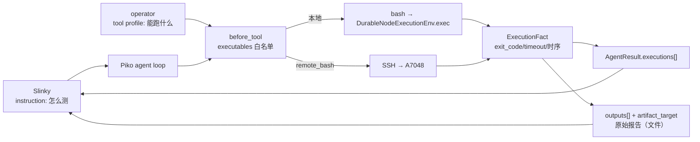

<!-- STD_DOCUMENT_COVER_BEGIN -->
# Piko 机制：测试执行（远程执行 + 执行事实 + 授权边界）

> STD 使用入口：[项目采用说明与标准导航](../../../README.md#std-entry)

| 文档字段 | 值 |
|---|---|
| Document ID | `piko-test-execution` |
| Document Version | `0.1.0` |
| Status | `Draft` |
| Project | `piko` |
| Document Owner | Piko Architecture Owner |
| Last Modified Date | `2026-11-03` |
| Template ID | `design.system-mechanism` |
| Template Version | `3.3.1` |
<!-- STD_DOCUMENT_COVER_END -->

## 1. 机制摘要：解决什么问题

Slinky 编写测试计划与测试用例，Piko 负责在目标机器上执行这些用例并把**原始结果**交回 Slinky。但 V0.1 的 Piko 有三个缺口：

1. **到不了目标机器**：Piko 有 scp（`src/transfer.ts`），没有 SSH 命令执行。HIFM 的测试要在 A7048 上跑，而 Piko 部署在 m5air。
2. **授权边界没生效**：tool profile 的 `permissions.executables` 在 schema 里声明了，运行时**从未被消费**（`src/tool-recovery.ts` 只处理 `network_hosts`）。agent 可以执行 profile 之外的任何命令。
3. **结果不可机器判定**：`AgentResult.summary` 是模型自己的自然语言。Slinky 需要的是 exit code、超时、原始报告摘要。

MECH-TESTEXEC 定义这三件事：**远程执行**（SSH，fail closed）、**可执行文件白名单强制**、**执行事实**（`ExecutionFact`）。

**受益者与任务**：Slinky 的 Testing 子系统需要可机器判定的执行事实来做独立 Oracle 比较；Piko 需要在实验环境崩溃时仍能存活并如实报告失败。

**核心输入 → 处理 → 输出**：输入是 task 的 instruction（slinky 给出「怎么测」）+ tool profile（operator 给出「能跑什么」）；处理是「白名单校验 → 远程或本地执行 → 捕获 exit code/超时/输出」；输出是 `AgentResult.executions[]` + 回收的 `outputs[]`。

**最重要取舍**：白名单按**可执行文件粒度**而非命令内容粒度。`python3 -c "..."` 放行。这换来了可预测的授权语义，代价是不防御「白名单程序被用来做别的事」。



---

## 2. 核心概念

### 2.1 两层边界：instruction 决定「怎么测」，profile 决定「能跑什么」

Piko 是 agent，**不内置测试框架**。Slinky 把任务装配成一段自由文本 instruction（PTS-04：「instruction 包含命令输入、超时、预期报告 JSON 字段和停止条件」），agent 的常规循环读它、用工具执行、写报告。

| 层 | 谁决定 | 管什么 |
|---|---|---|
| **instruction** | Slinky（PM 决定） | 跑哪条命令、什么超时、报告什么字段、停止条件 |
| **tool profile** | Piko 侧 operator 配置 | 可执行文件白名单、远程 host 白名单、网络出站白名单 |

两层不可互相替代。instruction 说「跑 pytest」决定**意图**；profile 的 `executables` 决定 pytest **能不能**被跑。缺 profile 层，agent 拿到一句「清理构建产物」的 instruction 就能执行 `rm -rf`。

### 2.2 执行事实（ExecutionFact）

一次工具执行的可机器判定事实。与 `summary`（模型自述，给人看）严格分离。

### 2.3 原始结果（RawResult）

Slinky 的 `TestExecution.raw_result_ref` 是 **Artifact 引用**，不是结果信封里的 JSON 字段。所以原始报告以**文件**形式回收（走 `output_paths`），执行事实以**字段**形式附在 Result 上。

---

## 3. 可执行文件白名单强制

### 3.1 当前状态：声明了但未执行（缺陷）

`config/tool-profiles.json` 的 `bash` 声明：

```json
"bash": {
  "effect": "process",
  "replay": "never",
  "permissions": { "executables": ["python3","pytest","node","npm","cat","ls","mkdir"] }
}
```

`interfaces/schemas/piko-tool-profile-v0.3.schema.json:54` 也声明了类型。但**除该 schema 行外没有任何运行时代码消费它**——`src/tool-recovery.ts:100` 的权限处理只做了 `network_hosts`。

这与已修复的 H2 `network_hosts` 未执行是同一类漏洞（schema 声明了，执行层没接）。

### 3.2 强制执行模型

**拦截点**：`src/pi-runtime.ts:207-218` 的 `before_tool` hook。

选它而非 Pi bash tool 的 `prepare` 钩子的理由：
- `prepare` 在 `env.exec` 之前调用，时序虽然正确，但它抛出的异常走 Pi 的 tool-error 路径，不复用 Piko 的 `block`/`toolFailure` 终止语义
- `before_tool` 已处理「tool 不在 profile」「路径越界」两类拒绝，模式一致
- 覆盖未来所有 `effect: "process"` 的工具，不只是 bash

**空 allowlist = 不限制**，与 `network_hosts` 空=passthrough 的语义对称。

**拒绝语义**：返回 `{block: {reason, terminate: true}}`，与现有路径越界处理完全一致。agent 看到明确错误；**副作用为零**——拦截发生在 `env.exec` 之前。

### 3.3 解析规则

本地 bash 的 command 是 shell 字符串，需要解析出实际会被执行的可执行文件：

| 规则 | 例子 | 结果 |
|---|---|---|
| 拆命令链 | `python3; rm -rf /` | `python3`, `rm` |
| 拆 pipeline | `pytest \| tee log` | `pytest`, `tee` |
| 跳过 env 赋值前缀 | `FOO=bar python3` | `python3` |
| 跳过 env/sudo/nice 前缀 | `env FOO=1 python3` | `python3` |
| basename 化 | `/usr/bin/python3` | `python3` |
| 去引号 | `"python3"` | `python3` |

**远程 argv 是数组**，无需字符串解析——直接取 `argv[0]` 的 basename。

### 3.4 粒度边界（重要）

白名单按**可执行文件**粒度，不是命令内容粒度。

- `python3 -c "import os; os.system('rm -rf /')"` → **放行**（可执行文件是 `python3`）
- `python3; rm -rf /` → **拒绝**（`rm` 不在白名单）

这是有意的取舍：命令内容解析不可能穷尽（解释器、eval、别名、脚本），把它做成可靠授权是伪命题。运营方通过选择可信的可执行文件来控制边界。

---

## 4. 远程执行（piko → A7048）

### 4.1 为什么需要

Piko 部署在 m5air（A7048 是实验环境，会死机；Piko 存活才能产出失败结果）。HIFM 的测试要在 A7048 上跑。

### 4.2 复用 transfer 的凭据骨架

`src/transfer.ts:94-113` 的 `scpArgs` 已经实现了全部 SSH 安全机制：

| 机制 | 位置 | 说明 |
|---|---|---|
| 私钥物化 | `scpKeyPath`，`:53` | 写到 0600 临时文件，从不落 ~/.ssh |
| **host key 钉扎** | `:107` | `StrictHostKeyChecking=yes` + `UserKnownHostsFile` |
| 禁交互 | `:105` | `BatchMode=yes`，不回退密码提示 |
| 只用指定密钥 | `:106` | `IdentitiesOnly=yes` |
| 非默认端口 | `:111` | `-P` |

远程命令执行需要的是**同一套凭据、不同的调用方式**（`scp` → `ssh <host> <argv>`）。所以这是复用，不是新建机制。

### 4.3 Fail-closed 约束

- 私钥与 known_hosts **必填**，缺失即拒（不 fallback 到 `~/.ssh`）
- **host key 必须钉扎**，不允许 `StrictHostKeyChecking=no`
- **目标 host 白名单**：`remote_hosts` 独立 allowlist。**与 `network_hosts` 分开**——远程执行的目标主机与网络出站目标不是一回事，不该共用一个 allowlist
- argv 数组、`shell=false`（不拼字符串，防注入）
- 输出有界（maxBytes/maxLines）
- 超时强制终止并回收 SSH 客户端

### 4.4 工具形态

新增 `remote_bash` 工具，参数 `{host, command, cwd?, timeout?}`。与本地 `bash` **工具名不同、语义不同**，由 tool profile 分别启用。

### 4.5 远端停止状态语义（关键）

**SSH 客户端退出 ≠ 远端进程已停止。**

断连、超时、客户端被杀等情形下，远端进程可能仍在运行。Piko 必须如实报告「远端停止状态未知」，**不能宣称已终止**。这与 Slinky Tools ISD 的既有结论一致（「SSH 客户端退出不宣称远端进程已停止」「不能用于按 PID 杀远端进程或推断停止」）。

`ExecutionFact.status` 取值含 `aborted` 与 `spawn_error`，用于区分「客户端侧中止」与「远端停止状态未知」。

---

## 5. 执行事实契约

### 5.1 Pi 层的 exit code 丢失问题

Pi 的 bash tool 在 `bash.ts:137-141` 把非零退出码转成 Error 文本并 throw：

```ts
if (result.value.exitCode !== 0) {
  throw new Error(`${outputText ? `${outputText}\n\n` : ""}Command exited with code ${result.value.exitCode}`);
}
```

`details` 只有 `{truncation?, fullOutputPath?}`——**数字 exit code 在 Pi 层就被丢弃**。Pi 的 `prepare` 钩子在 `env.exec` 之前调用（`bash.ts:68` vs `bash.ts:75`），因此也拿不到。

### 5.2 捕获接缝

`src/durable-fs.ts` 的 `DurableNodeExecutionEnv extends NodeExecutionEnv` 是 **Piko 自己的类**，当前只 override 了文件方法。override `exec()` 即可直接观察 `result.value.exitCode`，**零 upstream 改动**。

> **HIGH risk**：`DurableNodeExecutionEnv` 的 blast radius 是 HIGH（3 direct importer，触及 `worker.ts:run` 9 步与 `pi-runtime.ts:execute` 2 步两个执行流，4 个 module）。缓解：只**新增** override 并委托 `super.exec()`，不改现有路径行为；改完跑全量测试。

### 5.3 字段

```typescript
export type ExecutionStatus =
  | "exited"      // 正常结束，exit_code 有值
  | "timeout"     // 超时终止（远端停止状态可能未知）
  | "aborted"     // 客户端侧中止
  | "spawn_error" // 启动失败
  | "policy_denied"; // 被 executables / remote_hosts 白名单拒绝

export interface ExecutionFact {
  tool_call_id: string | null;
  command: string;
  exit_code: number | null;
  status: ExecutionStatus;
  output: string;      // 注意：Pi 层 stdout/stderr 已合并，无法分离
  truncated: boolean;
  timed_out: boolean;
  started_at: string;
  ended_at: string;
  duration_ms: number;
}
```

`AgentResult` 增加 `executions: ExecutionFact[]`（必填，默认 `[]`）。`AgentResult` 除 `failure` 外全是必填非空字段，保持这个风格。

### 5.4 stdout/stderr 无法分离

Pi 的 `NodeExecutionEnv` 把两个流喂给同一个 `feed()`（`nodejs.ts:579-580`），`ShellExecResult` 没有分列的 stdout/stderr。**这是 Pi 层的限制，不是 Piko 的选择。** 若未来需要分离，需要 upstream 改 `ShellExecResult`，不是加一个 Piko 钩子能解决的。

### 5.5 报告缺失也是失败事实

PTS-04：「超时、非零退出和**报告缺失**必须成为执行失败事实」。

任务声明了 `output_paths` 但一个都没回收成功 → `report_missing: true`，且任务状态应为 Failed。Slinky 侧 `execution.design.md:55` 同样要求「Pass/Fail必须有原始结果及Oracle证据」。

### 5.6 Oracle 比较不在 Piko

Slinky 的执行流程（`execution.design.md:61`）：

> 资格和准入 -> Runtime执行 -> **原始结果/证据回收** -> 校验身份版本 -> **独立 Oracle 比较** -> Analysis

**Oracle 比较在 Slinky 侧做。** Piko 的职责止于「原始结果/证据回收」。`execution.design.md:63`：「不用自然语言成功声明替代记录」。

---

## 6. 与 Slinky 的交接边界

### 6.1 依赖方向

Piko **不调用** Slinky 的 Tools。Slinky 委派任务给 Piko，Piko 执行，Slinky 消费 Piko 的 Result。

- `slinky/docs/30_subsystem_design/testing/design.md:143`：「外部仅消费各IR的普通Piko任务状态、结果和Usage」
- `slinky/docs/40_module_design/testing/execution/design.md:95`：「**不得修改 Piko/LLMTier 内部实现**」

### 6.2 协议版本

Piko 当前 machine authority 是 `0.3.0-simplified.6`（schema + OpenAPI + contract doc + fixture 四处一致）。Slinky 的客户端仍 pin 在 `simplified.5`（`piko_client.py:180` 注释：「Pinned to Piko e721ac0, simplified.5. No negotiation with simplified.6.」）。

**方向**：Slinky 升 `.6`，不是 Piko 退回 `.5`。Piko 侧产出 `.5 → .6` 字段级迁移清单作为交接件。

### 6.3 Piko 交回什么

| Slinky 需要 | Piko 提供 | 载体 |
|---|---|---|
| 执行状态 | `TaskView.state` | `GET /tasks/{task_id}` |
| 原始报告 | `outputs[]`（含 sha256/size） | `GET /tasks/{task_id}/result` |
| 投递状态 | `TaskView.artifact_delivery` | `GET /tasks/{task_id}` |
| 退出码/超时 | `executions[]` | `GET /tasks/{task_id}/result` |
| 判 Pass/Fail | — | **Slinky 侧做**（独立 Oracle 比较） |

---

## 7. 配置

### 7.1 tool profile 新增字段

```json
"remote_bash": {
  "effect": "process",
  "replay": "never",
  "permissions": {
    "executables": ["pytest", "python3"],
    "remote_hosts": ["a7048"]
  }
}
```

`remote_hosts` 的匹配规则与 `network_hosts` 对称：host 精确匹配（去端口），**不支持后缀或通配符**。

### 7.2 schema

`interfaces/schemas/piko-tool-profile-v0.3.schema.json` 的 `permissions` 增加 `remote_hosts`（与 `network_hosts` 同 pattern：`^[A-Za-z0-9.-]+(?::[0-9]{1,5})?$`）。

`executables` 已在 schema 中——**本机制是让它真正生效，不是新增字段**。

---

## 8. 验收

| 指标 | 目标 |
|---|---|
| 白名单外可执行文件被执行次数 | **0**（含 shell 链注入变体） |
| `exit_code` 缺失的执行 | **0**（每个 process 类执行都有 `ExecutionFact`） |
| 报告缺失被判为成功 | **0** |
| A7048 不可达时 Piko 进程存活率 | **100%**（拓扑保证 + 失败事实） |
| 远端停止状态被误报为「已终止」 | **0** |
| 单次远程执行额外延迟 | < 5%（相对 SSH roundtrip 本身） |

---

## 9. 风险与缓解

| 风险 | 缓解 |
|---|---|
| 白名单按可执行文件粒度，`python3 -c "..."` 可执行任意逻辑 | 有意的粒度边界，§3.4 已写明。运营方选择可信可执行文件 |
| SSH 客户端退出后远端仍在跑 | 如实报告 `status=aborted` / 停止状态未知，不宣称已终止 |
| stdout/stderr 无法分离 | Pi 层限制，已写明；需 upstream 改动 |
| `DurableNodeExecutionEnv` blast radius HIGH | 只增不改，委托 `super.exec()`，全量测试验证 |
| A7048 死机 | Piko 跑在 m5air；失败事实如实表达 |
| 白名单绕过（shell 别名、脚本、`exec`） | 别名与 `exec` 由父 shell 处理，白名单校验的是传给 shell 的 token |

---

## 10. 决策记录

| 日期 | 决策 | 理由 |
|---|---|---|
| 2026-11-03 | Piko 部署在 m5air，通过 SSH 连 A7048 | A7048 是实验环境会死机；Piko 存活才能产出失败结果 |
| 2026-11-03 | Piko 自己实现 SSH 客户端 | 依赖方向 slinky → piko；复用 transfer 的凭据骨架，不新建机制 |
| 2026-11-03 | 不内置测试框架 / 测试 DSL / `test_exec` 工具 | Piko 是 agent，按 instruction 执行即可 |
| 2026-11-03 | `executables` 在 `before_tool` 拦截 | 复用现有 block 机制；覆盖所有 process 类工具 |
| 2026-11-03 | 白名单按可执行文件粒度 | 命令内容解析不可能穷尽 |
| 2026-11-03 | exit code 在 `DurableNodeExecutionEnv.exec` 捕获 | Pi bash tool 丢弃数字 exit code；此接缝零 upstream 改动 |
| 2026-11-03 | `remote_hosts` 与 `network_hosts` 分开 | 远程执行目标主机 ≠ 网络出站目标 |
| 2026-11-03 | 不做 Docker 隔离 | A7048 隔离由 A7048 自身负责；Piko 是执行者非环境管理者 |
| 2026-11-03 | 不做 Oracle 比较 | Slinky 的职责（`execution.design.md:61`） |
