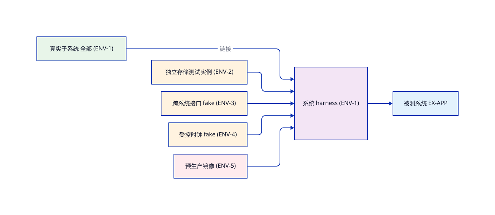

<!-- STD_DOCUMENT_COVER_BEGIN -->
# Piko system-test-scheme

> STD 使用入口：[项目采用说明与标准导航](../../../README.md#std-entry)

| 文档字段 | 值 |
|---|---|
| Document ID | `system-test-scheme` |
| Document Version | `0.1.0-draft.1` |
| Status | `Draft` |
| Project | `piko` |
| Authority | `piko` |
| Document Owner | Piko QA |
| Authors | opencode, corezilla |
| Created Date | `2026-10-10` |
| Last Modified Date | `2026-10-10` |
| Template ID | `tests.system-test-scheme` |
| Template Version | `0.7.18` |
| Template Conformance | `tailored` |
| Tailoring Reference | piko-std-tailoring-v0.1 |
| Migration Map Reference | none |
| Repository | `corezilla/piko` |
| Canonical Path | `docs/70_verification/system/system-test-scheme.md` |
| Supersedes | none |

> Reviewer、Approver、Approval Date 和 Release Tag 在进入相应状态时填写。Git commit/tag 是
> 外部不可变证据；不要在文档内容中伪造包含自身的 commit hash。
<!-- STD_DOCUMENT_COVER_END -->

> **编写建议**：本模板是系统测试方案，与 design.software-system（系统设计阶段）一一对应。方案只登记测试分类与 Case 清单（每 Case 一行责任摘要），不写 Case 细节；逐 Case 展开一 Case 一文档（tests.system-case）；黑盒边界纪律、真实系统 Oracle 分层、对接前检与工具资产化方法见[系统测试指南](../../docs/ai-guides/system-testing.md)，不在本模板重复。

> **格式说明**：`> ` 引用块为编写建议（指导如何填写，生成实例后保留，项目可按标签整体裁除）；```example 围栏为虚构教学示例（以源文本呈现成品形态，`new-design` 实例化时整块剥离，不得当作项目事实）；`⟨angle⟩` 为待填槽，反引号为照抄的短建议/示例值。

> 本方案绑定软件系统：父设计 Document ID 经 `--parent-document-id` 写入 metadata；系统设计 ID/版本在 §1 固定。

### 模板定位：方案、用例与计划的边界

> **编写建议**：本方案对应系统设计阶段（design.software-system；总体设计的软件分支同用本模板）。分母来源是系统设计的端到端流程（§7）、对外接口（§8）、系统约束与预算，以及机制的端到端保证（design.system-mechanism §15 承接进入本分母——机制不单独立测试文档）。子系统层归 tests.subsystem-test-scheme；验收活动不在本家族，按项目 tailoring 承接。

- **权威分工**：系统层测试的 Case 清单（ID、分类、优先级、责任摘要、设计状态）以本方案为唯一登记处；单 Case 展开归 `tests.system-case`（一 Case 一文档）；活动组织归 `tests.system-test-plan`。
- **只有摘要**：本方案每条 Case 只写责任摘要（要测什么），不写输入构造、Oracle 或步骤。
- **下层 PASS 不关闭本层**；本层 PASS 不关闭上层组合目标。

### 状态语义：用例状态

> **编写建议**：本方案只持有 用例状态（Designed / Gap / Tailored-N/A）；实现状态（Planned/Implemented）在对应 case-design 文档，执行状态与 Verdict 只在 Run 报告。混层即违例。

> 本文档对设计验证项（VRC/V-xxx）的引用规则：只引用 ID 与状态，不复制定义/判据；判据与契约权威归 design 与 tests.asset-design，本文档若细化执行断言需在变更时回溯设计修订并记录。

- **用例状态**：`Designed` / `Gap`（具名缺口） / `Tailored-N/A`——唯一权威：本方案 §6 登记；禁止：未设计写成已设计、N/A 无设计事实依据。

> **完成条件**：任一 Case 在本方案中只报设计状态；实现与执行状态可沿 Case ID 追到 case-design 文档与 Run 报告。

## 1. 目标、范围与被测对象

> **本节目的**：固定整软件系统组装层的对象与边界。
>
> **必须写清楚**：被测系统与设计基线；真实子系统；外部依赖真实或边界替身及证明边界；黑盒边界纪律——本层全部 Case 的布景入口清单（公开接口/外部控制面）、观察点清单（外部可观察事实）、禁读内部状态自查项，逐 Case 在 `tests.system-case` §2 声明；不证明的真实环境与验收目标。
>
> **抽象示例**：虚构 EX-APP 方案覆盖启动/配置/停止流程与机制端到端。
>
> **完成条件**：读者能说清系统层测什么、验收承接什么。

- **被测对象、设计基线与父对象**：


- **本阶段测试边界（真实组成 / 边界替身）**：


- **不证明的组合保证及承接入口**：


## 2. 测试方法与测试设计技术

> **本节目的**：固定系统层"怎么测"的方法论——单元层测试设计技术比较单一（mock 为主），上游测试常**多方法共存**，需逐一描述与边界。
>
> **必须写清楚**：测试设计技术（按 Case 家族用哪些——等价类划分/边界值/状态转换/决策表/错误猜测/属性测试/变异测试等，写明对哪些 family 用哪种及不用哪种）；入场标准（设计文档到位、方案清单冻结、Case 实现就绪、替身 Verified、环境齐）；离场标准（分母每条来源有 Case 或缺口、Verdict 齐全、缺口有主、设计变更触发重跑）；自动化策略（哪些进 CI、单 Case 选择入口、断点/重跑规则、flaky 不掩盖根因）。
>
> **抽象示例**：见本节 example 围栏示例）。
>
> **完成条件**：每个 §6 Case 行能指出所用方法与环境类型；入场/离场可判定；环境类型与 asset-design 契约对应；无未声明的环境依赖。

### 2.1 家族方法登记

> **本节目的**：为每个适用家族登记具体技术、环境引用与判定规则——§6 Case 行的方法出处。
>
> **必须写清楚**：每家族一条记录，三字段齐；判定规则含失败处置；家族不适用不在此登记（转 §7）。
>
> **抽象示例**：见本节 example 围栏示例。
>
> **完成条件**：每个 §6 登记行的家族能命中本节一条记录。

#### 2.1.1 Family · ⟨名称⟩

**测试设计技术**：`选用技术与具体注入内容（值/序列/交错）`

**环境类型引用**：`类型名（详见 §4）`

**自动化与判定规则**：`批量策略、一次判定/采样统计、INVALID 条件`


### 2.2 测试设计技术选型记录（按 Case 家族）
> **本节目的**：固定本层"怎么测"——按 Case 家族显式选用的设计技术与反模式；技术选择归本表不在灰例中重复。
>
> **必须写清楚**：每个 Case 家族显式给出选用技术、选用理由与不选用的反模式；家族不适用走 §7 Tailored-N/A，不允许空行；技术替换须连同 §6 清单复核同步，不得只在表里改词。
>
> **抽象示例**：见下方占位表的既有示例结构。
>
> **完成条件**：七家族均有技术或 §7 裁决；每行"不选用反模式"非空。

#### 2.2.1 Family · normal

**选用的设计技术**：等价类划分 + 边界值抽样

**选用理由**：`覆盖合法输入空间，验证主路径`

**不选用的反模式**：`不用全部输入矩阵（规模爆炸）`

#### 2.2.2 Family · boundary

**选用的设计技术**：边界值（上下限/零/1/刚好满）

**选用理由**：`边界是缺陷高发区，验证边界 + 边界附近 1 步`

**不选用的反模式**：`不用无 Oracle/无口径的随机与模糊；固定种子+统计判据下受契约约束的随机化合法`

#### 2.2.3 Family · negative

**选用的设计技术**：错误猜测 + 反例驱动

**选用理由**：`异常路径以"设计已识别的反例"为准`

**不选用的反模式**：`不用模糊异常注入（无 oracle / 无归因）`

#### 2.2.4 Family · concurrency

**选用的设计技术**：线程对偶 / 顺序交错

**选用理由**：`状态机驱动，固定种子控制时序`

**不选用的反模式**：`不用无种子/无交错复现的随机并发`

#### 2.2.5 Family · recovery

**选用的设计技术**：kill/异常路径 + RAII 恢复

**选用理由**：`资源归还与回滚基线需在失败路径覆盖`

**不选用的反模式**：`不用"重试"模拟恢复（掩盖根因）`

#### 2.2.6 Family · performance

**选用的设计技术**：单 Case 基线采样 + 多次回归比对

**选用理由**：`上游已验证语义，非性能预算基线`

**不选用的反模式**：`不用负载/容量测试（本层不负责系统预算）`

#### 2.2.7 Family · security

**选用的设计技术**：鉴权/注入/脱敏冒烟 + 资产级契约

**选用理由**：`上游/集成层已覆盖，本层仅冒烟`

**不选用的反模式**：`不用无 Oracle/无归因的模糊安全测试`

### 2.3 对象类型×必测维度展开表

> **本节目的**：让 ST 编写者按面/流类型展开全部必测格；与 §6.1 控件网格、§6.2 数据网格互补：本表管"每类面怎么测"，网格管"具体哪一格"。
>
> **必须写清楚**：系统对外可观察面按类型对号入座；参数类非法断言不应出现在本层（下沉 UT/MT，条 11 分载）。 删行必须给 tailoring 理由并登记缺口；新增对象类型按同格式补行。
>
> **抽象示例**：表内示例列。
>
> **完成条件**：每类面至少一个锚点家族且 §6.1/§6.2 网格逐格闭合。

#### 2.3.1 对象类型 · E2E 业务流

**必测维度（展开规则）**：

每角色×主旅程 ＋ 异常出口各×1

**判定要点**：

黑盒三清单齐（布景只走公开入口）


`配置→使用→停用全旅程`

#### 2.3.2 对象类型 · 控件面（§6.1 网格）

**必测维度（展开规则）**：

每控件冒烟锚 ＋ 危险控件双击/连点

**判定要点**：

可观察结果指向公开查询


`双击提交恰 1 次调用`

#### 2.3.3 对象类型 · 数据面（§6.2 网格）

**必测维度（展开规则）**：

数据项×行类别×变体逐格

**判定要点**：

逐值对账（条 8），类别外同值=Critical


`候选行两列同名→矩阵判`

#### 2.3.4 对象类型 · 权限矩阵

**必测维度（展开规则）**：

token 类×端点类抽样全覆盖

**判定要点**：

401/403 语义与文案


`data token→admin 403`

#### 2.3.5 对象类型 · 真实通道

**必测维度（展开规则）**：

UI/CLI 显示＝权威存储（同运行）

**判定要点**：

跨观察点，不经内部状态


`页面数字=GET 响应`

#### 2.3.6 对象类型 · 系统机制锚点

**必测维度（展开规则）**：

每机制端到端保证×1

**判定要点**：

复现与修复分开记录


`准入保证高压下不丢`

#### 2.3.7 对象类型 · 性能预算

**必测维度（展开规则）**：

每预算数字×统计口径

**判定要点**：

§3.1 判定链，预算出自设计


`p95/吞吐/峰值内存`

#### 2.3.8 对象类型 · 成本护栏（optional：外部计费系统必选）

**必测维度（展开规则）**：

计费类：上限触发与止损

**判定要点**：

超限行为可观察


`超预算→拒绝非静默`

#### 2.3.9 对象类型 · 恢复/灾备

**必测维度（展开规则）**：

kill/磁盘满/上游断

**判定要点**：

恢复完成判据分开


`断连→readyz 回绿+新请求`

#### 2.3.10 对象类型 · 安全样本

**必测维度（展开规则）**：

注入/敏感数据/脱敏 grep

**判定要点**：

零泄漏观察点（响应+日志+存储）


`prompt 注入样本拒绝`

#### 2.3.11 对象类型 · 升级兼容（optional：有存量数据/配置时）

**必测维度（展开规则）**：

旧数据/旧配置迁移×1

**判定要点**：

迁移有验证记录


`v1 存储 v2 读`

#### 2.3.12 对象类型 · absence 红线

**必测维度（展开规则）**：

旧路径/未声明字段探测

**判定要点**：

按需求负向逐条


`legacy /call→404`

## 3. 替身使用策略与边界

> **本节目的**：固定系统层替身的使用，让 §6 清单的替身选择可解释可复核。
>
> **必须写清楚**：替身决策准则（按所有权/可控性/真实性分类——内部真实/边界 fake/真协议测试实例/容器等）；替身形态（mock/fake/stub/spy 的取舍与代价）；替身保真度——契约与自检归 `tests.asset-design`（一资产一文档），方案与 Case 只引用其 ID 不复制行为；交互断言 vs 返回值断言（优先返回值，必要时断言关键调用序，但不耦合内部实现）；反模式（不 mock 你不拥有的接口、不 mock 值对象/纯数据、不为凑覆盖率而 mock、不过度断言内部细节）；与 §1 边界、§6 Case 清单、`tests.system-case` §2 替身选择一致。
>
> **抽象示例**：见本节 example 围栏示例。
>
> **完成条件**：每个 §6 Case 行能指出替身类型与契约文档 ID；替身矩阵与 asset-design 一一对应；反模式逐项被排除并有理由。

#### 3.1 替身 · ⟨名称⟩

**替身形态**：`mock/fake/stub/spy`

**替身契约文档（tests.asset-design）**：`对照本节"必须写清楚"填一条实际事实`

**决策理由**：`为何不能真实；不 mock 不拥有的对象`


## 4. 测试环境类型（方案定义）
> **必须写清楚**：每种环境类型给出用途、真实性边界（哪些依赖真实、哪些替身）、契约与版本引用（资产 ID）与并发/隔离约束；ENV 实例分配归计划 §4。

> **本节目的**：固定本层"在哪类环境上跑"——列出环境**类型**（抽象类别）及其行为/真伪与契约文档（tests.asset-design 或产品规范）；同一类型可多套实例（多 docker 用于并行），具体**实例编号与分配**由 `tests.system-test-plan` §4 编排，Case 在 §5 通过「环境类型 + ENV 实例编号」引用，不在本文档重复描述环境本身。

> **抽象示例**：见本节 example 围栏示例）+ 环境拓扑（ENV 类型 → ENV 实例 → 被测对象）。
>
> **完成条件**：每个 §6 Case 行能指出所用环境类型；类型与 asset-design 契约对应；无未声明的环境依赖。

#### 4.1 环境类型 · ⟨名称⟩

**行为/真伪**：`真实性与行为边界`

**契约文档**：`tests.asset-design ID；真实编译类写"—"`

**在本层用例中的角色**：`用于哪类 Case；重置/推进/断言时点`




## 5. 测试分类体系

> **本节目的**：固定本阶段的测试分类体系与适用裁剪。
>
> **必须写清楚**：采用 STD 统一家族词表（normal/boundary/negative/concurrency/recovery/security/performance/endurance），逐类声明本阶段适用性与裁剪依据；不适用不等于没写 Case，须在 §7 给事实。
>
> **抽象示例**：见本节 example 围栏示例。
>
> **完成条件**：分类体系可裁剪可追溯，每个适用分类在 §6 清单中至少有 Case 或缺口。

#### 5.1 分类 · normal / boundary / negative / concurrency / recovery / security / performance / endurance

**本阶段适用性**：适用/Tailored-N/A/不在本层

**裁剪依据**：`对照本节"必须写清楚"填一条实际事实`


## 6. 覆盖分母与 Case 清单

> **本节目的**：把 design.software-system 的适用来源 ID 转成 Case 清单——测试分母的唯一登记。
>
> **必须写清楚**：一个来源 ID 至少一条记录（可多 Case 分担，分别写责任摘要）；以设计文档（design §12/§14）的验证项 VRC 清单为分母逐项对账：每个 VRC 至少一个 Case——验证项是设计声明的必测点，本清单只引用其 ID 不复制定义、不做附录；Case ID 稳定且唯一（ST-⟨对象⟩-⟨NNN⟩）；责任摘要只写“要测什么、边界在哪”，不写输入与 Oracle；设计状态按状态语义；未实现与 NOT_RUN 不删；不适用转 §7。

> 来源 ID 与设计验证项（VRC）的边界：本登记处逐条记录 ID+责任摘要；判据/Oracle/Owner/契约权威归 design 与 tests.asset-design，不在此行复写；变更设计时同步 VRC 同步本清单。
> **抽象示例**：见本节 example 围栏示例。
>
> **完成条件**：每个适用来源 ID 有 Case 或缺口；每个 Case ID 可追到（或计划有）case-design 文档。

#### 6.1 Case · ⟨名称⟩

**来源 ID / 固定版本**：`设计来源行＋固定版本`

**设计验证项 ID**：`设计文档 VRC ID`

**Case ID**：`覆盖本项的 Case ID（多个用/）`

**分类**：`对照本节"必须写清楚"填一条实际事实`

**优先级**：`P0-P2`

**责任摘要（要测什么）**：`一句说清测什么、到哪停；不写输入与 Oracle`

**设计状态**：``Designed` / `Gap（编号／Owner／Gate）` / `Tailored-N/A`（§7 裁决）`

**上级组合验证入口**：`对照本节"必须写清楚"填一条实际事实`


### 6.1 暴露面与交互面清单（有交互面的产品必填）

> **本节目的**：让控件、命令、端点参数成为一等分母——没有登记就谈不上覆盖。
>
> **必须写清楚**：从机器权威源枚举（CLI help/参数注册表、端点注册表/openapi、UI 控件注册表 selector→handler→端点→权限），逐面登记动作、权限与期望可观察结果；每面必须指向 §6 清单的 Case ID 或具名缺口（缺口按 §7 登记 Gap/Tailored-N/A 裁决），完成条件为 100% 有 Case 或缺口；禁止凭记忆挑选。
>
> **抽象示例**：usage 面板刷新按钮 → 点击触发 GET /v1/usage → 面板更新。
>
> **完成条件**：暴露面全集与 §6 Case 清单对账零差集（该对账是 system-test-plan §3 执行前检的机器闸门）。

每个暴露面一条记录：

#### 6.1.1 暴露面 · ⟨selector / 命令 / 端点+参数⟩

**动作与权限**：`谁经哪个公开入口触发什么；权限引用访问矩阵行`

**期望可观察结果**：`外部可观察事实（响应/状态/权威存储）`

**Case / 缺口 · 状态**：``ST-…` 或 `Gap（编号／Owner／Gate）`；`登记/覆盖/关闭``

### 6.2 展示数据项分母

> **本节目的**：让系统呈现的每个数据项进入分母——"每个数据项都测了"必须可核查，不能人工估算。
>
> **必须写清楚**：从设计侧数据项清单（`design.definition` §3.N，经子系统/模块逐级上卷）机器引用生成，不凭记忆补；按**数据项 × 行类别 × 呈现变体**逐格登记（行类别取自 design §3.N 类别矩阵；无类别分化的单值项按一格），每格记展示位置、来源契约字段、断言方式（自动断言/截图复核）；每格指向 §6 的 Case ID 或具名缺口（按 §7 裁决），完成条件为 100% 格-或-缺口——Case 需求量由格数直接算出，不得人工估算。
>
> **抽象示例**：模型列表"状态"列 ← Deployment.state，空态显示 unknown，刷新时点=操作成功后 ≤1s。
>
> **完成条件**：数据项全集与 §6 Case 清单对账零差集；来源字段不可解析的条目按 Critical 回流设计。

每格（数据项×行类别×呈现变体）一条记录：

#### 6.2.1 数据格 · ⟨数据项 ID / 行类别 / 呈现变体⟩

**展示位置与来源契约字段**：`页面/导出位置 ← 契约字段 ID（design §3.N 清单行）`

**断言方式 · Case / 缺口**：``自动断言/截图复核`；`ST-…` 或 `Gap（编号／Owner／Gate）``

## 7. 不适用与缺口裁决

> **本节目的**：区分“不适用”与“尚未设计”。
>
> **必须写清楚**：Tailored-N/A 必须引用设计章节事实；Gap 须有 Owner 与恢复条件；两者都不从分母静默消失。
>
> **抽象示例**：见本节 example 围栏示例。
>
> **完成条件**：每条裁决有事实或 Owner；无“顺手 N/A”。

#### 7.1 裁决 · ⟨名称⟩

**裁决（Tailored-N/A 或 Gap）**：`对照本节"必须写清楚"填一条实际事实`

**Owner / 恢复条件**：`对照本节"必须写清楚"填一条实际事实`


## 8. 文档联动与清单变更规则

> **本节目的**：固定方案—用例—计划的联动规则，防三处漂移。
>
> **必须写清楚**：新 Case 先入本清单再建 case-design 文档（文档 ID＝Case ID）；清单变更须同步计划构成表；写明方案冻结/版本规则。
>
> **抽象示例**：见本节 example 围栏示例。
>
> **完成条件**：清单与 case-design 文档一一对应；计划只引用不复制。

- **方案冻结与变更规则**：


- **与 case-design / 计划的同步规则**：


> **交付自查**：每个适用来源 ID 是否都有 Case 或具名缺口；清单里的每个 Case ID 是否都有（或计划有）对应 case-design 文档；方案里是否混入了输入构造或 Oracle 细节？

## 附录 A. 本层设计验证项 VRC 汇集（对照用）

> **本节目的**：把设计文档声明的本层验证项 VRC 汇集于此，供逐项对照 §6 清单的覆盖。
>
> **必须写清楚**：VRC 清单以设计文档（design §12/§14）为唯一权威，本附录只登记 ID 与要验证什么，不复制判据/Oracle 定义；设计变更时本附录同步；每个 VRC 必须在 §6 清单有至少一个 Case，否则登记缺口。
>
> **抽象示例**：见本节 example 围栏示例。
>
> **完成条件**：本附录 VRC 集合与设计文档一致；每个 VRC 在 §6 清单有 Case 或缺口。

#### A.1 VRC · ⟨名称⟩

**要验证什么（名称/责任）**：`对照本节"必须写清楚"填一条实际事实`

**设计来源**：`对照本节"必须写清楚"填一条实际事实`

**§6 Case 覆盖**：`对照本节"必须写清楚"填一条实际事实`


