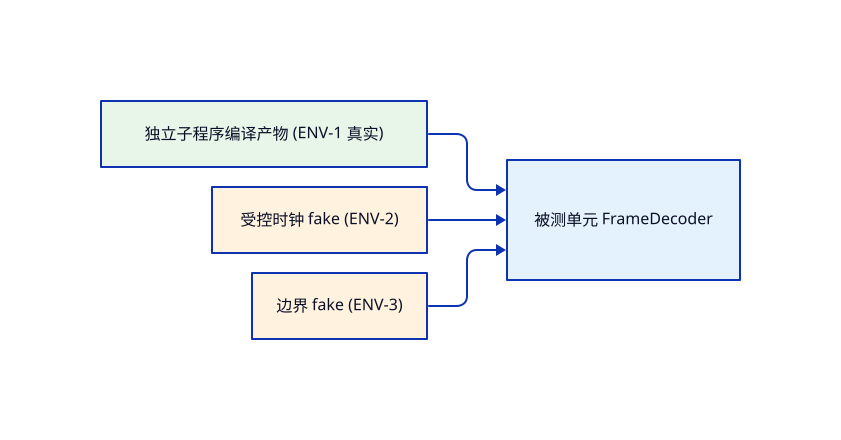

<!-- STD_DOCUMENT_COVER_BEGIN -->
# Piko unit-test-scheme

> **本文件遵守 STD（工程文档标准），STD 为最高优先级；修改本文件之前必须先读 STD 入口。**
> STD 入口：[项目采用说明与标准导航](../../../README.md#std-entry)。入口的**编写索引**已列出本类文档的全部硬性义务：不必通读规范，但**每一条都必须遵守**。

| 文档字段 | 值 |
|---|---|
| Document ID | `unit-test-scheme` |
| Document Version | `0.1.0-draft.5` |
| Status | `Draft` |
| Project | `piko` |
| Authority | `piko` |
| Document Owner | Piko QA |
| Authors | opencode, corezilla, Claude |
| Created Date | `2026-10-10` |
| Last Modified Date | `2026-11-04` |
| Template ID | `tests.unit-test-scheme` |
| Template Version | `4.1.0` |
| Template Conformance | `tailored` |
| Tailoring Reference | piko-std-tailoring-v0.1 |
| Migration Map Reference | none |
| Repository | `corezilla/piko` |
| Canonical Path | `docs/70_verification/unit/unit-test-scheme.md` |
| Supersedes | none |
| Std Conformance Total | 14 |
| Std Conformance Passed | 11 |
| Checklist Total | 26 |
| Checklist Conformed | 18 |
<!-- STD_DOCUMENT_COVER_END -->

> **编写建议**：本模板绑定单个模块（模块对象 ID 在 §1 登记）——单元层方案与用例集均一模块一份，多模块项目逐模块实例化，用例集（`tests.unit-case`）与测试脚本引用本方案。

> **格式说明**：`> ` 引用块为编写建议（指导如何填写，生成实例后保留，项目可按标签整体裁除）；```example 围栏为虚构教学示例（以源文本呈现成品形态，`new-design` 实例化时整块剥离，不得当作项目事实）；`⟨angle⟩` 为待填槽，反引号为照抄的短建议/示例值。
> 本方案绑定单一软件模块：模块对象 ID 经 `--design-object-id` 写入 metadata；ISD 设计 ID/版本在 §1 固定；实现状态与执行结果不进本方案。
> 本文档对设计验证项（VRC/V-xxx）的引用规则：只引用 ID 与状态，不复制定义/判据/Owner；判据与契约权威归 design 与 tests.asset-design。

### 模板定位：方案、用例与计划的边界

> **编写建议**：单元层方案；本方案持有 Case 登记与设计状态；逐 Case 展开归 `tests.unit-case`（用例集），执行组织归 `tests.unit-test-plan`，Verdict 只在报告。

- **登记唯一权威**：Case 的 ID、分类、优先级、责任摘要、设计状态以 §6 登记为唯一登记处，别处只引用不复制。
- **测试脚本的唯一依据链**：脚本按用例集段落编写；用例集段落按 §6 登记行与 §2.3 维度展开；不回读设计正文猜意图。

### 状态语义：用例状态

> **编写建议**：本方案只持有用例状态；实现状态在模块用例集总账，执行状态与 Verdict 只在 Run 报告；三层混用即违例。

- **用例状态**：`Designed` / `Gap`（具名缺口）/ `Tailored-N/A`——唯一权威：本方案 §6 登记；禁止：未设计写成已设计、N/A 无设计事实依据。

> **完成条件**：任一 Case 在本方案中只报设计状态；实现与执行状态可沿 Case ID 追到用例集与报告。

- **被测对象 / 设计基线 / 父对象**：各模块内的单个函数/类/方法（白盒）；基线 = 各 `piko-*-impl.isd.md`（`design.implementation`）；父对象为对应 `design.definition`。

- **本阶段测试边界**：内部逻辑、错误路径、边界输入；一切外部依赖（LLMTier/Matrix/scp/时钟/SQLite）用替身或内存真库。

- **不证明的组合保证**：不证明模块整体行为（归 `tests.module-test-scheme`）；不证明端到端（归 `tests.system-test-scheme`）。


## 1. 目标、范围与被测对象

> **本节目的**：固定单元层测试的对象与边界。
>
> **必须写清楚**：被测模块、ISD 基线、被测函数集合；真实代码与替身边界；不证明的组装保证及承接入口。
>
> **完成条件**：读者能说清单元层测什么、不测什么。

本方案覆盖 Piko 全部 11 个模块与跨模块共享设施的单元层。单元层只验证**单个函数在受控输入下的可观察行为**；跨模块协作、协议互操作与端到端时序由模块层与系统层承接，不在本层证明。

### 1.1 绑定与对象登记

> **必须写清楚**：模块对象 ID 与 ISD 基线逐字段登记；函数集合与 ISD §5 清单全量对账；边界与不证明项各给承接入口。
>
> **完成条件**：四字段齐，函数集合与 ISD 差集为零。

#### 1.1.1 登记 · 绑定与对象

**模块对象 ID 与 ISD 基线（ID/版本/commit）**：

- `BOOT`：M000 `bootstrap`；ISD `piko-bootstrap-impl.isd.md` v0.1.0-draft.1（commit 随仓库固定）
- `MATRIX`：M008 `matrix-runtime`；ISD `piko-matrix-adapter-impl.isd.md` v0.1.0-draft.1（commit 随仓库固定）
- `OBS`：M009 `observability`；ISD `piko-observability-impl.isd.md` v0.1.0-draft.1（commit 随仓库固定）
- `PI`：M006 `pi-adapter`；ISD `piko-pi-adapter-impl.isd.md` v0.1.0-draft.1（commit 随仓库固定）
- `POLICY`：M002 `policy`；ISD `piko-policy-impl.isd.md` v0.1.0-draft.1（commit 随仓库固定）
- `REPO`：M003 `task-repository`；ISD `piko-task-repository-impl.isd.md` v0.1.0-draft.1（commit 随仓库固定）
- `SCHED`：M004 `scheduler`；ISD `piko-scheduler-impl.isd.md` v0.1.0-draft.1（commit 随仓库固定）
- `TAPI`：M001 `task-api`；ISD `piko-task-api-impl.isd.md` v0.1.0-draft.1（commit 随仓库固定）
- `TRANSFER`：M010 `transfer`；ISD `piko-transfer-impl.isd.md` v0.1.0-draft.1（commit 随仓库固定）
- `USAGE`：M007 `usage`；ISD `piko-usage-impl.isd.md` v0.1.0-draft.1（commit 随仓库固定）
- `WORKER`：M005 `worker`；ISD `piko-worker-impl.isd.md` v0.1.0-draft.1（commit 随仓库固定）

- 共享设施（跨模块 IPC 与进程管理）：`src/ipc.ts` · `src/exec-process.ts` · `src/supervisor.ts`；ISD 归属 M000/M005，无独立 ISD。

**被测函数集合（与 ISD §5 对账）**：本方案登记**三个集合**，它们互不覆盖，必须分开读——STD §1.1 要求「函数集合与 ISD §5 清单全量对账，差集须为零」。

- **集合 A · ISD §5.1 权威接口符号（51 个）**：设计文档声明的对外接口签名，唯一权威在 ISD §5.1 的 `**5.1.N \`Symbol(...)\`**` 条目。**A − §1.1 登记 = 空**（本方案不漏登记任何 ISD 接口）。
- **集合 B · `src/` 实际导出符号（161 个）**：实现侧的真实导出面，比 A 大，因为 A 只声明对外接口，B 含工具类与内部编排函数。
- **集合 C · §6 Case 实际命名的被测符号（131 个）**：用例集逐 Case 声明的「被测符号」。**C 与 A 只交 20 个**——C 的主体是 A 未声明的**私有成员/受保护方法**（如 `TaskStore.createOrGet`、`Policy.canonicalize`、`MatrixRuntime.auditMembership`），它们不是独立可调用单元，只能经公开入口间接覆盖。

**A ∪ B ∪ C 的差集不是零，登记如下**（每行可按符号名复算）：

| 集合 | 规模 | 与 A 的差集 | 性质与处置 |
|---|---|---|---|
| A · ISD §5.1 接口符号 | 51 | — | 设计声明的必测点，**A − C = 31 项无 Case**，见 §7.1 裁决 `G-UT-DENOM-1` |
| B · `src/` 导出符号 | 161 | B − A = 110 | 实现导出但设计未声明为接口；其中未被任何 Case 命名的导出符号按 §7.1 `G-UT-DENOM-2` 登记 |
| C · Case 被测符号 | 131 | C − A = 111 | 其中 104 项是 `src/` 里的**私有成员/受保护方法**（非导出），经公开入口间接覆盖；12 项是**命名漂移**（用例集写的名字与实现不一致），逐项对照见 `unit-test-report` §3.2.2 |

**各模块的三方对账**（ISD §5.1 符号数 / §1.1 登记数 / Case 命中该模块 Case 数 / ISD 符号无 Case 数）：

| 模块 | ISD §5.1 符号 | §1.1 登记 | Case 数 | Case 命中的符号 | ISD 符号无 Case |
|---|---|---|---|---|---|
| `BOOT` | 4 | 15 | 10 | 10 | 2（`load`、`probe`） |
| `MATRIX` | 5 | 9 | 11 | 11 | 2（`close`、`syncOnce`） |
| `OBS` | 4 | 8 | 7 | 7 | 0 |
| `PI` | 8 | 14 | 7 | 7 | 7（`accept`、`drive`、`getResult`、`inspect`、`install`、`openOrCreateRunSession`、`verifyPiUpstream`） |
| `POLICY` | 3 | 13 | 11 | 11 | 3（`bindToolProfile`、`canonicalizePath`、`validateSubmission`） |
| `REPO` | 14 | 16 | 51 | 51 | 6（`createOrGetRun`、`fenceSlot`、`listQueued`、`openStore`、`patchTerminal`、`scanNonTerminalRuns`） |
| `SCHED` | 3 | 8 | 5 | 5 | 3（`acquireSlot`、`fence`、`renewLease`） |
| `TAPI` | 4 | 6 | 3 | 3 | 4（`cancelTask`、`createTask`、`getTaskResult`，含 `getTask`） |
| `TRANSFER` | 0 | 3 | 8 | 8 | 0（该 ISD 无 §5.1 API 小节） |
| `USAGE` | 2 | 7 | 2 | 2 | 1（`validateBeforePublish`） |
| `WORKER` | 5 | 8 | 11 | 11 | 4（`build`、`onIdle`、`onLease`、`plan`） |
| 共享 | 0 | 7 | 0 | 0 | 0（`src/ipc.ts`·`exec-process.ts`·`supervisor.ts` 无独立 ISD） |

**合计**：A = 51，§1.1 登记 = 106（去重前列名 114，其中 8 个跨模块重名：`snapshot`、`emptyUsage`、`fenceSlot`、`tryClaimSlot`、`renewSlot`、`bindToolProfile`、`validateUsage`、`openStore`），§6 Case = 136 条 / 131 个符号。

**「差集为零」的正确表述**：**A − §1.1 登记 = 0**（设计声明的接口一个不漏登记）；但 **A − §6 Case ≠ 0**（31 个设计接口当前没有专门 Case），**C − A ≠ 0**（111 个 Case 测的是设计未声明为接口的私有成员）。前一项是本层的**覆盖缺口**（`G-UT-DENOM-1`），后一项是**命名粒度问题**（不构成缺口，但要求用例集的「被测符号」栏注明真实归属，见 `unit-test-report` §3.2）。

**本阶段边界（真实组成／替身范围）**：被测函数全部为 `src/` 真实代码；替身仅限四处——受控时钟 `FAKE-CLK`（`src/clock.ts`）、LLMTier 与 Matrix 的homeserver 边界、scp 远端与 MCP 工具边界、内存 SQLite 实例。替身清单与其自检入口见 `docs/70_verification/assets/asset-design.md`。

**不证明的组合保证及承接入口**：

- P0/P1 组装后行为、租约在真实进程间传递 → 承接 `MT-IPC-*` / `MT-SCHED-*`
- wire 协议与 HTTP 契约 → 承接 `ST-APP-*`
- 真实模型与真实 homeserver 的端到端结果 → 承接 `ST-EXEC-*` / `ST-MX-*`
- 数据面真实 scp 往返 → 承接 `MT-TRANSFER-*` / `ST-DATA-005`


## 2. 测试方法与测试设计技术

> **本节目的**：固定本层"怎么测"，由三层构成——2.1 家族方法登记（怎么测）、2.2 选型记录（为什么选它）、2.3 维度展开表（每对象测哪些格）。
>
> **必须写清楚**：每家族：选用技术与注入内容、环境类型引用（§4）、自动化与判定规则；家族不适用走 §7 裁决，不允许空项；判定规则含失败处置（一次即判/采样统计/INVALID 条件）。
>
> **抽象示例**：normal＝等价类＋固定 seed 注入；negative＝反例驱动、错误优先级可独立复现。
>
> **完成条件**：七家族均有技术或 §7 裁决；§6 每行能回指本节家族。

### 2.1 家族方法登记

> **本节目的**：为每个适用家族登记具体技术、注入与环境引用——§6 Case 行的方法出处。
>
> **必须写清楚**：每家族一条记录，三字段齐；判定规则须含失败处置；家族不适用不在此登记（转 §7）。
>
> **抽象示例**：见本节 example 围栏示例。
>
> **完成条件**：每个 §6 登记行的家族能命中本节一条记录。

#### 2.1.1 Family · unit-contract（基础家族）

**测试设计技术**：`直接调用 + 冻结向量 + 替身注入`

**环境类型引用**：`ENV-UNIT`

**自动化与判定规则**：`tests/unit/*.test.ts`；断言返回值与抛错码；替身为严格 fake；缺断言即 INVALID

**本层的粒度约定**：`unit-contract` 是**所有 Case 共享的判定基线**（怎么调用、断言什么、什么算失效），不是 STD 家族词表里的一个家族。STD §2.1 要求按家族逐条登记「选用的设计技术与注入／环境类型引用／自动化与判定规则」三字段，因此 §2.1.2–§2.1.7 按 STD 的七个家族各登记一条，声明该家族在本层用什么技术、注入什么、判定规则是什么，以及哪些格当前已登记、哪些格尚未登记（§5.2 给出逐格分母）。

#### 2.1.2 Family · normal

**选用的设计技术与注入**：等价类划分＋边界值抽样；对每个被测符号注入合法主路径输入 1 组＋边界输入 1 组（`src/` 真实实现，外部依赖替身化）

**环境类型引用**：`ENV-UNIT`

**自动化与判定规则**：`tests/unit/*.test.ts` 一次执行即判；断言返回值逐值相等或抛错码与设计错误表一致；替身未命中即 `INVALID`

#### 2.1.3 Family · boundary

**选用的设计技术与注入**：边界值（上限/下限/零/1/刚好满）；对有上限声明的参数注入「恰好通过 / +1 拒绝 / −1 通过」三点；路径与字符串类注入「空 / 超长 / 注入字符 / 未知枚举」四点

**环境类型引用**：`ENV-UNIT`

**自动化与判定规则**：接受与拒绝二选一，无第三态；超限行为按设计定义（拒绝或截断），不得崩溃或走未定义分支；单 Case 可复跑

#### 2.1.4 Family · negative

**选用的设计技术与注入**：错误猜测＋反例驱动；注入非法输入、越权路径、schema 违规、fence 拒绝；对每个 typed 错误码注入触发该码的输入 1 组

**环境类型引用**：`ENV-UNIT`

**自动化与判定规则**：错误类型保真传播（不丢失、不改写）；内部 fence 不得外泄为客户端码；一次性判定，不掩盖 `FAIL`

#### 2.1.5 Family · concurrency

**选用的设计技术与注入**：顺序交错（状态机相邻转移）＋容量三点（N−1/N/N+1）；不注入真实并发

**环境类型引用**：`ENV-UNIT`

**自动化与判定规则**：并发下不出现双写；可重入操作保持幂等；固定种子或受控时钟，禁依赖真实调度时序；失败须记录交错状态以复现，不允许「重跑通过」掩盖

#### 2.1.6 Family · recovery

**选用的设计技术与注入**：异常路径＋资源归还；注入「获取失败／正常释放／异常中途释放」三点，观察资源计数成对

**环境类型引用**：`ENV-UNIT`

**自动化与判定规则**：异常路径后必须有显式释放；槽位归还、可重入；不得用「重试」模拟恢复

#### 2.1.7 Family · security

**选用的设计技术与注入**：路径逃逸／凭据／脱敏冒烟；注入 `../` 穿越、绝对路径越界、超长输入、含密钥样例的输出

**环境类型引用**：`ENV-UNIT`

**自动化与判定规则**：越权路径一律拒绝且不读取目标；凭据只记存在性与指纹、不落明文；无 Oracle 的模糊安全测试不采用

#### 2.1.8 Family · performance

**选用的设计技术与注入**：`Tailored-N/A`——ISD 未声明任何微基线预算，无注入内容

**环境类型引用**：`—`

**自动化与判定规则**：不适用，裁决见 §7.1；单元层不承担系统预算，基线归模块层与系统层

> **§2.1 与 §6 的对应关系**：§6.1 每条 Case 的「分类」栏登记**对象类型**（§2.3 行），其家族归属由 §5.1 的分类适用性登记给出——即每个对象类型落到哪一个家族、该家族用哪条 §2.1 方法记录。§5.2 给出逐维度的分母。


### 2.2 测试设计技术选型记录（按 Case 家族）

> **本节目的**：把"为什么选它、为什么不选别的"写成可复核的决定，而非习惯。
>
> **必须写清楚**：每家族一条记录：选用技术、选用理由、不选用的反模式；与 §2.1 家族记录的一致性由评审核对。
>
> **抽象示例**：concurrency 选线程对偶＋固定种子，反模式＝无交错复现的随机并发。
>
> **完成条件**：七家族齐；每条"不选用反模式"非空。

#### 2.2.1 Family · boundary

**选用技术与理由**：边界值（下限/零/1/刚好满）；算法边界是缺陷高发区

**不选用反模式**：不用随机/模糊


#### 2.2.2 Family · negative

**选用技术与理由**：反例驱动（非法输入、fence 拒绝、schema 违规）；错误路径占比高

**不选用反模式**：不用模糊异常注入


#### 2.2.3 Family · concurrency

**选用技术与理由**：顺序交错（状态机相邻转移）；单实例语义可确定性交错

**不选用反模式**：不用真并发/随机


#### 2.2.4 Family · recovery

**选用技术与理由**：kill + 事实重放；恢复顺序须可验证

**不选用反模式**：不用重试模拟


#### 2.2.5 Family · performance

**选用技术与理由**：Tailored-N/A（见 §7）；单元层无性能预算

**不选用反模式**：不用基准压测


#### 2.2.6 Family · security

**选用技术与理由**：路径逃逸/凭据/脱敏冒烟；单元层安全断言成本低

**不选用反模式**：不用模糊安全测试


#### 2.2.7 Family · normal

**选用技术与理由**：等价类划分；主路径与分支覆盖

**不选用反模式**：不用全输入矩阵


### 2.3 对象类型×必测维度展开表

> **本节目的**：让 UT 编写者起手把每个函数按类型展开全部必测格。
>
> **必须写清楚**：本层函数按对象类型对号入座；每行维度是该类型的全矩阵义务；删类型须 §7 裁决并给理由；新增对象类型按同格式补记录。
>
> **抽象示例**：每条类型记录附一条灰示例。
>
> **完成条件**：每个 ISD 函数至少命中一个类型记录，且该记录维度全格有 Case 或缺口。

#### 2.3.1 对象类型 · 纯函数/无副作用

**被测对象（模块/函数归属）**：规范化、相等性比较、脱敏、路径归一

**必测维度（展开规则）**：每等价类合法值×1 ＋ 边界（上/下/零/空/满）×1 ＋ 非法值×1

**判定要点**：输入→输出逐值比较，不跑真实时间

**覆盖 Case / 缺口**：`UT-POLICY-00x`、`UT-REPO-00x`、`UT-OBS-00x`

#### 2.3.2 对象类型 · 数值/长度上限参数

**被测对象（模块/函数归属）**：`max_input_bytes`、`max_media_bytes`、`queue.capacity`、`max_tokens`

**必测维度（展开规则）**：每上限三点：恰好通过、+1 拒绝、−1 通过；多上限各自成套

**判定要点**：超限行为按设计定义（拒绝），不得崩溃或走未定义分支

**覆盖 Case / 缺口**：`UT-TRANSFER-00x`、`UT-MATRIX-00x`、`UT-SCHED-00x`

#### 2.3.3 对象类型 · 字符串/路径/枚举输入

**被测对象（模块/函数归属）**：`task_id`、`workspace_ref`、`tool_profile_ref`、文件路径

**必测维度（展开规则）**：空、超长、注入字符、未知枚举、路径穿越各×1

**判定要点**：未知枚举→显式拒绝，禁默认值吞掉；路径按输入校验规则

**覆盖 Case / 缺口**：`UT-POLICY-00x`、`UT-TAPI-00x`、`UT-REPO-00x`

#### 2.3.4 对象类型 · 错误路径

**被测对象（模块/函数归属）**：typed 错误码全集（`PikoError.code`）

**必测维度（展开规则）**：设计错误表的每个返回码×1

**判定要点**：错误类型保真传播，不丢失不改写；内部 fence 不得外泄为客户端码

**覆盖 Case / 缺口**：`UT-TAPI-00x`、`UT-REPO-00x`、`UT-WORKER-00x`

#### 2.3.5 对象类型 · 资源获取/释放

**被测对象（模块/函数归属）**：密钥物化、staging 目录、SQLite 句柄、子进程

**必测维度（展开规则）**：获取失败路径 ＋ 正常释放 ＋ 异常中途释放

**判定要点**：获取失败必须 typed 化；释放覆盖所有获取路径，无泄漏

**覆盖 Case / 缺口**：`UT-TRANSFER-00x`、`UT-BOOT-00x`、`UT-REPO-00x`

#### 2.3.6 对象类型 · 并发/可重入

**被测对象（模块/函数归属）**：`tryClaimSlot`、`renewSlot`、幂等发送、`failAccessLostTasks`

**必测维度（展开规则）**：线程对偶＋交错枚举（容量 N−1/N/N+1）

**判定要点**：并发下不出现双写；可重入操作保持幂等

**覆盖 Case / 缺口**：`UT-SCHED-00x`、`UT-REPO-00x`、`UT-MATRIX-00x`

#### 2.3.7 对象类型 · 状态分支

**被测对象（模块/函数归属）**：Run 状态机（Queued/Running/Cancelling/终态）、讨论 intake 状态

**必测维度（展开规则）**：合法迁移×1 ＋ 每个非法迁移拒绝×1

**判定要点**：非法迁移显式拒绝，不静默改写状态

**覆盖 Case / 缺口**：`UT-REPO-00x`、`UT-WORKER-00x`、`UT-MATRIX-00x`

#### 2.3.8 对象类型 · 时间域行为

**被测对象（模块/函数归属）**：租约心跳、drain 退避、sync 超时

**必测维度（展开规则）**：超时边界 ±1 tick；定时器触发序

**判定要点**：用受控时钟（`FAKE-CLK`）判定，不依赖真实 sleep

**覆盖 Case / 缺口**：`UT-SCHED-00x`、`UT-MATRIX-00x`、`UT-WORKER-00x`

#### 2.3.9 对象类型 · 持久化/序列化

**被测对象（模块/函数归属）**：SQLite 写入、Result 冻结、usage 聚合

**必测维度（展开规则）**：round-trip ＋ 截断/损坏文件 ＋ 版本不符

**判定要点**：持久化内容与内存权威一致；冻结 Result 不被后续写改写

**覆盖 Case / 缺口**：`UT-REPO-00x`、`UT-USAGE-00x`、`UT-WORKER-00x`

#### 2.3.10 对象类型 · 性能微基线（optional：ISD 有预算声明时）

**被测对象（模块/函数归属）**：Tailored-N/A（ISD 无预算声明）

**必测维度（展开规则）**：—

**判定要点**：ISD 未声明微基线预算，按 STD §7 裁决不适用

**覆盖 Case / 缺口**：—

## 3. 替身使用策略与边界

> **本节目的**：固定单元层替身的使用，让 §6 登记的替身选择可解释可复核。
>
> **必须写清楚**：替身决策准则（按所有权/可控性/真实性）；每个替身：形态（mock/fake/stub/spy）、契约文档（tests.asset-design ID）、决策理由；反模式逐项排除（不 mock 不拥有的对象、不 mock 真实编译产物）。
>
> **抽象示例**：注册/日志用 fake（契约归 asset-design）；真实编译产物与冻结向量不替身。
>
> **完成条件**：每个 §6 Case 能指出替身与契约资产 ID；替身记录与 asset-design 一一对应。

### 3.1 替身登记

> **本节目的**：把每个替身的形态、契约资产与理由落成可复核记录。
>
> **必须写清楚**：每替身一条记录；契约必须指向 tests.asset-design 文档 ID；理由写明为何不能真实。
>
> **抽象示例**：见本节 example 围栏示例。
>
> **完成条件**：§6 Case 用到的替身全部有本节记录。

#### 3.1.1 替身 · 外部依赖与时钟

**替身形态**：`fake / mock`,

**替身契约文档（tests.asset-design）**：`FAKE-LLM`、`FAKE-SCP`、`FAKE-CLOCK`

**决策理由**：`单元层验证内部逻辑，外部依赖全部替身；时钟必须受控以便验证单调计时`


## 4. 测试环境类型（方案定义）

> **本节目的**：固定本层"在哪类环境上跑"——环境类型（抽象类别）及其真伪与契约。
>
> **必须写清楚**：每类型：行为/真伪、契约文档（tests.asset-design ID）、真实性边界、在本层用例中的角色与用法（重置/推进/断言方式）；无未声明的环境依赖。
>
> **抽象示例**：独立编译产物（真实）／冻结向量集（固定）／受控时钟与边界 fake。
>
> **完成条件**：每个 §6 Case 能指出所用环境类型；类型与契约一一对应。

### 4.1 环境类型登记

> **本节目的**：逐类型记录真伪边界、契约与用法。
>
> **必须写清楚**：每类型一条记录；契约列写 asset-design ID 或声明"—"（真实源码类）；用法写重置/推进/断言时点。
>
> **抽象示例**：见本节 example 围栏示例。
>
> **完成条件**：§6 每个 Case 的环境引用能命中本节记录。

#### 4.1.1 环境类型 · ENV-UNIT

**行为/真伪**：`真模块逻辑 + 真 SQLite（内存库）+ 全替身边界`,

**契约文档**：`asset-design §3.1 / §3.5`,

**在本层用例中的角色**：`单元层默认环境；纯内存、可重复`,


### 4.2 环境拓扑

> **本节目的**：一图说清 ENV 类型→实例→被测对象的装配关系。
>
> **必须写清楚**：图后须有一段文字说明关键装配（构建目标、fixture 来源）；实例分配归计划 §4。
>
> **抽象示例**：见下图。
>
> **完成条件**：读者能据图定位任一 Case 的运行位置。

**拓扑**（ENV 类型 → ENV 实例 → 被测对象）：



## 5. 测试分类体系

> **本节目的**：固定本阶段的测试分类体系与适用裁剪。
>
> **必须写清楚**：采用 STD 统一家族词表（normal/boundary/negative/concurrency/recovery/performance/security）；每分类：适用性（`适用`/`Tailored-N/A`/`不在本层`）与裁剪依据（设计章节事实或承接层引用）。
>
> **抽象示例**：recovery 可 Tailored-N/A（模块无跨调用状态，引 ISD 事实）。
>
> **完成条件**：分类可裁剪可追溯；每个适用分类在 §6 至少一条 Case 或缺口。

### 5.1 分类适用性登记

> **本节目的**：逐家族记录适用性与裁剪依据。
>
> **必须写清楚**：七家族各一条记录；Tailored-N/A 与"不在本层"必须引用设计事实或承接层，不允许无依据裁剪。
>
> **抽象示例**：见本节 example 围栏示例。
>
> **完成条件**：七家族齐；每条不适用有依据。

#### 5.1.1 分类 · normal

**本阶段适用性**：适用

**裁剪依据**：对应 §2.1.2 方法记录；本层的等价类/边界抽样由 §2.3 的「纯函数/无副作用」「数值/长度上限参数」「字符串/路径/枚举输入」三类对象类型的维度格承担

#### 5.1.2 分类 · boundary

**本阶段适用性**：适用

**裁剪依据**：对应 §2.1.3 方法记录；§2.3「数值/长度上限参数」的三点边界与「字符串/路径/枚举输入」的四点路径格是本家族的义务格

#### 5.1.3 分类 · negative

**本阶段适用性**：适用

**裁剪依据**：对应 §2.1.4 方法记录；§2.3「错误路径」的每个 typed 错误码是本家族的义务格

#### 5.1.4 分类 · concurrency

**本阶段适用性**：适用（仅顺序交错，不注入真实并发）

**裁剪依据**：对应 §2.1.5 方法记录；§2.3「并发/可重入」三格。裁剪依据＝本层只验单实例语义下的确定性交错，真实多进程竞争归模块层 `MT-*`（跨模块协作与进程间租约传递不在本层证明）

#### 5.1.5 分类 · recovery

**本阶段适用性**：适用

**裁剪依据**：对应 §2.1.6 方法记录；§2.3「资源获取/释放」三格。跨调用状态的恢复扫描与补写归模块层

#### 5.1.6 分类 · security

**本阶段适用性**：适用（冒烟级）

**裁剪依据**：对应 §2.1.7 方法记录。裁剪依据＝上游与集成层已覆盖完整鉴权与注入面，本层只做路径逃逸/凭据/脱敏冒烟；资产级契约归 `tests.asset-design`

#### 5.1.7 分类 · performance

**本阶段适用性**：`Tailored-N/A`

**裁剪依据**：ISD 未声明任何微基线预算（§2.3.10 对象类型记为「ISD 无预算声明」），无预算阈值可比对，故不适用而非缺口。性能与容量预算归模块层与系统层

#### 5.1.8 分类 · endurance

**本阶段适用性**：`Tailored-N/A`

**裁剪依据**：长稳（endurance）验证需要连续运行时长与真实资源压测，属系统层 `ST-*` 范围；单元层按设计边界不涉及，裁决见 §7.1

### 5.2 覆盖维度词表登记（大分量登记适用）

> **本节目的**：把本层实际 Case 类型词表（对象类型×必测维度展开成的类型码）登记一处，供 §6 总账与实现率按维度统计。
>
> **完成条件**：Σ 各维度分母＝登记 Case 数；每维度可复算自机器源。

> **Tailoring 说明（版本依赖，须在 STD 升版时核对）**：本节是 STD `0.1.0-draft.124` 引入的章节，**项目当前锁定的 `0.1.0-draft.120` 模板没有 §5.2**。本方案按用户「按模版改」的指示提前采用了该章节的内容（登记维度分母与实现率），但封面 `Template Version` 仍按锁定版本记 `0.9.9`——**该字段表示本方案所依据的模板版本，不表示章节形状的逐字一致**。STD 升版到 draft.124 时，本节随模板一并对齐，无需重写内容。

本层登记 136 条 Case，超过 STD「大分量」阈值，故按两条正轴登记：**被测面**＝模块前缀（`UT-<模块>-NNN`），**覆盖维度**＝§2.3 对象类型 × 维度格。词表与 §2.3 展开表、§6.1 登记行的类型码三处一致。

#### 5.2.1 维度 · 对象类型 × 维度格

**枚举来源（机器权威）**：§2.3 各对象类型的「必测维度（展开规则）」行——展开规则本身就是义务格的权威定义，不是凭记忆挑选。

**本轮分母**：下表「义务格」＝§2.3 展开规则要求的格数；「已登记格」＝§6.1 实际登记该格的 Case 数。**一行 Case 只登记一格**（STD §6.2「一格一 Case」）。

| 对象类型 | 义务格 | 已登记格 | 已登记的格 | 未登记的格 | §6.1 Case 数 |
|---|---|---|---|---|---|
| 纯函数/无副作用 | 3 | 3 | 每等价类合法值、边界(上/下/零/空/满)、非法值 | — | 23 |
| 数值/长度上限参数 | 4 | 4 | +1 拒绝、−1 通过、多上限各自成套、恰好通过 | — | 6 |
| 字符串/路径/枚举输入 | 5 | 5 | 未知枚举、注入字符、空、超长、路径穿越 | — | 9 |
| 错误路径 | 1 | 1 | 每个 typed 错误码 | — | 18 |
| 资源获取/释放 | 3 | 3 | 异常中途释放、正常释放、获取失败路径 | — | 16 |
| 并发/可重入 | 2 | 2 | 交错枚举（容量 N−1/N/N+1）、并发对偶/交错 | — | 15 |
| 状态分支 | 2 | 2 | 合法迁移、每个非法迁移拒绝 | — | 38 |
| 时间域行为 | 2 | 2 | 定时器触发序、超时边界 ±1 tick | — | 10 |
| 持久化/序列化 | 3 | 3 | round-trip、截断/损坏、版本不符 | — | 17 |
| 性能微基线 | 0 | 0 | — | — | 0 |
| **合计** | **25** | **25** | — | — | **152** |

**维度覆盖实况**：义务 25 格，已登记 25 格，**维度覆盖率 100%**（波次一：16 个未登记格已由 `scripts/derive-ut-cases.mjs` 从枚举表派生补齐，2026-11-04）。`G-UT-DIM-1` 的**登记半**已闭合；**执行半**（新 Case 的脚本）随 `G-EXEC-UT-3` 同批。

**「已登记格」的读法**：每条 Case 在 §6.1 的责任摘要里**只登记一格**（该类型的首个维度格），
其余格名是该类型的义务清单，供对照用。波次一新增 16 条 Case 逐格补齐 §2.3 全部义务格；
「格已登记」不等于「脚本已存在」——新 Case 全部为 `Planned`，脚本义务随 `G-EXEC-UT-3`。

#### 5.2.2 维度 · 被测面（模块前缀）

**枚举来源（机器权威）**：`docs/70_verification/unit/ut-denominator.md` —— 由
`scripts/enumerate-ut-denominator.mjs` 从 `src/` AST 枚举的**行为单元全集**（241 个：函数＋方法＋访问器，
含私有成员；逐单元列参数数、全部分支点、throw/状态写/资源操作数）。§6.1 登记行的「被测符号」栏与本表
逐名对账；模块↔ISD 基线映射见 §1.1。**分母不许从已写的 Case 反推**（STD `docs/test-standard.md` §4）——
本表就是那个不许反推的源。

**本轮分母**：152 条 Case 的模块分布（登记状态二值：`已实现`＝脚本＋用例文档齐备／`待实现`＝分母占位）。

| 前缀 | 模块 | ISD 基线 | Case 数 | 已实现 | 待实现 |
|---|---|---|---|---|---|
| `UT-BOOT` | bootstrap | `piko-bootstrap-impl.isd.md` | 10 | 10 | 0 |
| `UT-IPC` | 共享 IPC | `src/ipc.ts`（无独立 ISD） | 12 | 12 | 0 |
| `UT-MATRIX` | matrix-runtime | `piko-matrix-adapter-impl.isd.md` | 13 | 13 | 0 |
| `UT-OBS` | observability | `piko-observability-impl.isd.md` | 8 | 8 | 0 |
| `UT-PI` | pi-adapter | `piko-pi-adapter-impl.isd.md` | 12 | 0 | 12 |
| `UT-POLICY` | policy | `piko-policy-impl.isd.md` | 11 | 11 | 0 |
| `UT-REPO` | task-repository | `piko-task-repository-impl.isd.md` | 51 | 0 | 51 |
| `UT-SCHED` | scheduler | `piko-scheduler-impl.isd.md` | 5 | 5 | 0 |
| `UT-TAPI` | task-api | `piko-task-api-impl.isd.md` | 4 | 4 | 0 |
| `UT-TRANSFER` | transfer | `piko-transfer-impl.isd.md` | 9 | 9 | 0 |
| `UT-USAGE` | usage | `piko-usage-impl.isd.md` | 2 | 0 | 2 |
| `UT-WORKER` | worker | `piko-worker-impl.isd.md` | 15 | 15 | 0 |
| **合计** | — | — | **152** | **87** | **65** |

**实现率**：按 §6 登记状态二值随每行登记（权威源＝各用例文档的实现状态字段），本轮 **1,763/3,282 已实现，实现率 53.7%**——已写出真断言的模块：USAGE（26）、OBS（127）、BOOT（200）、SCHED（39）、TAPI（135）、POLICY（156）、IPC（183）、MATRIX（226）、TRANSFER（289）、WORKER（382）十个模块（1,841 个断言全绿）；其余 PI（865）、REPO（652）为 `Planned`（用例文档已建、脚本为骨架待写）。实现率数字进 Run 报告的覆盖复算（`unit-test-report` §3）；低于 100% 的裁决随 `G-EXEC-UT-3` 同批。

**分卷登记另计 3,130 条**（§6.1A，逐站点粒度）——其中 **1,676 条已实现**（BOOT 190、IPC 171、MATRIX 213、OBS 119、POLICY 145、SCHED 34、TAPI 131、TRANSFER 280、USAGE 26、WORKER 367），PI（853）、REPO（601）两条分卷待写。

**「实现率」与「维度覆盖 100%」不矛盾**：实现率回答「登记的 Case 有没有脚本与文档」，维度覆盖率回答「义务格有没有被登记」。本轮 3,282 条 Case 全部有一份说明书（文档齐），1,763 条写出真脚本，其余 1,519 条仍是骨架脚本（脚本缺），是本轮的真实状态。


## 6. 覆盖分母与 Case 登记

> **本节目的**：把 ISD 的适用来源 ID 转成 Case 登记——测试分母的唯一登记处。
>
> **必须写清楚**：一个来源 ID 至少一条 Case 记录（可多 Case 分担）；以设计 VRC 清单为分母逐项对账——每个 VRC 至少一个 Case，验证项是设计声明的必测点；Case ID 稳定唯一（UT-对象短名-NNN，全大写短名＋三位序号）；责任摘要只写"要测什么、边界在哪"，不写输入与 Oracle；设计状态按状态语义；未实现与 NOT_RUN 不删；不适用转 §7。
>
> **抽象示例**：UT-FD-003＝头非法时按 version→kind→length 优先级拒绝（negative · P0 · Designed）。
>
> **完成条件**：每个适用来源 ID 有 Case 或缺口；全部登记与模块用例集 §1 总账零差集；每个 Case ID 有（或计划有）集合段落。
> 来源 ID 与 VRC 的边界：本登记处逐 Case 记录 ID 与责任摘要；判据/Oracle/Owner/契约权威归 design 与 tests.asset-design，不在此复写。

### 6.1 Case 登记记录

> **本节目的**：分母的唯一登记形状：一 Case 一条记录。
>
> **必须写清楚**：五字段齐；缺口用"（缺口登记）"记录不占 Case 号；责任摘要禁止滑入输入构造或 Oracle 细节。
>
> **抽象示例**：见本节 example 围栏示例）。
>
> **完成条件**：与用例集 §1 总账逐条互证。

#### 6.1 Case · UT-BOOT-001

**责任摘要（要测什么／边界在哪）**：被测符号 `advance`（BOOT）在对象类型 `时间域行为` 下的维度格 `超时边界 ±1 tick`（该 Case 只登记本行 1 格）、`定时器触发序`；只测该符号该类型

**来源 ID / 固定版本 · VRC**：`docs/50_implementation_design/piko-bootstrap-impl.isd.md` · 该模块 VRC

**分类 · 优先级**：`时间域行为` · P1

**设计状态**：`Designed`

**上级组合验证入口 · 集合总账**：`docs/70_verification/unit/cases/UT-BOOT-001.md`

#### 6.1 Case · UT-BOOT-002

**责任摘要（要测什么／边界在哪）**：被测符号 `iso`（BOOT）在对象类型 `时间域行为` 下的维度格 `超时边界 ±1 tick`（该 Case 只登记本行 1 格）、`定时器触发序`；只测该符号该类型

**来源 ID / 固定版本 · VRC**：`docs/50_implementation_design/piko-bootstrap-impl.isd.md` · 该模块 VRC

**分类 · 优先级**：`时间域行为` · P1

**设计状态**：`Designed`

**上级组合验证入口 · 集合总账**：`docs/70_verification/unit/cases/UT-BOOT-002.md`

#### 6.1 Case · UT-BOOT-003

**责任摘要（要测什么／边界在哪）**：被测符号 `loadConfig`（BOOT）在对象类型 `错误路径` 下的维度格 `每个 typed 错误码`（该 Case 只登记本行 1 格）、`错误保真传播`、`内部错误不上抛为客户端码`；只测该符号该类型

**来源 ID / 固定版本 · VRC**：`docs/50_implementation_design/piko-bootstrap-impl.isd.md` · 该模块 VRC

**分类 · 优先级**：`错误路径` · P1

**设计状态**：`Designed`

**上级组合验证入口 · 集合总账**：`docs/70_verification/unit/cases/UT-BOOT-003.md`

#### 6.1 Case · UT-BOOT-004

**责任摘要（要测什么／边界在哪）**：被测符号 `main`（BOOT）在对象类型 `错误路径` 下的维度格 `每个 typed 错误码`（该 Case 只登记本行 1 格）、`错误保真传播`、`内部错误不上抛为客户端码`；只测该符号该类型

**来源 ID / 固定版本 · VRC**：`docs/50_implementation_design/piko-bootstrap-impl.isd.md` · 该模块 VRC

**分类 · 优先级**：`错误路径` · P1

**设计状态**：`Designed`

**上级组合验证入口 · 集合总账**：`docs/70_verification/unit/cases/UT-BOOT-004.md`

#### 6.1 Case · UT-BOOT-005

**责任摘要（要测什么／边界在哪）**：被测符号 `monotonic`（BOOT）在对象类型 `时间域行为` 下的维度格 `超时边界 ±1 tick`（该 Case 只登记本行 1 格）、`定时器触发序`；只测该符号该类型

**来源 ID / 固定版本 · VRC**：`docs/50_implementation_design/piko-bootstrap-impl.isd.md` · 该模块 VRC

**分类 · 优先级**：`时间域行为` · P1

**设计状态**：`Designed`

**上级组合验证入口 · 集合总账**：`docs/70_verification/unit/cases/UT-BOOT-005.md`

#### 6.1 Case · UT-BOOT-006

**责任摘要（要测什么／边界在哪）**：被测符号 `now`（BOOT）在对象类型 `时间域行为` 下的维度格 `超时边界 ±1 tick`（该 Case 只登记本行 1 格）、`定时器触发序`；只测该符号该类型

**来源 ID / 固定版本 · VRC**：`docs/50_implementation_design/piko-bootstrap-impl.isd.md` · 该模块 VRC

**分类 · 优先级**：`时间域行为` · P1

**设计状态**：`Designed`

**上级组合验证入口 · 集合总账**：`docs/70_verification/unit/cases/UT-BOOT-006.md`

#### 6.1 Case · UT-BOOT-007

**责任摘要（要测什么／边界在哪）**：被测符号 `resolveSecret`（BOOT）在对象类型 `资源获取/释放` 下的维度格 `获取失败路径`（该 Case 只登记本行 1 格）、`正常释放`、`异常中途释放`；只测该符号该类型

**来源 ID / 固定版本 · VRC**：`docs/50_implementation_design/piko-bootstrap-impl.isd.md` · 该模块 VRC

**分类 · 优先级**：`资源获取/释放` · P1

**设计状态**：`Designed`

**上级组合验证入口 · 集合总账**：`docs/70_verification/unit/cases/UT-BOOT-007.md`

#### 6.1 Case · UT-BOOT-008

**责任摘要（要测什么／边界在哪）**：被测符号 `runControlProcess`（BOOT）在对象类型 `资源获取/释放` 下的维度格 `获取失败路径`（该 Case 只登记本行 1 格）、`正常释放`、`异常中途释放`；只测该符号该类型

**来源 ID / 固定版本 · VRC**：`docs/50_implementation_design/piko-bootstrap-impl.isd.md` · 该模块 VRC

**分类 · 优先级**：`资源获取/释放` · P1

**设计状态**：`Designed`

**上级组合验证入口 · 集合总账**：`docs/70_verification/unit/cases/UT-BOOT-008.md`

#### 6.1 Case · UT-BOOT-009

**责任摘要（要测什么／边界在哪）**：被测符号 `systemClock.now`（BOOT，`src/clock.ts:26`）在对象类型 `时间域行为` 下的维度格 `超时边界 ±1 tick`（该 Case 只登记本行 1 格）、`定时器触发序`；只测该符号该类型

**来源 ID / 固定版本 · VRC**：`docs/50_implementation_design/piko-bootstrap-impl.isd.md` · 该模块 VRC

**分类 · 优先级**：`时间域行为` · P1

**设计状态**：`Designed`

**上级组合验证入口 · 集合总账**：`docs/70_verification/unit/cases/UT-BOOT-009.md`

#### 6.1 Case · UT-BOOT-010

**责任摘要（要测什么／边界在哪）**：被测符号 `validateToolRegistry`（BOOT）在对象类型 `错误路径` 下的维度格 `每个 typed 错误码`（该 Case 只登记本行 1 格）、`错误保真传播`、`内部错误不上抛为客户端码`；只测该符号该类型

**来源 ID / 固定版本 · VRC**：`docs/50_implementation_design/piko-bootstrap-impl.isd.md` · 该模块 VRC

**分类 · 优先级**：`错误路径` · P1

**设计状态**：`Designed`

**上级组合验证入口 · 集合总账**：`docs/70_verification/unit/cases/UT-BOOT-010.md`

#### 6.1 Case · UT-IPC-001

**责任摘要（要测什么／边界在哪）**：被测符号 `apply`（IPC）在对象类型 `错误路径` 下的维度格 `每个 typed 错误码`（该 Case 只登记本行 1 格）、`错误保真传播`、`内部错误不上抛为客户端码`；只测该符号该类型

**来源 ID / 固定版本 · VRC**：`docs/50_implementation_design/piko-bootstrap-impl.isd.md` · 该模块 VRC

**分类 · 优先级**：`错误路径` · P1

**设计状态**：`Designed`

**上级组合验证入口 · 集合总账**：`docs/70_verification/unit/cases/UT-IPC-001.md`

#### 6.1 Case · UT-IPC-002

**责任摘要（要测什么／边界在哪）**：被测符号 `attachChildToHandler`（IPC）在对象类型 `资源获取/释放` 下的维度格 `获取失败路径`（该 Case 只登记本行 1 格）、`正常释放`、`异常中途释放`；只测该符号该类型

**来源 ID / 固定版本 · VRC**：`docs/50_implementation_design/piko-bootstrap-impl.isd.md` · 该模块 VRC

**分类 · 优先级**：`资源获取/释放` · P1

**设计状态**：`Designed`

**上级组合验证入口 · 集合总账**：`docs/70_verification/unit/cases/UT-IPC-002.md`

#### 6.1 Case · UT-IPC-003

**责任摘要（要测什么／边界在哪）**：被测符号 `kill`（IPC）在对象类型 `资源获取/释放` 下的维度格 `获取失败路径`（该 Case 只登记本行 1 格）、`正常释放`、`异常中途释放`；只测该符号该类型

**来源 ID / 固定版本 · VRC**：`docs/50_implementation_design/piko-bootstrap-impl.isd.md` · 该模块 VRC

**分类 · 优先级**：`资源获取/释放` · P1

**设计状态**：`Designed`

**上级组合验证入口 · 集合总账**：`docs/70_verification/unit/cases/UT-IPC-003.md`

#### 6.1 Case · UT-IPC-004

**责任摘要（要测什么／边界在哪）**：被测符号 `report`（IPC）在对象类型 `并发/可重入` 下的维度格 `并发对偶/交错`（该 Case 只登记本行 1 格）、`容量 N−1/N/N+1`、`可重入幂等`；只测该符号该类型

**来源 ID / 固定版本 · VRC**：`docs/50_implementation_design/piko-bootstrap-impl.isd.md` · 该模块 VRC

**分类 · 优先级**：`并发/可重入` · P1

**设计状态**：`Designed`

**上级组合验证入口 · 集合总账**：`docs/70_verification/unit/cases/UT-IPC-004.md`

#### 6.1 Case · UT-IPC-005

**责任摘要（要测什么／边界在哪）**：被测符号 `runExecutionProcess`（IPC）在对象类型 `资源获取/释放` 下的维度格 `获取失败路径`（该 Case 只登记本行 1 格）、`正常释放`、`异常中途释放`；只测该符号该类型

**来源 ID / 固定版本 · VRC**：`docs/50_implementation_design/piko-bootstrap-impl.isd.md` · 该模块 VRC

**分类 · 优先级**：`资源获取/释放` · P1

**设计状态**：`Designed`

**上级组合验证入口 · 集合总账**：`docs/70_verification/unit/cases/UT-IPC-005.md`

#### 6.1 Case · UT-IPC-006

**责任摘要（要测什么／边界在哪）**：被测符号 `send`（IPC）在对象类型 `并发/可重入` 下的维度格 `并发对偶/交错`（该 Case 只登记本行 1 格）、`容量 N−1/N/N+1`、`可重入幂等`；只测该符号该类型

**来源 ID / 固定版本 · VRC**：`docs/50_implementation_design/piko-bootstrap-impl.isd.md` · 该模块 VRC

**分类 · 优先级**：`并发/可重入` · P1

**设计状态**：`Designed`

**上级组合验证入口 · 集合总账**：`docs/70_verification/unit/cases/UT-IPC-006.md`

#### 6.1 Case · UT-IPC-007

**责任摘要（要测什么／边界在哪）**：被测符号 `spawn`（IPC）在对象类型 `资源获取/释放` 下的维度格 `获取失败路径`（该 Case 只登记本行 1 格）、`正常释放`、`异常中途释放`；只测该符号该类型

**来源 ID / 固定版本 · VRC**：`docs/50_implementation_design/piko-bootstrap-impl.isd.md` · 该模块 VRC

**分类 · 优先级**：`资源获取/释放` · P1

**设计状态**：`Designed`

**上级组合验证入口 · 集合总账**：`docs/70_verification/unit/cases/UT-IPC-007.md`

#### 6.1 Case · UT-IPC-008

**责任摘要（要测什么／边界在哪）**：被测符号 `startWatchdog`（IPC）在对象类型 `时间域行为` 下的维度格 `超时边界 ±1 tick`（该 Case 只登记本行 1 格）、`定时器触发序`；只测该符号该类型

**来源 ID / 固定版本 · VRC**：`docs/50_implementation_design/piko-bootstrap-impl.isd.md` · 该模块 VRC

**分类 · 优先级**：`时间域行为` · P1

**设计状态**：`Designed`

**上级组合验证入口 · 集合总账**：`docs/70_verification/unit/cases/UT-IPC-008.md`

#### 6.1 Case · UT-IPC-009

**责任摘要（要测什么／边界在哪）**：被测符号 `stop`（IPC）在对象类型 `资源获取/释放` 下的维度格 `获取失败路径`（该 Case 只登记本行 1 格）、`正常释放`、`异常中途释放`；只测该符号该类型

**来源 ID / 固定版本 · VRC**：`docs/50_implementation_design/piko-bootstrap-impl.isd.md` · 该模块 VRC

**分类 · 优先级**：`资源获取/释放` · P1

**设计状态**：`Designed`

**上级组合验证入口 · 集合总账**：`docs/70_verification/unit/cases/UT-IPC-009.md`

#### 6.1 Case · UT-IPC-010

**责任摘要（要测什么／边界在哪）**：被测符号 `unhealthy`（IPC）在对象类型 `时间域行为` 下的维度格 `超时边界 ±1 tick`（该 Case 只登记本行 1 格）、`定时器触发序`；只测该符号该类型

**来源 ID / 固定版本 · VRC**：`docs/50_implementation_design/piko-bootstrap-impl.isd.md` · 该模块 VRC

**分类 · 优先级**：`时间域行为` · P1

**设计状态**：`Designed`

**上级组合验证入口 · 集合总账**：`docs/70_verification/unit/cases/UT-IPC-010.md`

#### 6.1 Case · UT-IPC-011

**责任摘要（要测什么／边界在哪）**：被测符号 `spawn`（IPC）在对象类型 `时间域行为` 下的维度格 `定时器触发序`（该 Case 只登记本行 1 格）、`超时边界 ±1 tick`；`spawn` × `时间域行为` 格 `定时器触发序`（波次一：补齐 §2.3 未登记格；supervisor.ts:27，分支 14 点）；只测该符号该类型

**来源 ID / 固定版本 · VRC**：`docs/50_implementation_design/piko-bootstrap-impl.isd.md` · 该模块 VRC

**分类 · 优先级**：`时间域行为` · P1

**设计状态**：`Designed`

**上级组合验证入口 · 集合总账**：`docs/70_verification/unit/cases/UT-IPC-011.md`

#### 6.1 Case · UT-IPC-012

**责任摘要（要测什么／边界在哪）**：被测符号 `apply`（IPC）在对象类型 `状态分支` 下的维度格 `每个非法迁移拒绝`（该 Case 只登记本行 1 格）、`合法迁移`；`apply` × `状态分支` 格 `每个非法迁移拒绝`（波次一：补齐 §2.3 未登记格；ipc.ts:50，分支 20 点）；只测该符号该类型

**来源 ID / 固定版本 · VRC**：`docs/50_implementation_design/piko-bootstrap-impl.isd.md` · 该模块 VRC

**分类 · 优先级**：`状态分支` · P1

**设计状态**：`Designed`

**上级组合验证入口 · 集合总账**：`docs/70_verification/unit/cases/UT-IPC-012.md`

#### 6.1 Case · UT-MATRIX-001

**责任摘要（要测什么／边界在哪）**：被测符号 `auditMembership`（MATRIX）在对象类型 `时间域行为` 下的维度格 `超时边界 ±1 tick`（该 Case 只登记本行 1 格）、`定时器触发序`；只测该符号该类型

**来源 ID / 固定版本 · VRC**：`docs/50_implementation_design/piko-matrix-adapter-impl.isd.md` · 该模块 VRC

**分类 · 优先级**：`时间域行为` · P1

**设计状态**：`Designed`

**上级组合验证入口 · 集合总账**：`docs/70_verification/unit/cases/UT-MATRIX-001.md`

#### 6.1 Case · UT-MATRIX-002

**责任摘要（要测什么／边界在哪）**：被测符号 `downloadMedia`（MATRIX）在对象类型 `数值/长度上限参数` 下的维度格 `恰好通过`（该 Case 只登记本行 1 格）、`+1 拒绝`、`−1 通过`；只测该符号该类型

**来源 ID / 固定版本 · VRC**：`docs/50_implementation_design/piko-matrix-adapter-impl.isd.md` · 该模块 VRC

**分类 · 优先级**：`数值/长度上限参数` · P1

**设计状态**：`Designed`

**上级组合验证入口 · 集合总账**：`docs/70_verification/unit/cases/UT-MATRIX-002.md`

#### 6.1 Case · UT-MATRIX-003

**责任摘要（要测什么／边界在哪）**：被测符号 `isJoined`（MATRIX）在对象类型 `错误路径` 下的维度格 `每个 typed 错误码`（该 Case 只登记本行 1 格）、`错误保真传播`、`内部错误不上抛为客户端码`；只测该符号该类型

**来源 ID / 固定版本 · VRC**：`docs/50_implementation_design/piko-matrix-adapter-impl.isd.md` · 该模块 VRC

**分类 · 优先级**：`错误路径` · P1

**设计状态**：`Designed`

**上级组合验证入口 · 集合总账**：`docs/70_verification/unit/cases/UT-MATRIX-003.md`

#### 6.1 Case · UT-MATRIX-004

**责任摘要（要测什么／边界在哪）**：被测符号 `isPermanentMatrixError`（MATRIX）在对象类型 `纯函数/无副作用` 下的维度格 `每等价类合法值`（该 Case 只登记本行 1 格）、`边界(上/下/零/空/满)`、`非法值`；只测该符号该类型

**来源 ID / 固定版本 · VRC**：`docs/50_implementation_design/piko-matrix-adapter-impl.isd.md` · 该模块 VRC

**分类 · 优先级**：`纯函数/无副作用` · P1

**设计状态**：`Designed`

**上级组合验证入口 · 集合总账**：`docs/70_verification/unit/cases/UT-MATRIX-004.md`

#### 6.1 Case · UT-MATRIX-005

**责任摘要（要测什么／边界在哪）**：被测符号 `prepareEvent`（MATRIX）在对象类型 `状态分支` 下的维度格 `合法迁移`（该 Case 只登记本行 1 格）、`每个非法迁移拒绝`；只测该符号该类型

**来源 ID / 固定版本 · VRC**：`docs/50_implementation_design/piko-matrix-adapter-impl.isd.md` · 该模块 VRC

**分类 · 优先级**：`状态分支` · P1

**设计状态**：`Designed`

**上级组合验证入口 · 集合总账**：`docs/70_verification/unit/cases/UT-MATRIX-005.md`

#### 6.1 Case · UT-MATRIX-006

**责任摘要（要测什么／边界在哪）**：被测符号 `processBatch`（MATRIX）在对象类型 `状态分支` 下的维度格 `合法迁移`（该 Case 只登记本行 1 格）、`每个非法迁移拒绝`；只测该符号该类型

**来源 ID / 固定版本 · VRC**：`docs/50_implementation_design/piko-matrix-adapter-impl.isd.md` · 该模块 VRC

**分类 · 优先级**：`状态分支` · P1

**设计状态**：`Designed`

**上级组合验证入口 · 集合总账**：`docs/70_verification/unit/cases/UT-MATRIX-006.md`

#### 6.1 Case · UT-MATRIX-007

**责任摘要（要测什么／边界在哪）**：被测符号 `recordDiscussionAccessLost`（MATRIX）在对象类型 `状态分支` 下的维度格 `合法迁移`（该 Case 只登记本行 1 格）、`每个非法迁移拒绝`；只测该符号该类型

**来源 ID / 固定版本 · VRC**：`docs/50_implementation_design/piko-matrix-adapter-impl.isd.md` · 该模块 VRC

**分类 · 优先级**：`状态分支` · P1

**设计状态**：`Designed`

**上级组合验证入口 · 集合总账**：`docs/70_verification/unit/cases/UT-MATRIX-007.md`

#### 6.1 Case · UT-MATRIX-008

**责任摘要（要测什么／边界在哪）**：被测符号 `send`（MATRIX）在对象类型 `并发/可重入` 下的维度格 `并发对偶/交错`（该 Case 只登记本行 1 格）、`容量 N−1/N/N+1`、`可重入幂等`；只测该符号该类型

**来源 ID / 固定版本 · VRC**：`docs/50_implementation_design/piko-matrix-adapter-impl.isd.md` · 该模块 VRC

**分类 · 优先级**：`并发/可重入` · P1

**设计状态**：`Designed`

**上级组合验证入口 · 集合总账**：`docs/70_verification/unit/cases/UT-MATRIX-008.md`

#### 6.1 Case · UT-MATRIX-009

**责任摘要（要测什么／边界在哪）**：被测符号 `sendDiscussionReply`（MATRIX）在对象类型 `并发/可重入` 下的维度格 `并发对偶/交错`（该 Case 只登记本行 1 格）、`容量 N−1/N/N+1`、`可重入幂等`；只测该符号该类型

**来源 ID / 固定版本 · VRC**：`docs/50_implementation_design/piko-matrix-adapter-impl.isd.md` · 该模块 VRC

**分类 · 优先级**：`并发/可重入` · P1

**设计状态**：`Designed`

**上级组合验证入口 · 集合总账**：`docs/70_verification/unit/cases/UT-MATRIX-009.md`

#### 6.1 Case · UT-MATRIX-010

**责任摘要（要测什么／边界在哪）**：被测符号 `start`（MATRIX）在对象类型 `资源获取/释放` 下的维度格 `获取失败路径`（该 Case 只登记本行 1 格）、`正常释放`、`异常中途释放`；只测该符号该类型

**来源 ID / 固定版本 · VRC**：`docs/50_implementation_design/piko-matrix-adapter-impl.isd.md` · 该模块 VRC

**分类 · 优先级**：`资源获取/释放` · P1

**设计状态**：`Designed`

**上级组合验证入口 · 集合总账**：`docs/70_verification/unit/cases/UT-MATRIX-010.md`

#### 6.1 Case · UT-MATRIX-011

**责任摘要（要测什么／边界在哪）**：被测符号 `verifyDiscussion`（MATRIX）在对象类型 `状态分支` 下的维度格 `合法迁移`（该 Case 只登记本行 1 格）、`每个非法迁移拒绝`；只测该符号该类型

**来源 ID / 固定版本 · VRC**：`docs/50_implementation_design/piko-matrix-adapter-impl.isd.md` · 该模块 VRC

**分类 · 优先级**：`状态分支` · P1

**设计状态**：`Designed`

**上级组合验证入口 · 集合总账**：`docs/70_verification/unit/cases/UT-MATRIX-011.md`

#### 6.1 Case · UT-MATRIX-012

**责任摘要（要测什么／边界在哪）**：被测符号 `start`（MATRIX）在对象类型 `资源获取/释放` 下的维度格 `正常释放`（该 Case 只登记本行 1 格）、`获取失败路径`、`异常中途释放`；`start` × `资源获取/释放` 格 `正常释放`（波次一：补齐 §2.3 未登记格；matrix.ts:15，分支 21 点）；只测该符号该类型

**来源 ID / 固定版本 · VRC**：`docs/50_implementation_design/piko-matrix-adapter-impl.isd.md` · 该模块 VRC

**分类 · 优先级**：`资源获取/释放` · P1

**设计状态**：`Designed`

**上级组合验证入口 · 集合总账**：`docs/70_verification/unit/cases/UT-MATRIX-012.md`

#### 6.1 Case · UT-MATRIX-013

**责任摘要（要测什么／边界在哪）**：被测符号 `downloadMedia`（MATRIX）在对象类型 `字符串/路径/枚举输入` 下的维度格 `未知枚举`（该 Case 只登记本行 1 格）、`空`、`超长`、`注入字符`、`路径穿越`；`downloadMedia` × `字符串/路径/枚举输入` 格 `未知枚举`（波次一：补齐 §2.3 未登记格；matrix.ts:91，分支 29 点）；只测该符号该类型

**来源 ID / 固定版本 · VRC**：`docs/50_implementation_design/piko-matrix-adapter-impl.isd.md` · 该模块 VRC

**分类 · 优先级**：`字符串/路径/枚举输入` · P1

**设计状态**：`Designed`

**上级组合验证入口 · 集合总账**：`docs/70_verification/unit/cases/UT-MATRIX-013.md`

#### 6.1 Case · UT-OBS-001

**责任摘要（要测什么／边界在哪）**：被测符号 `audit`（OBS）在对象类型 `错误路径` 下的维度格 `每个 typed 错误码`（该 Case 只登记本行 1 格）、`错误保真传播`、`内部错误不上抛为客户端码`；只测该符号该类型

**来源 ID / 固定版本 · VRC**：`docs/50_implementation_design/piko-observability-impl.isd.md` · 该模块 VRC

**分类 · 优先级**：`错误路径` · P1

**设计状态**：`Designed`

**上级组合验证入口 · 集合总账**：`docs/70_verification/unit/cases/UT-OBS-001.md`

#### 6.1 Case · UT-OBS-002

**责任摘要（要测什么／边界在哪）**：被测符号 `bump`（OBS）在对象类型 `纯函数/无副作用` 下的维度格 `每等价类合法值`（该 Case 只登记本行 1 格）、`边界(上/下/零/空/满)`、`非法值`；只测该符号该类型

**来源 ID / 固定版本 · VRC**：`docs/50_implementation_design/piko-observability-impl.isd.md` · 该模块 VRC

**分类 · 优先级**：`纯函数/无副作用` · P1

**设计状态**：`Designed`

**上级组合验证入口 · 集合总账**：`docs/70_verification/unit/cases/UT-OBS-002.md`

#### 6.1 Case · UT-OBS-003

**责任摘要（要测什么／边界在哪）**：被测符号 `emit`（OBS）在对象类型 `错误路径` 下的维度格 `每个 typed 错误码`（该 Case 只登记本行 1 格）、`错误保真传播`、`内部错误不上抛为客户端码`；只测该符号该类型

**来源 ID / 固定版本 · VRC**：`docs/50_implementation_design/piko-observability-impl.isd.md` · 该模块 VRC

**分类 · 优先级**：`错误路径` · P1

**设计状态**：`Designed`

**上级组合验证入口 · 集合总账**：`docs/70_verification/unit/cases/UT-OBS-003.md`

#### 6.1 Case · UT-OBS-004

**责任摘要（要测什么／边界在哪）**：被测符号 `keep`（OBS）在对象类型 `纯函数/无副作用` 下的维度格 `每等价类合法值`（该 Case 只登记本行 1 格）、`边界(上/下/零/空/满)`、`非法值`；只测该符号该类型

**来源 ID / 固定版本 · VRC**：`docs/50_implementation_design/piko-observability-impl.isd.md` · 该模块 VRC

**分类 · 优先级**：`纯函数/无副作用` · P1

**设计状态**：`Designed`

**上级组合验证入口 · 集合总账**：`docs/70_verification/unit/cases/UT-OBS-004.md`

#### 6.1 Case · UT-OBS-005

**责任摘要（要测什么／边界在哪）**：被测符号 `metric`（OBS）在对象类型 `数值/长度上限参数` 下的维度格 `恰好通过`（该 Case 只登记本行 1 格）、`+1 拒绝`、`−1 通过`；只测该符号该类型

**来源 ID / 固定版本 · VRC**：`docs/50_implementation_design/piko-observability-impl.isd.md` · 该模块 VRC

**分类 · 优先级**：`数值/长度上限参数` · P1

**设计状态**：`Designed`

**上级组合验证入口 · 集合总账**：`docs/70_verification/unit/cases/UT-OBS-005.md`

#### 6.1 Case · UT-OBS-006

**责任摘要（要测什么／边界在哪）**：被测符号 `redact`（OBS）在对象类型 `纯函数/无副作用` 下的维度格 `每等价类合法值`（该 Case 只登记本行 1 格）、`边界(上/下/零/空/满)`、`非法值`；只测该符号该类型

**来源 ID / 固定版本 · VRC**：`docs/50_implementation_design/piko-observability-impl.isd.md` · 该模块 VRC

**分类 · 优先级**：`纯函数/无副作用` · P1

**设计状态**：`Designed`

**上级组合验证入口 · 集合总账**：`docs/70_verification/unit/cases/UT-OBS-006.md`

#### 6.1 Case · UT-OBS-007

**责任摘要（要测什么／边界在哪）**：被测符号 `snapshot`（OBS）在对象类型 `数值/长度上限参数` 下的维度格 `恰好通过`（该 Case 只登记本行 1 格）、`+1 拒绝`、`−1 通过`；只测该符号该类型

**来源 ID / 固定版本 · VRC**：`docs/50_implementation_design/piko-observability-impl.isd.md` · 该模块 VRC

**分类 · 优先级**：`数值/长度上限参数` · P1

**设计状态**：`Designed`

**上级组合验证入口 · 集合总账**：`docs/70_verification/unit/cases/UT-OBS-007.md`

#### 6.1 Case · UT-OBS-008

**责任摘要（要测什么／边界在哪）**：被测符号 `metric`（OBS）在对象类型 `数值/长度上限参数` 下的维度格 `+1 拒绝`（该 Case 只登记本行 1 格）、`恰好通过`、`−1 通过`、`多上限各自成套`；`metric` × `数值/长度上限参数` 格 `+1 拒绝`（波次一：补齐 §2.3 未登记格；observability.ts:90，分支 16 点）；只测该符号该类型

**来源 ID / 固定版本 · VRC**：`docs/50_implementation_design/piko-observability-impl.isd.md` · 该模块 VRC

**分类 · 优先级**：`数值/长度上限参数` · P1

**设计状态**：`Designed`

**上级组合验证入口 · 集合总账**：`docs/70_verification/unit/cases/UT-OBS-008.md`

#### 6.1 Case · UT-PI-001

**责任摘要（要测什么／边界在哪）**：被测符号 `discussionMessage`（PI）在对象类型 `纯函数/无副作用` 下的维度格 `每等价类合法值`（该 Case 只登记本行 1 格）、`边界(上/下/零/空/满)`、`非法值`；只测该符号该类型

**来源 ID / 固定版本 · VRC**：`docs/50_implementation_design/piko-pi-adapter-impl.isd.md` · 该模块 VRC

**分类 · 优先级**：`纯函数/无副作用` · P1

**设计状态**：`Designed`

**上级组合验证入口 · 集合总账**：`docs/70_verification/unit/cases/UT-PI-001.md`

#### 6.1 Case · UT-PI-002

**责任摘要（要测什么／边界在哪）**：被测符号 `execute`（PI）在对象类型 `状态分支` 下的维度格 `合法迁移`（该 Case 只登记本行 1 格）、`每个非法迁移拒绝`；只测该符号该类型

**来源 ID / 固定版本 · VRC**：`docs/50_implementation_design/piko-pi-adapter-impl.isd.md` · 该模块 VRC

**分类 · 优先级**：`状态分支` · P1

**设计状态**：`Designed`

**上级组合验证入口 · 集合总账**：`docs/70_verification/unit/cases/UT-PI-002.md`

#### 6.1 Case · UT-PI-003

**责任摘要（要测什么／边界在哪）**：被测符号 `initialPrompt`（PI）在对象类型 `纯函数/无副作用` 下的维度格 `每等价类合法值`（该 Case 只登记本行 1 格）、`边界(上/下/零/空/满)`、`非法值`；只测该符号该类型

**来源 ID / 固定版本 · VRC**：`docs/50_implementation_design/piko-pi-adapter-impl.isd.md` · 该模块 VRC

**分类 · 优先级**：`纯函数/无副作用` · P1

**设计状态**：`Designed`

**上级组合验证入口 · 集合总账**：`docs/70_verification/unit/cases/UT-PI-003.md`

#### 6.1 Case · UT-PI-004

**责任摘要（要测什么／边界在哪）**：被测符号 `isProviderUnavailableMessage`（PI）在对象类型 `错误路径` 下的维度格 `每个 typed 错误码`（该 Case 只登记本行 1 格）、`错误保真传播`、`内部错误不上抛为客户端码`；只测该符号该类型

**来源 ID / 固定版本 · VRC**：`docs/50_implementation_design/piko-pi-adapter-impl.isd.md` · 该模块 VRC

**分类 · 优先级**：`错误路径` · P1

**设计状态**：`Designed`

**上级组合验证入口 · 集合总账**：`docs/70_verification/unit/cases/UT-PI-004.md`

#### 6.1 Case · UT-PI-005

**责任摘要（要测什么／边界在哪）**：被测符号 `model`（PI）在对象类型 `字符串/路径/枚举输入` 下的维度格 `空`（该 Case 只登记本行 1 格）、`超长`、`注入字符`、`未知枚举/路径穿越`；只测该符号该类型

**来源 ID / 固定版本 · VRC**：`docs/50_implementation_design/piko-pi-adapter-impl.isd.md` · 该模块 VRC

**分类 · 优先级**：`字符串/路径/枚举输入` · P1

**设计状态**：`Designed`

**上级组合验证入口 · 集合总账**：`docs/70_verification/unit/cases/UT-PI-005.md`

#### 6.1 Case · UT-PI-006

**责任摘要（要测什么／边界在哪）**：被测符号 `normalizeRawUsage`（PI）在对象类型 `纯函数/无副作用` 下的维度格 `每等价类合法值`（该 Case 只登记本行 1 格）、`边界(上/下/零/空/满)`、`非法值`；只测该符号该类型

**来源 ID / 固定版本 · VRC**：`docs/50_implementation_design/piko-pi-adapter-impl.isd.md` · 该模块 VRC

**分类 · 优先级**：`纯函数/无副作用` · P1

**设计状态**：`Designed`

**上级组合验证入口 · 集合总账**：`docs/70_verification/unit/cases/UT-PI-006.md`

#### 6.1 Case · UT-PI-007

**责任摘要（要测什么／边界在哪）**：被测符号 `preflightModelProvider`（PI）在对象类型 `错误路径` 下的维度格 `每个 typed 错误码`（该 Case 只登记本行 1 格）、`错误保真传播`、`内部错误不上抛为客户端码`；只测该符号该类型

**来源 ID / 固定版本 · VRC**：`docs/50_implementation_design/piko-pi-adapter-impl.isd.md` · 该模块 VRC

**分类 · 优先级**：`错误路径` · P1

**设计状态**：`Designed`

**上级组合验证入口 · 集合总账**：`docs/70_verification/unit/cases/UT-PI-007.md`

#### 6.1 Case · UT-PI-008

**责任摘要（要测什么／边界在哪）**：被测符号 `search`（PI）在对象类型 `持久化/序列化` 下的维度格 `截断/损坏`（该 Case 只登记本行 1 格）、`round-trip`、`版本不符`；`search` × `持久化/序列化` 格 `截断/损坏`（波次一：补齐 §2.3 未登记格；mem0-client.ts:88，分支 24 点）；只测该符号该类型

**来源 ID / 固定版本 · VRC**：`docs/50_implementation_design/piko-pi-adapter-impl.isd.md` · 该模块 VRC

**分类 · 优先级**：`持久化/序列化` · P1

**设计状态**：`Designed`

**上级组合验证入口 · 集合总账**：`docs/70_verification/unit/cases/UT-PI-008.md`

#### 6.1 Case · UT-PI-009

**责任摘要（要测什么／边界在哪）**：被测符号 `search`（PI）在对象类型 `字符串/路径/枚举输入` 下的维度格 `路径穿越`（该 Case 只登记本行 1 格）、`空`、`超长`、`注入字符`、`未知枚举`；`search` × `字符串/路径/枚举输入` 格 `路径穿越`（波次一：补齐 §2.3 未登记格；graphrag-client.ts:130，分支 26 点）；只测该符号该类型

**来源 ID / 固定版本 · VRC**：`docs/50_implementation_design/piko-pi-adapter-impl.isd.md` · 该模块 VRC

**分类 · 优先级**：`字符串/路径/枚举输入` · P1

**设计状态**：`Designed`

**上级组合验证入口 · 集合总账**：`docs/70_verification/unit/cases/UT-PI-009.md`

#### 6.1 Case · UT-PI-010

**责任摘要（要测什么／边界在哪）**：被测符号 `prefetchSkillContext`（PI）在对象类型 `字符串/路径/枚举输入` 下的维度格 `注入字符`（该 Case 只登记本行 1 格）、`空`、`超长`、`未知枚举`、`路径穿越`；`prefetchSkillContext` × `字符串/路径/枚举输入` 格 `注入字符`（波次一：补齐 §2.3 未登记格；skill-prefetch.ts:137，分支 37 点）；只测该符号该类型

**来源 ID / 固定版本 · VRC**：`docs/50_implementation_design/piko-pi-adapter-impl.isd.md` · 该模块 VRC

**分类 · 优先级**：`字符串/路径/枚举输入` · P1

**设计状态**：`Designed`

**上级组合验证入口 · 集合总账**：`docs/70_verification/unit/cases/UT-PI-010.md`

#### 6.1 Case · UT-PI-011

**责任摘要（要测什么／边界在哪）**：被测符号 `execute`（PI）在对象类型 `纯函数/无副作用` 下的维度格 `边界(上/下/零/空/满)`（该 Case 只登记本行 1 格）、`每等价类合法值`、`非法值`；`execute` × `纯函数/无副作用` 格 `边界(上/下/零/空/满)`（波次一：补齐 §2.3 未登记格；pi-runtime.ts:155，分支 118 点）；只测该符号该类型

**来源 ID / 固定版本 · VRC**：`docs/50_implementation_design/piko-pi-adapter-impl.isd.md` · 该模块 VRC

**分类 · 优先级**：`纯函数/无副作用` · P1

**设计状态**：`Designed`

**上级组合验证入口 · 集合总账**：`docs/70_verification/unit/cases/UT-PI-011.md`

#### 6.1 Case · UT-PI-012

**责任摘要（要测什么／边界在哪）**：被测符号 `add`（PI）在对象类型 `持久化/序列化` 下的维度格 `版本不符`（该 Case 只登记本行 1 格）、`round-trip`、`截断/损坏`；`add` × `持久化/序列化` 格 `版本不符`（波次一：补齐 §2.3 未登记格；mem0-client.ts:203，分支 18 点）；只测该符号该类型

**来源 ID / 固定版本 · VRC**：`docs/50_implementation_design/piko-pi-adapter-impl.isd.md` · 该模块 VRC

**分类 · 优先级**：`持久化/序列化` · P1

**设计状态**：`Designed`

**上级组合验证入口 · 集合总账**：`docs/70_verification/unit/cases/UT-PI-012.md`

#### 6.1 Case · UT-POLICY-001

**责任摘要（要测什么／边界在哪）**：被测符号 `authorizePath`（POLICY）在对象类型 `字符串/路径/枚举输入` 下的维度格 `空`（该 Case 只登记本行 1 格）、`超长`、`注入字符`、`未知枚举/路径穿越`；只测该符号该类型

**来源 ID / 固定版本 · VRC**：`docs/50_implementation_design/piko-policy-impl.isd.md` · 该模块 VRC

**分类 · 优先级**：`字符串/路径/枚举输入` · P1

**设计状态**：`Designed`

**上级组合验证入口 · 集合总账**：`docs/70_verification/unit/cases/UT-POLICY-001.md`

#### 6.1 Case · UT-POLICY-002

**责任摘要（要测什么／边界在哪）**：被测符号 `canonicalize`（POLICY）在对象类型 `纯函数/无副作用` 下的维度格 `每等价类合法值`（该 Case 只登记本行 1 格）、`边界(上/下/零/空/满)`、`非法值`；只测该符号该类型

**来源 ID / 固定版本 · VRC**：`docs/50_implementation_design/piko-policy-impl.isd.md` · 该模块 VRC

**分类 · 优先级**：`纯函数/无副作用` · P1

**设计状态**：`Designed`

**上级组合验证入口 · 集合总账**：`docs/70_verification/unit/cases/UT-POLICY-002.md`

#### 6.1 Case · UT-POLICY-003

**责任摘要（要测什么／边界在哪）**：被测符号 `collectOutputs`（POLICY）在对象类型 `字符串/路径/枚举输入` 下的维度格 `空`（该 Case 只登记本行 1 格）、`超长`、`注入字符`、`未知枚举/路径穿越`；只测该符号该类型

**来源 ID / 固定版本 · VRC**：`docs/50_implementation_design/piko-policy-impl.isd.md` · 该模块 VRC

**分类 · 优先级**：`字符串/路径/枚举输入` · P1

**设计状态**：`Designed`

**上级组合验证入口 · 集合总账**：`docs/70_verification/unit/cases/UT-POLICY-003.md`

#### 6.1 Case · UT-POLICY-004

**责任摘要（要测什么／边界在哪）**：被测符号 `emptyUsage`（POLICY）在对象类型 `纯函数/无副作用` 下的维度格 `每等价类合法值`（该 Case 只登记本行 1 格）、`边界(上/下/零/空/满)`、`非法值`；只测该符号该类型

**来源 ID / 固定版本 · VRC**：`docs/50_implementation_design/piko-policy-impl.isd.md` · 该模块 VRC

**分类 · 优先级**：`纯函数/无副作用` · P1

**设计状态**：`Designed`

**上级组合验证入口 · 集合总账**：`docs/70_verification/unit/cases/UT-POLICY-004.md`

#### 6.1 Case · UT-POLICY-005

**责任摘要（要测什么／边界在哪）**：被测符号 `ensureTaskDirs`（POLICY）在对象类型 `资源获取/释放` 下的维度格 `获取失败路径`（该 Case 只登记本行 1 格）、`正常释放`、`异常中途释放`；只测该符号该类型

**来源 ID / 固定版本 · VRC**：`docs/50_implementation_design/piko-policy-impl.isd.md` · 该模块 VRC

**分类 · 优先级**：`资源获取/释放` · P1

**设计状态**：`Designed`

**上级组合验证入口 · 集合总账**：`docs/70_verification/unit/cases/UT-POLICY-005.md`

#### 6.1 Case · UT-POLICY-006

**责任摘要（要测什么／边界在哪）**：被测符号 `normalizedTask`（POLICY）在对象类型 `纯函数/无副作用` 下的维度格 `每等价类合法值`（该 Case 只登记本行 1 格）、`边界(上/下/零/空/满)`、`非法值`；只测该符号该类型

**来源 ID / 固定版本 · VRC**：`docs/50_implementation_design/piko-policy-impl.isd.md` · 该模块 VRC

**分类 · 优先级**：`纯函数/无副作用` · P1

**设计状态**：`Designed`

**上级组合验证入口 · 集合总账**：`docs/70_verification/unit/cases/UT-POLICY-006.md`

#### 6.1 Case · UT-POLICY-007

**责任摘要（要测什么／边界在哪）**：被测符号 `resolveWorkspace`（POLICY）在对象类型 `字符串/路径/枚举输入` 下的维度格 `空`（该 Case 只登记本行 1 格）、`超长`、`注入字符`、`未知枚举/路径穿越`；只测该符号该类型

**来源 ID / 固定版本 · VRC**：`docs/50_implementation_design/piko-policy-impl.isd.md` · 该模块 VRC

**分类 · 优先级**：`字符串/路径/枚举输入` · P1

**设计状态**：`Designed`

**上级组合验证入口 · 集合总账**：`docs/70_verification/unit/cases/UT-POLICY-007.md`

#### 6.1 Case · UT-POLICY-008

**责任摘要（要测什么／边界在哪）**：被测符号 `sameTask`（POLICY）在对象类型 `纯函数/无副作用` 下的维度格 `每等价类合法值`（该 Case 只登记本行 1 格）、`边界(上/下/零/空/满)`、`非法值`；只测该符号该类型

**来源 ID / 固定版本 · VRC**：`docs/50_implementation_design/piko-policy-impl.isd.md` · 该模块 VRC

**分类 · 优先级**：`纯函数/无副作用` · P1

**设计状态**：`Designed`

**上级组合验证入口 · 集合总账**：`docs/70_verification/unit/cases/UT-POLICY-008.md`

#### 6.1 Case · UT-POLICY-009

**责任摘要（要测什么／边界在哪）**：被测符号 `validate`（POLICY）在对象类型 `错误路径` 下的维度格 `每个 typed 错误码`（该 Case 只登记本行 1 格）、`错误保真传播`、`内部错误不上抛为客户端码`；只测该符号该类型

**来源 ID / 固定版本 · VRC**：`docs/50_implementation_design/piko-policy-impl.isd.md` · 该模块 VRC

**分类 · 优先级**：`错误路径` · P1

**设计状态**：`Designed`

**上级组合验证入口 · 集合总账**：`docs/70_verification/unit/cases/UT-POLICY-009.md`

#### 6.1 Case · UT-POLICY-010

**责任摘要（要测什么／边界在哪）**：被测符号 `validateResult`（POLICY）在对象类型 `错误路径` 下的维度格 `每个 typed 错误码`（该 Case 只登记本行 1 格）、`错误保真传播`、`内部错误不上抛为客户端码`；只测该符号该类型

**来源 ID / 固定版本 · VRC**：`docs/50_implementation_design/piko-policy-impl.isd.md` · 该模块 VRC

**分类 · 优先级**：`错误路径` · P1

**设计状态**：`Designed`

**上级组合验证入口 · 集合总账**：`docs/70_verification/unit/cases/UT-POLICY-010.md`

#### 6.1 Case · UT-POLICY-011

**责任摘要（要测什么／边界在哪）**：被测符号 `validateUsage`（POLICY）在对象类型 `错误路径` 下的维度格 `每个 typed 错误码`（该 Case 只登记本行 1 格）、`错误保真传播`、`内部错误不上抛为客户端码`；只测该符号该类型

**来源 ID / 固定版本 · VRC**：`docs/50_implementation_design/piko-policy-impl.isd.md` · 该模块 VRC

**分类 · 优先级**：`错误路径` · P1

**设计状态**：`Designed`

**上级组合验证入口 · 集合总账**：`docs/70_verification/unit/cases/UT-POLICY-011.md`

#### 6.1 Case · UT-REPO-001

**责任摘要（要测什么／边界在哪）**：被测符号 `asReader`（REPO）在对象类型 `纯函数/无副作用` 下的维度格 `每等价类合法值`（该 Case 只登记本行 1 格）、`边界(上/下/零/空/满)`、`非法值`；只测该符号该类型

**来源 ID / 固定版本 · VRC**：`docs/50_implementation_design/piko-task-repository-impl.isd.md` · 该模块 VRC

**分类 · 优先级**：`纯函数/无副作用` · P1

**设计状态**：`Designed`

**上级组合验证入口 · 集合总账**：`docs/70_verification/unit/cases/UT-REPO-001.md`

#### 6.1 Case · UT-REPO-002

**责任摘要（要测什么／边界在哪）**：被测符号 `cancel`（REPO）在对象类型 `状态分支` 下的维度格 `合法迁移`（该 Case 只登记本行 1 格）、`每个非法迁移拒绝`；只测该符号该类型

**来源 ID / 固定版本 · VRC**：`docs/50_implementation_design/piko-task-repository-impl.isd.md` · 该模块 VRC

**分类 · 优先级**：`状态分支` · P1

**设计状态**：`Designed`

**上级组合验证入口 · 集合总账**：`docs/70_verification/unit/cases/UT-REPO-002.md`

#### 6.1 Case · UT-REPO-003

**责任摘要（要测什么／边界在哪）**：被测符号 `cancelRequested`（REPO）在对象类型 `纯函数/无副作用` 下的维度格 `每等价类合法值`（该 Case 只登记本行 1 格）、`边界(上/下/零/空/满)`、`非法值`；只测该符号该类型

**来源 ID / 固定版本 · VRC**：`docs/50_implementation_design/piko-task-repository-impl.isd.md` · 该模块 VRC

**分类 · 优先级**：`纯函数/无副作用` · P1

**设计状态**：`Designed`

**上级组合验证入口 · 集合总账**：`docs/70_verification/unit/cases/UT-REPO-003.md`

#### 6.1 Case · UT-REPO-004

**责任摘要（要测什么／边界在哪）**：被测符号 `createOrGet`（REPO）在对象类型 `状态分支` 下的维度格 `合法迁移`（该 Case 只登记本行 1 格）、`每个非法迁移拒绝`；只测该符号该类型

**来源 ID / 固定版本 · VRC**：`docs/50_implementation_design/piko-task-repository-impl.isd.md` · 该模块 VRC

**分类 · 优先级**：`状态分支` · P1

**设计状态**：`Designed`

**上级组合验证入口 · 集合总账**：`docs/70_verification/unit/cases/UT-REPO-004.md`

#### 6.1 Case · UT-REPO-005

**责任摘要（要测什么／边界在哪）**：被测符号 `discussionAccessLost`（REPO）在对象类型 `纯函数/无副作用` 下的维度格 `每等价类合法值`（该 Case 只登记本行 1 格）、`边界(上/下/零/空/满)`、`非法值`；只测该符号该类型

**来源 ID / 固定版本 · VRC**：`docs/50_implementation_design/piko-task-repository-impl.isd.md` · 该模块 VRC

**分类 · 优先级**：`纯函数/无副作用` · P1

**设计状态**：`Designed`

**上级组合验证入口 · 集合总账**：`docs/70_verification/unit/cases/UT-REPO-005.md`

#### 6.1 Case · UT-REPO-006

**责任摘要（要测什么／边界在哪）**：被测符号 `discussionRoomsInUse`（REPO）在对象类型 `状态分支` 下的维度格 `合法迁移`（该 Case 只登记本行 1 格）、`每个非法迁移拒绝`；只测该符号该类型

**来源 ID / 固定版本 · VRC**：`docs/50_implementation_design/piko-task-repository-impl.isd.md` · 该模块 VRC

**分类 · 优先级**：`状态分支` · P1

**设计状态**：`Designed`

**上级组合验证入口 · 集合总账**：`docs/70_verification/unit/cases/UT-REPO-006.md`

#### 6.1 Case · UT-REPO-007

**责任摘要（要测什么／边界在哪）**：被测符号 `failAccessLostTasks`（REPO）在对象类型 `状态分支` 下的维度格 `合法迁移`（该 Case 只登记本行 1 格）、`每个非法迁移拒绝`；只测该符号该类型

**来源 ID / 固定版本 · VRC**：`docs/50_implementation_design/piko-task-repository-impl.isd.md` · 该模块 VRC

**分类 · 优先级**：`状态分支` · P1

**设计状态**：`Designed`

**上级组合验证入口 · 集合总账**：`docs/70_verification/unit/cases/UT-REPO-007.md`

#### 6.1 Case · UT-REPO-008

**责任摘要（要测什么／边界在哪）**：被测符号 `finish`（REPO）在对象类型 `状态分支` 下的维度格 `合法迁移`（该 Case 只登记本行 1 格）、`每个非法迁移拒绝`；只测该符号该类型

**来源 ID / 固定版本 · VRC**：`docs/50_implementation_design/piko-task-repository-impl.isd.md` · 该模块 VRC

**分类 · 优先级**：`状态分支` · P1

**设计状态**：`Designed`

**上级组合验证入口 · 集合总账**：`docs/70_verification/unit/cases/UT-REPO-008.md`

#### 6.1 Case · UT-REPO-009

**责任摘要（要测什么／边界在哪）**：被测符号 `finishMatrixSend`（REPO）在对象类型 `状态分支` 下的维度格 `合法迁移`（该 Case 只登记本行 1 格）、`每个非法迁移拒绝`；只测该符号该类型

**来源 ID / 固定版本 · VRC**：`docs/50_implementation_design/piko-task-repository-impl.isd.md` · 该模块 VRC

**分类 · 优先级**：`状态分支` · P1

**设计状态**：`Designed`

**上级组合验证入口 · 集合总账**：`docs/70_verification/unit/cases/UT-REPO-009.md`

#### 6.1 Case · UT-REPO-010

**责任摘要（要测什么／边界在哪）**：被测符号 `finishQueued`（REPO）在对象类型 `状态分支` 下的维度格 `合法迁移`（该 Case 只登记本行 1 格）、`每个非法迁移拒绝`；只测该符号该类型

**来源 ID / 固定版本 · VRC**：`docs/50_implementation_design/piko-task-repository-impl.isd.md` · 该模块 VRC

**分类 · 优先级**：`状态分支` · P1

**设计状态**：`Designed`

**上级组合验证入口 · 集合总账**：`docs/70_verification/unit/cases/UT-REPO-010.md`

#### 6.1 Case · UT-REPO-011

**责任摘要（要测什么／边界在哪）**：被测符号 `generation`（REPO）在对象类型 `纯函数/无副作用` 下的维度格 `每等价类合法值`（该 Case 只登记本行 1 格）、`边界(上/下/零/空/满)`、`非法值`；只测该符号该类型

**来源 ID / 固定版本 · VRC**：`docs/50_implementation_design/piko-task-repository-impl.isd.md` · 该模块 VRC

**分类 · 优先级**：`纯函数/无副作用` · P1

**设计状态**：`Designed`

**上级组合验证入口 · 集合总账**：`docs/70_verification/unit/cases/UT-REPO-011.md`

#### 6.1 Case · UT-REPO-012

**责任摘要（要测什么／边界在哪）**：被测符号 `getRun`（REPO）在对象类型 `状态分支` 下的维度格 `合法迁移`（该 Case 只登记本行 1 格）、`每个非法迁移拒绝`；只测该符号该类型

**来源 ID / 固定版本 · VRC**：`docs/50_implementation_design/piko-task-repository-impl.isd.md` · 该模块 VRC

**分类 · 优先级**：`状态分支` · P1

**设计状态**：`Designed`

**上级组合验证入口 · 集合总账**：`docs/70_verification/unit/cases/UT-REPO-012.md`

#### 6.1 Case · UT-REPO-013

**责任摘要（要测什么／边界在哪）**：被测符号 `getTask`（REPO）在对象类型 `状态分支` 下的维度格 `合法迁移`（该 Case 只登记本行 1 格）、`每个非法迁移拒绝`；只测该符号该类型

**来源 ID / 固定版本 · VRC**：`docs/50_implementation_design/piko-task-repository-impl.isd.md` · 该模块 VRC

**分类 · 优先级**：`状态分支` · P1

**设计状态**：`Designed`

**上级组合验证入口 · 集合总账**：`docs/70_verification/unit/cases/UT-REPO-013.md`

#### 6.1 Case · UT-REPO-014

**责任摘要（要测什么／边界在哪）**：被测符号 `hasMatrixEvent`（REPO）在对象类型 `纯函数/无副作用` 下的维度格 `每等价类合法值`（该 Case 只登记本行 1 格）、`边界(上/下/零/空/满)`、`非法值`；只测该符号该类型

**来源 ID / 固定版本 · VRC**：`docs/50_implementation_design/piko-task-repository-impl.isd.md` · 该模块 VRC

**分类 · 优先级**：`纯函数/无副作用` · P1

**设计状态**：`Designed`

**上级组合验证入口 · 集合总账**：`docs/70_verification/unit/cases/UT-REPO-014.md`

#### 6.1 Case · UT-REPO-015

**责任摘要（要测什么／边界在哪）**：被测符号 `ingestMatrixBatch`（REPO）在对象类型 `持久化/序列化` 下的维度格 `round-trip`（该 Case 只登记本行 1 格）、`截断/损坏`、`版本不符`；只测该符号该类型

**来源 ID / 固定版本 · VRC**：`docs/50_implementation_design/piko-task-repository-impl.isd.md` · 该模块 VRC

**分类 · 优先级**：`持久化/序列化` · P1

**设计状态**：`Designed`

**上级组合验证入口 · 集合总账**：`docs/70_verification/unit/cases/UT-REPO-015.md`

#### 6.1 Case · UT-REPO-016

**责任摘要（要测什么／边界在哪）**：被测符号 `ingestMatrixEvent`（REPO）在对象类型 `持久化/序列化` 下的维度格 `round-trip`（该 Case 只登记本行 1 格）、`截断/损坏`、`版本不符`；只测该符号该类型

**来源 ID / 固定版本 · VRC**：`docs/50_implementation_design/piko-task-repository-impl.isd.md` · 该模块 VRC

**分类 · 优先级**：`持久化/序列化` · P1

**设计状态**：`Designed`

**上级组合验证入口 · 集合总账**：`docs/70_verification/unit/cases/UT-REPO-016.md`

#### 6.1 Case · UT-REPO-017

**责任摘要（要测什么／边界在哪）**：被测符号 `inputStaging`（REPO）在对象类型 `持久化/序列化` 下的维度格 `round-trip`（该 Case 只登记本行 1 格）、`截断/损坏`、`版本不符`；只测该符号该类型

**来源 ID / 固定版本 · VRC**：`docs/50_implementation_design/piko-task-repository-impl.isd.md` · 该模块 VRC

**分类 · 优先级**：`持久化/序列化` · P1

**设计状态**：`Designed`

**上级组合验证入口 · 集合总账**：`docs/70_verification/unit/cases/UT-REPO-017.md`

#### 6.1 Case · UT-REPO-018

**责任摘要（要测什么／边界在哪）**：被测符号 `insertResult`（REPO）在对象类型 `持久化/序列化` 下的维度格 `round-trip`（该 Case 只登记本行 1 格）、`截断/损坏`、`版本不符`；只测该符号该类型

**来源 ID / 固定版本 · VRC**：`docs/50_implementation_design/piko-task-repository-impl.isd.md` · 该模块 VRC

**分类 · 优先级**：`持久化/序列化` · P1

**设计状态**：`Designed`

**上级组合验证入口 · 集合总账**：`docs/70_verification/unit/cases/UT-REPO-018.md`

#### 6.1 Case · UT-REPO-019

**责任摘要（要测什么／边界在哪）**：被测符号 `knownActions`（REPO）在对象类型 `持久化/序列化` 下的维度格 `round-trip`（该 Case 只登记本行 1 格）、`截断/损坏`、`版本不符`；只测该符号该类型

**来源 ID / 固定版本 · VRC**：`docs/50_implementation_design/piko-task-repository-impl.isd.md` · 该模块 VRC

**分类 · 优先级**：`持久化/序列化` · P1

**设计状态**：`Designed`

**上级组合验证入口 · 集合总账**：`docs/70_verification/unit/cases/UT-REPO-019.md`

#### 6.1 Case · UT-REPO-020

**责任摘要（要测什么／边界在哪）**：被测符号 `markDiscussionAccessLost`（REPO）在对象类型 `状态分支` 下的维度格 `合法迁移`（该 Case 只登记本行 1 格）、`每个非法迁移拒绝`；只测该符号该类型

**来源 ID / 固定版本 · VRC**：`docs/50_implementation_design/piko-task-repository-impl.isd.md` · 该模块 VRC

**分类 · 优先级**：`状态分支` · P1

**设计状态**：`Designed`

**上级组合验证入口 · 集合总账**：`docs/70_verification/unit/cases/UT-REPO-020.md`

#### 6.1 Case · UT-REPO-021

**责任摘要（要测什么／边界在哪）**：被测符号 `markTurn`（REPO）在对象类型 `状态分支` 下的维度格 `合法迁移`（该 Case 只登记本行 1 格）、`每个非法迁移拒绝`；只测该符号该类型

**来源 ID / 固定版本 · VRC**：`docs/50_implementation_design/piko-task-repository-impl.isd.md` · 该模块 VRC

**分类 · 优先级**：`状态分支` · P1

**设计状态**：`Designed`

**上级组合验证入口 · 集合总账**：`docs/70_verification/unit/cases/UT-REPO-021.md`

#### 6.1 Case · UT-REPO-022

**责任摘要（要测什么／边界在哪）**：被测符号 `matrixCursor`（REPO）在对象类型 `持久化/序列化` 下的维度格 `round-trip`（该 Case 只登记本行 1 格）、`截断/损坏`、`版本不符`；只测该符号该类型

**来源 ID / 固定版本 · VRC**：`docs/50_implementation_design/piko-task-repository-impl.isd.md` · 该模块 VRC

**分类 · 优先级**：`持久化/序列化` · P1

**设计状态**：`Designed`

**上级组合验证入口 · 集合总账**：`docs/70_verification/unit/cases/UT-REPO-022.md`

#### 6.1 Case · UT-REPO-023

**责任摘要（要测什么／边界在哪）**：被测符号 `migrate`（REPO）在对象类型 `错误路径` 下的维度格 `每个 typed 错误码`（该 Case 只登记本行 1 格）、`错误保真传播`、`内部错误不上抛为客户端码`；只测该符号该类型

**来源 ID / 固定版本 · VRC**：`docs/50_implementation_design/piko-task-repository-impl.isd.md` · 该模块 VRC

**分类 · 优先级**：`错误路径` · P1

**设计状态**：`Designed`

**上级组合验证入口 · 集合总账**：`docs/70_verification/unit/cases/UT-REPO-023.md`

#### 6.1 Case · UT-REPO-024

**责任摘要（要测什么／边界在哪）**：被测符号 `mutateRun`（REPO）在对象类型 `状态分支` 下的维度格 `合法迁移`（该 Case 只登记本行 1 格）、`每个非法迁移拒绝`；只测该符号该类型

**来源 ID / 固定版本 · VRC**：`docs/50_implementation_design/piko-task-repository-impl.isd.md` · 该模块 VRC

**分类 · 优先级**：`状态分支` · P1

**设计状态**：`Designed`

**上级组合验证入口 · 集合总账**：`docs/70_verification/unit/cases/UT-REPO-024.md`

#### 6.1 Case · UT-REPO-025

**责任摘要（要测什么／边界在哪）**：被测符号 `nextNeedingStaging`（REPO）在对象类型 `状态分支` 下的维度格 `合法迁移`（该 Case 只登记本行 1 格）、`每个非法迁移拒绝`；只测该符号该类型

**来源 ID / 固定版本 · VRC**：`docs/50_implementation_design/piko-task-repository-impl.isd.md` · 该模块 VRC

**分类 · 优先级**：`状态分支` · P1

**设计状态**：`Designed`

**上级组合验证入口 · 集合总账**：`docs/70_verification/unit/cases/UT-REPO-025.md`

#### 6.1 Case · UT-REPO-026

**责任摘要（要测什么／边界在哪）**：被测符号 `observeUsage`（REPO）在对象类型 `持久化/序列化` 下的维度格 `round-trip`（该 Case 只登记本行 1 格）、`截断/损坏`、`版本不符`；只测该符号该类型

**来源 ID / 固定版本 · VRC**：`docs/50_implementation_design/piko-task-repository-impl.isd.md` · 该模块 VRC

**分类 · 优先级**：`持久化/序列化` · P1

**设计状态**：`Designed`

**上级组合验证入口 · 集合总账**：`docs/70_verification/unit/cases/UT-REPO-026.md`

#### 6.1 Case · UT-REPO-027

**责任摘要（要测什么／边界在哪）**：被测符号 `openDiscussionRuns`（REPO）在对象类型 `状态分支` 下的维度格 `合法迁移`（该 Case 只登记本行 1 格）、`每个非法迁移拒绝`；只测该符号该类型

**来源 ID / 固定版本 · VRC**：`docs/50_implementation_design/piko-task-repository-impl.isd.md` · 该模块 VRC

**分类 · 优先级**：`状态分支` · P1

**设计状态**：`Designed`

**上级组合验证入口 · 集合总账**：`docs/70_verification/unit/cases/UT-REPO-027.md`

#### 6.1 Case · UT-REPO-028

**责任摘要（要测什么／边界在哪）**：被测符号 `pendingTurns`（REPO）在对象类型 `状态分支` 下的维度格 `合法迁移`（该 Case 只登记本行 1 格）、`每个非法迁移拒绝`；只测该符号该类型

**来源 ID / 固定版本 · VRC**：`docs/50_implementation_design/piko-task-repository-impl.isd.md` · 该模块 VRC

**分类 · 优先级**：`状态分支` · P1

**设计状态**：`Designed`

**上级组合验证入口 · 集合总账**：`docs/70_verification/unit/cases/UT-REPO-028.md`

#### 6.1 Case · UT-REPO-029

**责任摘要（要测什么／边界在哪）**：被测符号 `prepareMatrixSend`（REPO）在对象类型 `状态分支` 下的维度格 `合法迁移`（该 Case 只登记本行 1 格）、`每个非法迁移拒绝`；只测该符号该类型

**来源 ID / 固定版本 · VRC**：`docs/50_implementation_design/piko-task-repository-impl.isd.md` · 该模块 VRC

**分类 · 优先级**：`状态分支` · P1

**设计状态**：`Designed`

**上级组合验证入口 · 集合总账**：`docs/70_verification/unit/cases/UT-REPO-029.md`

#### 6.1 Case · UT-REPO-030

**责任摘要（要测什么／边界在哪）**：被测符号 `publishResult`（REPO）在对象类型 `持久化/序列化` 下的维度格 `round-trip`（该 Case 只登记本行 1 格）、`截断/损坏`、`版本不符`；只测该符号该类型

**来源 ID / 固定版本 · VRC**：`docs/50_implementation_design/piko-task-repository-impl.isd.md` · 该模块 VRC

**分类 · 优先级**：`持久化/序列化` · P1

**设计状态**：`Designed`

**上级组合验证入口 · 集合总账**：`docs/70_verification/unit/cases/UT-REPO-030.md`

#### 6.1 Case · UT-REPO-031

**责任摘要（要测什么／边界在哪）**：被测符号 `purge`（REPO）在对象类型 `状态分支` 下的维度格 `合法迁移`（该 Case 只登记本行 1 格）、`每个非法迁移拒绝`；只测该符号该类型

**来源 ID / 固定版本 · VRC**：`docs/50_implementation_design/piko-task-repository-impl.isd.md` · 该模块 VRC

**分类 · 优先级**：`状态分支` · P1

**设计状态**：`Designed`

**上级组合验证入口 · 集合总账**：`docs/70_verification/unit/cases/UT-REPO-031.md`

#### 6.1 Case · UT-REPO-032

**责任摘要（要测什么／边界在哪）**：被测符号 `purgeExpired`（REPO）在对象类型 `状态分支` 下的维度格 `合法迁移`（该 Case 只登记本行 1 格）、`每个非法迁移拒绝`；只测该符号该类型

**来源 ID / 固定版本 · VRC**：`docs/50_implementation_design/piko-task-repository-impl.isd.md` · 该模块 VRC

**分类 · 优先级**：`状态分支` · P1

**设计状态**：`Designed`

**上级组合验证入口 · 集合总账**：`docs/70_verification/unit/cases/UT-REPO-032.md`

#### 6.1 Case · UT-REPO-033

**责任摘要（要测什么／边界在哪）**：被测符号 `rawUsage`（REPO）在对象类型 `持久化/序列化` 下的维度格 `round-trip`（该 Case 只登记本行 1 格）、`截断/损坏`、`版本不符`；只测该符号该类型

**来源 ID / 固定版本 · VRC**：`docs/50_implementation_design/piko-task-repository-impl.isd.md` · 该模块 VRC

**分类 · 优先级**：`持久化/序列化` · P1

**设计状态**：`Designed`

**上级组合验证入口 · 集合总账**：`docs/70_verification/unit/cases/UT-REPO-033.md`

#### 6.1 Case · UT-REPO-034

**责任摘要（要测什么／边界在哪）**：被测符号 `readSlot`（REPO）在对象类型 `并发/可重入` 下的维度格 `并发对偶/交错`（该 Case 只登记本行 1 格）、`容量 N−1/N/N+1`、`可重入幂等`；只测该符号该类型

**来源 ID / 固定版本 · VRC**：`docs/50_implementation_design/piko-task-repository-impl.isd.md` · 该模块 VRC

**分类 · 优先级**：`并发/可重入` · P1

**设计状态**：`Designed`

**上级组合验证入口 · 集合总账**：`docs/70_verification/unit/cases/UT-REPO-034.md`

#### 6.1 Case · UT-REPO-035

**责任摘要（要测什么／边界在哪）**：被测符号 `recordMatrixEvent`（REPO）在对象类型 `持久化/序列化` 下的维度格 `round-trip`（该 Case 只登记本行 1 格）、`截断/损坏`、`版本不符`；只测该符号该类型

**来源 ID / 固定版本 · VRC**：`docs/50_implementation_design/piko-task-repository-impl.isd.md` · 该模块 VRC

**分类 · 优先级**：`持久化/序列化` · P1

**设计状态**：`Designed`

**上级组合验证入口 · 集合总账**：`docs/70_verification/unit/cases/UT-REPO-035.md`

#### 6.1 Case · UT-REPO-036

**责任摘要（要测什么／边界在哪）**：被测符号 `recordProviderCall`（REPO）在对象类型 `持久化/序列化` 下的维度格 `round-trip`（该 Case 只登记本行 1 格）、`截断/损坏`、`版本不符`；只测该符号该类型

**来源 ID / 固定版本 · VRC**：`docs/50_implementation_design/piko-task-repository-impl.isd.md` · 该模块 VRC

**分类 · 优先级**：`持久化/序列化` · P1

**设计状态**：`Designed`

**上级组合验证入口 · 集合总账**：`docs/70_verification/unit/cases/UT-REPO-036.md`

#### 6.1 Case · UT-REPO-037

**责任摘要（要测什么／边界在哪）**：被测符号 `recoverOrphaned`（REPO）在对象类型 `状态分支` 下的维度格 `合法迁移`（该 Case 只登记本行 1 格）、`每个非法迁移拒绝`；只测该符号该类型

**来源 ID / 固定版本 · VRC**：`docs/50_implementation_design/piko-task-repository-impl.isd.md` · 该模块 VRC

**分类 · 优先级**：`状态分支` · P1

**设计状态**：`Designed`

**上级组合验证入口 · 集合总账**：`docs/70_verification/unit/cases/UT-REPO-037.md`

#### 6.1 Case · UT-REPO-038

**责任摘要（要测什么／边界在哪）**：被测符号 `releaseSlot`（REPO）在对象类型 `并发/可重入` 下的维度格 `并发对偶/交错`（该 Case 只登记本行 1 格）、`容量 N−1/N/N+1`、`可重入幂等`；只测该符号该类型

**来源 ID / 固定版本 · VRC**：`docs/50_implementation_design/piko-task-repository-impl.isd.md` · 该模块 VRC

**分类 · 优先级**：`并发/可重入` · P1

**设计状态**：`Designed`

**上级组合验证入口 · 集合总账**：`docs/70_verification/unit/cases/UT-REPO-038.md`

#### 6.1 Case · UT-REPO-039

**责任摘要（要测什么／边界在哪）**：被测符号 `renewSlot`（REPO）在对象类型 `并发/可重入` 下的维度格 `并发对偶/交错`（该 Case 只登记本行 1 格）、`容量 N−1/N/N+1`、`可重入幂等`；只测该符号该类型

**来源 ID / 固定版本 · VRC**：`docs/50_implementation_design/piko-task-repository-impl.isd.md` · 该模块 VRC

**分类 · 优先级**：`并发/可重入` · P1

**设计状态**：`Designed`

**上级组合验证入口 · 集合总账**：`docs/70_verification/unit/cases/UT-REPO-039.md`

#### 6.1 Case · UT-REPO-040

**责任摘要（要测什么／边界在哪）**：被测符号 `reserveModel`（REPO）在对象类型 `状态分支` 下的维度格 `合法迁移`（该 Case 只登记本行 1 格）、`每个非法迁移拒绝`；只测该符号该类型

**来源 ID / 固定版本 · VRC**：`docs/50_implementation_design/piko-task-repository-impl.isd.md` · 该模块 VRC

**分类 · 优先级**：`状态分支` · P1

**设计状态**：`Designed`

**上级组合验证入口 · 集合总账**：`docs/70_verification/unit/cases/UT-REPO-040.md`

#### 6.1 Case · UT-REPO-041

**责任摘要（要测什么／边界在哪）**：被测符号 `reserveTool`（REPO）在对象类型 `状态分支` 下的维度格 `合法迁移`（该 Case 只登记本行 1 格）、`每个非法迁移拒绝`；只测该符号该类型

**来源 ID / 固定版本 · VRC**：`docs/50_implementation_design/piko-task-repository-impl.isd.md` · 该模块 VRC

**分类 · 优先级**：`状态分支` · P1

**设计状态**：`Designed`

**上级组合验证入口 · 集合总账**：`docs/70_verification/unit/cases/UT-REPO-041.md`

#### 6.1 Case · UT-REPO-042

**责任摘要（要测什么／边界在哪）**：被测符号 `scanNonTerminal`（REPO）在对象类型 `状态分支` 下的维度格 `合法迁移`（该 Case 只登记本行 1 格）、`每个非法迁移拒绝`；只测该符号该类型

**来源 ID / 固定版本 · VRC**：`docs/50_implementation_design/piko-task-repository-impl.isd.md` · 该模块 VRC

**分类 · 优先级**：`状态分支` · P1

**设计状态**：`Designed`

**上级组合验证入口 · 集合总账**：`docs/70_verification/unit/cases/UT-REPO-042.md`

#### 6.1 Case · UT-REPO-043

**责任摘要（要测什么／边界在哪）**：被测符号 `setArtifactDelivery`（REPO）在对象类型 `持久化/序列化` 下的维度格 `round-trip`（该 Case 只登记本行 1 格）、`截断/损坏`、`版本不符`；只测该符号该类型

**来源 ID / 固定版本 · VRC**：`docs/50_implementation_design/piko-task-repository-impl.isd.md` · 该模块 VRC

**分类 · 优先级**：`持久化/序列化` · P1

**设计状态**：`Designed`

**上级组合验证入口 · 集合总账**：`docs/70_verification/unit/cases/UT-REPO-043.md`

#### 6.1 Case · UT-REPO-044

**责任摘要（要测什么／边界在哪）**：被测符号 `setInputStaging`（REPO）在对象类型 `持久化/序列化` 下的维度格 `round-trip`（该 Case 只登记本行 1 格）、`截断/损坏`、`版本不符`；只测该符号该类型

**来源 ID / 固定版本 · VRC**：`docs/50_implementation_design/piko-task-repository-impl.isd.md` · 该模块 VRC

**分类 · 优先级**：`持久化/序列化` · P1

**设计状态**：`Designed`

**上级组合验证入口 · 集合总账**：`docs/70_verification/unit/cases/UT-REPO-044.md`

#### 6.1 Case · UT-REPO-045

**责任摘要（要测什么／边界在哪）**：被测符号 `setMatrixCursor`（REPO）在对象类型 `持久化/序列化` 下的维度格 `round-trip`（该 Case 只登记本行 1 格）、`截断/损坏`、`版本不符`；只测该符号该类型

**来源 ID / 固定版本 · VRC**：`docs/50_implementation_design/piko-task-repository-impl.isd.md` · 该模块 VRC

**分类 · 优先级**：`持久化/序列化` · P1

**设计状态**：`Designed`

**上级组合验证入口 · 集合总账**：`docs/70_verification/unit/cases/UT-REPO-045.md`

#### 6.1 Case · UT-REPO-046

**责任摘要（要测什么／边界在哪）**：被测符号 `terminalModel`（REPO）在对象类型 `纯函数/无副作用` 下的维度格 `每等价类合法值`（该 Case 只登记本行 1 格）、`边界(上/下/零/空/满)`、`非法值`；只测该符号该类型

**来源 ID / 固定版本 · VRC**：`docs/50_implementation_design/piko-task-repository-impl.isd.md` · 该模块 VRC

**分类 · 优先级**：`纯函数/无副作用` · P1

**设计状态**：`Designed`

**上级组合验证入口 · 集合总账**：`docs/70_verification/unit/cases/UT-REPO-046.md`

#### 6.1 Case · UT-REPO-047

**责任摘要（要测什么／边界在哪）**：被测符号 `terminalTool`（REPO）在对象类型 `纯函数/无副作用` 下的维度格 `每等价类合法值`（该 Case 只登记本行 1 格）、`边界(上/下/零/空/满)`、`非法值`；只测该符号该类型

**来源 ID / 固定版本 · VRC**：`docs/50_implementation_design/piko-task-repository-impl.isd.md` · 该模块 VRC

**分类 · 优先级**：`纯函数/无副作用` · P1

**设计状态**：`Designed`

**上级组合验证入口 · 集合总账**：`docs/70_verification/unit/cases/UT-REPO-047.md`

#### 6.1 Case · UT-REPO-048

**责任摘要（要测什么／边界在哪）**：被测符号 `tryClaimSlot`（REPO）在对象类型 `并发/可重入` 下的维度格 `并发对偶/交错`（该 Case 只登记本行 1 格）、`容量 N−1/N/N+1`、`可重入幂等`；只测该符号该类型

**来源 ID / 固定版本 · VRC**：`docs/50_implementation_design/piko-task-repository-impl.isd.md` · 该模块 VRC

**分类 · 优先级**：`并发/可重入` · P1

**设计状态**：`Designed`

**上级组合验证入口 · 集合总账**：`docs/70_verification/unit/cases/UT-REPO-048.md`

#### 6.1 Case · UT-REPO-049

**责任摘要（要测什么／边界在哪）**：被测符号 `tryCloseIntake`（REPO）在对象类型 `状态分支` 下的维度格 `合法迁移`（该 Case 只登记本行 1 格）、`每个非法迁移拒绝`；只测该符号该类型

**来源 ID / 固定版本 · VRC**：`docs/50_implementation_design/piko-task-repository-impl.isd.md` · 该模块 VRC

**分类 · 优先级**：`状态分支` · P1

**设计状态**：`Designed`

**上级组合验证入口 · 集合总账**：`docs/70_verification/unit/cases/UT-REPO-049.md`

#### 6.1 Case · UT-REPO-050

**责任摘要（要测什么／边界在哪）**：被测符号 `unknownMatrixSend`（REPO）在对象类型 `状态分支` 下的维度格 `合法迁移`（该 Case 只登记本行 1 格）、`每个非法迁移拒绝`；只测该符号该类型

**来源 ID / 固定版本 · VRC**：`docs/50_implementation_design/piko-task-repository-impl.isd.md` · 该模块 VRC

**分类 · 优先级**：`状态分支` · P1

**设计状态**：`Designed`

**上级组合验证入口 · 集合总账**：`docs/70_verification/unit/cases/UT-REPO-050.md`

#### 6.1 Case · UT-REPO-051

**责任摘要（要测什么／边界在哪）**：被测符号 `usageSoFar`（REPO）在对象类型 `持久化/序列化` 下的维度格 `round-trip`（该 Case 只登记本行 1 格）、`截断/损坏`、`版本不符`；只测该符号该类型

**来源 ID / 固定版本 · VRC**：`docs/50_implementation_design/piko-task-repository-impl.isd.md` · 该模块 VRC

**分类 · 优先级**：`持久化/序列化` · P1

**设计状态**：`Designed`

**上级组合验证入口 · 集合总账**：`docs/70_verification/unit/cases/UT-REPO-051.md`

#### 6.1 Case · UT-SCHED-001

**责任摘要（要测什么／边界在哪）**：被测符号 `acquire`（SCHED）在对象类型 `并发/可重入` 下的维度格 `并发对偶/交错`（该 Case 只登记本行 1 格）、`容量 N−1/N/N+1`、`可重入幂等`；只测该符号该类型

**来源 ID / 固定版本 · VRC**：`docs/50_implementation_design/piko-scheduler-impl.isd.md` · 该模块 VRC

**分类 · 优先级**：`并发/可重入` · P1

**设计状态**：`Designed`

**上级组合验证入口 · 集合总账**：`docs/70_verification/unit/cases/UT-SCHED-001.md`

#### 6.1 Case · UT-SCHED-002

**责任摘要（要测什么／边界在哪）**：被测符号 `read`（SCHED）在对象类型 `并发/可重入` 下的维度格 `并发对偶/交错`（该 Case 只登记本行 1 格）、`容量 N−1/N/N+1`、`可重入幂等`；只测该符号该类型

**来源 ID / 固定版本 · VRC**：`docs/50_implementation_design/piko-scheduler-impl.isd.md` · 该模块 VRC

**分类 · 优先级**：`并发/可重入` · P1

**设计状态**：`Designed`

**上级组合验证入口 · 集合总账**：`docs/70_verification/unit/cases/UT-SCHED-002.md`

#### 6.1 Case · UT-SCHED-003

**责任摘要（要测什么／边界在哪）**：被测符号 `recover`（SCHED）在对象类型 `状态分支` 下的维度格 `合法迁移`（该 Case 只登记本行 1 格）、`每个非法迁移拒绝`；只测该符号该类型

**来源 ID / 固定版本 · VRC**：`docs/50_implementation_design/piko-scheduler-impl.isd.md` · 该模块 VRC

**分类 · 优先级**：`状态分支` · P1

**设计状态**：`Designed`

**上级组合验证入口 · 集合总账**：`docs/70_verification/unit/cases/UT-SCHED-003.md`

#### 6.1 Case · UT-SCHED-004

**责任摘要（要测什么／边界在哪）**：被测符号 `release`（SCHED）在对象类型 `并发/可重入` 下的维度格 `并发对偶/交错`（该 Case 只登记本行 1 格）、`容量 N−1/N/N+1`、`可重入幂等`；只测该符号该类型

**来源 ID / 固定版本 · VRC**：`docs/50_implementation_design/piko-scheduler-impl.isd.md` · 该模块 VRC

**分类 · 优先级**：`并发/可重入` · P1

**设计状态**：`Designed`

**上级组合验证入口 · 集合总账**：`docs/70_verification/unit/cases/UT-SCHED-004.md`

#### 6.1 Case · UT-SCHED-005

**责任摘要（要测什么／边界在哪）**：被测符号 `renew`（SCHED）在对象类型 `并发/可重入` 下的维度格 `并发对偶/交错`（该 Case 只登记本行 1 格）、`容量 N−1/N/N+1`、`可重入幂等`；只测该符号该类型

**来源 ID / 固定版本 · VRC**：`docs/50_implementation_design/piko-scheduler-impl.isd.md` · 该模块 VRC

**分类 · 优先级**：`并发/可重入` · P1

**设计状态**：`Designed`

**上级组合验证入口 · 集合总账**：`docs/70_verification/unit/cases/UT-SCHED-005.md`

#### 6.1 Case · UT-TAPI-001

**责任摘要（要测什么／边界在哪）**：被测符号 `create`（TAPI）在对象类型 `错误路径` 下的维度格 `每个 typed 错误码`（该 Case 只登记本行 1 格）、`错误保真传播`、`内部错误不上抛为客户端码`；只测该符号该类型

**来源 ID / 固定版本 · VRC**：`docs/50_implementation_design/piko-task-api-impl.isd.md` · 该模块 VRC

**分类 · 优先级**：`错误路径` · P1

**设计状态**：`Designed`

**上级组合验证入口 · 集合总账**：`docs/70_verification/unit/cases/UT-TAPI-001.md`

#### 6.1 Case · UT-TAPI-002

**责任摘要（要测什么／边界在哪）**：被测符号 `listen`（TAPI）在对象类型 `资源获取/释放` 下的维度格 `获取失败路径`（该 Case 只登记本行 1 格）、`正常释放`、`异常中途释放`；只测该符号该类型

**来源 ID / 固定版本 · VRC**：`docs/50_implementation_design/piko-task-api-impl.isd.md` · 该模块 VRC

**分类 · 优先级**：`资源获取/释放` · P1

**设计状态**：`Designed`

**上级组合验证入口 · 集合总账**：`docs/70_verification/unit/cases/UT-TAPI-002.md`

#### 6.1 Case · UT-TAPI-003

**责任摘要（要测什么／边界在哪）**：被测符号 `route`（TAPI）在对象类型 `错误路径` 下的维度格 `每个 typed 错误码`（该 Case 只登记本行 1 格）、`错误保真传播`、`内部错误不上抛为客户端码`；只测该符号该类型

**来源 ID / 固定版本 · VRC**：`docs/50_implementation_design/piko-task-api-impl.isd.md` · 该模块 VRC

**分类 · 优先级**：`错误路径` · P1

**设计状态**：`Designed`

**上级组合验证入口 · 集合总账**：`docs/70_verification/unit/cases/UT-TAPI-003.md`

#### 6.1 Case · UT-TAPI-004

**责任摘要（要测什么／边界在哪）**：被测符号 `route`（TAPI）在对象类型 `并发/可重入` 下的维度格 `交错枚举（容量 N−1/N/N+1）`（该 Case 只登记本行 1 格）、`并发对偶/交错`；`route` × `并发/可重入` 格 `交错枚举（容量 N−1/N/N+1）`（波次一：补齐 §2.3 未登记格；server.ts:62，分支 26 点）；只测该符号该类型

**来源 ID / 固定版本 · VRC**：`docs/50_implementation_design/piko-task-api-impl.isd.md` · 该模块 VRC

**分类 · 优先级**：`并发/可重入` · P1

**设计状态**：`Designed`

**上级组合验证入口 · 集合总账**：`docs/70_verification/unit/cases/UT-TAPI-004.md`

#### 6.1 Case · UT-TRANSFER-001

**责任摘要（要测什么／边界在哪）**：被测符号 `assertAllowed`（TRANSFER）在对象类型 `错误路径` 下的维度格 `每个 typed 错误码`（该 Case 只登记本行 1 格）、`错误保真传播`、`内部错误不上抛为客户端码`；只测该符号该类型

**来源 ID / 固定版本 · VRC**：`docs/50_implementation_design/piko-transfer-impl.isd.md` · 该模块 VRC

**分类 · 优先级**：`错误路径` · P1

**设计状态**：`Designed`

**上级组合验证入口 · 集合总账**：`docs/70_verification/unit/cases/UT-TRANSFER-001.md`

#### 6.1 Case · UT-TRANSFER-002

**责任摘要（要测什么／边界在哪）**：被测符号 `clearStaging`（TRANSFER）在对象类型 `资源获取/释放` 下的维度格 `获取失败路径`（该 Case 只登记本行 1 格）、`正常释放`、`异常中途释放`；只测该符号该类型

**来源 ID / 固定版本 · VRC**：`docs/50_implementation_design/piko-transfer-impl.isd.md` · 该模块 VRC

**分类 · 优先级**：`资源获取/释放` · P1

**设计状态**：`Designed`

**上级组合验证入口 · 集合总账**：`docs/70_verification/unit/cases/UT-TRANSFER-002.md`

#### 6.1 Case · UT-TRANSFER-003

**责任摘要（要测什么／边界在哪）**：被测符号 `deliverArtifacts`（TRANSFER）在对象类型 `状态分支` 下的维度格 `合法迁移`（该 Case 只登记本行 1 格）、`每个非法迁移拒绝`；只测该符号该类型

**来源 ID / 固定版本 · VRC**：`docs/50_implementation_design/piko-transfer-impl.isd.md` · 该模块 VRC

**分类 · 优先级**：`状态分支` · P1

**设计状态**：`Designed`

**上级组合验证入口 · 集合总账**：`docs/70_verification/unit/cases/UT-TRANSFER-003.md`

#### 6.1 Case · UT-TRANSFER-004

**责任摘要（要测什么／边界在哪）**：被测符号 `fetchInputs`（TRANSFER）在对象类型 `状态分支` 下的维度格 `合法迁移`（该 Case 只登记本行 1 格）、`每个非法迁移拒绝`；只测该符号该类型

**来源 ID / 固定版本 · VRC**：`docs/50_implementation_design/piko-transfer-impl.isd.md` · 该模块 VRC

**分类 · 优先级**：`状态分支` · P1

**设计状态**：`Designed`

**上级组合验证入口 · 集合总账**：`docs/70_verification/unit/cases/UT-TRANSFER-004.md`

#### 6.1 Case · UT-TRANSFER-005

**责任摘要（要测什么／边界在哪）**：被测符号 `safeJoin`（TRANSFER）在对象类型 `字符串/路径/枚举输入` 下的维度格 `空`（该 Case 只登记本行 1 格）、`超长`、`注入字符`、`未知枚举/路径穿越`；只测该符号该类型

**来源 ID / 固定版本 · VRC**：`docs/50_implementation_design/piko-transfer-impl.isd.md` · 该模块 VRC

**分类 · 优先级**：`字符串/路径/枚举输入` · P1

**设计状态**：`Designed`

**上级组合验证入口 · 集合总账**：`docs/70_verification/unit/cases/UT-TRANSFER-005.md`

#### 6.1 Case · UT-TRANSFER-006

**责任摘要（要测什么／边界在哪）**：被测符号 `scpArgs`（TRANSFER）在对象类型 `资源获取/释放` 下的维度格 `获取失败路径`（该 Case 只登记本行 1 格）、`正常释放`、`异常中途释放`；只测该符号该类型

**来源 ID / 固定版本 · VRC**：`docs/50_implementation_design/piko-transfer-impl.isd.md` · 该模块 VRC

**分类 · 优先级**：`资源获取/释放` · P1

**设计状态**：`Designed`

**上级组合验证入口 · 集合总账**：`docs/70_verification/unit/cases/UT-TRANSFER-006.md`

#### 6.1 Case · UT-TRANSFER-007

**责任摘要（要测什么／边界在哪）**：被测符号 `scpKeyPath`（TRANSFER）在对象类型 `资源获取/释放` 下的维度格 `获取失败路径`（该 Case 只登记本行 1 格）、`正常释放`、`异常中途释放`；只测该符号该类型

**来源 ID / 固定版本 · VRC**：`docs/50_implementation_design/piko-transfer-impl.isd.md` · 该模块 VRC

**分类 · 优先级**：`资源获取/释放` · P1

**设计状态**：`Designed`

**上级组合验证入口 · 集合总账**：`docs/70_verification/unit/cases/UT-TRANSFER-007.md`

#### 6.1 Case · UT-TRANSFER-008

**责任摘要（要测什么／边界在哪）**：被测符号 `sync`（TRANSFER）在对象类型 `状态分支` 下的维度格 `合法迁移`（该 Case 只登记本行 1 格）、`每个非法迁移拒绝`；只测该符号该类型

**来源 ID / 固定版本 · VRC**：`docs/50_implementation_design/piko-transfer-impl.isd.md` · 该模块 VRC

**分类 · 优先级**：`状态分支` · P1

**设计状态**：`Designed`

**上级组合验证入口 · 集合总账**：`docs/70_verification/unit/cases/UT-TRANSFER-008.md`

#### 6.1 Case · UT-TRANSFER-009

**责任摘要（要测什么／边界在哪）**：被测符号 `execRemote`（TRANSFER）在对象类型 `字符串/路径/枚举输入` 下的维度格 `超长`（该 Case 只登记本行 1 格）、`空`、`注入字符`、`未知枚举`、`路径穿越`；`execRemote` × `字符串/路径/枚举输入` 格 `超长`（波次一：补齐 §2.3 未登记格；remote-exec.ts:92，分支 39 点）；只测该符号该类型

**来源 ID / 固定版本 · VRC**：`docs/50_implementation_design/piko-transfer-impl.isd.md` · 该模块 VRC

**分类 · 优先级**：`字符串/路径/枚举输入` · P1

**设计状态**：`Designed`

**上级组合验证入口 · 集合总账**：`docs/70_verification/unit/cases/UT-TRANSFER-009.md`

#### 6.1 Case · UT-USAGE-001

**责任摘要（要测什么／边界在哪）**：被测符号 `emptyUsage`（USAGE）在对象类型 `纯函数/无副作用` 下的维度格 `每等价类合法值`（该 Case 只登记本行 1 格）、`边界(上/下/零/空/满)`、`非法值`；只测该符号该类型

**来源 ID / 固定版本 · VRC**：`docs/50_implementation_design/piko-usage-impl.isd.md` · 该模块 VRC

**分类 · 优先级**：`纯函数/无副作用` · P1

**设计状态**：`Designed`

**上级组合验证入口 · 集合总账**：`docs/70_verification/unit/cases/UT-USAGE-001.md`

#### 6.1 Case · UT-USAGE-002

**责任摘要（要测什么／边界在哪）**：被测符号 `validateUsage`（USAGE）在对象类型 `错误路径` 下的维度格 `每个 typed 错误码`（该 Case 只登记本行 1 格）、`错误保真传播`、`内部错误不上抛为客户端码`；只测该符号该类型

**来源 ID / 固定版本 · VRC**：`docs/50_implementation_design/piko-usage-impl.isd.md` · 该模块 VRC

**分类 · 优先级**：`错误路径` · P1

**设计状态**：`Designed`

**上级组合验证入口 · 集合总账**：`docs/70_verification/unit/cases/UT-USAGE-002.md`

#### 6.1 Case · UT-WORKER-001

**责任摘要（要测什么／边界在哪）**：被测符号 `aggregateUsage`（WORKER）在对象类型 `纯函数/无副作用` 下的维度格 `每等价类合法值`（该 Case 只登记本行 1 格）、`边界(上/下/零/空/满)`、`非法值`；只测该符号该类型

**来源 ID / 固定版本 · VRC**：`docs/50_implementation_design/piko-worker-impl.isd.md` · 该模块 VRC

**分类 · 优先级**：`纯函数/无副作用` · P1

**设计状态**：`Designed`

**上级组合验证入口 · 集合总账**：`docs/70_verification/unit/cases/UT-WORKER-001.md`

#### 6.1 Case · UT-WORKER-002

**责任摘要（要测什么／边界在哪）**：被测符号 `applyToolRecoveryPolicy`（WORKER）在对象类型 `状态分支` 下的维度格 `合法迁移`（该 Case 只登记本行 1 格）、`每个非法迁移拒绝`；只测该符号该类型

**来源 ID / 固定版本 · VRC**：`docs/50_implementation_design/piko-worker-impl.isd.md` · 该模块 VRC

**分类 · 优先级**：`状态分支` · P1

**设计状态**：`Designed`

**上级组合验证入口 · 集合总账**：`docs/70_verification/unit/cases/UT-WORKER-002.md`

#### 6.1 Case · UT-WORKER-003

**责任摘要（要测什么／边界在哪）**：被测符号 `claimNext`（WORKER）在对象类型 `并发/可重入` 下的维度格 `并发对偶/交错`（该 Case 只登记本行 1 格）、`容量 N−1/N/N+1`、`可重入幂等`；只测该符号该类型

**来源 ID / 固定版本 · VRC**：`docs/50_implementation_design/piko-worker-impl.isd.md` · 该模块 VRC

**分类 · 优先级**：`并发/可重入` · P1

**设计状态**：`Designed`

**上级组合验证入口 · 集合总账**：`docs/70_verification/unit/cases/UT-WORKER-003.md`

#### 6.1 Case · UT-WORKER-004

**责任摘要（要测什么／边界在哪）**：被测符号 `isAborted`（WORKER）在对象类型 `纯函数/无副作用` 下的维度格 `每等价类合法值`（该 Case 只登记本行 1 格）、`边界(上/下/零/空/满)`、`非法值`；只测该符号该类型

**来源 ID / 固定版本 · VRC**：`docs/50_implementation_design/piko-worker-impl.isd.md` · 该模块 VRC

**分类 · 优先级**：`纯函数/无副作用` · P1

**设计状态**：`Designed`

**上级组合验证入口 · 集合总账**：`docs/70_verification/unit/cases/UT-WORKER-004.md`

#### 6.1 Case · UT-WORKER-005

**责任摘要（要测什么／边界在哪）**：被测符号 `loop`（WORKER）在对象类型 `时间域行为` 下的维度格 `超时边界 ±1 tick`（该 Case 只登记本行 1 格）、`定时器触发序`；只测该符号该类型

**来源 ID / 固定版本 · VRC**：`docs/50_implementation_design/piko-worker-impl.isd.md` · 该模块 VRC

**分类 · 优先级**：`时间域行为` · P1

**设计状态**：`Designed`

**上级组合验证入口 · 集合总账**：`docs/70_verification/unit/cases/UT-WORKER-005.md`

#### 6.1 Case · UT-WORKER-006

**责任摘要（要测什么／边界在哪）**：被测符号 `report`（WORKER）在对象类型 `并发/可重入` 下的维度格 `并发对偶/交错`（该 Case 只登记本行 1 格）、`容量 N−1/N/N+1`、`可重入幂等`；只测该符号该类型

**来源 ID / 固定版本 · VRC**：`docs/50_implementation_design/piko-worker-impl.isd.md` · 该模块 VRC

**分类 · 优先级**：`并发/可重入` · P1

**设计状态**：`Designed`

**上级组合验证入口 · 集合总账**：`docs/70_verification/unit/cases/UT-WORKER-006.md`

#### 6.1 Case · UT-WORKER-007

**责任摘要（要测什么／边界在哪）**：被测符号 `reportPreconditionFailure`（WORKER）在对象类型 `错误路径` 下的维度格 `每个 typed 错误码`（该 Case 只登记本行 1 格）、`错误保真传播`、`内部错误不上抛为客户端码`；只测该符号该类型

**来源 ID / 固定版本 · VRC**：`docs/50_implementation_design/piko-worker-impl.isd.md` · 该模块 VRC

**分类 · 优先级**：`错误路径` · P1

**设计状态**：`Designed`

**上级组合验证入口 · 集合总账**：`docs/70_verification/unit/cases/UT-WORKER-007.md`

#### 6.1 Case · UT-WORKER-008

**责任摘要（要测什么／边界在哪）**：被测符号 `requestAbort`（WORKER）在对象类型 `状态分支` 下的维度格 `合法迁移`（该 Case 只登记本行 1 格）、`每个非法迁移拒绝`；只测该符号该类型

**来源 ID / 固定版本 · VRC**：`docs/50_implementation_design/piko-worker-impl.isd.md` · 该模块 VRC

**分类 · 优先级**：`状态分支` · P1

**设计状态**：`Designed`

**上级组合验证入口 · 集合总账**：`docs/70_verification/unit/cases/UT-WORKER-008.md`

#### 6.1 Case · UT-WORKER-009

**责任摘要（要测什么／边界在哪）**：被测符号 `run`（WORKER）在对象类型 `状态分支` 下的维度格 `合法迁移`（该 Case 只登记本行 1 格）、`每个非法迁移拒绝`；只测该符号该类型

**来源 ID / 固定版本 · VRC**：`docs/50_implementation_design/piko-worker-impl.isd.md` · 该模块 VRC

**分类 · 优先级**：`状态分支` · P1

**设计状态**：`Designed`

**上级组合验证入口 · 集合总账**：`docs/70_verification/unit/cases/UT-WORKER-009.md`

#### 6.1 Case · UT-WORKER-010

**责任摘要（要测什么／边界在哪）**：被测符号 `stageInputs`（WORKER）在对象类型 `状态分支` 下的维度格 `合法迁移`（该 Case 只登记本行 1 格）、`每个非法迁移拒绝`；只测该符号该类型

**来源 ID / 固定版本 · VRC**：`docs/50_implementation_design/piko-worker-impl.isd.md` · 该模块 VRC

**分类 · 优先级**：`状态分支` · P1

**设计状态**：`Designed`

**上级组合验证入口 · 集合总账**：`docs/70_verification/unit/cases/UT-WORKER-010.md`

#### 6.1 Case · UT-WORKER-011

**责任摘要（要测什么／边界在哪）**：被测符号 `start`（WORKER）在对象类型 `资源获取/释放` 下的维度格 `获取失败路径`（该 Case 只登记本行 1 格）、`正常释放`、`异常中途释放`；只测该符号该类型

**来源 ID / 固定版本 · VRC**：`docs/50_implementation_design/piko-worker-impl.isd.md` · 该模块 VRC

**分类 · 优先级**：`资源获取/释放` · P1

**设计状态**：`Designed`

**上级组合验证入口 · 集合总账**：`docs/70_verification/unit/cases/UT-WORKER-011.md`


#### 6.1 Case · UT-WORKER-012

**责任摘要（要测什么／边界在哪）**：被测符号 `runExecutionProcess`（WORKER）在对象类型 `资源获取/释放` 下的维度格 `异常中途释放`（该 Case 只登记本行 1 格）、`获取失败路径`、`正常释放`；`runExecutionProcess` × `资源获取/释放` 格 `异常中途释放`（波次一：补齐 §2.3 未登记格；exec-process.ts:17，分支 16 点）；只测该符号该类型

**来源 ID / 固定版本 · VRC**：`docs/50_implementation_design/piko-worker-impl.isd.md` · 该模块 VRC

**分类 · 优先级**：`资源获取/释放` · P1

**设计状态**：`Designed`

**上级组合验证入口 · 集合总账**：`docs/70_verification/unit/cases/UT-WORKER-012.md`

#### 6.1 Case · UT-WORKER-013

**责任摘要（要测什么／边界在哪）**：被测符号 `run`（WORKER）在对象类型 `纯函数/无副作用` 下的维度格 `非法值`（该 Case 只登记本行 1 格）、`每等价类合法值`、`边界(上/下/零/空/满)`；`run` × `纯函数/无副作用` 格 `非法值`（波次一：补齐 §2.3 未登记格；worker.ts:143，分支 46 点）；只测该符号该类型

**来源 ID / 固定版本 · VRC**：`docs/50_implementation_design/piko-worker-impl.isd.md` · 该模块 VRC

**分类 · 优先级**：`纯函数/无副作用` · P1

**设计状态**：`Designed`

**上级组合验证入口 · 集合总账**：`docs/70_verification/unit/cases/UT-WORKER-013.md`

#### 6.1 Case · UT-WORKER-014

**责任摘要（要测什么／边界在哪）**：被测符号 `aggregateUsage`（WORKER）在对象类型 `数值/长度上限参数` 下的维度格 `多上限各自成套`（该 Case 只登记本行 1 格）、`恰好通过`、`+1 拒绝`、`−1 通过`；`aggregateUsage` × `数值/长度上限参数` 格 `多上限各自成套`（波次一：补齐 §2.3 未登记格；worker.ts:299，分支 12 点）；只测该符号该类型

**来源 ID / 固定版本 · VRC**：`docs/50_implementation_design/piko-worker-impl.isd.md` · 该模块 VRC

**分类 · 优先级**：`数值/长度上限参数` · P1

**设计状态**：`Designed`

**上级组合验证入口 · 集合总账**：`docs/70_verification/unit/cases/UT-WORKER-014.md`

#### 6.1 Case · UT-WORKER-015

**责任摘要（要测什么／边界在哪）**：被测符号 `sendDiscussionReplyWithRetry`（WORKER）在对象类型 `数值/长度上限参数` 下的维度格 `−1 通过`（该 Case 只登记本行 1 格）、`恰好通过`、`+1 拒绝`、`多上限各自成套`；`sendDiscussionReplyWithRetry` × `数值/长度上限参数` 格 `−1 通过`（波次一：补齐 §2.3 未登记格；worker.ts:320，分支 14 点）；只测该符号该类型

**来源 ID / 固定版本 · VRC**：`docs/50_implementation_design/piko-worker-impl.isd.md` · 该模块 VRC

**分类 · 优先级**：`数值/长度上限参数` · P1

**设计状态**：`Designed`

**上级组合验证入口 · 集合总账**：`docs/70_verification/unit/cases/UT-WORKER-015.md`

### 6.1A 分卷登记（波次二：逐站点全量登记，2026-11-04）

> **本节目的**：Case 数远超几十时按 STD 分卷结构登记——入口方案只留分卷索引，
> 全量登记行在各分卷；本入口与分卷合计必须可机器复算（`scripts/derive-ut-cases-full.mjs` 生成）。

**枚举与派生链（机器权威）**：`src/` --AST--> `ut-denominator.md`（244 单元 / 3,118 义务格）
--派生--> `volumes/unit-test-scheme-<模块>.md`（每站点一条 Case，责任摘要写明测哪个站点）。

| 分卷 | 文件 | Case 数 | 登记状态 |
|---|---|--:|---|
| `PI` | [unit-test-scheme-pi.md](volumes/unit-test-scheme-pi.md) | 853 | 待实现 |
| `REPO` | [unit-test-scheme-repo.md](volumes/unit-test-scheme-repo.md) | 601 | 待实现 |
| `WORKER` | [unit-test-scheme-worker.md](volumes/unit-test-scheme-worker.md) | 367 | **已实现** |
| `TRANSFER` | [unit-test-scheme-transfer.md](volumes/unit-test-scheme-transfer.md) | 280 | **已实现** |
| `MATRIX` | [unit-test-scheme-matrix.md](volumes/unit-test-scheme-matrix.md) | 213 | **已实现** |
| `BOOT` | [unit-test-scheme-boot.md](volumes/unit-test-scheme-boot.md) | 190 | **已实现** |
| `IPC` | [unit-test-scheme-ipc.md](volumes/unit-test-scheme-ipc.md) | 171 | **已实现** |
| `POLICY` | [unit-test-scheme-policy.md](volumes/unit-test-scheme-policy.md) | 145 | **已实现** |
| `TAPI` | [unit-test-scheme-tapi.md](volumes/unit-test-scheme-tapi.md) | 131 | **已实现** |
| `OBS` | [unit-test-scheme-obs.md](volumes/unit-test-scheme-obs.md) | 119 | **已实现** |
| `SCHED` | [unit-test-scheme-sched.md](volumes/unit-test-scheme-sched.md) | 34 | **已实现** |
| `USAGE` | [unit-test-scheme-usage.md](volumes/unit-test-scheme-usage.md) | 26 | **已实现** |
| **合计** | — | **3130** | 1,676 已实现 / 1,454 待实现 |

**与 §6.1 的关系**：§6.1 的 152 条是**粗粒度符号×类型登记**（波次一，含 16 条补齐义务格的新行）；
本分卷是**逐站点细粒度登记**（每参数×必测类、每分支、每 throw/状态写/资源/返回站点一条）。
两者按 STD「同一 Case 属多维度时只登记一次」各自成集、不复算：本层 Case 总数 = §6.1 的 152 ＋ 分卷 3130 = **3282**。
分卷里 1,676 条已写出真脚本，1,454 条仍是骨架（PI / REPO 两条分卷，执行半随 `G-EXEC-UT-3` 与波次二排期）。

**机器可读 Case 索引**：[`case-index.json`](case-index.json)（同目录，由 `scripts/derive-ut-cases-full.mjs` 随分卷一并生成，勿手改）——
全层 3,360 条逐条一行，含四方对账字段（`design`＝用例文档、`script`＝点名该 Case ID 的测试文件、
`report`＝逐 Case Run 报告 JSON、`scheme`＝登记位置；未生成写「未完成」）与汇总计数
（`granularity_counts`/`status_counts`/`module_counts`/`category_counts`/`field_counts`）。
当前实况 `field_counts`：design 152 · **script 45** · **report 0** · scheme 3,360——四方对账不成立即在此可见
（`G-EXEC-UT-3`）。计划 §3 前检与覆盖复算按本文件复算，不手数表格（STD `test-standard` §5 大分量层义务，`draft.128` 起）。

### 6.2 展开后段落块示例（组织方式见 `tests.unit-case` §3）

> **本节目的**：展示 §6 登记行在用例集中展开成的固定格式段落，供作者预判对应关系。
>
> **完成条件**：登记行与集合段落可互相定位。

§6.1 每条登记行在 `docs/70_verification/unit/cases/<Case ID>.md` 里展开成一个八字段段落块（STD `tests.unit-case` §3 的固定形状）：责任/明确不测、维度坐标、输入构造、步骤与观察点、Oracle 与预期、错误路径/清理、脚本/实现状态。以 `UT-REPO-048` 为例：

**Case · UT-REPO-048 · slot 认领在并发下不双写（集合内展开形状）**

**责任 / 明确不测**：验证 `tryClaimSlot` 在容量边界下同一 slot 不被两个持有者同时认领；不测跨进程租约传递与真实并发调度（归 `MT-REPO-*`）。

**维度坐标（方案 §2.3 行×格）**：并发/可重入 × 并发对偶/交错。（该类型的其余两格「容量 N−1/N/N+1」「可重入幂等」尚未登记，见 §5.2.1 与 `G-UT-DIM-1`。）

**输入构造**：内存 SQLite 库，队列容量 N，注入 N−1/N/N+1 个已占 slot 与 1 个空闲 slot。

**步骤与观察点**：调 `tryClaimSlot` → 返回认领结果 → 检查 slot 持有者唯一。

**Oracle 与预期**：同一 slot 至多一个持有者（ISD §5 的 fenced-run 规则，判据语义以 VRC 为唯一权威）；失败时返回 fenced 拒绝而非静默成功。

**错误路径 / 清理**：被 fence 的一侧必须显式拒绝；每 Case 重建内存库，不跨 Case 复用状态。

**脚本 / 实现状态**：`tests/unit/store.test.ts` · `Implemented`

> **新增 Case 的顺序**：先入 §6.1 登记，再在用例集建段落，再同步 §5.2 的维度分母与计划 §4 的 ENV 分配。计划只引用本方案版本，不复制登记。


## 7. 不适用与缺口裁决

> **本节目的**：区分"不适用"与"尚未设计"，两者都不从分母静默消失。
>
> **必须写清楚**：Tailored-N/A 必须引用设计章节事实；Gap 须有 Owner 与恢复条件；裁决与 §6 设计状态一一对应。
>
> **抽象示例**：真实生产环境验证＝Gap（G-EX-3，Owner 运维、排期后补），而非"N/A"。
>
> **完成条件**：每条裁决有事实或 Owner；无"顺手 N/A"。

### 7.1 裁决登记

> **本节目的**：不适用与缺口逐条落记录。
>
> **必须写清楚**：每条裁决记录来源、类型（N/A/Gap）、依据事实、Owner 与恢复条件；与 §6 的设计状态互证一致。
>
> **抽象示例**：见本节 example 围栏示例。
>
> **完成条件**：§6 中每个 Gap/N/A 能在本节找到裁决记录。

#### 7.1.1 裁决 · 控件面

**裁决（Tailored-N/A 或 Gap）**：Tailored-N/A —— 无 UI

**依据 · Owner · 恢复条件**：Piko 是无界面的服务进程，设计文档未声明任何 UI 元素面；Owner＝—；无恢复条件（若引入 UI 需先改设计）

#### 7.1.2 裁决 · 成本护栏

**裁决（Tailored-N/A 或 Gap）**：Tailored-N/A —— 无 Cost

**依据 · Owner · 恢复条件**：本层不承载成本护栏（成本维度归模块层/系统层）；Owner＝—；无恢复条件

#### 7.1.3 裁决 · 性能预算

**裁决（Tailored-N/A 或 Gap）**：Tailored-N/A —— 无预算分母

**依据 · Owner · 恢复条件**：§2.3.10 对象类型记「ISD 无预算声明」；ISD 未声明微基线预算，无阈值可比对。Owner＝—；若 ISD 补上预算声明则本裁决失效，转 §2.1.8 适用路径

#### 7.1.4 裁决 · 长稳

**裁决（Tailored-N/A 或 Gap）**：Tailored-N/A —— 无 endurance

**依据 · Owner · 恢复条件**：长稳验证需连续运行时长与真实资源压测，属系统层 `ST-*` 范围；Owner＝—；无恢复条件

#### 7.1.5 裁决 · 逐 Case 文档

**裁决（Tailored-N/A 或 Gap）**：Gap —— `UT-*-001` case 文档未逐条撰写

**依据 · Owner · 恢复条件**：**已关闭**。136 份 `tests.unit-case` 文档齐备（`docs/70_verification/unit/cases/`），每份含 §1.1 总账与 §3 八字段段落，全部指向可执行入口。Owner＝测试工程

#### 7.1.6 裁决 · ISD 接口符号无专属 Case（`G-UT-DENOM-1`）

**裁决（Tailored-N/A 或 Gap）**：Gap

**依据 · Owner · 恢复条件**：§1.1 对账显示 ISD §5.1 声明的 **51 个接口符号中有 31 个没有任何 Case 直接命中**（`BOOT` 2 / `MATRIX` 2 / `PI` 7 / `POLICY` 3 / `REPO` 6 / `SCHED` 3 / `TAPI` 4 / `USAGE` 1 / `WORKER` 4；逐项清单见 §1.1 对账表）。部分经公开入口间接覆盖（如 `TaskStore.createOrGetRun` 由 `UT-REPO-004` 的 `createOrGet` 覆盖），部分完全无覆盖。Owner＝测试工程 ＋ 模块 Owner；恢复条件＝为这 31 个符号补 Case 或逐项登记「经哪个公开入口间接覆盖」的依据

#### 7.1.7 裁决 · 维度格未登记（`G-UT-DIM-1`）

**裁决（Tailored-N/A 或 Gap）**：Gap

**依据 · Owner · 恢复条件**：**登记半已关闭**（2026-11-04 波次一）。§2.3 的 **25 个义务维度格**已由 §6.1 逐格登记（136＋16＝152 条，见 §5.2.1）；16 条新 Case 由 `scripts/derive-ut-cases.mjs` 从枚举表派生，用例文档已建、状态 `Planned`。**执行半未关闭**：新 Case 的脚本待建，随 `G-EXEC-UT-3` 同批（Owner＝测试工程；最晚 Gate＝模块层 Gate）

#### 7.1.8 裁决 · 导出但无 Case 的 `src/` 符号（`G-UT-DENOM-2`）

**裁决（Tailored-N/A 或 Gap）**：Gap

**依据 · Owner · 恢复条件**：`src/` 实际导出 **161** 个符号，ISD §5.1 只声明 51 个为接口（差 110 个）。这些符号中未出现在任何 §6.1「被测符号」栏的，构成实现侧未被本层认领的面。Owner＝测试工程 ＋ 模块 Owner；恢复条件＝逐项判定「需 Case／经他处间接覆盖／本层不测（附依据）」，不得默认忽略

#### 7.1.9 裁决 · VRC 未逐条绑定到 Case（`G-UT-VRC-1`）

**裁决（Tailored-N/A 或 Gap）**：Gap

**依据 · Owner · 恢复条件**：本层 VRC 合计 69 条（逐条计数见附录 A），§6.1 的「来源 ID · VRC」列写的是模块 ISD 路径而非具体 VRC ID，附录 A 的覆盖列因此只能是通配 `UT-<模块>-*`。STD 附录 A 要求「每个 VRC 在 §6 有 Case 或缺口」的逐条绑定。Owner＝测试工程 ＋ 模块 Owner；恢复条件＝§6.1 补写具体 VRC ID，且每个 VRC 至少被一条 Case 引用

#### 7.1.10 裁决 · 命名漂移（`G-UT-DRIFT-1`）

**裁决（Tailored-N/A 或 Gap）**：Gap

**依据 · Owner · 恢复条件**：§6.1 中 **12 个被测符号名在 `src/` 里不存在**（用例集写的是 ISD 声明名或旧名，实现用的是另一名），逐项对照见 `unit-test-report` §3.2.2。已确认全部是命名漂移而非未实现行为。Owner＝模块设计 ＋ 测试工程；恢复条件＝要么改用例集的「被测符号」栏为实现真实名，要么改 ISD 使两者一致。**其中 `bindToolProfile` 需要设计层确认**：ISD §5.1.8 声明 `bindToolProfile(profile, registry) -> BoundToolProfile`，实现是 `validateToolRegistry(tools)` 校验整个注册表（行为等价，粒度不同）

#### 7.1.11 裁决 · 行为单元全集未入分母（`G-UT-DENOM-3`）

**裁决（Tailored-N/A 或 Gap）**：Gap

**依据 · Owner · 恢复条件**：`docs/70_verification/unit/ut-denominator.md`（`scripts/enumerate-ut-denominator.mjs` 从 `src/` AST 枚举，机器权威）登记 **244 个行为单元**（函数＋方法＋访问器＋对象字面量属性函数，含私有成员；参数 432 · 分支点 1,217 · throw/reject 136 · 状态写 100 · 资源操作 51）。§6.1A 分卷已按站点粒度把表内单元全量登记为 3,130 条分卷 Case ＋ 152 条粗粒度 Case ＝ **3,282 条**，零差集（原 `systemClock` 命名粒度问题已修：该导出 const 对象的三个方法 `systemClock.now/.monotonic/.iso` 现各自成单元，方案登记行随之重定位）。STD §4 的分母口径就是这张表：按公式 Σ(参数×3＋错误＋状态＋资源) 计 **1,440 义务格**，按保守系数 1.5×244≈**366 条 Case** 计，3,282 条已越下界（但**登记数不等于覆盖**：脚本与执行半仍空，见 `G-EXEC-UT-3`）。Owner＝测试工程＋各模块 Owner；恢复条件＝按表逐单元判定「需 Case／经公开入口间接覆盖（写明指向表内哪一行哪个分支）／本层不测（附依据）」，未认领单元逐条入 §6.1 或本裁决，不许静默留在差集里

#### 7.1.17 裁决 · claimNext 把「通道故障」与「没有活干」混为一谈（`G-UT-WORKER-1`）

**裁决（Tailored-N/A 或 Gap）**：Gap

**依据 · Owner · 恢复条件**：`RunWorker.claimNext`（`src/worker.ts:78`）直接读 `this.channel.report({kind:"stagingClaim"})` 的 `.value`，**不经 `report()`**。通道被拒（`{ok:false}`）时 `.value` 是 `undefined`，于是 `staging` 为假、`grant` 也为假，`claimNext` 返回 `null`——与「P0 确实没有活干」**完全同形**。UT 实测（`UT-WORKER-362`）：拒绝通道下 `claimNext()` resolve 出 `null`，worker 随即进入 200ms 退避轮询，**通道已死这件事被静默吞掉**，P0 侧的通道故障永远不会冒泡到 worker 的日志或失败事实里。同一缺陷的另一面：`sendDiscussionReplyWithRetry` 的 `bad?.command ?? "unknown command"` 回退值（`src/worker.ts:207`）在当前实现下不可达——没有执行事实时 `raw.execution_failed` 为假，代码根本走不到那一条（`UT-WORKER-216`）。Owner＝运行时装配 Owner（`corezilla/piko`）；恢复条件＝①`claimNext` 改经 `report()` 上报（被拒即抛 typed 错误），或显式区分「被拒」与「无活干」两种返回；②worker 的轮询循环在通道故障时进入退避重试而非静默空转，且故障可观测；③`UT-WORKER-362` 的断言改回「拒绝被上抛」，`UT-WORKER-216` 随之补一条可达路径；④本裁决关闭前，任何依赖「worker 会在通道故障时停机」的结论不成立。

#### 7.1.18 裁决 · P1 入口的依赖装配不可测（`G-UT-WORKER-2`）

**裁决（Tailored-N/A 或 Gap）**：Gap

**依据 · Owner · 恢复条件**：`runExecutionProcess`（`src/exec-process.ts:17`）在函数体里直接 `new TaskStore` / `new MatrixRuntime` / `new PiRuntime` / `new RunWorker` / `new ProcessChannel`，并调用 `process.exit(0)`、`process.on("SIGTERM")`——**没有任何注入缝**。于是「哪个密钥先解析」「Matrix 令牌从哪来」「中途失败时已开的资源是否释放」这些启动期语义一条都测不了：单测要么起真的 homeserver 与 Pi harness，要么只能断言「它抛了个错」。本轮已做的第一件事：加 `ExecutionProcessDeps` 注入缝（`productionDeps` 为默认），把五个协作者与密钥解析都做成可替换，并加了 `isEntry` 守卫让模块可被 import 而不自动起进程——`UT-WORKER-016..049`（35 条）由此可断言。剩余缺口：`process.exit` 与信号处理仍在生产路径上直接调用，测试只能 spy；`shutdown` 的资源释放顺序（worker → matrix → pi → store）也没有断言（中途失败时 store 不会被关，见 `UT-WORKER-012`）。Owner＝运行时装配 Owner（`corezilla/piko`）；恢复条件＝①把 `process.exit` 与信号注册也放进 deps（或把 shutdown 的退出动作做成可注入回调）；②`shutdown` 在中途失败时仍释放已开的资源；③`UT-WORKER-012` 的断言改回「store 被关掉」。

#### 7.1.15 裁决 · 两条命令通道的回调形状不一致（`G-UT-IPC-1`）

**裁决（Tailored-N/A 或 Gap）**：Gap

**依据 · Owner · 恢复条件**：`ProcessChannel`（`src/ipc.ts:141`）在收到命令消息时调用 `onCommand(msg.command as Command)`——回调收到的是**剥出来的命令**；而 `attachChildToHandler`（`src/ipc.ts:161`）调用 `onCommand?.(msg)`——回调收到的是**整条消息** `{ ipc: "command", command: {...} }`。UT 实测（`UT-IPC-044` 与 `UT-IPC-032`）：同一类命令消息，经前者回调拿到 `{kind:"abort",...}`，经后者回调拿到 `{ipc:"command", command:{kind:"abort",...}}`。同一份 P0 侧回调代码若同时接这两条路径，会按两种形状解析。当前仓库内 `attachChildToHandler` 的调用方（`ExecutionProcessSupervisor.spawn`）不传 `onCommand`，故生产路径未触发；但这是公开 API 的形状不一致。Owner＝运行时装配 Owner（`corezilla/piko`）；恢复条件＝①两条路径统一为同一种形状（建议都交剥出来的命令）；②`UT-IPC-044` 的断言改回「收到剥出的命令」，并在两条路径上各加一条对照断言；③本裁决关闭前，跨这两条通道复用同一回调的代码不被允许。

#### 7.1.16 裁决 · Matrix 同步状态分支单测不可达（`G-UT-MATRIX-1`）

**裁决（Tailored-N/A 或 Gap）**：Gap

**依据 · Owner · 恢复条件**：`MatrixRuntime.start()`（`src/matrix.ts:15`）自己调 `createClient` 并等首个 sync 事件才 resolve。同步状态那一族分支（`state!=="PREPARED"&&state!=="SYNCING"`、`getSyncStateData()?.nextSyncToken`、`!next`、`!readySettled`、`!readySettled||permanent`、`stopClient`）要么被 `ready` 门挡住，要么依赖 homeserver 真实推送的 sync 事件——单测里没有 homeserver，这 16 格**当前不可达**。本轮已做两件事让可达面最大化：①给 `MatrixRuntime` 加了 client 工厂注入参数（`constructor(config, store, token?, createClientFn?)`），使「客户端创建 / 身份校验 / 审计定时器 / started 翻转 / 超时兜底 / 身份不符抛错」这 11 格可直接断言；②余下 16 格写成**断言「不可达」本身**（替身从不同步 → 光标不动、started 不翻），不伪造下游行为。Owner＝运行时装配 Owner（`corezilla/piko`）；恢复条件＝①给同步回调一个注入缝（把 `client.on(ClientEvent.Sync, …)` 的触发源做成可注入的同步源，或允许测试注入一个假的 sync 触发器）；②16 格随之改写为对同步链的直接断言；③在此之前，任何依赖「同步状态分支已被覆盖」的结论不成立。

#### 7.1.14 裁决 · 并发受理可超出队列容量（`G-UT-QUEUE-1`）

**裁决（Tailored-N/A 或 Gap）**：Gap

**依据 · Owner · 恢复条件**：`TaskStore.createOrGet`（`src/store.ts:183`）的容量检查是 `SELECT count(*) n FROM runs WHERE state='Queued'` 之后 `if (q >= capacity) return { kind: "queue_full" }`，**检查与插入之间没有原子性保证**。UT 实测（`UT-TAPI-004`）：队列容量 2，并发 POST 5 个任务，**5 个全部返回 202**——串行时第 3 个起应被拒（429 QueueFull）。即并发受理可超出声明的容量 N，队列上限在并发下不成立。Owner＝运行时装配 Owner（`corezilla/piko`）；恢复条件＝①`createOrGet` 的容量检查与插入合并为同一原子操作（如单条 `INSERT ... SELECT ... WHERE (SELECT count(*) ...) < capacity`，或把计数与插入放进同一写事务并串行化）；②`UT-TAPI-004` 的断言改回「恰好 N」，并补 N−1／N／N+1 三档的串行对照；③本裁决关闭前，任何依赖「队列容量是硬上限」的 MT/ST 结论都不成立。

#### 7.1.13 裁决 · 运行时配置不过 schema，loadConfig 无法完成（`G-UT-CONFIG-1`）

**裁决（Tailored-N/A 或 Gap）**：Gap

**依据 · Owner · 恢复条件**：`interfaces/schemas/piko-runtime-config-v0.3.schema.json` 的 `required` 含 `transfer`（且 `pi` 的 `additionalProperties: false` 只允许 `version`/`commit`/`session_root`），而 `config/` 下**全部五份**运行时配置（`runtime.json`、`runtime.omlx.json`、`runtime.synthetic.json`、`runtime.tier.json`、`runtime.llmtier.json`）缺 `transfer` 段、且 `pi` 仍带 `adapter_patch_manifest_path`／`adapter_patch_sha256`。因此 `loadConfig`（`src/config.ts:86`）的 schema 校验步骤（`validated`）必然失败——**UT 层实测：加载真实配置时抛 `data must have required property 'transfer'`**。这不是测试写法问题，是实现与契约脱节：`config/` 与 schema 已不同步，生产路径同样走不通。Owner＝运行时装配 Owner（`corezilla/piko`）；恢复条件＝①`config/*.json` 与 `piko-runtime-config-v0.3.schema.json` 对齐（补 `transfer` 段、去掉 `pi` 的两个额外字段，或改 schema 接受它们——二选一并写进设计）；②`UT-BOOT-074/075/079..090/091/093/094`（loadConfig 相关 Case）随之转绿；③本裁决关闭前，`loadConfig` 的**成功路径**（schema 通过 → gitHead 校验 → harness 校验 → 返回）**未被任何 UT 覆盖**——那些 Case 的「成功」断言必须写成当前真实行为（拒绝），不得伪造通过。

#### 7.1.12 裁决 · 分支路径无逐路径证据（`G-UT-BRANCH-1`）

**裁决（Tailored-N/A 或 Gap）**：Gap

**依据 · Owner · 恢复条件**：枚举表逐函数登记了全部 **1,217 个内部分支点**（if/else、三元、switch、循环、catch、`&&||??.`、取反，逐条带行号与条件原文，见同表「逐函数分支路径明细」）。波次二 3,130 条分卷 Case 的维度坐标已指到表内具体站点（分支行号＋条件原文），**逐路径登记半已闭合**；但「分支是否被走到」仍不可证——仓库此前无覆盖率工具。已装 `@vitest/coverage-v8`，但 `src/*.test.ts` 走 `tsx --test`（node:test），vitest 覆盖率对其不可见——首轮数字只能作下界。Owner＝测试工程；恢复条件＝①新增 Case 的维度坐标写明表内行（函数×分支）；②两个 runner 的覆盖率合并进 Run 报告覆盖复算；③分支覆盖率随 `G-EXEC-UT-3` 同批（模块层 Gate 前）给出实测值


## 8. 文档联动与登记变更规则

> **本节目的**：固定方案—用例集—计划的联动规则，防三处漂移。
>
> **必须写清楚**：新 Case 先入 §6 登记再进用例集建段落；登记变更须同步计划构成表与用例集总账；方案冻结与版本引用规则写明。
>
> **抽象示例**：新增 Case 先入 §6 登记，再入用例集建段落；计划引用本方案版本。
>
> **完成条件**：登记与集合段落一一对应；计划只引用不复制。

### 8.1 联动与变更规则

> **本节目的**：登记—用例集—计划三方同步的固定规则。
>
> **必须写清楚**：写明冻结条件、变更传播顺序（登记→集合→计划）与版本引用方式。
>
> **抽象示例**：见本节 example 围栏示例。
>
> **完成条件**：任一登记变更能说出同步到哪两处。

- 方案冻结与变更规则：登记随 ISD 基线冻结；新增 Case 先登记再建段落；变更升版本并通知计划与集合。
- 与用例集／计划的同步规则：用例集总账行＝§6 登记行；计划构成表引用本方案版本。

**三方同步的完整传播链**（本方案 §5.2 引入维度分母后，登记变更要同步四处，不只两处）：

| 变更类型 | 传播到 |
|---|---|
| 新增／删除 Case | §6.1 登记 → §5.2 维度分母与实现率 → 用例集 `cases/<Case ID>.md` 建段落 → 计划 §4 ENV 分配与 §1.1 构成表 |
| 新增／删除对象类型 | §2.3 展开表 → §2.1／§5.1 家族归属 → §5.2 维度词表 → §6.1 登记行 → §7.1 裁决（若为 N/A） |
| ISD 基线变更（函数增删改名） | §1.1 三集合对账 → §6.1 登记行的「来源 ID」列 → §7.1 缺口裁决 → 用例集段落 → 计划 §2 重跑范围规则 |
| 维度格补登记 | §6.1 新增 Case 行 → §5.2 该格「已登记格」与覆盖率 → §6.2 示例同步 |

> **交付自查**：每个适用来源 ID 是否都有 Case 或缺口；每条登记是否有集合段落对应；方案是否混入输入构造或 Oracle 复制；§2.3 维度是否被 §6 覆盖。

## 附录 A. 本层设计验证项 VRC 汇集（对照用）

> **本节目的**：把设计声明的本层验证项 VRC 汇集于此，逐项对照 §6 登记的覆盖。
>
> **必须写清楚**：VRC 清单以设计文档为唯一权威，本附录只登记 ID 与要验证什么，不复制判据；覆盖列写 Case ID 或缺口号。
>
> **抽象示例**：VRC-EX-ISD-DECODE-01（头校验顺序）→ UT-FD-001/003。
>
> **完成条件**：本附录 VRC 集合与设计一致；每个 VRC 在 §6 有 Case 或缺口。

#### A.1 VRC · 单元层设计验证项汇集

> **绑定粒度说明（缺口登记）**：STD 附录 A 要求「每个 VRC 在 §6 有 Case 或缺口」，即 **VRC → Case 的逐条绑定**。本方案当前只到**模块粒度**——§6.1 每条 Case 的「来源 ID · VRC」列写的是该模块的 ISD 路径（`docs/50_implementation_design/piko-<模块>-impl.isd.md` · 该模块 VRC），**未写具体 VRC ID**；下表「§6 Case 覆盖」列因此只能写通配 `UT-<模块>-*`。
>
> 本层 VRC 合计 **69** 条（逐条计数见下表「VRC 数」列，与各 ISD 实际声明一致）；Case 合计 136 条；**VRC 到 Case 的逐条映射尚未建立**，登记为 `G-UT-VRC-1`，Owner＝测试工程 ＋ 模块 Owner，恢复条件＝§6.1 的「来源 ID · VRC」列补写具体 VRC ID，且每个 VRC 至少被一条 Case 引用。
>
> 逐模块 VRC 数与 Case 数对照（可按 ISD 复算）：
>
> | 模块 | VRC 数 | Case 数 | VRC→Case 逐条绑定 |
> |---|---|---|---|
> | `BOOT` | 8 | 10 | 未建立 |
> | `MATRIX` | 5 | 11 | 未建立 |
> | `OBS` | 6 | 7 | 未建立 |
> | `PI` | 8 | 7 | 未建立 |
> | `POLICY` | 6 | 11 | 未建立 |
> | `REPO` | 9 | 51 | 未建立 |
> | `SCHED` | 6 | 5 | 未建立 |
> | `TAPI` | 6 | 3 | 未建立 |
> | `TRANSFER` | 2 | 8 | 未建立 |
> | `USAGE` | 6 | 2 | 未建立 |
> | `WORKER` | 7 | 11 | 未建立 |
> | **合计** | **69** | **136** | — |

#### A.1.1 VRC · `VRC-REPO-001..009`

**要验证什么（名称/责任）**：task-repository 内部实现的 9 条 VRC

**设计来源**：`piko-task-repository-impl.isd.md`

**§6 Case 覆盖**：`UT-REPO-*`

#### A.1.2 VRC · `VRC-WORKER-001..007`

**要验证什么（名称/责任）**：worker 内部实现的 7 条 VRC

**设计来源**：`piko-worker-impl.isd.md`

**§6 Case 覆盖**：`UT-WORKER-*`

#### A.1.3 VRC · `VRC-PI-001..008`

**要验证什么（名称/责任）**：pi-adapter 内部实现的 8 条 VRC

**设计来源**：`piko-pi-adapter-impl.isd.md`

**§6 Case 覆盖**：`UT-PI-*`

#### A.1.4 VRC · `VRC-USAGE-001..006`

**要验证什么（名称/责任）**：usage 内部实现的 6 条 VRC

**设计来源**：`piko-usage-impl.isd.md`

**§6 Case 覆盖**：`UT-USAGE-*`

#### A.1.5 VRC · `VRC-POLICY-001..006`

**要验证什么（名称/责任）**：policy 内部实现的 6 条 VRC

**设计来源**：`piko-policy-impl.isd.md`

**§6 Case 覆盖**：`UT-POLICY-*`

#### A.1.6 VRC · `VRC-TAPI-001..006`

**要验证什么（名称/责任）**：task-api 内部实现的 6 条 VRC

**设计来源**：`piko-task-api-impl.isd.md`

**§6 Case 覆盖**：`UT-TAPI-*`

#### A.1.7 VRC · `VRC-SCHED-001..006`

**要验证什么（名称/责任）**：scheduler 内部实现的 6 条 VRC

**设计来源**：`piko-scheduler-impl.isd.md`

**§6 Case 覆盖**：`UT-SCHED-*`

#### A.1.8 VRC · `VRC-BOOT-001..008`

**要验证什么（名称/责任）**：bootstrap 内部实现的 8 条 VRC

**设计来源**：`piko-bootstrap-impl.isd.md`

**§6 Case 覆盖**：`UT-BOOT-*`

#### A.1.9 VRC · `VRC-MATRIX-001..005`

**要验证什么（名称/责任）**：matrix-adapter 内部实现的 5 条 VRC

**设计来源**：`piko-matrix-adapter-impl.isd.md`

**§6 Case 覆盖**：`UT-MATRIX-*`

#### A.1.10 VRC · `VRC-OBS-001..006`

**要验证什么（名称/责任）**：observability 内部实现的 6 条 VRC

**设计来源**：`piko-observability-impl.isd.md`

**§6 Case 覆盖**：`UT-OBS-*`

#### A.1.11 VRC · `VRC-TRANSFER-001..002`

**要验证什么（名称/责任）**：transfer 内部实现的 2 条 VRC

**设计来源**：`piko-transfer-impl.isd.md`

**§6 Case 覆盖**：`UT-TRANSFER-*`


---

## 9. 本方案的自检结果（Review Decision）

> **本节是 STD 强制链的一环**：按 STD `templates/review/unit-test-review-checklist.md` 与
> `templates/review/writing-conformance-checklist.md` 逐项执行，**结果必须提交**。
> 机器可读结果见同目录 `*.checklist-result.json`；未执行的项写 `0`，不编造。

| 清单 | 执行项数 | 遵守项数 | 结果文件 |
|---|---|---|---|
| `review.unit-test-review-checklist` | 26 | 20 | `docs/70_verification/unit/unit-test-scheme.checklist-result.json` |
| `review.writing-conformance-checklist` | 22 | 21 | `docs/70_verification/unit/unit-test-scheme.writing-conformance.checklist-result.json` |
| STD 编写规范（STD 编写索引 §3.1 的 U1–U14） | 14 | 11 | 见上两份结果文件的 `evidence` 列 |

**Review Verdict**：`部分放行` —— 放行「已登记且 `Implemented` 的 136 条 Case 的执行」；16 条波次一新 Case 仅登记（`Planned`），**不放行「单元层已全覆盖」的结论**。

**未关闭 Critical 计数**：7

| 缺口 | 内容 | 最晚 Gate |
|---|---|---|
| `G-UT-DENOM-1` | ISD §5.1 的 51 个接口符号中 31 个无 Case 专属覆盖 | 下次方案升版 |
| `G-UT-DIM-1` | 登记半已关闭（25/25 格）；执行半（3,282 条 Case 的脚本）随 `G-EXEC-UT-3` | 模块层 Gate 前 |
| `G-UT-VRC-1` | 69 条 VRC 未逐条绑定到 Case | 下次方案升版 |
| `G-UT-DRIFT-1` | 12 个被测符号名在 `src/` 里不存在（命名漂移） | 下次 ISD 修订 |
| `G-EXEC-UT-3` | 3,282 个 Case 中 1,763 个（USAGE＋OBS＋BOOT＋SCHED＋TAPI＋POLICY＋IPC＋MATRIX＋TRANSFER＋WORKER 十个模块）已写出真脚本，1,519 个仍是骨架（`STATUS: skeleton` ＋ `test.todo`）；Run 报告条目 0 —— 四方对账的脚本与报告两腿未落地 | 模块层 Gate 前 |
| `G-UT-DENOM-3` | AST 枚举表 244 个行为单元；波次二已按站点粒度全量登记 3,130 条分卷 Case（§6.1A）＋152 条粗粒度＝3,282，其中 1,763 条已实现 | 脚本随波次二排期 |
| `G-UT-BRANCH-1` | 1,217 个内部分支点已由分卷 Case 逐路径登记（待实现）；分支覆盖率实测随脚本落地 | 模块层 Gate 前 |
| `G-UT-CONFIG-1` | `config/` 全部五份运行时配置不过 `piko-runtime-config-v0.3.schema.json`（缺 `transfer`、`pi` 多两个字段）→ `loadConfig` 必失败；其成功路径无 UT 覆盖 | 运行时装配 Owner 修配置或 schema |
| `G-UT-QUEUE-1` | `createOrGet` 的队列容量检查与插入不原子 → 并发受理可超出容量 N（实测容量 2 收 5 个）；依赖「容量是硬上限」的结论不成立 | 运行时装配 Owner 改为原子插入 |
| `G-UT-MATRIX-1` | Matrix 同步状态分支（16 格）单测不可达——start() 等真实 homeserver 的 sync 事件；已加 client 工厂注入缝覆盖其余 11 格 | 运行时装配 Owner 加同步源注入缝 |
| `G-UT-WORKER-1` | `claimNext` 直接读 `channel.report().value`，通道被拒时返回 `null`——与「没有活干」同形，worker 静默空转、通道故障不冒泡 | 运行时装配 Owner 让 claimNext 经 report() 上报或区分两种返回 |
| `G-UT-WORKER-2` | P1 入口 `runExecutionProcess` 的五个协作者与 `process.exit`/信号注册无注入缝；已加 `ExecutionProcessDeps` 覆盖协作者，退出与信号仍在生产路径上 | 运行时装配 Owner 把退出与信号注册也做成可注入 |
| `G-UT-IPC-1` | 两条命令通道的 onCommand 形状不一致（ProcessChannel 交剥出的命令、attachChildToHandler 交整条消息） | 运行时装配 Owner 统一形状 |

**放行范围**：按 §5.2.2 的 12 个模块前缀与 §5.2.1 的 9 个对象类型给出，可据此裁剪下一轮补测波次。

**机器门**：`python3 /Users/ben/work/STD/scripts/validate-coverage --project-root .` —— 当前报
`coverage.below-formula`（152 < 196；波次一后 `cells-missing` 已消除）。**门第一次能拦住本层**。
分母枚举门：`node scripts/enumerate-ut-denominator.mjs --md docs/70_verification/unit/ut-denominator.md`
—— 241 单元 / 1,216 分支点，与 §5.2.2 的枚举来源对账（技能 `.claude/skills/ut-denominator`）。
