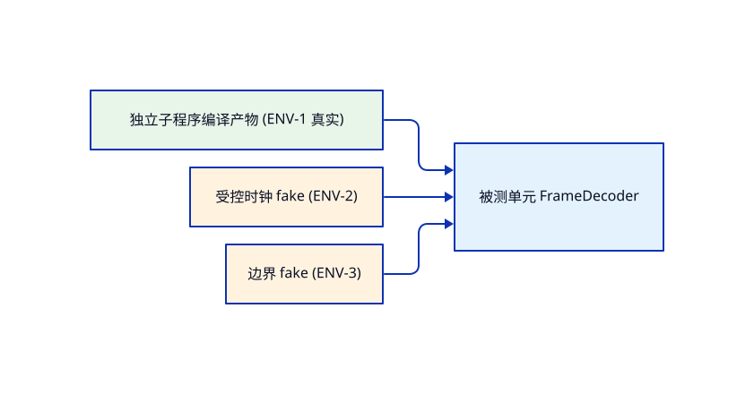

<!-- STD_DOCUMENT_COVER_BEGIN -->
# Piko unit-test-scheme

> STD 使用入口：[项目采用说明与标准导航](../../../README.md#std-entry)

| 文档字段 | 值 |
|---|---|
| Document ID | `unit-test-scheme` |
| Document Version | `0.1.0-draft.1` |
| Status | `Draft` |
| Project | `piko` |
| Authority | `piko` |
| Document Owner | Piko QA |
| Authors | opencode, corezilla |
| Created Date | `2026-10-10` |
| Last Modified Date | `2026-10-10` |
| Template ID | `tests.unit-test-scheme` |
| Template Version | `0.9.9` |
| Template Conformance | `tailored` |
| Tailoring Reference | piko-std-tailoring-v0.1 |
| Migration Map Reference | none |
| Repository | `corezilla/piko` |
| Canonical Path | `docs/70_verification/unit/unit-test-scheme.md` |
| Supersedes | none |

> Reviewer、Approver、Approval Date 和 Release Tag 在进入相应状态时填写。Git commit/tag 是
> 外部不可变证据；不要在文档内容中伪造包含自身的 commit hash。
<!-- STD_DOCUMENT_COVER_END -->

> **编写建议**：本模板绑定单个模块（模块对象 ID 在 §1 登记）——单元层方案与用例集均一模块一份，多模块项目逐模块实例化，用例集（`tests.unit-case`）与测试脚本引用本方案。

> **格式说明**：`> ` 引用块为编写建议（指导如何填写，生成实例后保留，项目可按标签整体裁除）；```example 围栏为虚构教学示例（以源文本呈现成品形态，`new-design` 实例化时整块剥离，不得当作项目事实）；`⟨angle⟩` 为待填槽，反引号为照抄的短建议/示例值。
> 本方案绑定单一软件模块：模块对象 ID 经 `--design-object-id` 写入 metadata；ISD 设计 ID/版本在 §1 固定；实现状态与执行结果不进本方案。
> 本文档对设计验证项（VRC/V-xxx）的引用规则：只引用 ID 与状态，不复制定义/判据/Owner；判据与契约权威归 design 与 tests.asset-design。

### 模板定位：方案、用例与计划的边界

> **编写建议**：单元层方案；本方案持有 Case 登记与设计状态；逐 Case 展开归 `tests.unit-case`（用例集），执行组织归 `tests.unit-test-plan`，Verdict 只在报告。

- **登记唯一权威**：Case 的 ID、分类、优先级、责任摘要、设计状态以 §6 登记为唯一登记处，别处只引用不复制。
- **测试脚本的唯一依据链**：脚本按用例集段落编写；用例集段落按 §6 登记行与 §2.3 维度展开；不回读设计正文猜意图。

### 状态语义：用例状态

> **编写建议**：本方案只持有用例状态；实现状态在模块用例集总账，执行状态与 Verdict 只在 Run 报告；三层混用即违例。

- **用例状态**：`Designed` / `Gap`（具名缺口）/ `Tailored-N/A`——唯一权威：本方案 §6 登记；禁止：未设计写成已设计、N/A 无设计事实依据。

> **完成条件**：任一 Case 在本方案中只报设计状态；实现与执行状态可沿 Case ID 追到用例集与报告。

- **被测对象 / 设计基线 / 父对象**：各模块内的单个函数/类/方法（白盒）；基线 = 各 `piko-*-impl.isd.md`（`design.implementation`）；父对象为对应 `design.definition`。

- **本阶段测试边界**：内部逻辑、错误路径、边界输入；一切外部依赖（LLMTier/Matrix/scp/时钟/SQLite）用替身或内存真库。

- **不证明的组合保证**：不证明模块整体行为（归 `tests.module-test-scheme`）；不证明端到端（归 `tests.system-test-scheme`）。


## 2. 测试方法与测试设计技术

> **本节目的**：固定本层"怎么测"，由三层构成——2.1 家族方法登记（怎么测）、2.2 选型记录（为什么选它）、2.3 维度展开表（每对象测哪些格）。
>
> **必须写清楚**：每家族：选用技术与注入内容、环境类型引用（§4）、自动化与判定规则；家族不适用走 §7 裁决，不允许空项；判定规则含失败处置（一次即判/采样统计/INVALID 条件）。
>
> **抽象示例**：normal＝等价类＋固定 seed 注入；negative＝反例驱动、错误优先级可独立复现。
>
> **完成条件**：七家族均有技术或 §7 裁决；§6 每行能回指本节家族。

### 2.1 家族方法登记

> **本节目的**：为每个适用家族登记具体技术、注入与环境引用——§6 Case 行的方法出处。
>
> **必须写清楚**：每家族一条记录，三字段齐；判定规则须含失败处置；家族不适用不在此登记（转 §7）。
>
> **抽象示例**：见本节 example 围栏示例。
>
> **完成条件**：每个 §6 登记行的家族能命中本节一条记录。

#### 2.1.1 Family · unit-contract（基础家族）

**测试设计技术**：`直接调用 + 冻结向量 + 替身注入`

**环境类型引用**：`ENV-UNIT`

**自动化与判定规则**：`tests/unit/*.test.ts`；断言返回值与抛错码；替身为严格 fake；缺断言即 INVALID


### 2.2 测试设计技术选型记录（按 Case 家族）

> **本节目的**：把"为什么选它、为什么不选别的"写成可复核的决定，而非习惯。
>
> **必须写清楚**：每家族一条记录：选用技术、选用理由、不选用的反模式；与 §2.1 家族记录的一致性由评审核对。
>
> **抽象示例**：concurrency 选线程对偶＋固定种子，反模式＝无交错复现的随机并发。
>
> **完成条件**：七家族齐；每条"不选用反模式"非空。

#### 2.2.1 Family · boundary

**选用技术与理由**：边界值（下限/零/1/刚好满）；算法边界是缺陷高发区

**不选用反模式**：不用随机/模糊


#### 2.2.2 Family · negative

**选用技术与理由**：反例驱动（非法输入、fence 拒绝、schema 违规）；错误路径占比高

**不选用反模式**：不用模糊异常注入


#### 2.2.3 Family · concurrency

**选用技术与理由**：顺序交错（状态机相邻转移）；单实例语义可确定性交错

**不选用反模式**：不用真并发/随机


#### 2.2.4 Family · recovery

**选用技术与理由**：kill + 事实重放；恢复顺序须可验证

**不选用反模式**：不用重试模拟


#### 2.2.5 Family · performance

**选用技术与理由**：Tailored-N/A（见 §7）；单元层无性能预算

**不选用反模式**：不用基准压测


#### 2.2.6 Family · security

**选用技术与理由**：路径逃逸/凭据/脱敏冒烟；单元层安全断言成本低

**不选用反模式**：不用模糊安全测试


#### 2.2.7 Family · normal

**选用技术与理由**：等价类划分；主路径与分支覆盖

**不选用反模式**：不用全输入矩阵


### 2.3 对象类型×必测维度展开表

> **本节目的**：让 UT 编写者起手把每个函数按类型展开全部必测格。
>
> **必须写清楚**：本层函数按对象类型对号入座；每行维度是该类型的全矩阵义务；删类型须 §7 裁决并给理由；新增对象类型按同格式补记录。
>
> **抽象示例**：每条类型记录附一条灰示例。
>
> **完成条件**：每个 ISD 函数至少命中一个类型记录，且该记录维度全格有 Case 或缺口。

#### 2.3.1 对象类型 · E2E 业务流

**本阶段适用性**：Tailored-N/A

**裁剪依据**：单元层不跨模块

**覆盖 Case / 缺口**：—


#### 2.3.2 对象类型 · 控件面

**本阶段适用性**：Tailored-N/A

**裁剪依据**：无 UI

**覆盖 Case / 缺口**：—


#### 2.3.3 对象类型 · 数据面

**本阶段适用性**：适用

**裁剪依据**：M010 输入校验/幂等函数

**覆盖 Case / 缺口**：UT-TRANSFER-001/002


#### 2.3.4 对象类型 · 权限矩阵

**本阶段适用性**：适用

**裁剪依据**：M002 路径判定

**覆盖 Case / 缺口**：UT-POLICY-001


#### 2.3.5 对象类型 · 真实通道

**本阶段适用性**：Tailored-N/A

**裁剪依据**：真实通道属系统层

**覆盖 Case / 缺口**：—


#### 2.3.6 对象类型 · 系统机制锚点

**本阶段适用性**：Tailored-N/A

**裁剪依据**：机制保证属模块/系统层

**覆盖 Case / 缺口**：—


#### 2.3.7 对象类型 · 性能预算

**本阶段适用性**：Tailored-N/A

**裁剪依据**：无预算分母

**覆盖 Case / 缺口**：—


#### 2.3.8 对象类型 · 成本护栏

**本阶段适用性**：Tailored-N/A

**裁剪依据**：无 Cost

**覆盖 Case / 缺口**：—


#### 2.3.9 对象类型 · 恢复/灾备

**本阶段适用性**：适用

**裁剪依据**：恢复扫描/补写函数

**覆盖 Case / 缺口**：UT-REPO-004、UT-WORKER-003


#### 2.3.1 对象类型 · E2E 业务流

**本阶段适用性**：Tailored-N/A

**裁剪依据**：单元层不跨模块

**覆盖 Case / 缺口**：—


## 3. 替身使用策略与边界

> **本节目的**：固定单元层替身的使用，让 §6 登记的替身选择可解释可复核。
>
> **必须写清楚**：替身决策准则（按所有权/可控性/真实性）；每个替身：形态（mock/fake/stub/spy）、契约文档（tests.asset-design ID）、决策理由；反模式逐项排除（不 mock 不拥有的对象、不 mock 真实编译产物）。
>
> **抽象示例**：注册/日志用 fake（契约归 asset-design）；真实编译产物与冻结向量不替身。
>
> **完成条件**：每个 §6 Case 能指出替身与契约资产 ID；替身记录与 asset-design 一一对应。

### 3.1 替身登记

> **本节目的**：把每个替身的形态、契约资产与理由落成可复核记录。
>
> **必须写清楚**：每替身一条记录；契约必须指向 tests.asset-design 文档 ID；理由写明为何不能真实。
>
> **抽象示例**：见本节 example 围栏示例。
>
> **完成条件**：§6 Case 用到的替身全部有本节记录。

#### 3.1.1 替身 · 外部依赖与时钟

**替身形态**：`fake / mock`,

**替身契约文档（tests.asset-design）**：`FAKE-LLM`、`FAKE-SCP`、`FAKE-CLOCK`

**决策理由**：`单元层验证内部逻辑，外部依赖全部替身；时钟必须受控以便验证单调计时`


## 4. 测试环境类型（方案定义）

> **本节目的**：固定本层"在哪类环境上跑"——环境类型（抽象类别）及其真伪与契约。
>
> **必须写清楚**：每类型：行为/真伪、契约文档（tests.asset-design ID）、真实性边界、在本层用例中的角色与用法（重置/推进/断言方式）；无未声明的环境依赖。
>
> **抽象示例**：独立编译产物（真实）／冻结向量集（固定）／受控时钟与边界 fake。
>
> **完成条件**：每个 §6 Case 能指出所用环境类型；类型与契约一一对应。

### 4.1 环境类型登记

> **本节目的**：逐类型记录真伪边界、契约与用法。
>
> **必须写清楚**：每类型一条记录；契约列写 asset-design ID 或声明"—"（真实源码类）；用法写重置/推进/断言时点。
>
> **抽象示例**：见本节 example 围栏示例。
>
> **完成条件**：§6 每个 Case 的环境引用能命中本节记录。

#### 4.1.1 环境类型 · ENV-UNIT

**行为/真伪**：`真模块逻辑 + 真 SQLite（内存库）+ 全替身边界`,

**契约文档**：`asset-design §3.1 / §3.5`,

**在本层用例中的角色**：`单元层默认环境；纯内存、可重复`,


### 4.2 环境拓扑

> **本节目的**：一图说清 ENV 类型→实例→被测对象的装配关系。
>
> **必须写清楚**：图后须有一段文字说明关键装配（构建目标、fixture 来源）；实例分配归计划 §4。
>
> **抽象示例**：见下图。
>
> **完成条件**：读者能据图定位任一 Case 的运行位置。

**拓扑**（ENV 类型 → ENV 实例 → 被测对象）：



## 5. 测试分类体系

> **本节目的**：固定本阶段的测试分类体系与适用裁剪。
>
> **必须写清楚**：采用 STD 统一家族词表（normal/boundary/negative/concurrency/recovery/performance/security）；每分类：适用性（`适用`/`Tailored-N/A`/`不在本层`）与裁剪依据（设计章节事实或承接层引用）。
>
> **抽象示例**：recovery 可 Tailored-N/A（模块无跨调用状态，引 ISD 事实）。
>
> **完成条件**：分类可裁剪可追溯；每个适用分类在 §6 至少一条 Case 或缺口。

### 5.1 分类适用性登记

> **本节目的**：逐家族记录适用性与裁剪依据。
>
> **必须写清楚**：七家族各一条记录；Tailored-N/A 与"不在本层"必须引用设计事实或承接层，不允许无依据裁剪。
>
> **抽象示例**：见本节 example 围栏示例。
>
> **完成条件**：七家族齐；每条不适用有依据。

#### 5.1.1 分类 · normal / boundary / negative / concurrency / recovery / security / performance / endurance

**本阶段适用性**：适用

**裁剪依据**：normal/boundary/negative/recovery/security 有对应 Case（见 §6）；concurrency 仅顺序交错；performance/endurance 走 §7


## 6. 覆盖分母与 Case 登记

> **本节目的**：把 ISD 的适用来源 ID 转成 Case 登记——测试分母的唯一登记处。
>
> **必须写清楚**：一个来源 ID 至少一条 Case 记录（可多 Case 分担）；以设计 VRC 清单为分母逐项对账——每个 VRC 至少一个 Case，验证项是设计声明的必测点；Case ID 稳定唯一（UT-对象短名-NNN，全大写短名＋三位序号）；责任摘要只写"要测什么、边界在哪"，不写输入与 Oracle；设计状态按状态语义；未实现与 NOT_RUN 不删；不适用转 §7。
>
> **抽象示例**：UT-FD-003＝头非法时按 version→kind→length 优先级拒绝（negative · P0 · Designed）。
>
> **完成条件**：每个适用来源 ID 有 Case 或缺口；全部登记与模块用例集 §1 总账零差集；每个 Case ID 有（或计划有）集合段落。
> 来源 ID 与 VRC 的边界：本登记处逐 Case 记录 ID 与责任摘要；判据/Oracle/Owner/契约权威归 design 与 tests.asset-design，不在此复写。

### 6.1 Case 登记记录

> **本节目的**：分母的唯一登记形状：一 Case 一条记录。
>
> **必须写清楚**：五字段齐；缺口用"（缺口登记）"记录不占 Case 号；责任摘要禁止滑入输入构造或 Oracle 细节。
>
> **抽象示例**：见本节 example 围栏示例）。
>
> **完成条件**：与用例集 §1 总账逐条互证。

#### 6.1.1 Case · 模块内部函数（登记矩阵）

#### 6.1.2 Case · UT-REPO-001

**来源 ID / 固定版本**：`piko-task-repository-impl.isd.md`（`design.implementation`）

**设计验证项 ID**：`VRC-REPO-001..009`（9 条，本 Case 分担）

**Case ID**：`UT-REPO-001`

**分类**：`normal`

**优先级**：`P1`

**责任摘要（要测什么）**：task-repository 内部函数/算法的正常、边界与错误路径；不测模块整体行为

**设计状态**：`Gap（G-CASE-003：case 文档未逐条撰写）`

**上级组合验证入口**：`module-test-scheme`

#### 6.1.3 Case · UT-WORKER-001

**来源 ID / 固定版本**：`piko-worker-impl.isd.md`（`design.implementation`）

**设计验证项 ID**：`VRC-WORKER-001..007`（7 条，本 Case 分担）

**Case ID**：`UT-WORKER-001`

**分类**：`normal`

**优先级**：`P1`

**责任摘要（要测什么）**：worker 内部函数/算法的正常、边界与错误路径；不测模块整体行为

**设计状态**：`Gap（G-CASE-003：case 文档未逐条撰写）`

**上级组合验证入口**：`module-test-scheme`

#### 6.1.4 Case · UT-PI-001

**来源 ID / 固定版本**：`piko-pi-adapter-impl.isd.md`（`design.implementation`）

**设计验证项 ID**：`VRC-PI-001..008`（8 条，本 Case 分担）

**Case ID**：`UT-PI-001`

**分类**：`normal`

**优先级**：`P1`

**责任摘要（要测什么）**：pi-adapter 内部函数/算法的正常、边界与错误路径；不测模块整体行为

**设计状态**：`Gap（G-CASE-003：case 文档未逐条撰写）`

**上级组合验证入口**：`module-test-scheme`

#### 6.1.5 Case · UT-USAGE-001

**来源 ID / 固定版本**：`piko-usage-impl.isd.md`（`design.implementation`）

**设计验证项 ID**：`VRC-USAGE-001..006`（6 条，本 Case 分担）

**Case ID**：`UT-USAGE-001`

**分类**：`normal`

**优先级**：`P1`

**责任摘要（要测什么）**：usage 内部函数/算法的正常、边界与错误路径；不测模块整体行为

**设计状态**：`Gap（G-CASE-003：case 文档未逐条撰写）`

**上级组合验证入口**：`module-test-scheme`

#### 6.1.6 Case · UT-POLICY-001

**来源 ID / 固定版本**：`piko-policy-impl.isd.md`（`design.implementation`）

**设计验证项 ID**：`VRC-POLICY-001..006`（6 条，本 Case 分担）

**Case ID**：`UT-POLICY-001`

**分类**：`normal`

**优先级**：`P1`

**责任摘要（要测什么）**：policy 内部函数/算法的正常、边界与错误路径；不测模块整体行为

**设计状态**：`Gap（G-CASE-003：case 文档未逐条撰写）`

**上级组合验证入口**：`module-test-scheme`

#### 6.1.7 Case · UT-TAPI-001

**来源 ID / 固定版本**：`piko-task-api-impl.isd.md`（`design.implementation`）

**设计验证项 ID**：`VRC-TAPI-001..006`（6 条，本 Case 分担）

**Case ID**：`UT-TAPI-001`

**分类**：`normal`

**优先级**：`P1`

**责任摘要（要测什么）**：task-api 内部函数/算法的正常、边界与错误路径；不测模块整体行为

**设计状态**：`Gap（G-CASE-003：case 文档未逐条撰写）`

**上级组合验证入口**：`module-test-scheme`

#### 6.1.8 Case · UT-SCHED-001

**来源 ID / 固定版本**：`piko-scheduler-impl.isd.md`（`design.implementation`）

**设计验证项 ID**：`VRC-SCHED-001..006`（6 条，本 Case 分担）

**Case ID**：`UT-SCHED-001`

**分类**：`normal`

**优先级**：`P1`

**责任摘要（要测什么）**：scheduler 内部函数/算法的正常、边界与错误路径；不测模块整体行为

**设计状态**：`Gap（G-CASE-003：case 文档未逐条撰写）`

**上级组合验证入口**：`module-test-scheme`

#### 6.1.9 Case · UT-BOOT-001

**来源 ID / 固定版本**：`piko-bootstrap-impl.isd.md`（`design.implementation`）

**设计验证项 ID**：`VRC-BOOT-001..008`（8 条，本 Case 分担）

**Case ID**：`UT-BOOT-001`

**分类**：`normal`

**优先级**：`P1`

**责任摘要（要测什么）**：bootstrap 内部函数/算法的正常、边界与错误路径；不测模块整体行为

**设计状态**：`Gap（G-CASE-003：case 文档未逐条撰写）`

**上级组合验证入口**：`module-test-scheme`

#### 6.1.10 Case · UT-MATRIX-001

**来源 ID / 固定版本**：`piko-matrix-adapter-impl.isd.md`（`design.implementation`）

**设计验证项 ID**：`VRC-MATRIX-001..005`（5 条，本 Case 分担）

**Case ID**：`UT-MATRIX-001`

**分类**：`normal`

**优先级**：`P1`

**责任摘要（要测什么）**：matrix-adapter 内部函数/算法的正常、边界与错误路径；不测模块整体行为

**设计状态**：`Gap（G-CASE-003：case 文档未逐条撰写）`

**上级组合验证入口**：`module-test-scheme`

#### 6.1.11 Case · UT-OBS-001

**来源 ID / 固定版本**：`piko-observability-impl.isd.md`（`design.implementation`）

**设计验证项 ID**：`VRC-OBS-001..006`（6 条，本 Case 分担）

**Case ID**：`UT-OBS-001`

**分类**：`normal`

**优先级**：`P1`

**责任摘要（要测什么）**：observability 内部函数/算法的正常、边界与错误路径；不测模块整体行为

**设计状态**：`Gap（G-CASE-003：case 文档未逐条撰写）`

**上级组合验证入口**：`module-test-scheme`

#### 6.1.12 Case · UT-TRANSFER-001

**来源 ID / 固定版本**：`piko-transfer-impl.isd.md`（`design.implementation`）

**设计验证项 ID**：`VRC-TRANSFER-001..002`（2 条，本 Case 分担）

**Case ID**：`UT-TRANSFER-001`

**分类**：`normal`

**优先级**：`P1`

**责任摘要（要测什么）**：transfer 内部函数/算法的正常、边界与错误路径；不测模块整体行为

**设计状态**：`Gap（G-CASE-003：case 文档未逐条撰写）`

**上级组合验证入口**：`module-test-scheme`


### 6.2 展开后段落块示例（组织方式见 `tests.unit-case` §3）

> **本节目的**：展示 §6 登记行在用例集中展开成的固定格式段落，供作者预判对应关系。
>
> **必须写清楚**：与用例集 §3 骨架一致：#### ⟨Case ID⟩ 标题＋八字段段落；本小节灰示例，实例化剥离。
>
> **抽象示例**：新增 Case 先入 §6 登记，再入用例集建段落；计划引用本方案版本。
>
> **完成条件**：登记行与集合段落可互相定位。


## 7. 不适用与缺口裁决

> **本节目的**：区分"不适用"与"尚未设计"，两者都不从分母静默消失。
>
> **必须写清楚**：Tailored-N/A 必须引用设计章节事实；Gap 须有 Owner 与恢复条件；裁决与 §6 设计状态一一对应。
>
> **抽象示例**：真实生产环境验证＝Gap（G-EX-3，Owner 运维、排期后补），而非"N/A"。
>
> **完成条件**：每条裁决有事实或 Owner；无"顺手 N/A"。

### 7.1 裁决登记

> **本节目的**：不适用与缺口逐条落记录。
>
> **必须写清楚**：每条裁决记录来源、类型（N/A/Gap）、依据事实、Owner 与恢复条件；与 §6 的设计状态互证一致。
>
> **抽象示例**：见本节 example 围栏示例。
>
> **完成条件**：§6 中每个 Gap/N/A 能在本节找到裁决记录。

#### 7.1.1 裁决 · 不适用与缺口（登记矩阵）

#### 7.1.1 裁决 · 控件面

**裁决（Tailored-N/A 或 Gap）**：Tailored-N/A —— 无 UI

**Owner / 恢复条件**：—

#### 7.1.2 裁决 · 成本护栏

**裁决（Tailored-N/A 或 Gap）**：Tailored-N/A —— 无 Cost

**Owner / 恢复条件**：—

#### 7.1.3 裁决 · 性能预算

**裁决（Tailored-N/A 或 Gap）**：Tailored-N/A —— 无预算分母

**Owner / 恢复条件**：—

#### 7.1.4 裁决 · 长稳

**裁决（Tailored-N/A 或 Gap）**：Tailored-N/A —— 无 endurance

**Owner / 恢复条件**：—

#### 7.1.5 裁决 · 逐 Case 文档

**裁决（Tailored-N/A 或 Gap）**：Gap —— `UT-*-001` case 文档未逐条撰写

**Owner / 恢复条件**：测试工程 / 按 §6 拆分


## 8. 文档联动与登记变更规则

> **本节目的**：固定方案—用例集—计划的联动规则，防三处漂移。
>
> **必须写清楚**：新 Case 先入 §6 登记再进用例集建段落；登记变更须同步计划构成表与用例集总账；方案冻结与版本引用规则写明。
>
> **抽象示例**：新增 Case 先入 §6 登记，再入用例集建段落；计划引用本方案版本。
>
> **完成条件**：登记与集合段落一一对应；计划只引用不复制。

### 8.1 联动与变更规则

> **本节目的**：登记—用例集—计划三方同步的固定规则。
>
> **必须写清楚**：写明冻结条件、变更传播顺序（登记→集合→计划）与版本引用方式。
>
> **抽象示例**：见本节 example 围栏示例。
>
> **完成条件**：任一登记变更能说出同步到哪两处。

- 方案冻结与变更规则：登记随 ISD 基线冻结；新增 Case 先登记再建段落；变更升版本并通知计划与集合。
- 与用例集／计划的同步规则：用例集总账行＝§6 登记行；计划构成表引用本方案版本。


> **交付自查**：每个适用来源 ID 是否都有 Case 或缺口；每条登记是否有集合段落对应；方案是否混入输入构造或 Oracle 复制；§2.3 维度是否被 §6 覆盖。

## 附录 A. 本层设计验证项 VRC 汇集（对照用）

> **本节目的**：把设计声明的本层验证项 VRC 汇集于此，逐项对照 §6 登记的覆盖。
>
> **必须写清楚**：VRC 清单以设计文档为唯一权威，本附录只登记 ID 与要验证什么，不复制判据；覆盖列写 Case ID 或缺口号。
>
> **抽象示例**：VRC-EX-ISD-DECODE-01（头校验顺序）→ UT-FD-001/003。
>
> **完成条件**：本附录 VRC 集合与设计一致；每个 VRC 在 §6 有 Case 或缺口。

#### A.1 VRC · 单元层设计验证项汇集

#### A.1.1 VRC · `VRC-REPO-001..009`

**要验证什么（名称/责任）**：task-repository 内部实现的 9 条 VRC

**设计来源**：`piko-task-repository-impl.isd.md`

**§6 Case 覆盖**：`UT-REPO-001`

#### A.1.2 VRC · `VRC-WORKER-001..007`

**要验证什么（名称/责任）**：worker 内部实现的 7 条 VRC

**设计来源**：`piko-worker-impl.isd.md`

**§6 Case 覆盖**：`UT-WORKER-001`

#### A.1.3 VRC · `VRC-PI-001..008`

**要验证什么（名称/责任）**：pi-adapter 内部实现的 8 条 VRC

**设计来源**：`piko-pi-adapter-impl.isd.md`

**§6 Case 覆盖**：`UT-PI-001`

#### A.1.4 VRC · `VRC-USAGE-001..006`

**要验证什么（名称/责任）**：usage 内部实现的 6 条 VRC

**设计来源**：`piko-usage-impl.isd.md`

**§6 Case 覆盖**：`UT-USAGE-001`

#### A.1.5 VRC · `VRC-POLICY-001..006`

**要验证什么（名称/责任）**：policy 内部实现的 6 条 VRC

**设计来源**：`piko-policy-impl.isd.md`

**§6 Case 覆盖**：`UT-POLICY-001`

#### A.1.6 VRC · `VRC-TAPI-001..006`

**要验证什么（名称/责任）**：task-api 内部实现的 6 条 VRC

**设计来源**：`piko-task-api-impl.isd.md`

**§6 Case 覆盖**：`UT-TAPI-001`

#### A.1.7 VRC · `VRC-SCHED-001..006`

**要验证什么（名称/责任）**：scheduler 内部实现的 6 条 VRC

**设计来源**：`piko-scheduler-impl.isd.md`

**§6 Case 覆盖**：`UT-SCHED-001`

#### A.1.8 VRC · `VRC-BOOT-001..008`

**要验证什么（名称/责任）**：bootstrap 内部实现的 8 条 VRC

**设计来源**：`piko-bootstrap-impl.isd.md`

**§6 Case 覆盖**：`UT-BOOT-001`

#### A.1.9 VRC · `VRC-MATRIX-001..005`

**要验证什么（名称/责任）**：matrix-adapter 内部实现的 5 条 VRC

**设计来源**：`piko-matrix-adapter-impl.isd.md`

**§6 Case 覆盖**：`UT-MATRIX-001`

#### A.1.10 VRC · `VRC-OBS-001..006`

**要验证什么（名称/责任）**：observability 内部实现的 6 条 VRC

**设计来源**：`piko-observability-impl.isd.md`

**§6 Case 覆盖**：`UT-OBS-001`

#### A.1.11 VRC · `VRC-TRANSFER-001..002`

**要验证什么（名称/责任）**：transfer 内部实现的 2 条 VRC

**设计来源**：`piko-transfer-impl.isd.md`

**§6 Case 覆盖**：`UT-TRANSFER-001`

